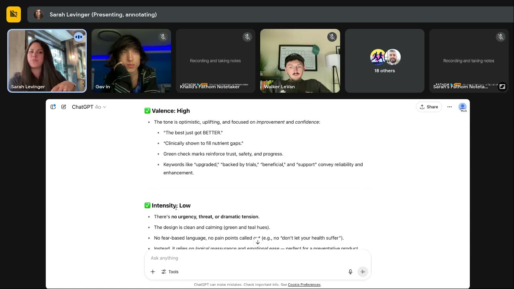
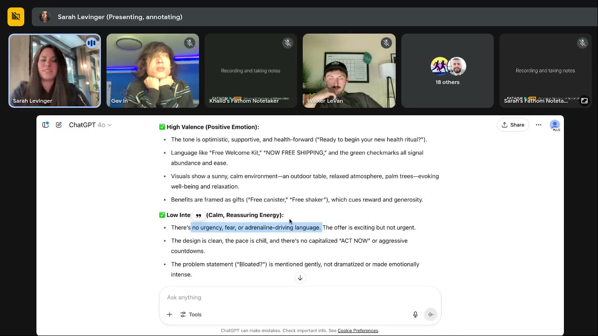
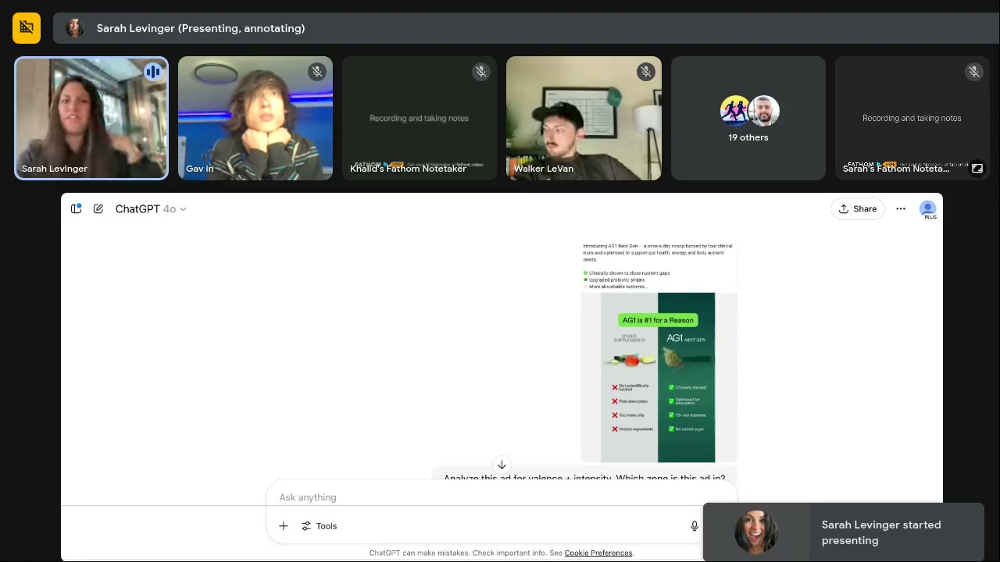
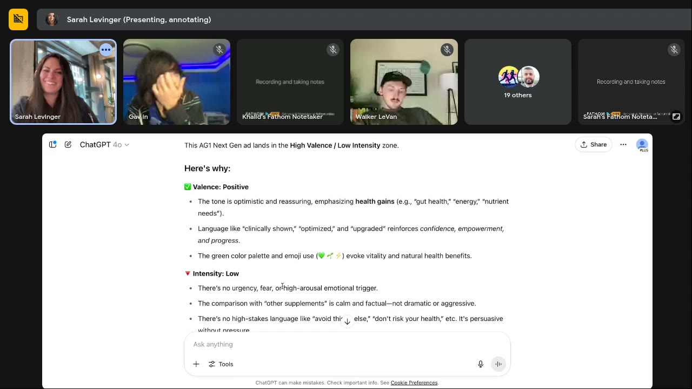

# AG1 (Athletic Greens)
> Greens-powder supplement sold by subscription, positioned on clinical backing ("four human clinical trials") and a calm daily-ritual tone; a **big-brand example Sarah audited** (not a member's brand) to show **emotional stagnation**: 15–20 ads, all in Zone 1.

## 🤖 Agent use
- **Use when:** tearing down a large supplement competitor; checking whether a competitor (or our account) is stuck in one emotional zone; finding the gap to attack.
- **Inputs → outputs:** competitor ad library → zone tag per ad (run the V+I prompt) → the empty zones and the objections they leave unspoken → our Zone 2–4 hooks.
- **Rules:**
  - DO tag every competitor ad by zone; if all sit in one zone, that's the opening ([0:03:10–0:10:29](../courses/tether-lab/05-live-recordings/2025-06-11-live-with-sarah.md)).
  - DON'T count a new format as a new emotion: AG1's offer static and its comparison static trigger "the same exact emotion" ([0:05:19–0:07:22](../courses/tether-lab/05-live-recordings/2025-06-11-live-with-sarah.md)).
  - DO turn a competitor's own objection list into negative-zone hooks ("I've tried every supplement and they all upset my stomach") ([0:07:22](../courses/tether-lab/05-live-recordings/2025-06-11-live-with-sarah.md)).
  - DO go high-intensity by attacking industry beliefs, not the viewer ("most greens have junk in them, you're smart for noticing") ([0:19:08–0:21:13](../courses/tether-lab/05-live-recordings/2025-06-11-live-with-sarah.md)).
  - DON'T copy a big competitor's core word: if AG1 says "activate", go the opposite way ("boost your mitochondria") ([0:42:22–0:44:31](../courses/tether-lab/05-live-recordings/2025-06-11-live-with-sarah.md)).
  - DON'T treat ad-library longevity as proof of a winner; big brands can afford to leave ads on ([0:22:19–0:26:35](../courses/tether-lab/05-live-recordings/2025-06-11-live-with-sarah.md)).
- **See also:** [Emotional stagnation](../concepts/emotional-stagnation.md) · [Emotional zones](../concepts/emotional-zones.md) · [Valence-intensity prompts](../resources/valence-intensity-prompts.md) · [ChatGPT](../tools/chatgpt.md)

## At a glance
| Field | Value |
|---|---|
| Niche | Supplements: greens powder |
| Relationship | Competitor / big-brand example audited live by Sarah |
| Ads / pages discussed | 3 statics shown (self-comparison, UGC-style offer, competitor comparison); 15–20 reviewed off-screen |
| Heuristics seen | [authority bias](../concepts/heuristics/authority-bias.md) (clinical trials), [social proof](../concepts/heuristics/social-proof.md) / leader ("#1"), [processing fluency](../concepts/heuristics/processing-fluency.md), gift/offer framing |
| Zones | All Zone 1, high valence / low intensity (Sarah, via her custom GPT) |
| Selves | Actual / habit ("new health ritual") (wiki tag) |
| Sessions | [Live June 11](../courses/tether-lab/05-live-recordings/2025-06-11-live-with-sarah.md) |

## Ads and pages discussed
All three were run through Sarah's custom GPT with the prompt **"Analyze this ad for valence + intensity. Which zone is this ad in?"** [0:04:30].

### 1. "The best just got BETTER." (static, self before/after)

*AG1 compares its new formula to its own old product. [0:04:30]*

*The GPT's verdict: high valence, low intensity, "logical reassurance and emotional ease". [0:04:55]*

| Brand / product (niche) | Format | Hook / opening | What works | What fails | Fix suggested | Principle | Source |
|---|---|---|---|---|---|---|---|
| AG1 Next Gen (greens powder) | Static, self before/after + checklist | "The best just got BETTER." | Unusual before/after against **their own old product**; authority ("four human clinical trials"); clean fluency | Zone 1, no urgency, threat or tension, like every other AG1 ad | Add Zone 2–4 ads; call out true industry beliefs | Emotional stagnation; zones belong to people | [0:03:10–0:05:19](../courses/tether-lab/05-live-recordings/2025-06-11-live-with-sarah.md) |

### 2. "Get your $76 Free Welcome Kit Now" (UGC-style offer static)

*Bundle/offer ad; primary text "Ready to begin your new health ritual?" [0:06:40]*

*Same zone again; the pain point "Bloated?" is whispered. [0:07:05]*

| Brand / product (niche) | Format | Hook / opening | What works | What fails | Fix suggested | Principle | Source |
|---|---|---|---|---|---|---|---|
| AG1 (greens powder) | UGC-style static, offer / bundle | "Get your $76 Free Welcome Kit Now" | Different format and angle: full bundle as gifts (canister, shaker, travel packs), free shipping, sunny lifestyle scene | "Between the two of them, we basically have the same exact emotion being triggered"; pain point whispered | Diversify zones; a real Zone 3 version would dramatize the bloating (wiki example) | A new format ≠ a new emotion | [0:05:19–0:07:22](../courses/tether-lab/05-live-recordings/2025-06-11-live-with-sarah.md) |

### 3. "AG1 is #1 for a Reason" (us-vs-them comparison static)

*Lists supplement objections: not backed, poor absorption, too many pills, hidden ingredients. [0:07:36]*

*Third ad, third Zone 1 verdict. [0:07:56]*

| Brand / product (niche) | Format | Hook / opening | What works | What fails | Fix suggested | Principle | Source |
|---|---|---|---|---|---|---|---|
| AG1 Next Gen (greens powder) | Static, comparison chart | "AG1 is #1 for a Reason" | Names the objections people have about supplements; leader framing ("#1") | Calm, factual, still Zone 1. 15–20 AG1 ads in the same zone: "this is so scary" | Use the chart's own objections as Zone 3/4 hooks: "I've tried every supplement and they all upset my stomach"; industry call-out + "you're smart for noticing" | Big brands get stuck in one zone | [0:07:22–0:09:27](../courses/tether-lab/05-live-recordings/2025-06-11-live-with-sarah.md) |

### Member comments on AG1
- **Bren Harper:** high intensity can get spammy; "AG1 and Bobbie formula" can get high CTR but dilute the brand. Sarah: find the belief that makes people shift; criticize the industry, praise the viewer, never attack their sense of self [0:19:08–0:21:13]. See [community members](../people/community-members.md#bren-harper).
- **Yana Zhurovich:** runs ads in the same space; AG1's ads look single-zone but the messaging is smart and they seem to grow. Sarah: "You can never tell who's doing well"; "running for 195 days" in an ad library isn't proof [0:22:19–0:26:35]. See [community members](../people/community-members.md#yana-zhurovich).
- **Competitor-research example:** if AG1's core word is "activate", "I don't want to do anything that they're doing… we actually go crazy wild the opposite direction" → "boost your mitochondria", go small and specific where they're vague [0:42:22–0:44:31].

## Transferable lessons (remix for our product)
- Run the zone audit on a competitor's whole library before writing; the empty zones are our angles.
- For ingestibles, cover what's in it, that many others take it, and how it differs; then call out true industry problems or the situational experience (greens "taste nasty… it's going to dissipate quicker") ([0:24:32–0:26:35](../courses/tether-lab/05-live-recordings/2025-06-11-live-with-sarah.md)).
- Use the competitor's objection checklist as raw material for pain-first UGC hooks (the creator lived each objection).
- Copy the self-before/after mechanic (new formula vs old) only if we actually upgraded.

## Backlinks
| Where | Timestamp(s) | What |
|---|---|---|
| [Live June 11](../courses/tether-lab/05-live-recordings/2025-06-11-live-with-sarah.md) | 0:03:10–0:09:27 | Three-ad zone audit |
| [Live June 11](../courses/tether-lab/05-live-recordings/2025-06-11-live-with-sarah.md) | 0:17:00–0:26:35 | Zones belong to people; Bren and Yana comments |
| [Live June 11](../courses/tether-lab/05-live-recordings/2025-06-11-live-with-sarah.md) | 0:42:22–0:44:31 | "Activate" → go opposite |

## Related
[VITUS](vitus.md) · [Milky](milky.md) · [Nutrafol](nutrafol.md) · [Liquid Death](liquid-death.md) · [Emotional stagnation](../concepts/emotional-stagnation.md) · [Valence–intensity diagnostic](../frameworks/valence-intensity-diagnostic.md)
