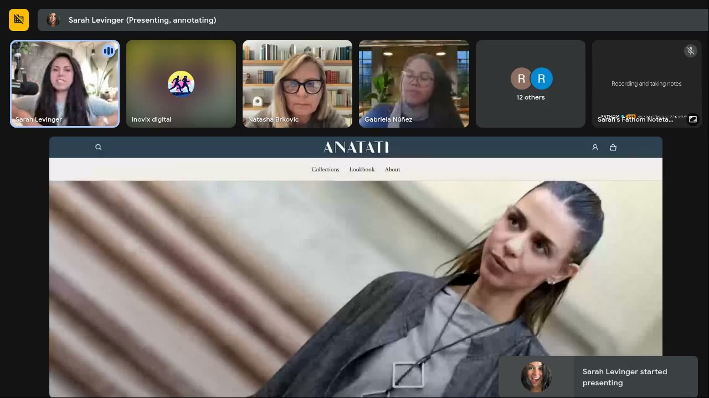
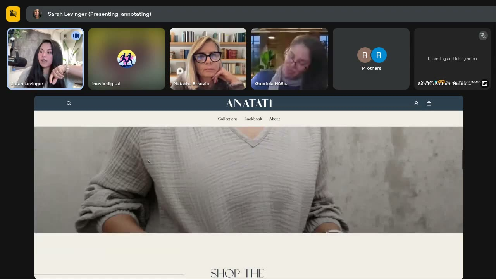
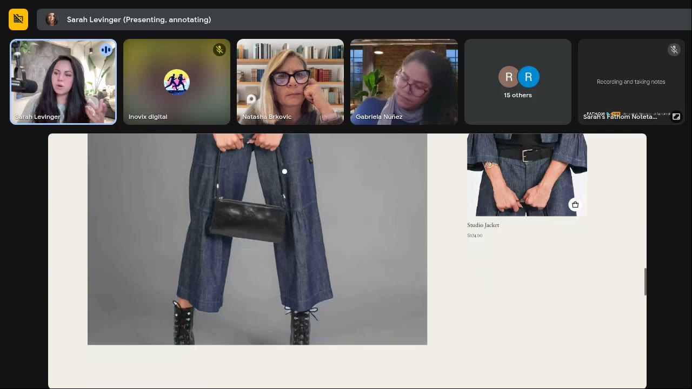
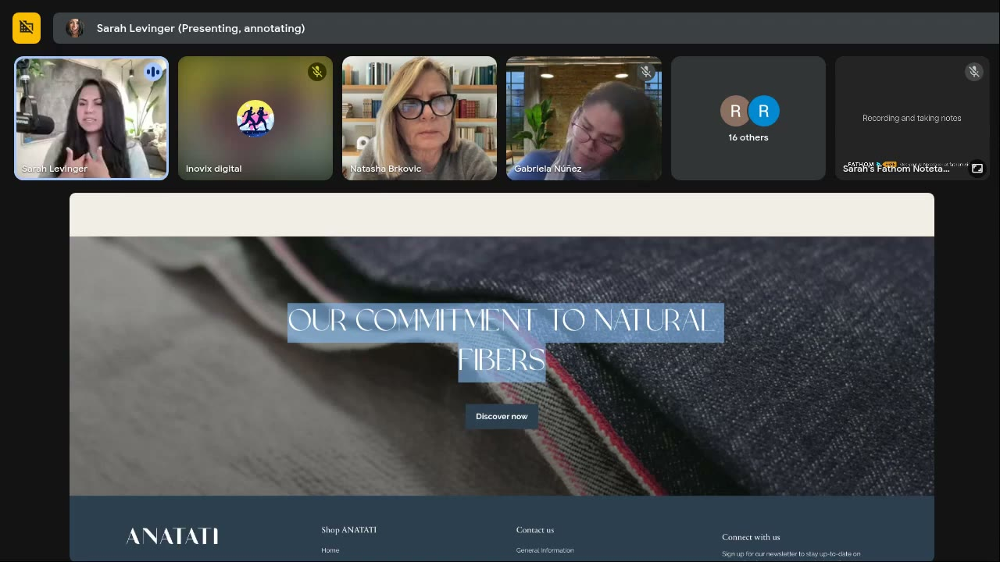

# ANATATI
> Women's fashion in natural fibres, "American-made, European-inspired". A **member's brand: Natasha Brkovic**; its homepage was the first page roasted in [Roast My Ads #2](../courses/tether-lab/05-live-recordings/2025-06-25-roast-my-ads-2.md). Low cognitive load done right; the fixes are about **you-language, buying verbs and a specific emotion**.

## 🤖 Agent use
- **Use when:** auditing a fashion homepage/lander that ads send traffic to; writing hero copy over model images; rewriting browse CTAs into buy CTAs; checking ad ↔ landing-page congruence.
- **Inputs → outputs:** a landing page → one hero image + one specific core message, rewritten section headers ("our" → "your"), action CTAs, image-size fixes.
- **Rules:**
  - DO make overlay text match the model's facial expression and body language; the brain compares them ([0:06:23–0:06:50](../courses/tether-lab/05-live-recordings/2025-06-25-roast-my-ads-2.md)).
  - DO pick one hero image (versatile, most product) + one message; visitors see 1–2 carousel slides ([0:16:49–0:17:58](../courses/tether-lab/05-live-recordings/2025-06-25-roast-my-ads-2.md)).
  - DO name the *type* of confidence ("boardroom-level"); generic "confidence" keeps the brand neutral and attachment weak ([0:17:58–0:23:13](../courses/tether-lab/05-live-recordings/2025-06-25-roast-my-ads-2.md)).
  - DO push language out ("your"), except USP claims (fibres, manufacturing) ([0:14:49–0:15:45](../courses/tether-lab/05-live-recordings/2025-06-25-roast-my-ads-2.md)).
  - DON'T use "shop/browse" on a lander; use get / grab / select / find ([0:12:19–0:13:47](../courses/tether-lab/05-live-recordings/2025-06-25-roast-my-ads-2.md)).
  - IF fashion THEN lead with function/show-don't-tell: emotional messaging "usually doesn't hit" until they wear it ([0:22:16–0:22:35](../courses/tether-lab/05-live-recordings/2025-06-25-roast-my-ads-2.md)).
- **See also:** [Landing-page psychology audit](../frameworks/landing-page-psychology-audit.md) · [Cognitive load](../concepts/heuristics/cognitive-load.md) · [Choice overload](../concepts/heuristics/choice-overload.md) · [Illusion Nursing Dress](illusion-nursing-dress.md) · [Natasha Brkovic](../people/community-members.md#natasha-brkovic)

## At a glance
| Field | Value |
|---|---|
| Niche | Apparel: women's fashion, natural fibres |
| Relationship | Member's brand (Natasha Brkovic), roasted live |
| Ads / pages discussed | 1 homepage / landing page (hero carousel + 6 sections) |
| Heuristics seen | [Processing fluency](../concepts/heuristics/processing-fluency.md), [choice overload](../concepts/heuristics/choice-overload.md), ownership via "you" language |
| Zones | Positive, low–moderate intensity: Zone 1 edging to Zone 2 if confidence is made specific (wiki tag) |
| Selves | [Ideal](../concepts/ideal-self.md) (aspirational confidence) (wiki tag) |
| Sessions | [Roast My Ads #2](../courses/tether-lab/05-live-recordings/2025-06-25-roast-my-ads-2.md) |

## Ads and pages discussed

### 1. Homepage / lander: "Style that speaks" carousel (Roast #2)

*Hero (overlay text missing due to a carousel glitch) and only three nav items. Low cognitive load, "doing great". [0:03:00]*

*Fabric moving on a body proves quality. [0:09:40]*

*Image larger than one screen forces a scroll; shrink to fit the frame. [0:10:40]*

*"Our latest collections" = us-focused → "Your next favorite". [0:15:00]*

*The one place to keep "our": the USP. Add a "this is how we're different" subhead. [0:15:45]*

| Brand / product (niche) | Format | Hook / opening | What works | What fails | Fix suggested | Principle | Source |
|---|---|---|---|---|---|---|---|
| ANATATI (women's fashion, natural fibres, American-made / European-inspired) | Brand landing / home page | Hero carousel: "Style that speaks" / "Confidence that attracts" / "Attitude that defines" / "Bold. Chic. Ready for anything." / "American-made, European-inspired" | Very low cognitive load; overlay copy matches the models' expressions ("chic… a little bit of attitude"); 3 nav items; fabric video; clean; ~3 CTAs; "less is more" | Brand-focused messages ("Our latest collections"); browsing verbs ("Browse by categories", "Shop the look", "View all categories"); five rotating messages when visitors see 1–2; generic "confidence"; images bigger than one screen | One hero image + one core message; name the confidence ("boardroom-level"); "Your next favorite"; "Find your favorites"; "Get/Select the look"; "Shop our best sellers" (use heat maps); keep "Our commitment to natural fibers" + "how we're different"; shrink images | [Processing fluency](../concepts/heuristics/processing-fluency.md), [choice overload](../concepts/heuristics/choice-overload.md), ownership language, emotion specificity | [0:02:08–0:22:16](../courses/tether-lab/05-live-recordings/2025-06-25-roast-my-ads-2.md) |

**Rewrites (before → after)**
| Before | After | What changed | Source |
|---|---|---|---|
| "Our latest collections" | "Your next favorite" | us → you (ownership) | [0:15:00](../courses/tether-lab/05-live-recordings/2025-06-25-roast-my-ads-2.md) |
| "Browse by categories" | "Find your favorites" | browse → buying verb | [0:12:19](../courses/tether-lab/05-live-recordings/2025-06-25-roast-my-ads-2.md) |
| "Shop the look" | "Get the look / Select the look / Buy this look" | passive → active | [0:14:15](../courses/tether-lab/05-live-recordings/2025-06-25-roast-my-ads-2.md) |
| "View all categories" | "Shop the looks / Shop our best sellers" | point to the heat-map winner | [0:20:04–0:21:10](../courses/tether-lab/05-live-recordings/2025-06-25-roast-my-ads-2.md) |
| "Confidence that attracts" | "Boardroom-level confidence" (Jamie, chat; Sarah: "fantastic") | generic → specific situation | [0:22:49–0:23:13](../courses/tether-lab/05-live-recordings/2025-06-25-roast-my-ads-2.md) |

## Transferable lessons (remix for our product)
1. **Hero = one image + one specific emotion**, matched to the model's expression.
2. **Name the flavour of the feeling** (boss-babe, cheeky, boardroom) to attract one specific buyer.
3. **"Your", not "our"**, except for the differentiator.
4. **Action CTAs** (get, grab, select, find); "shop" = later.
5. **Fashion:** show the fabric moving on a body; keep images inside one screen.

## Backlinks
| Where | Timestamp(s) | What |
|---|---|---|
| [Roast My Ads #2](../courses/tether-lab/05-live-recordings/2025-06-25-roast-my-ads-2.md) | 0:02:08–0:23:13 | Homepage roast: load, message, CTA |

## Related
[Natasha Brkovic](../people/community-members.md#natasha-brkovic) · [Landing-page psychology audit](../frameworks/landing-page-psychology-audit.md) · [Intensity](../concepts/intensity.md) · [Brands index](README.md)
