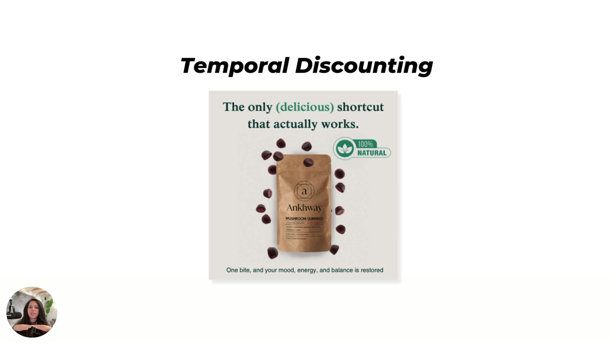

# Ankhway
> Mushroom gummies ("The only (delicious) shortcut that actually works.", "100% Natural"); Sarah's **temporal-discounting example** in Heuristics 101; Ankhway is among the brands whose ads Sarah calls "ones that we designed" ([Sarah Levinger](../people/sarah-levinger.md)).

## 🤖 Agent use
- **Use when:** writing a time-to-benefit line for any supplement / functional product; making the reward feel close.
- **Inputs → outputs:** a product's benefit → a footer/hook that says how soon the benefit arrives ("one bite").
- **Rules:**
  - DO tell the brain how long until it feels results: "One bite, and your mood, energy, and balance is restored" ([04:58–05:30](../courses/tether-lab/02-heuristics-101/03-emotion-clarity-urgency.md)).
  - DON'T use temporal discounting to talk about price; "it has nothing to do with price". Use "today", "now", "first use", "in the next hour" ([04:13; 05:30–05:59](../courses/tether-lab/02-heuristics-101/03-emotion-clarity-urgency.md)).
  - DON'T claim an instant effect the product can't deliver (wiki rule).
- **See also:** [Temporal discounting](../concepts/heuristics/temporal-discounting.md)

## At a glance
| Field | Value |
|---|---|
| Niche | Supplements: mushroom gummies |
| Relationship | Heuristics 101 example ad; listed among Tether-designed client ads |
| Ads / pages discussed | 1 static |
| Heuristics seen | [temporal discounting](../concepts/heuristics/temporal-discounting.md) |
| Zones / Selves | Not classified |
| Sessions | [Heuristics 101 L3](../courses/tether-lab/02-heuristics-101/03-emotion-clarity-urgency.md) |

## Ads and pages discussed

### 1. "The only (delicious) shortcut that actually works." (static, Heuristics 101 L3)

*"100% Natural" badge; the key line is the footer "One bite, and your mood, energy, and balance is restored." [04:30]*

| Brand / product (niche) | Format | Hook / opening | What works | What fails | Fix suggested | Principle | Source |
|---|---|---|---|---|---|---|---|
| Ankhway (mushroom gummies) | Static | "The only (delicious) shortcut that actually works." | "Shortcut" speaks to it "just slightly"; the footer "one bite" does the real work by making time-to-benefit immediate | — | — | Make the reward feel close | [04:30–05:30](../courses/tether-lab/02-heuristics-101/03-emotion-clarity-urgency.md) |

## Transferable lessons (remix for our product)
- Add a "one [unit of use] and…" line to UGC scripts and statics; it is a cheap time-to-benefit cue.

## Backlinks
| Where | Timestamp(s) | What |
|---|---|---|
| [Heuristics 101 L3](../courses/tether-lab/02-heuristics-101/03-emotion-clarity-urgency.md) | 04:13–05:59 | Temporal discounting example |
| [Heuristics 101 L5](../courses/tether-lab/02-heuristics-101/05-stacking-psychology-for-growth.md) | 07:00 | Nine-example recap slide |

## Related
[VITUS](vitus.md) · [Temporal discounting](../concepts/heuristics/temporal-discounting.md) · the May 7 mushroom-gummy "reliable piece of calm" case is an unnamed brand ([May 7, 0:41:36](../courses/tether-lab/05-live-recordings/2025-05-07-live-with-sarah.md)); no link to Ankhway is stated.
