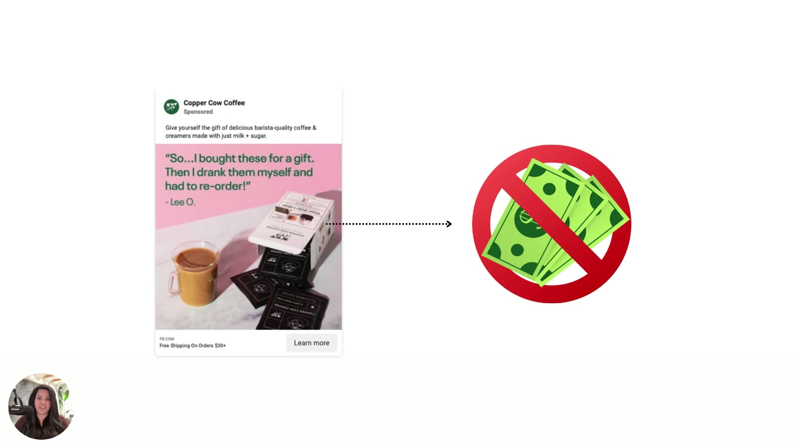

# Copper Cow Coffee
> DTC Vietnamese-style pour-over coffee and creamers ("barista-quality coffee & creamers made with just milk + sugar"). In the course it's the **running case study of the Valence & Intensity module**: a pretty testimonial static that "should work" but doesn't sell, diagnosed as Zone 1 and rewritten into all four zones. The brand is never named aloud; the identification comes from the ads on screen.

## 🤖 Agent use
- **Use when:** a competitor's (or our) coffee/beverage or other "boost" product ad looks good but underperforms; when you need a worked example of moving one ad across the four emotional zones with verbs, visuals and promise.
- **Inputs → outputs:** one underperforming static → zone diagnosis (valence + intensity + customer state) → 4 zone rewrites (headline + visual direction) to test.
- **Rules:**
  - DO judge the ad's **emotional temperature** against why people buy the category: coffee is bought "for a boost", so a cozy Zone 1 ad risks "save for later" or "ignore" [04:54–05:16 L4](../courses/tether-lab/03-valence-intensity-model/04-diagnosing-emotional-misfires.md).
  - DO fix the tone before rebuilding: swap verbs ("soft, conversational" → "quick, sharp, definitive"), then visuals (saturated pink, zoom in), then the promise (indulgence → stimulation / instant reward) [00:44–06:03 L5](../courses/tether-lab/03-valence-intensity-model/05-fixing-the-tone-without-rebuilding-the-ad.md).
  - DO generate rewrites per target zone with the four zone prompts, pasting the ad as context [06:03–08:31 L5](../courses/tether-lab/03-valence-intensity-model/05-fixing-the-tone-without-rebuilding-the-ad.md).
  - DON'T assume Zone 1 is wrong in general: "It depends on what your customer wants to feel" [03:36–03:58 L4](../courses/tether-lab/03-valence-intensity-model/04-diagnosing-emotional-misfires.md).
  - DON'T reuse the Zone 4 rewrite's "before it sold out" unless the stock-out is real (wiki rule; see [scarcity](../concepts/heuristics/scarcity-heuristic.md)).
- **See also:** [Valence–intensity diagnostic](../frameworks/valence-intensity-diagnostic.md) · [Tone shifting](../frameworks/tone-shifting.md) · [Emotional zones](../concepts/emotional-zones.md) · [Emotional promise](../concepts/emotional-promise.md) · [Valence + Intensity prompts](../resources/valence-intensity-prompts.md)

## At a glance
| Field | Value |
|---|---|
| Niche | Food & beverage: DTC coffee |
| Relationship | Spoken/on-screen example in lessons (not a member's brand; not stated to be Sarah's client) |
| Ads / pages discussed | 6+ statics: original testimonial, verb-shift rewrite, intensified visual, softened visual, "dopamine" rewrite, four zone rewrites |
| Heuristics seen | [Social proof](../concepts/heuristics/social-proof.md) (testimonials), [affect](../concepts/heuristics/affect-heuristic.md), [salience](../concepts/heuristics/salience-bias.md) (saturated colour), [scarcity](../concepts/heuristics/scarcity-heuristic.md) (Z4 rewrite) |
| Zones | Original = **Zone 1** (Sarah/ChatGPT); rewrites in Z1–Z4 (Sarah's slide) |
| Selves | "Obsessed… hoarded" ad shown as "right self + right ad = win" (self not named) |
| Sessions | M2 L1, M3 L1–L6, M4 L1, M4 L3 |

## Ads and pages discussed

### 1. "So…I bought these for a gift. Then I drank them myself and had to re-order!" (testimonial static; M2 L1, M3 L1–L4)

*The module's "should be working" ad: soft-pink background, latte, box and sachets, testimonial headline (Lee O.), "Free Shipping On Orders $30+". [M3 L1 00:30]*

*ChatGPT places it at high valence / low intensity (Zone 1). [M3 L4 03:00]*

| Brand / product (niche) | Format | Hook / opening | What works | What fails | Fix suggested | Principle | Source |
|---|---|---|---|---|---|---|---|
| Copper Cow Coffee (DTC pour-over coffee & creamers) | Static Meta image ad, customer testimonial on soft pink | "So…I bought these for a gift. Then I drank them myself and had to re-order!" – Lee O. | Good offer (free shipping $30+), strong headline, well designed, positive [social proof](../concepts/heuristics/social-proof.md); "somewhat humorous" | Doesn't convert. Zone 1: "no urgency… not really dramatic… just a cozy ad", soft pink, gentle light. Sells indulgence/surprise/delight, but coffee is bought "for a boost". "The words on this ad are right, but the feeling is kind of wrong." | Move to higher intensity: verbs, saturated colour, closer crop, a stimulation/"instant reward" promise (see #2–#5) | Optimize for feel, not words; match zone to purchase motive | [M3 L1 00:30; 01:31–02:05](../courses/tether-lab/03-valence-intensity-model/01-the-real-reason-your-ad-isnt-working.md); [M3 L4 02:11–05:16](../courses/tether-lab/03-valence-intensity-model/04-diagnosing-emotional-misfires.md) |

- First appears in Heuristics 101 as the "coffee map" example: the subconscious judges a coffee ad against everything it knows about coffee (mom's coffee, this morning's cup, beans that made you sick) [04:03–04:56](../courses/tether-lab/02-heuristics-101/01-targeting-the-decision-making-brain.md).
- The diagnostic prompt used, verbatim: "Analyze the following ad for sentiment. Place it within one of the 4 quadrants on the Valence + Intensity Map." [M3 L4 01:30](../courses/tether-lab/03-valence-intensity-model/04-diagnosing-emotional-misfires.md)
- Being "about 10% off on the valence intensity map… is really all it takes to feel completely wrong." [M3 L5 05:17](../courses/tether-lab/03-valence-intensity-model/05-fixing-the-tone-without-rebuilding-the-ad.md)

### 2. Verb shift: "Obsessed. Bought one box and then hoarded the next three." (rewrite; M3 L5, M4 L1)

*Lever 1: same layout, headline moved from "soft, cozy, conversational" to "quick, sharp, definitive". Zone 1 → Zone 2. [M3 L5 01:00]*

| Brand / product (niche) | Format | Hook / opening | What works | What fails | Fix suggested | Principle | Source |
|---|---|---|---|---|---|---|---|
| Copper Cow Coffee | Testimonial static (rewrite) | "Obsessed. Bought one box and then hoarded the next three." | Message shifts from "please pay attention to us" to "hey, don't ignore this"; valence stays high, intensity rises; "our core message really never changed, just the delivery did" | — | — | Verbs are "emotional accelerators" | [M3 L5 00:44–02:09](../courses/tether-lab/03-valence-intensity-model/05-fixing-the-tone-without-rebuilding-the-ad.md) |

- The same "Obsessed…" ad (attributed to "Aisan") illustrates "right customer self + right ad = win" in the Self Targeting module [M4 L1 03:23](../courses/tether-lab/04-self-targeting-system/01-why-your-ads-stop-working-over-time.md).

*Only one self buys; match the ad to the self in control. [M4 L1 03:23]*

### 3. Visual intensify vs soften (M3 L5)

*Raise intensity: "soft baby pink" → intense pink, product stacked large. "Every time I test Meta with this pink color, it works really well." [M3 L5 02:28]*

*Lower intensity: desaturate, zoom out, softer/morning light. "Really enjoyed this coffee. Will order again." – Jenny J. [M3 L5 03:00]*

| Brand / product (niche) | Format | Hook / opening | What works | What fails | Fix suggested | Principle | Source |
|---|---|---|---|---|---|---|---|
| Copper Cow Coffee | Static visual variants | Same testimonial line | Intensify: bolder colour, zoom in ("up close and personal is very intense… sensory punch"). Soften: desaturate, zoom out, morning light ("very calming") | — | Pick the direction your diagnosis needs | Visual intensity lever | [M3 L5 02:09–03:42](../courses/tether-lab/03-valence-intensity-model/05-fixing-the-tone-without-rebuilding-the-ad.md) |

### 4. "This coffee? Straight-up dopamine in a mug." (promise shift; M3 L5)

*Lever 3: change the emotional promise from indulgence to stimulation/instant reward; saturated orange, pour-over action shot. [M3 L5 05:30]*

| Brand / product (niche) | Format | Hook / opening | What works | What fails | Fix suggested | Principle | Source |
|---|---|---|---|---|---|---|---|
| Copper Cow Coffee | Static (Zone 2 rewrite) | "This coffee? Straight-up dopamine in a mug." / "Experience café-quality pour overs inspired by Vietnam — wherever, whenever you want." | Sells the boost (stimulation, instant reward) the category is bought for; Sarah's "most important" lever | — | — | Change the emotion you sell, not just the words | [M3 L5 03:42–06:03](../courses/tether-lab/03-valence-intensity-model/05-fixing-the-tone-without-rebuilding-the-ad.md) |

### 5. One ad, four zones (M3 L5)

*The four zone-prompt outputs on the map. [M3 L5 08:30]*

*Visuals shift with the zone: morning light (Z1), saturated orange (Z2), muted pink + black coffee (Z3), smiling face + regret/scarcity line (Z4). [M3 L5 09:17]*

| Brand / product (niche) | Format | Hook / opening | What works | What fails | Fix suggested | Principle | Source |
|---|---|---|---|---|---|---|---|
| Copper Cow Coffee | 4 statics, one per zone | Z1 "Finally, a coffee that slows you down—in the best way." · Z2 "This coffee? Straight-up dopamine in a mug." · Z3 "It's 2025. Why are we still drinking stale beans?" · Z4 "The coffee you should have gifted—before it sold out." | Same product, four emotional temperatures to test; "none of these quadrants are wrong or right" | (shown, not tested on screen) | Test across zones; "don't run static emotions in a dynamic feed" | Draft emotional arcs across zones | [M3 L5 06:03–09:41](../courses/tether-lab/03-valence-intensity-model/05-fixing-the-tone-without-rebuilding-the-ad.md) |

- The four prompts (verbatim cores): Z1 "a sigh of relief they didn't know they needed"; Z2 "about to have their breakthrough moment"; Z3 "quietly calling out a truth they've been avoiding"; Z4 "about to make a big mistake — and your product is the only thing that stops it" [M3 L5 06:03–08:31](../courses/tether-lab/03-valence-intensity-model/05-fixing-the-tone-without-rebuilding-the-ad.md).

### 6. Copper Cow ads as metaphors in the Self Targeting module (M4 L3)

*Keep hitting one segment with the same ad and the pool "dries up". [M4 L3 00:57]*

*Every coffee experience is linked in the brain, so one customer holds many identities. [M4 L3 01:47]*

## Transferable lessons (remix for our product)
- Before rewriting a competitor's look, name the **reason the category is bought** (boost, calm, status…) and check the ad's zone matches it.
- To raise intensity cheaply: definitive verbs and short clipped sentences ("Obsessed."), saturated colour (Sarah's Meta pink), tighter product crop.
- To lower intensity: desaturate, zoom out, morning light.
- For a UGC script, translate the zone into delivery: Z2 creator energy and quick cuts vs Z1 slow, warm morning ritual (wiki inference from the visual levers).
- Generate one variant per zone from a single winning ad and test them together.

## Backlinks
| Where | Timestamp(s) | What |
|---|---|---|
| [M2 L1 Targeting the Decision-Making Brain](../courses/tether-lab/02-heuristics-101/01-targeting-the-decision-making-brain.md) | 04:03 | Coffee "map" example |
| [M3 L1 The Real Reason Your Ad Isn't Working](../courses/tether-lab/03-valence-intensity-model/01-the-real-reason-your-ad-isnt-working.md) | 00:30–02:05 | "Should work, doesn't sell" |
| [M3 L2 Understanding Valence & Intensity](../courses/tether-lab/03-valence-intensity-model/02-understanding-valence-and-intensity.md) | 00:18 | Reference ad on screen |
| [M3 L4 Diagnosing Emotional Misfires](../courses/tether-lab/03-valence-intensity-model/04-diagnosing-emotional-misfires.md) | 02:11–05:16 | Zone 1 diagnosis; coffee = boost |
| [M3 L5 Fixing the Tone](../courses/tether-lab/03-valence-intensity-model/05-fixing-the-tone-without-rebuilding-the-ad.md) | 00:44–09:41 | Three levers, four zone rewrites |
| [M3 L6 Map + Move Your Messaging](../courses/tether-lab/03-valence-intensity-model/06-map-and-move-your-messaging.md) | 01:00 | Four-step fix loop |
| [M4 L1 Why Your Ads Stop Working](../courses/tether-lab/04-self-targeting-system/01-why-your-ads-stop-working-over-time.md) | 03:23 | Right self + right ad |
| [M4 L3 Why One Self Isn't Enough](../courses/tether-lab/04-self-targeting-system/03-why-one-self-isnt-enough-to-scale.md) | 00:57; 01:47; 02:21 | Segment dries up; coffee association map |

## Related
[Golden-milk chai (Aazar Shad)](golden-milk-chai-aazar-shad.md) · [Canvas Gelato](canvas-gelato.md) · [Valence](../concepts/valence.md) · [Intensity](../concepts/intensity.md) · [Emotional misfire](../concepts/emotional-misfire.md) · [Brands index](README.md)
