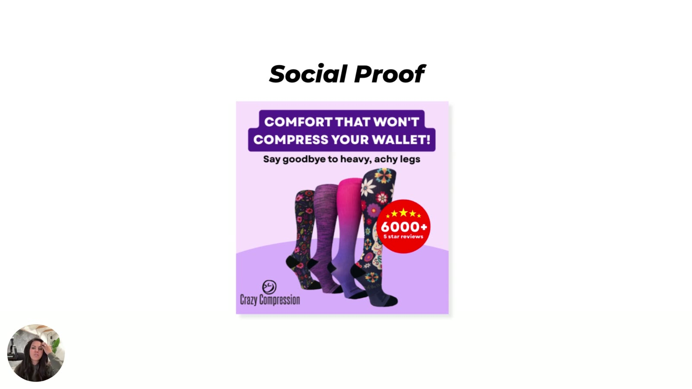

# Crazy Compression
> Compression socks brand. Its "6000+ 5 star reviews" static is Heuristics 101's **social proof** example, with Sarah's fix: talk about the *people*, not the stars ("6,000 sock lovers have adopted [brand]").

## 🤖 Agent use
- **Use when:** writing or upgrading review/social-proof badges and lines in statics or UGC captions.
- **Inputs → outputs:** a stars/review-count badge → a humanised, identity-typed social proof line.
- **Rules:**
  - DO say who the reviewers are: "6,000 sock lovers have adopted [brand]" / "6,000 people who have tried it and loved it" [03:33–03:51](../courses/tether-lab/02-heuristics-101/02-using-biases-that-sell.md).
  - DON'T rely on stars alone: "you can get a lot better results just by injecting some humanity into your social proof" [03:53–04:02](../courses/tether-lab/02-heuristics-101/02-using-biases-that-sell.md).
  - DON'T inflate the number; use the real count (wiki rule).
- **See also:** [Social proof](../concepts/heuristics/social-proof.md) · [AMA Biolabs / typed social proof](ama-biolabs-yerba-magic.md)

## At a glance
| Field | Value |
|---|---|
| Niche | Apparel: compression socks |
| Relationship | Lesson example |
| Ads / pages discussed | 1 static |
| Heuristics seen | [Social proof](../concepts/heuristics/social-proof.md) |
| Zones / Selves | Not tagged |
| Sessions | [M2 L2](../courses/tether-lab/02-heuristics-101/02-using-biases-that-sell.md) |

## Ads and pages discussed

### 1. "Comfort that won't compress your wallet! Say goodbye to heavy, achy legs" (static, M2 L2)

*Red "★★★★★ 6000+ 5 star reviews" badge; Sarah suggests "6,000 sock lovers". [02:30]*

| Brand / product (niche) | Format | Hook / opening | What works | What fails | Fix suggested | Principle | Source |
|---|---|---|---|---|---|---|---|
| Crazy Compression (compression socks) | Static | "Comfort that won't compress your wallet! Say goodbye to heavy, achy legs" | Big "6000+ 5 star reviews" badge; clear pain line | Proof is stars only, not people | "6,000 sock lovers have adopted [brand]" | Humanise social proof | [02:30–04:02](../courses/tether-lab/02-heuristics-101/02-using-biases-that-sell.md) |

## Transferable lessons (remix for our product)
- Rewrite every "X 5-star reviews" badge as "X [identity] [verb]": "35,000 dairy lovers trust…", "10,000 chai lovers are switching…".

## Backlinks
| Where | Timestamp(s) | What |
|---|---|---|
| [M2 L2 Using Biases That Sell](../courses/tether-lab/02-heuristics-101/02-using-biases-that-sell.md) | 02:28–04:02 | Social proof example |
| [M2 L5 Stacking](../courses/tether-lab/02-heuristics-101/05-stacking-psychology-for-growth.md) | 07:00 | Shown among the nine example ads |

## Related
[Compression-sock brand (Nate)](README.md#unnamed-and-category-examples) · [Golden-milk chai (Aazar Shad)](golden-milk-chai-aazar-shad.md) · [Brands index](README.md)
