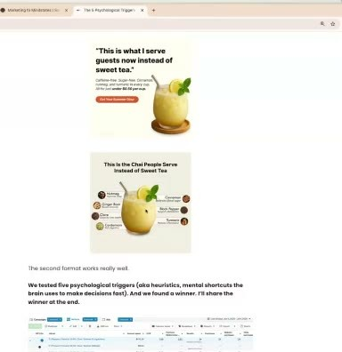
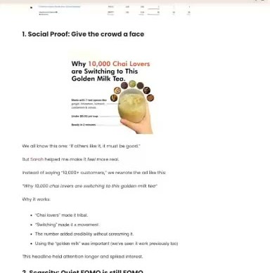
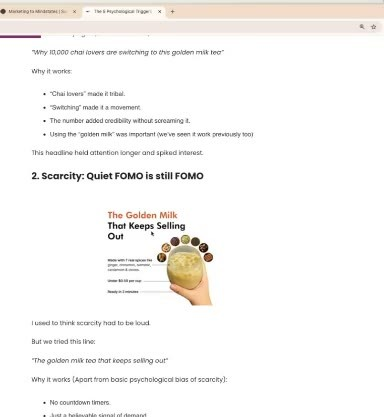
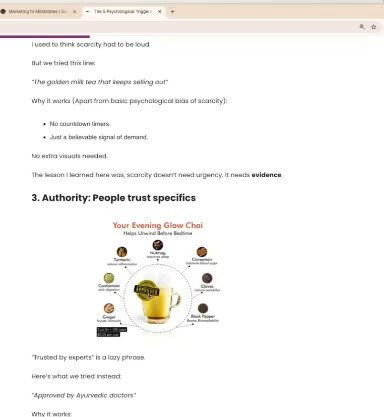
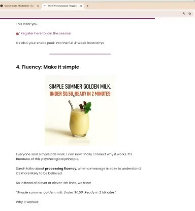
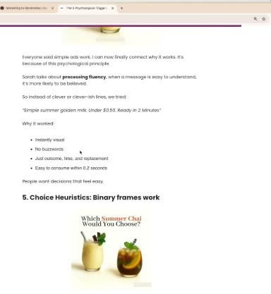

# Golden-milk chai brand (Aazar Shad)
> A golden-milk / turmeric chai drink (caffeine-free, sugar-free, "under $0.50 per cup") that **community member [Aazar Shad](../people/community-members.md#aazar-shad)** runs as a side project. The brand name is never said in the sessions. He shared the cleanest **one-heuristic-per-variant headline test** in the course (scarcity won), and asked how to switch Gen Z matcha drinkers.

## 🤖 Agent use
- **Use when:** iterating a winning static by testing heuristics one at a time; writing beverage/wellness drink ads; trying to switch buyers away from an incumbent drink.
- **Inputs → outputs:** a winning control static → 5 headline variants (social proof, scarcity, authority, fluency, choice) with everything else fixed → winner + next iteration.
- **Rules:**
  - DO iterate on the winner and change only the headline: "I actually iterated on the winning ad, not [came] up with a new ad altogether" [0:29:12–0:30:15](../courses/tether-lab/05-live-recordings/2025-07-09-live-with-sarah.md).
  - DO keep the proven elements constant: outcome visual (the drink), spices on display, "under 50 cents per cup" [0:30:15–0:32:21](../courses/tether-lab/05-live-recordings/2025-07-09-live-with-sarah.md).
  - DO write scarcity as evidence of demand, not urgency ("The Golden Milk That Keeps Selling Out"); only if it's true (wiki rule) [0:26:20–0:26:46](../courses/tether-lab/05-live-recordings/2025-07-09-live-with-sarah.md).
  - DO use specific authority ("Approved by Ayurvedic doctors") over "trusted by experts" [0:25:57–0:26:06](../courses/tether-lab/05-live-recordings/2025-07-09-live-with-sarah.md).
  - IF you need younger switchers THEN make them question their attachment ("Is your matcha really doing what you think it is?"), not attack the incumbent [1:03:25–1:05:31](../courses/tether-lab/05-live-recordings/2025-06-18-live-with-sarah.md).
- **See also:** [Heuristic stacking](../concepts/heuristic-stacking.md) · [Scarcity](../concepts/heuristics/scarcity-heuristic.md) · [Creative testing system](../frameworks/creative-testing-system.md) · [Canvas Gelato](canvas-gelato.md)

## At a glance
| Field | Value |
|---|---|
| Niche | Food & beverage: functional tea / golden milk |
| Relationship | Member's brand (Aazar Shad) |
| Ads / pages discussed | 2 control statics + 5 heuristic variants (shown); benefit-led ads + landing page (described) |
| Heuristics seen | [Framing](../concepts/heuristics/framing-effect.md) (price per cup, vs sweet tea), [fluency](../concepts/heuristics/processing-fluency.md), [social proof](../concepts/heuristics/social-proof.md), [scarcity](../concepts/heuristics/scarcity-heuristic.md) (winner), [authority](../concepts/heuristics/authority-bias.md), choice/binary frame |
| Zones | Variants tagged Z1–Z2 (wiki tags) |
| Selves | Mostly [Actual](../concepts/actual-self.md); authority variant [Ought](../concepts/ought-self.md) (wiki tags) |
| Sessions | [Jun 18](../courses/tether-lab/05-live-recordings/2025-06-18-live-with-sarah.md), [Jul 9](../courses/tether-lab/05-live-recordings/2025-07-09-live-with-sarah.md) |

## Ads and pages discussed

### 1. Controls: "This is what I serve guests now instead of sweet tea" (statics, Jul 9)

*Existing winners: quote headline + "under $0.50 per cup"; second format with labelled spices "works really well". AI-generated image (no summer photo available). [0:25:25]*

| Brand / product (niche) | Format | Hook / opening | What works | What fails | Fix suggested | Principle | Source |
|---|---|---|---|---|---|---|---|
| Aazar's chai / golden-milk brand (DTC beverage) | Static, AI-generated drink image | "This is what I serve guests now instead of sweet tea." / "This Is the Chai People Serve Instead of Sweet Tea" | Replacement framing (vs sweet tea), price framing "under $0.50 per cup", spices visible as proof, outcome visual | Nothing stated; cup later made to look more real | Keep as control; change only the headline, one heuristic per variant | Iterate on winners | [0:24:56–0:25:57; 0:30:25–0:31:33](../courses/tether-lab/05-live-recordings/2025-07-09-live-with-sarah.md) |

### 2. Variant: social proof, "Why 10,000 Chai Lovers are Switching to This Golden Milk Tea."

*"Give the crowd a face": Sarah helped turn "10,000+ customers" into a tribal movement line. [0:25:12]*

| Brand / product (niche) | Format | Hook / opening | What works | What fails | Fix suggested | Principle | Source |
|---|---|---|---|---|---|---|---|
| Chai brand | Static, hand holding cup, spice ring | "Why 10,000 Chai Lovers are Switching to This Golden Milk Tea." | "'Chai lovers' made it tribal. 'Switching' made it a movement"; held attention longer | Lost to scarcity on ROAS | — | Social proof with an identity + movement verb | [0:25:12–0:25:45](../courses/tether-lab/05-live-recordings/2025-07-09-live-with-sarah.md) |

### 3. Variant (WINNER): scarcity, "The Golden Milk That Keeps Selling Out"

*"Scarcity doesn't need urgency. It needs evidence." No countdown timer. [0:25:48]*

| Brand / product (niche) | Format | Hook / opening | What works | What fails | Fix suggested | Principle | Source |
|---|---|---|---|---|---|---|---|
| Chai brand | Static, same layout | "The Golden Milk That Keeps Selling Out" | **Best ROAS; the variant that scaled.** Quiet demand signal, implies others keep buying; like a "TikTok viral product → blows up on Facebook" | — | Precise counts ("36 products left"); pair with choice: "the chai that sold out — which one would you pick?" | Scarcity as evidence, not urgency | [0:26:20–0:26:46; 0:28:09–0:28:55](../courses/tether-lab/05-live-recordings/2025-07-09-live-with-sarah.md) |

- CPAs reported ~$15 vs ~$17 (which ad had which is ambiguous); "the FOMO one is scalable so I can put more money behind it, the other one is not" [0:28:09–0:28:55](../courses/tether-lab/05-live-recordings/2025-07-09-live-with-sarah.md).

### 4. Variant: authority, "Your Evening Glow Chai — Helps Unwind Before Bedtime" + "Approved by Ayurvedic doctors"

*"'Trusted by experts' is a lazy phrase"; make the badge big and recognisable. [0:26:02]*

| Brand / product (niche) | Format | Hook / opening | What works | What fails | Fix suggested | Principle | Source |
|---|---|---|---|---|---|---|---|
| Chai brand | Static, cup with spice-benefit callouts and badge | "Your Evening Glow Chai — Helps Unwind Before Bedtime" | Specific authority title; customers love the unwind-before-bed use case | Lost to scarcity | Bigger, instantly recognisable badge | Specific authority beats generic | [0:25:57–0:26:06](../courses/tether-lab/05-live-recordings/2025-07-09-live-with-sarah.md) |

### 5. Variant: fluency, "Simple Summer Golden Milk. Under $0.50. Ready in 2 Minutes"

*"Just outcome, time, and replacement. Easy to consume within 0.2 seconds." [0:26:11]*

| Brand / product (niche) | Format | Hook / opening | What works | What fails | Fix suggested | Principle | Source |
|---|---|---|---|---|---|---|---|
| Chai brand | Static, bold condensed headline, plain cup | "Simple summer golden milk. Under $0.50. Ready in 2 Minutes" | No buzzwords; instantly visual | Lost to scarcity | — | [Processing fluency](../concepts/heuristics/processing-fluency.md) | [0:26:06–0:26:12](../courses/tether-lab/05-live-recordings/2025-07-09-live-with-sarah.md) |

### 6. Variant: choice, "Which Summer Chai Would You Choose?"

*Binary A vs B: golden milk vs iced chai. [0:26:16]*

| Brand / product (niche) | Format | Hook / opening | What works | What fails | Fix suggested | Principle | Source |
|---|---|---|---|---|---|---|---|
| Chai brand | Static, two products side by side | "Which Summer Chai Would You Choose?" | Sarah predicted it would win ("more personalized"); CPA within ~$2 of the winner | Didn't scale | Combine with scarcity | Binary choice frame | [0:26:12–0:26:27; 0:28:09–0:28:55](../courses/tether-lab/05-live-recordings/2025-07-09-live-with-sarah.md) |

### 7. Benefit-led ads that only reach older buyers (described, Jun 18)
| Brand / product (niche) | Format | Hook / opening | What works | What fails | Fix suggested | Principle | Source |
|---|---|---|---|---|---|---|---|
| Aazar's golden-milk / turmeric tea | Ads + landing page | Benefit-led (inflammation, joint pain) | "Kills it" with older buyers who feel the pain | Doesn't reach Gen Z (matcha, coffee, chai lattes) | Question the attachment: "Is your matcha really doing what you think it is?", "Are you actually a matcha girl, or do you want to be the type that does A, B, C"; A/B a landing page "Matcha is out, turmeric is in" / "the girlies aren't doing matcha anymore"; avoid scammy attacks | Switching = question the attachment and identity | [1:01:19–1:06:33](../courses/tether-lab/05-live-recordings/2025-06-18-live-with-sarah.md) |

- Aazar's favourite headlines come from review language (a customer stopped Benadryl and melatonin; pain "melt[ed] away") [0:26:46–0:27:20](../courses/tether-lab/05-live-recordings/2025-07-09-live-with-sarah.md). Treat health claims from reviews carefully (wiki note).

## Transferable lessons (remix for our product)
- Test plan template: control + 5 variants, one heuristic each, headline-only changes; scale the one that **scales**, not only the lowest CPA.
- Scarcity copy that doesn't feel pushy: "The [product] that keeps selling out", backed by a real stock-out.
- Specific authority: name the exact expert type your audience trusts.
- Switching scripts: open by questioning the viewer's current habit ("Is your [incumbent] really doing what you think?"), then introduce ours.

## Backlinks
| Where | Timestamp(s) | What |
|---|---|---|
| [Live Jul 9](../courses/tether-lab/05-live-recordings/2025-07-09-live-with-sarah.md) | 0:24:24–0:32:21 | Five-heuristic test, scarcity winner, method |
| [Live Jun 18](../courses/tether-lab/05-live-recordings/2025-06-18-live-with-sarah.md) | 1:01:19–1:06:33 | Switching Gen Z from matcha |

## Related
[Copper Cow Coffee](copper-cow-coffee.md) · [Canvas Gelato](canvas-gelato.md) · [Aazar Shad](../people/community-members.md#aazar-shad) · [Brands index](README.md)
