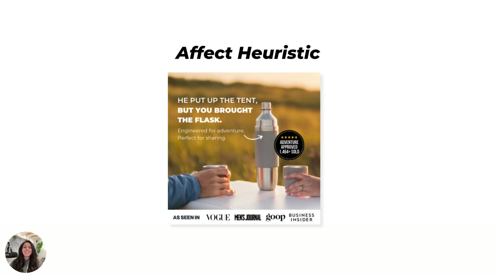
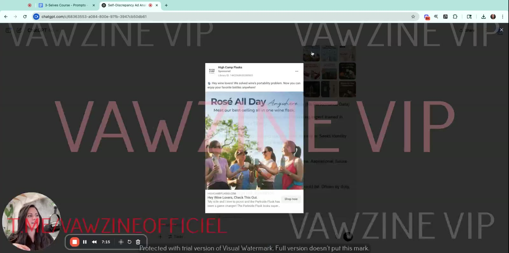
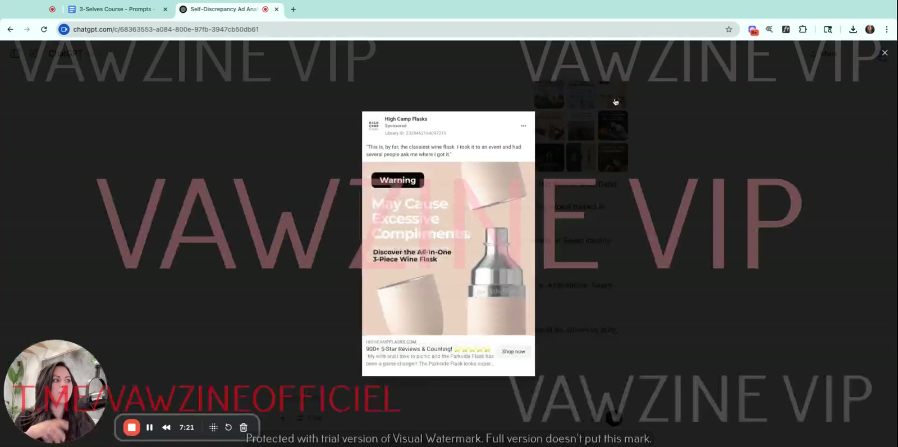
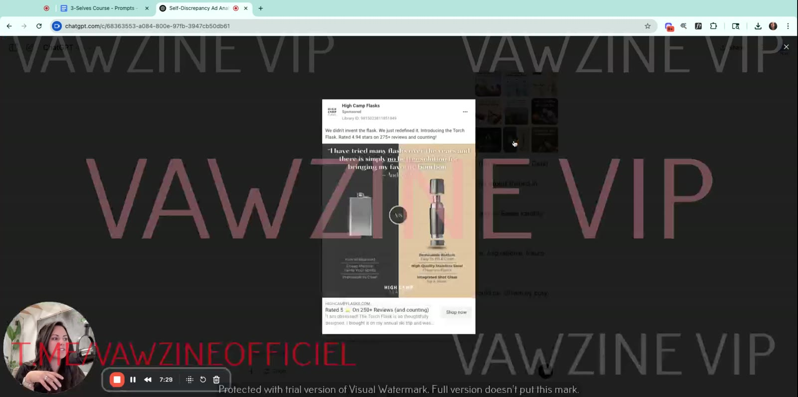
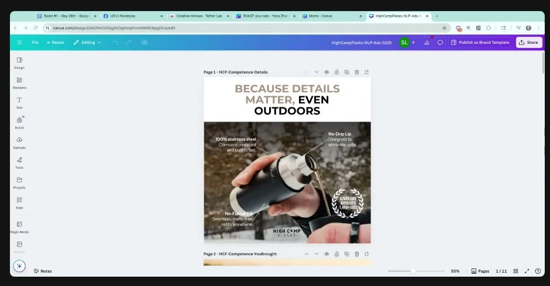

# High Camp Flasks
> Premium insulated flasks "for adventures both rugged and refined" ("From Cabin To Campfire"). **Sarah's own agency client**: the course's most-used example brand. Its statics teach the affect heuristic, heuristic stacking, the 3-selves diagnostic and rewrite, and static design (visual weight, rounded shapes).

**Also known as:** Firelight Flask (product name on the M2 L5 stacked ad; treated here as a High Camp product, a wiki inference from the M4 9-ad grid, which contains the same "stronger than s'mores" headline). The M4 L7 page also mentions "Parkside Flask" for the wine flask in the "Spill the Tea" ad.

## 🤖 Agent use
- **Use when:** tearing down drinkware / outdoor / giftable-lifestyle ads; building a 3-selves variant set (Actual / Ideal / Ought) from one winning static; designing a feature-callout static; mining reviews for scene headlines.
- **Inputs → outputs:** our product + reviews + one winning ad → a review-sourced scene hook, three self-variants with matched proof types, and a weighted static layout (headline → image → 3 call-outs → seal).
- **Rules:**
  - DO lift headlines from customer reviews: "He put up the tent, but you brought the flask" came from a review ([M2 L3 01:27](../courses/tether-lab/02-heuristics-101/03-emotion-clarity-urgency.md)).
  - DO match proof type to self: press bar ("As seen in Vogue…") for **Ought**, peer reviews ("900+ 5-Star Reviews from real wine lovers") for **Actual** ([M4 L7 02:30](../courses/tether-lab/04-self-targeting-system/07-how-to-rewrite-winning-ads-for-new-selves.md)).
  - DON'T ship model-invented proof. ChatGPT's Ought rewrite invented "Featured in *Outside* and *Men's Health*"; the final ad used the brand's real "As seen in" bar ([M4 L7 02:02](../courses/tether-lab/04-self-targeting-system/07-how-to-rewrite-winning-ads-for-new-selves.md)).
  - IF the product is the hero (product-hero or old-vs-new comparison) THEN expect it to read as **Ideal**; balance with identity call-outs (Actual) and standards (Ought) ([M4 L6 06:57–07:54](../courses/tether-lab/04-self-targeting-system/06-how-to-use-the-prompts-for-instant-insights.md)).
  - DO weight the part of the sentence that carries the message ("backwards weight"), keep headline ≤3 lines and call-outs bold-top-line value stacks ([Roast #1 0:36:37–0:40:44](../courses/tether-lab/05-live-recordings/2025-05-28-roast-my-ads-1.md)).
  - IF the background is vibrant THEN make the product a single, darker standalone object so it stays salient ([M2 L5 05:09](../courses/tether-lab/02-heuristics-101/05-stacking-psychology-for-growth.md)).
- **See also:** [Three selves diagnostic](../frameworks/three-selves-diagnostic.md) · [Rewriting ads for new selves](../frameworks/rewriting-ads-for-new-selves.md) · [Testing ads by self type](../frameworks/testing-ads-by-self-type.md) · [Visual weight hierarchy](../frameworks/visual-weight-hierarchy.md) · [Heuristic stacking](../concepts/heuristic-stacking.md)

## At a glance
| Field | Value |
|---|---|
| Niche | Home, kitchen & outdoor: premium flasks (wine, whiskey, cocktails) |
| Relationship | Sarah's client ("good friends in that brand", [M4 L5 06:20](../courses/tether-lab/04-self-targeting-system/05-run-the-3-selves-diagnostic-on-your-ads.md)); ads "Tether designed" ([M2 L3](../courses/tether-lab/02-heuristics-101/03-emotion-clarity-urgency.md)) |
| Ads / pages discussed | ~15 statics + homepage (9-ad grid, 3 self examples, 3 rewrite variants, 3 Roast #1 reference designs, stacked Firelight ad) |
| Heuristics seen | [Affect](../concepts/heuristics/affect-heuristic.md), [authority bias](../concepts/heuristics/authority-bias.md) (guarantee seal, press bar), [salience](../concepts/heuristics/salience-bias.md), [social proof](../concepts/heuristics/social-proof.md) (1,464+ sold, 900+ reviews) |
| Zones | Mostly Zone 1–2 positive (wiki tag) |
| Selves | Actual most consistent; Ideal when product is hero; Ought minor (ChatGPT diagnostic, [M4 L6 06:37](../courses/tether-lab/04-self-targeting-system/06-how-to-use-the-prompts-for-instant-insights.md)) |
| Sessions | M2 L3, M2 L5, M4 L2/L5/L6/L7/L8, [Roast #1](../courses/tether-lab/05-live-recordings/2025-05-28-roast-my-ads-1.md) |

## Ads and pages discussed

### 1. "He put up the tent, but you brought the flask." (static, M2 L3 affect / M4 L5 Actual self / Roast #1 backwards weight)

*Golden-hour couple, steel flask, "Adventure approved 1,464+ sold" seal, "As seen in Vogue, Men's Journal, goop, Business Insider" bar. [M2 L3 00:21]*

*Roast #1 page "HCF-Competence-YouBrought": the "backwards weight" example. [0:39:42]*

| Brand / product (niche) | Format | Hook / opening | What works | What fails | Fix suggested | Principle | Source |
|---|---|---|---|---|---|---|---|
| High Camp Flasks (outdoor drinkware) | Static, lifestyle photo + sold seal + press bar | "He put up the tent, but you brought the flask." | Review-sourced scene drops the viewer into a camping memory where "you contributed too" ([affect](../concepts/heuristics/affect-heuristic.md)). **Actual self**: "calm… proven… tested" identity affirmation (Sarah). Backwards weight: the second clause is heavier, so the takeaway is "you bring the fun". [Social proof](../concepts/heuristics/social-proof.md) seal + [authority](../concepts/heuristics/authority-bias.md) press bar. | — | — | Experience before pitch; weight the clause that is the message | [M2 L3 00:21–02:20](../courses/tether-lab/02-heuristics-101/03-emotion-clarity-urgency.md); [M4 L5 01:30](../courses/tether-lab/04-self-targeting-system/05-run-the-3-selves-diagnostic-on-your-ads.md); [Roast #1 0:39:40–0:40:44](../courses/tether-lab/05-live-recordings/2025-05-28-roast-my-ads-1.md) |

- Scored Actual 8.0 / Ideal 1.2 / Ought 2.1 on the lesson slide ([M4 L5 03:30](../courses/tether-lab/04-self-targeting-system/05-run-the-3-selves-diagnostic-on-your-ads.md)).

### 2. "For when you need something stronger than s'mores." (Firelight Flask® stacked static, M2 L5)

*Annotated: affect (fire + s'mores headline), authority ("Preserved Taste Guaranty" seal), salience (fiery background vs metal). [M2 L5 03:17]*

| Brand / product (niche) | Format | Hook / opening | What works | What fails | Fix suggested | Principle | Source |
|---|---|---|---|---|---|---|---|
| Firelight Flask (High Camp product, wiki inference) | Static, fire background, 3 feature call-outs, gold guarantee seal | "For when you need something stronger than s'mores." | Headline and image "paired together very, very carefully" = dual mental picture ([affect](../concepts/heuristics/affect-heuristic.md)); a guarantee "automatically creates a level of authority" | Salience inverted: vibrant background, subdued products | "Use one particular product in the middle… a standalone darker color so that… vibrant background stands out" | Anything distinctive gets the most attention ([salience](../concepts/heuristics/salience-bias.md)) | [M2 L5 03:13–05:26](../courses/tether-lab/02-heuristics-101/05-stacking-psychology-for-growth.md) |

### 3. The 9-ad grid (M4 L2 / L6)

*The 9-ad sample (3 top / 3 mid / 3 flop labels are illustrative; Sarah has no metrics for this brand). [M4 L2 01:15]*

| Brand / product (niche) | Format | Hook / opening | What works | What fails | Fix suggested | Principle | Source |
|---|---|---|---|---|---|---|---|
| High Camp Flasks, 9-ad set (wine/whiskey flasks) | Statics, Meta | "Rosé All Day Anywhere", "May Cause Excessive Compliments", old-vs-Torch-Flask comparison, "For when you need something stronger than s'mores", "So elegant and stylish. I'm getting one for myself.", "Adventure hard, unwind harder", "Customizable, just like your cocktails", "Survival skills: fire-building 2/10, cocktail prep 10/10", "Remember the moments, not the imperfections" | Actual is the most consistent self ("wine lovers, outdoorsmen, whiskey drinkers"; validation + lifestyle) | Ideal dominates whenever the product is the hero; Ought only "a minor supportive role" | Diversify. Sarah: "I might not want to be doing that… if I'm trying to make sure I'm not stagnating" | Diagnose over-indexing by ad type, then fill missing selves | [M4 L6 06:37–07:54](../courses/tether-lab/04-self-targeting-system/06-how-to-use-the-prompts-for-instant-insights.md) |

*"Rosé All Day Anywhere": scored Actual 8 / Ideal 3 / Ought 2, "strong identity validation for wine lovers". [M4 L6 05:37]*

*Product-hero ("Warning: May Cause Excessive Compliments", 900+ 5-star reviews) reads as Ideal. [M4 L6 07:22]*

*"I have tried many flasks over the years…" comparison (4.94 stars on 275+ reviews): upgrade framing = Ideal. [M4 L6 07:28]*

### 4. Actual / Ideal / Ought examples (M4 L5)

*Ideal: "For campfire legends only", "you could be this person if you had this product". [M4 L5 02:04]*

*Ought: "Because details matter, even outdoors", responsibility and standards; feature call-outs justify it. [M4 L5 02:34]*

| Brand / product (niche) | Format | Hook / opening | What works | What fails | Fix suggested | Principle | Source |
|---|---|---|---|---|---|---|---|
| High Camp Flasks | Static, dark product shot + review + "Adventurer's Choice" badge | "For campfire legends only." | Aspirational identity invitation: "very transformational… next level" | Not critiqued | — | Ideal = "become the legend" | [M4 L5 02:04](../courses/tether-lab/04-self-targeting-system/05-run-the-3-selves-diagnostic-on-your-ads.md) |
| High Camp Flasks | Static, headline over feature-callout photo | "Because details matter, even outdoors." | "Responsibility, that pressure… a little bit of morality… protective language" | Not critiqued | — | Ought = "you should care about details" | [M4 L5 02:34](../courses/tether-lab/04-self-targeting-system/05-run-the-3-selves-diagnostic-on-your-ads.md) |

- ⚠️ The score slide swaps the Ideal/Ought values for these two ads (legends shows Ought 7.3, details shows Ideal 9.6); trust the narration ([M4 L5 03:30](../courses/tether-lab/04-self-targeting-system/05-run-the-3-selves-diagnostic-on-your-ads.md)).

### 5. "Spill The Tea, Not Your Wine." → Ought and Actual rewrites (M4 L7 / L8)

*The winning input ad. ChatGPT: Ideal ("who you'd rather be… classy"); Sarah: "pretty spot on". [M4 L7 01:43]*

*Prompt 3 output for Ought and Actual. Note the invented "Featured in Outside and Men's Health" proof. [M4 L7 02:02]*

*Final set: Ideal / Ought ("Don't Risk the Bottle… Real Adults Bring a Flask" + real press bar) / Actual ("For Wine Lovers Who Know… You Already Bring the Good Stuff" + 900+ reviews). [M4 L7 02:30; M4 L8 00:50]*

| Brand / product (niche) | Format | Hook / opening | What works | What fails | Fix suggested | Principle | Source |
|---|---|---|---|---|---|---|---|
| High Camp (wine flask; "Parkside Flask" per M4 L7 page) | 3 statics, same visual (wine splash + flask), one ad set | Ideal "Spill The Tea, Not Your Wine." → Ought "Don't Risk the Bottle… Real Adults Bring a Flask" → Actual "For Wine Lovers Who Know… You Already Bring the Good Stuff" | Same offer, CTA, LP, price; only the self changes: "opening an emotional door to a different window of themselves… zero extra creative cost". Proof switched per self (press for Ought, peer reviews for Actual). | ChatGPT invented press proof for Ought | Replaced with the brand's real "As seen in" bar | Change who you invite, not the offer; never fabricate proof | [M4 L7 01:08–04:12](../courses/tether-lab/04-self-targeting-system/07-how-to-rewrite-winning-ads-for-new-selves.md); [M4 L8](../courses/tether-lab/04-self-targeting-system/08-how-to-test-your-ads-by-self-type.md) |

- If a core message has worked "for two years… every single time", keep it and don't re-self it ([M4 L7 02:43](../courses/tether-lab/04-self-targeting-system/07-how-to-rewrite-winning-ads-for-new-selves.md)).

### 6. Sarah's reference designs in Roast #1 (static design 101)

*"HCF-Competence-Details": headline in white space first, ≤3 lines, bold top line on each call-out = value stack. [0:37:26]*

*"HCF-Esteem-Moments": rounded text bubbles, her "best CRO hack". [0:49:30]*

| Brand / product (niche) | Format | Hook / opening | What works | What fails | Fix suggested | Principle | Source |
|---|---|---|---|---|---|---|---|
| High Camp Flasks (Sarah's design) | Static, headline + in-use photo + 3 feature call-outs + sold seal | "Because details matter, even outdoors" | Weighting order headline → image → call-outs; ≤3 lines; bold top line; 3 product-specific features; 1,464+ sold seal. File tag: **Competence** (need). | Image "a little bit complicated, but this is what we had to use for the brand" | — | Weighting tells people what to believe | [Roast #1 0:36:37–0:38:39](../courses/tether-lab/05-live-recordings/2025-05-28-roast-my-ads-1.md) |
| High Camp Flasks (Sarah's design) | Static, product + wine splash, rounded bubbles | "For Wine Lovers Who Know… You Already Bring the Good Stuff" | Rounded shapes "feel less scary" (her claim, uncited study); Esteem tag; 900+ 5-star reviews | — | — | Rounded shapes and buttons convert better | [Roast #1 0:48:07–0:51:22](../courses/tether-lab/05-live-recordings/2025-05-28-roast-my-ads-1.md) |

- Canva file name on screen: "HighCampFlasks-NLP-Ads-0225"; page names carry a need tag (Competence, Esteem) ([Roast #1 0:49:14](../courses/tether-lab/05-live-recordings/2025-05-28-roast-my-ads-1.md)).

### 7. Homepage (context)

*"For adventures both rugged and refined… Insulated, sharable, stylish, fun… From Cabin To Campfire." [M4 L5 06:26]*

## Transferable lessons (remix for our product)
1. **Review → scene headline:** find a review line that puts the buyer in a moment where *they* contributed something; use it verbatim-ish as the hook.
2. **One winner → three selves:** keep visual, offer and LP; swap headline, subhead and proof type (Actual = peers, Ought = authority/press, Ideal = aspiration).
3. **Audit by ad type:** product-hero and comparison ads drift Ideal; identity call-outs stay Actual. Count before you brief.
4. **Static layout:** headline in white space → product-in-use image → 3 bolded call-outs → one proof seal. Weight the payoff clause. Rounded text containers.
5. **Salience:** calm field + one distinctive product, not a loud field with muted products.
6. **Proof hygiene:** every press logo, review count and "sold" number must be real.

## Backlinks
| Where | Timestamp(s) | What |
|---|---|---|
| [M2 L3 Emotion, Clarity, Urgency](../courses/tether-lab/02-heuristics-101/03-emotion-clarity-urgency.md) | 00:21–02:20 | Affect heuristic: tent/flask ad, review-sourced |
| [M2 L5 Stacking Psychology](../courses/tether-lab/02-heuristics-101/05-stacking-psychology-for-growth.md) | 03:13–05:26 | Firelight Flask stack + salience fix |
| [M4 L2 Diagnose Which Self](../courses/tether-lab/04-self-targeting-system/02-diagnose-which-self-your-ads-target.md) | 01:15 | 9-ad grid |
| [M4 L5 Run the Diagnostic](../courses/tether-lab/04-self-targeting-system/05-run-the-3-selves-diagnostic-on-your-ads.md) | 01:30–06:26 | Actual/Ideal/Ought examples, scores, homepage |
| [M4 L6 Prompts](../courses/tether-lab/04-self-targeting-system/06-how-to-use-the-prompts-for-instant-insights.md) | 02:50–08:23 | Live ChatGPT diagnostic and takeaways |
| [M4 L7 Rewrite](../courses/tether-lab/04-self-targeting-system/07-how-to-rewrite-winning-ads-for-new-selves.md) | 01:08–04:12 | Spill the Tea → Ought/Actual |
| [M4 L8 Test by self](../courses/tether-lab/04-self-targeting-system/08-how-to-test-your-ads-by-self-type.md) | 00:50 | Three variants in one ad set |
| [Roast My Ads #1](../courses/tether-lab/05-live-recordings/2025-05-28-roast-my-ads-1.md) | 0:36:37–0:40:44; 0:48:07–0:51:22 | Reference designs: weighting, backwards weight, rounded bubbles |

## Related
[Sarah Levinger](../people/sarah-levinger.md) · [Three selves](../concepts/three-selves.md) · [Actual self](../concepts/actual-self.md) · [Ideal self](../concepts/ideal-self.md) · [Ought self](../concepts/ought-self.md) · [Affect heuristic](../concepts/heuristics/affect-heuristic.md) · [ChatGPT](../tools/chatgpt.md) · [Brands index](README.md)
