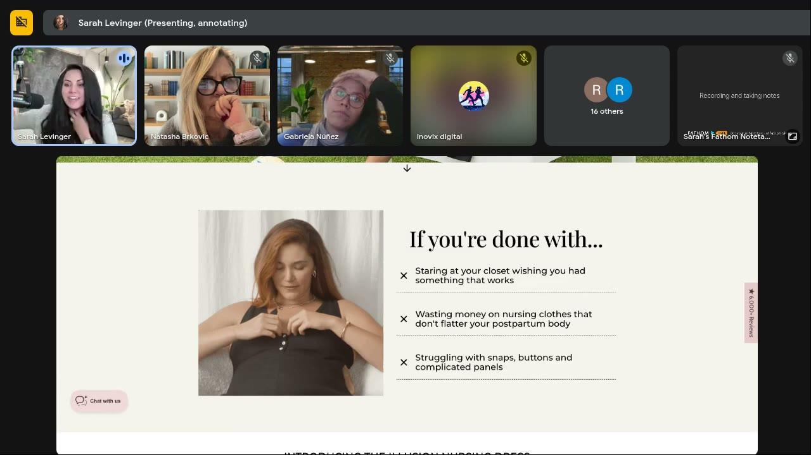
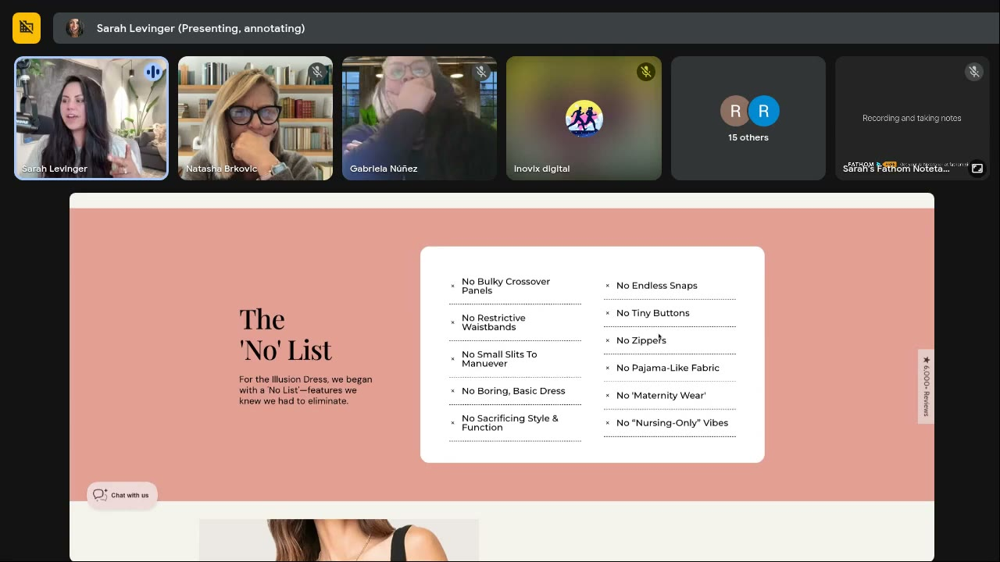
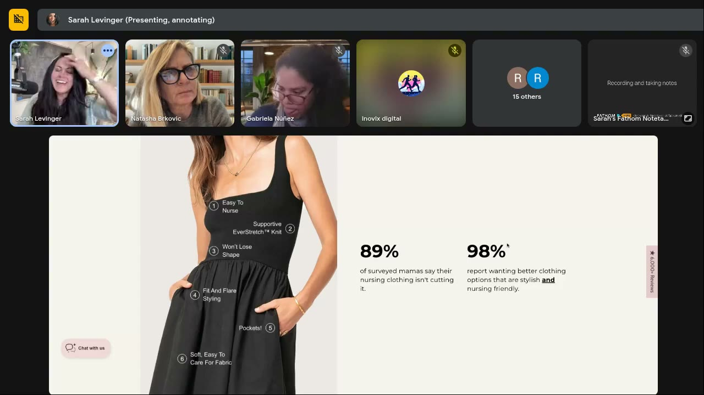
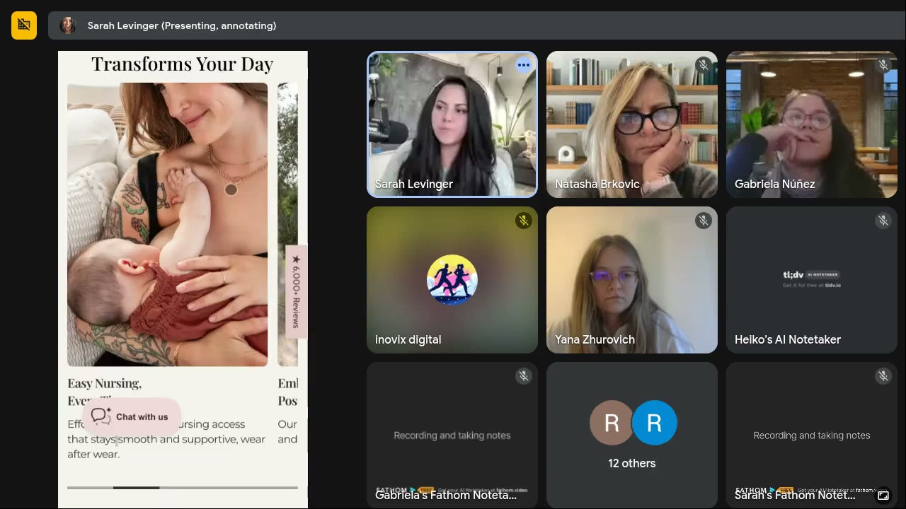

# Illusion Nursing Dress
> A $118 nursing / postpartum dress with a new stretchy-compression knit ("6,000+ Reviews"). A **member's brand: Satya Twena**; its custom paid-traffic lander was roasted in [Roast My Ads #2](../courses/tether-lab/05-live-recordings/2025-06-25-roast-my-ads-2.md). Teaches context priming via props, retail-style section order, early buy points and leading with the innovation.

## 🤖 Agent use
- **Use when:** auditing a long PDP/lander for a fashion or mom product; choosing hero props and words; deciding where buy buttons go; turning pain bullets into page sections.
- **Inputs → outputs:** a long lander → re-ordered sections (retail walk-through), extra CTAs after convincing sections, prop/copy fixes, combined bullets, table → graphic.
- **Rules:**
  - DO treat every hero prop as context: a basketball read as "older kids / boy mom" ([0:25:31–0:27:32](../courses/tether-lab/05-live-recordings/2025-06-25-roast-my-ads-2.md)). Use props that scream the exact life stage, kept elevated.
  - DO use the customer's word: moms say "nursing", not "feeding" ([0:46:20–0:46:32](../courses/tether-lab/05-live-recordings/2025-06-25-roast-my-ads-2.md)).
  - IF fashion under ~$200 THEN put buy buttons early (after the drape video, after the fit section): "show, don't tell" ([0:42:17–0:43:31](../courses/tether-lab/05-live-recordings/2025-06-25-roast-my-ads-2.md)).
  - DO lead with the innovation paradox ("stretchy compression") and a sensory word ("hug") ([0:44:25–0:46:08](../courses/tether-lab/05-live-recordings/2025-06-25-roast-my-ads-2.md)).
  - DO keep bullets 3–5, ≤2 lines; merge related items; don't duplicate info in tables ([0:29:29–0:36:28](../courses/tether-lab/05-live-recordings/2025-06-25-roast-my-ads-2.md)).
  - DO inject a winning ad concept into the page ("If you're done with…") ([0:28:34–0:28:57](../courses/tether-lab/05-live-recordings/2025-06-25-roast-my-ads-2.md)).
- **See also:** [Landing-page psychology audit](../frameworks/landing-page-psychology-audit.md) · [Salience bias](../concepts/heuristics/salience-bias.md) · [Cognitive load](../concepts/heuristics/cognitive-load.md) · [ANATATI](anatati.md) · [Satya Twena](../people/community-members.md#satya-twena)

## At a glance
| Field | Value |
|---|---|
| Niche | Apparel: nursing / postpartum dresses |
| Relationship | Member's brand (Satya Twena), roasted live |
| Ads / pages discussed | 1 custom lander (desktop + mobile, ~10 sections) |
| Heuristics seen | [Salience](../concepts/heuristics/salience-bias.md) (contrast), context priming, [processing fluency](../concepts/heuristics/processing-fluency.md), [framing](../concepts/heuristics/framing-effect.md) (No list), [social proof](../concepts/heuristics/social-proof.md) (89% / 98% / 6,000+), [scarcity](../concepts/heuristics/scarcity-heuristic.md) (sold out → pre-order) |
| Zones | Zone 3 pain whisper ("If you're done with…") resolving to Zone 1 ("feel beautiful") (wiki tag) |
| Selves | [Actual](../concepts/actual-self.md) (postpartum body now) + [Ideal](../concepts/ideal-self.md) (feel beautiful) (wiki tag) |
| Sessions | [Roast My Ads #2](../courses/tether-lab/05-live-recordings/2025-06-25-roast-my-ads-2.md) |

## Ads and pages discussed

### 1. Custom lander: "Feed and Feel Beautiful Everyday." (Roast #2)

*High-contrast black dress pulls the eye first. Basketball → "boy mom"; "Feed" confuses; white text on green is hard to read. [0:24:00]*

*An ad concept injected into the page: 3 pain bullets, ≤2 lines each. "I freaking love this." [0:29:15]*

*Great USP framing ("why this dress exists"), but 11 bullets is too many. [0:35:15]*

*Numbered callouts + big numbers (89% / 98%) = the low-load way to communicate. [0:36:10]*

*The first buy point appears far down the page. "Pre-order now" is a strong action CTA. [0:37:00]*

*Mobile "sliver" carousel: a partly hidden next card makes people swipe. [0:32:55]*

| Brand / product (niche) | Format | Hook / opening | What works | What fails | Fix suggested | Principle | Source |
|---|---|---|---|---|---|---|---|
| Illusion Nursing Dress (nursing/postpartum fashion, $118, "6,000+ reviews") | Custom landing page for paid traffic | "Feed and Feel Beautiful Everyday." + "Get your dress now" over a model in a black dress on a lawn | Contrast hero; "If you're done with…" pain bullets; drape video; 2-line bullets; numbered callouts + 89% / 98% big numbers; "No list" USP; mobile sliver carousel; "Get your dress now" / "Pre-order now" CTAs; 30-day guarantee | Basketball + grass = mixed "older kids" signals; "Feed" isn't how moms talk; text on green; heavy sections; 11-item No list; duplicated table; long page → fatigue; **one buy point, far down**; nursing function and the stretch innovation shown too late; few baby images | Newborn props (baby ball, blanket, teether, wooden play gym; keep it elevated); "Nurse and feel beautiful every day"; black fade behind text; merge No-list items; table → graphic; CTAs after the first video and fit section ("Did you like it? Choose your color", "Find your color, find your fit"); lead with the stretch; describe the knit as a "hug"; retail-order sections | Context priming; show-don't-tell for fashion; [cognitive load](../concepts/heuristics/cognitive-load.md) | [0:23:24–0:49:44](../courses/tether-lab/05-live-recordings/2025-06-25-roast-my-ads-2.md) |

- **Section order Sarah proposes (retail walk-through):** hero (why we're different, the feeling) → why they'd enjoy it → drape video → close-up details ("turn the piece over in their hands") → why it beats everything else → No list → comparison as a graphic ([0:37:41–0:40:29](../courses/tether-lab/05-live-recordings/2025-06-25-roast-my-ads-2.md)).
- Satya on the knit: "It's not about thinness… postpartum you just feel spacious" → use "hug" so it doesn't read as real compression ([0:44:25–0:45:13](../courses/tether-lab/05-live-recordings/2025-06-25-roast-my-ads-2.md)).
- Mobile view = "a whole different feeling" (different crop, ball, text placement). Review both ([0:32:52–0:33:30](../courses/tether-lab/05-live-recordings/2025-06-25-roast-my-ads-2.md)).

**Rewrites (before → after)**
| Before | After | What changed | Source |
|---|---|---|---|
| "Feed and Feel Beautiful Everyday." | "Nurse and feel beautiful every day." | customer's word | [0:46:20](../courses/tether-lab/05-live-recordings/2025-06-25-roast-my-ads-2.md) |
| "Flattering your changing postpartum body" (Satya's draft framing) | knit that "hugs" you | sensory word, avoids thinness | [0:45:13](../courses/tether-lab/05-live-recordings/2025-06-25-roast-my-ads-2.md) |
| Single buy box at the bottom | "Did you like it? Choose your color" after the video; "Find your color, find your fit" after the fit section | earlier, contextual CTAs | [0:38:05](../courses/tether-lab/05-live-recordings/2025-06-25-roast-my-ads-2.md) |

## Transferable lessons (remix for our product)
1. **Props are copy**: audit every background object for which life stage/identity it signals.
2. **Pain bullets from ads belong on the page** ("If you're done with…").
3. **Lead with the paradox innovation** (two opposite properties in one product).
4. **Fashion = show, then sell**: video of drape, then a buy button immediately.
5. **Big numbers + icons** beat paragraphs; merge and de-duplicate lists.
6. **Scarcity done honestly**: "sold out quickly, now available for pre-order" (real status).

## Backlinks
| Where | Timestamp(s) | What |
|---|---|---|
| [Roast My Ads #2](../courses/tether-lab/05-live-recordings/2025-06-25-roast-my-ads-2.md) | 0:23:24–0:49:44 | Lander roast, section order, CTA rules |

## Related
[Satya Twena](../people/community-members.md#satya-twena) · [Landing-page psychology audit](../frameworks/landing-page-psychology-audit.md) · [Brands index](README.md)
