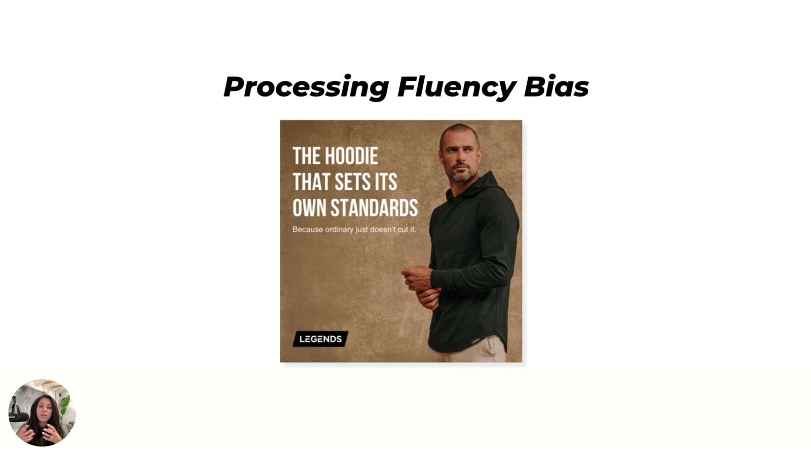

# LEGENDS
> Men's apparel brand (hoodie ad). **Sarah's agency client** ("a LEGENDS hoodie ad Tether designed"); the course's example of [processing fluency](../concepts/heuristics/processing-fluency.md): one message, a confident face, no bullets.

## 🤖 Agent use
- **Use when:** tearing down menswear / apparel statics; writing a minimal static where the model's expression carries the message; cutting over-explained copy.
- **Inputs → outputs:** a product shot + model image → one headline + one sub-line, no bullets; a model brief (expression = the brand's emotion).
- **Rules:**
  - DO say less: headline + model expression "does a lot… We don't actually have to say a whole lot" ([M2 L3 03:09–03:30](../courses/tether-lab/02-heuristics-101/03-emotion-clarity-urgency.md)).
  - DON'T add "bullet points everywhere… you don't need them" ([M2 L3 03:30–04:01](../courses/tether-lab/02-heuristics-101/03-emotion-clarity-urgency.md)).
  - DO brief the model's expression to the message ("definitive… casual… kind of pride").
  - DON'T over-design: "Please don't over design your way into trying to convince people to buy from you" ([M2 L3 03:50](../courses/tether-lab/02-heuristics-101/03-emotion-clarity-urgency.md)).
- **See also:** [Processing fluency](../concepts/heuristics/processing-fluency.md) · expected [Model image psychology](../concepts/model-image-psychology.md) · [Net Positive](net-positive.md) (model expression as message)

## At a glance
| Field | Value |
|---|---|
| Niche | Apparel: men's hoodies |
| Relationship | Sarah's client (Tether-designed ad) |
| Ads / pages discussed | 1 static |
| Heuristics seen | [Processing fluency](../concepts/heuristics/processing-fluency.md) |
| Zones | Not stated (pride/confidence; wiki tag Zone 1–2) |
| Selves | Not stated |
| Sessions | [M2 L3](../courses/tether-lab/02-heuristics-101/03-emotion-clarity-urgency.md); shown in the M2 L5 9-ad lineup |

## Ads and pages discussed

### 1. "The hoodie that sets its own standards." (static, M2 L3)

*Textured tan background, confident man in a black hoodie, sub-line "Because ordinary just doesn't cut it." No bullets. [M2 L3 02:30]*

| Brand / product (niche) | Format | Hook / opening | What works | What fails | Fix suggested | Principle | Source |
|---|---|---|---|---|---|---|---|
| LEGENDS (men's apparel) | Static, single model, textured background | "The hoodie that sets its own standards." / "Because ordinary just doesn't cut it." | One message, a proud confident model ("definitive… casual… kind of pride"), textured tan background, no bullets | — | — | Fluency: say less; let the face carry it | [M2 L3 02:30–03:30](../courses/tether-lab/02-heuristics-101/03-emotion-clarity-urgency.md) |

## Transferable lessons (remix for our product)
1. Pick **one** claim; let the image deliver the emotion.
2. Brief creators/models on a specific expression that matches the headline.
3. Delete bullets from statics unless each is load-bearing.
4. "Standards" / "ordinary doesn't cut it" = status framing without a status claim (wiki tag: [status signaling](../concepts/heuristics/status-signaling.md)).

## Backlinks
| Where | Timestamp(s) | What |
|---|---|---|
| [M2 L3 Emotion, Clarity, Urgency](../courses/tether-lab/02-heuristics-101/03-emotion-clarity-urgency.md) | 02:30–04:01 | Fluency example; anti-bullet rule |
| [M2 L5 Stacking Psychology](../courses/tether-lab/02-heuristics-101/05-stacking-psychology-for-growth.md) | 07:00 | In the 9-ad lineup |

## Related
[Sarah Levinger](../people/sarah-levinger.md) · [Processing fluency](../concepts/heuristics/processing-fluency.md) · [Brands index](README.md)
