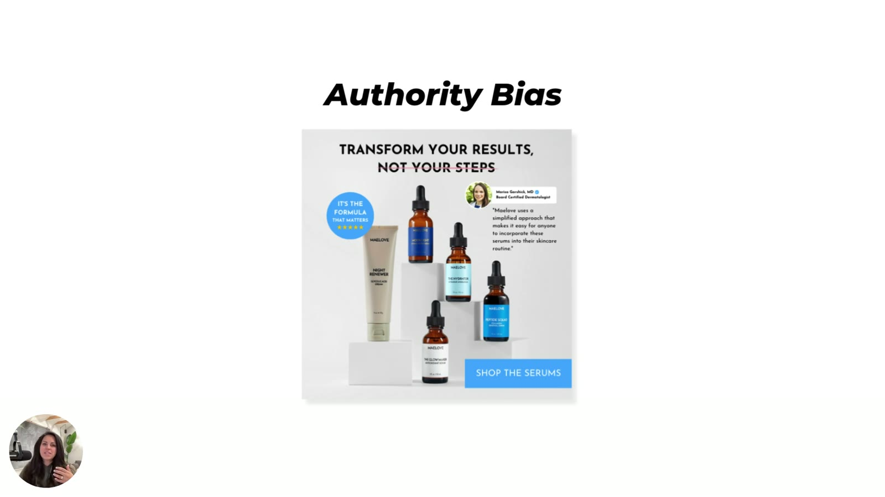
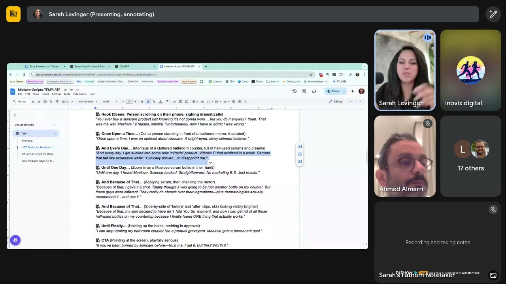
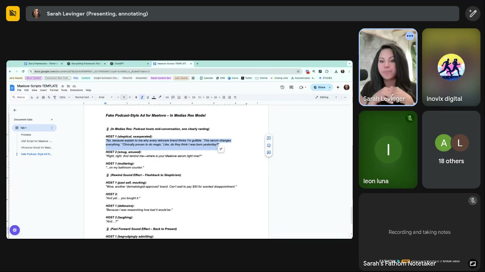
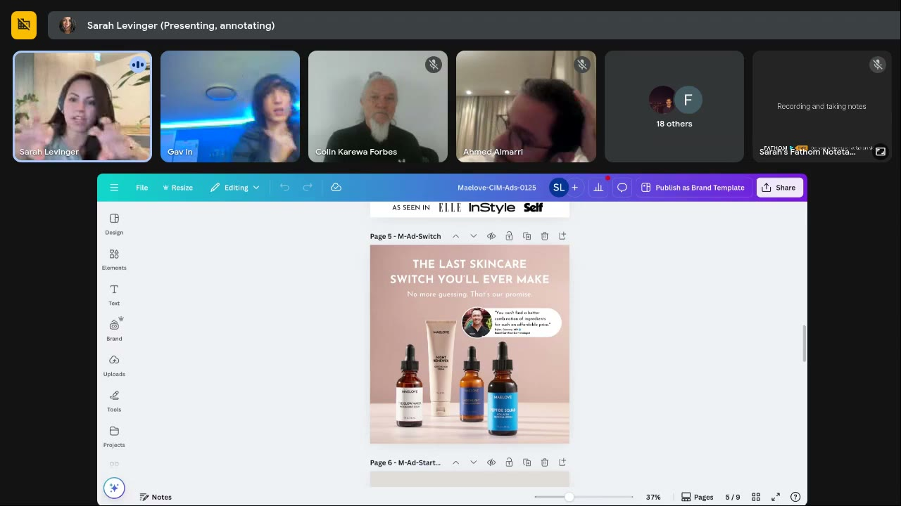

# Maelove
> DTC skincare serums positioned as science-backed, affordable, "no marketing B.S."; a **Tether client**, so these are ads and scripts Sarah's team designed and uses as teaching models (not member submissions).

## 🤖 Agent use
- **Use when:** writing skincare / beauty UGC scripts, building switching-behavior angles ("last product you'll need"), using a dermatologist as authority, or blending two emotions that each won alone.
- **Inputs → outputs:** a skincare competitor's ads or our serum → identity + behavior angle (the countertop of half-used bottles), three script structures (Pixar UGC, Hero's Journey influencer, In Medias Res podcast), a blended-emotion static.
- **Rules:**
  - DO target identity and a real behavior, not use cases. "Do you have wrinkles? Sunspots?" fatigued fast because "I identify as the opposite" ([May 7, 0:17:51–0:20:05](../courses/tether-lab/05-live-recordings/2025-05-07-live-with-sarah.md)).
  - DO mine behavior research for the outlier insight (40 bottles on the counter kept because of sunk cost) and build the message on it ([0:17:51](../courses/tether-lab/05-live-recordings/2025-05-07-live-with-sarah.md)).
  - DO write scripts from a named story framework, not "write me a UGC script"; spend ~two-thirds of the script on setup ([May 14, 0:16:17–0:20:41](../courses/tether-lab/05-live-recordings/2025-05-14-live-with-sarah.md)).
  - DO blend emotions only after each wins separately; squish the two winners' headline + subhead into one ad ([June 4, 0:47:21–0:49:22](../courses/tether-lab/05-live-recordings/2025-06-04-live-with-sarah.md)).
  - IF you use a doctor as authority THEN check the audience trusts doctors (boomers and people with bad medical experiences may not) ([L2 05:20–05:52](../courses/tether-lab/02-heuristics-101/02-using-biases-that-sell.md)).
  - DON'T copy the "guarantee/promise" line unless the guarantee is real; Sarah reads "promise" as a guarantee (security).
- **See also:** [Authority bias](../concepts/heuristics/authority-bias.md) · [Actual self](../concepts/actual-self.md) · [Blended emotions](../concepts/blended-emotions.md) · [Story frameworks](../frameworks/story-frameworks-for-ads.md) · [ChatGPT](../tools/chatgpt.md)

## At a glance
| Field | Value |
|---|---|
| Niche | Skincare / beauty: serums |
| Relationship | Sarah's (Tether's) client; ads "we designed" |
| Ads / pages discussed | 6 (2 statics, 1 spoken case, 3 scripts) |
| Heuristics seen | [authority bias](../concepts/heuristics/authority-bias.md) (dermatologist), [social proof](../concepts/heuristics/social-proof.md) (reviews in scripts), [open loop](../concepts/heuristics/open-loop.md) (podcast), [contrast](../concepts/heuristics/contrast.md), guarantee = security |
| Zones | Zone 3 → Zone 1 arcs in scripts; Zone 1 relief over a Zone 3 pain in the blended static (wiki tags) |
| Selves | [Actual](../concepts/actual-self.md) (burned skincare veteran, tired switcher) + [Ideal](../concepts/ideal-self.md) (holistic girl) (wiki tags) |
| Sessions | [Heuristics 101 L2](../courses/tether-lab/02-heuristics-101/02-using-biases-that-sell.md) · [May 7](../courses/tether-lab/05-live-recordings/2025-05-07-live-with-sarah.md) · [May 14](../courses/tether-lab/05-live-recordings/2025-05-14-live-with-sarah.md) · [June 4](../courses/tether-lab/05-live-recordings/2025-06-04-live-with-sarah.md) |

## Ads and pages discussed

### 1. "Transform your results, not your steps" (static, Heuristics 101 L2)

*Dermatologist quote card (Marisa Garshick, MD, Board Certified Dermatologist), "It's the formula that matters ★★★★★" badge, "Shop the serums" CTA. Sarah's authority-bias example. [04:00]*

| Brand / product (niche) | Format | Hook / opening | What works | What fails | Fix suggested | Principle | Source |
|---|---|---|---|---|---|---|---|
| Maelove (skincare serums) | Static | "Transform your results, not your steps" | Quote card from a board-certified dermatologist borrows niche credibility ("borrowing authority from her") | — | Check the audience trusts doctor-level authority | Authority via a perceived expert | [04:00–05:15](../courses/tether-lab/02-heuristics-101/02-using-biases-that-sell.md) |

- Authority is "used sparingly in the industry, but I wish we would use it more", especially for "medicalized" products [04:05].

### 2. Use-case ads → "the last time you're ever going to switch" (spoken case, May 7)
*(Described, not shown. The brand is not named; it is very likely Maelove because the May 14 scripts and the June 4 static use the same countertop / switching insight. Wiki inference, as the session page marks it.)*

| Brand / product (niche) | Format | Hook / opening | What works | What fails | Fix suggested | Principle | Source |
|---|---|---|---|---|---|---|---|
| Skincare client, probably Maelove | Ads (format not specified) | Before: "Do you have wrinkles? Sunspots? Dry skin? Oily skin?" | Got customers in | Fatigued fast; CPA stuck high; use case ≠ identity | Identity (holistic / natural) + behavior insight: "You can throw away those 40 bottles… this is the last time you're ever going to switch." It "crushed" with longevity | Identity first, then behavior | [0:17:51–0:20:05](../courses/tether-lab/05-live-recordings/2025-05-07-live-with-sarah.md) |

- The insight came from a pictorial survey: "I have 40 bottles… 30 bottles on my counter… 50… 15", kept because they already paid (sunk cost) [0:17:51].

### 3. UGC script, Pixar model (script, May 14)

*"UGC Script for Maelove – Pixar Model" from Sarah's "Maelove-Scripts-TEMPLATE" doc. [0:17:40]*

Beats (verbatim, compressed): Hook "You ever buy a skincare product just knowing it's not gonna work… but you do it anyway? Yeah. That was me with Maelove… now I have to admit I was wrong." → Once upon a time "an optimist about skincare" → Every day "sucked into some new 'miracle' product… Serums that felt like expensive water" → Until one day "Science-backed. Straightforward. No marketing B.S." → Because of that (dermatologists recommend it) → Because of that "get rid of all those half-used bottles on my countertop" → Until finally "stop treating my bathroom counter like a product graveyard" → CTA "If you've been burned by skincare before… this? Worth it."

| Brand / product (niche) | Format | Hook / opening | What works | What fails | Fix suggested | Principle | Source |
|---|---|---|---|---|---|---|---|
| Maelove (skincare serum) | UGC script, Pixar Story Framework | "You ever buy a skincare product just knowing it's not gonna work…" | Confession hook; "product graveyard" counter; humour; clean beats; light dermatologist authority. "A whole lot more emotion" than a generic UGC prompt | Not stated | — | Story framework > generic UGC prompt | [0:16:17–0:18:29](../courses/tether-lab/05-live-recordings/2025-05-14-live-with-sarah.md) |

- Prompt (paraphrased): "Here's my concept: people have too many bottles on their countertop. Here's my avatar: she's a female, she loves skincare, she's having a hard time figuring out which one's for her. Use the Pixar story model, write me a script." [0:17:42]

### 4. Influencer script, Hero's Journey (script, May 14)

*Skepticism → trial → weekly check-ins → replacing old products. [0:18:45]*

Beats (compressed): "I'm gonna be honest… I did not want to like this. And now I have to make a public apology to my skin." → tried everything → "Science-backed, dermatologist-approved… But I've heard that before" → reads reviews → "First week?… Second week?… Third week?" → "did it replace my old go-to products? …yeah, it did" → clears the counter.

| Brand / product (niche) | Format | Hook / opening | What works | What fails | Fix suggested | Principle | Source |
|---|---|---|---|---|---|---|---|
| Maelove (skincare serum) | Influencer script, Hero's Journey | "I did not want to like this… public apology to my skin." | Reluctant-convert arc; proof woven into the story instead of a proof dump after the solution; week-by-week realism | Not stated | — | Let the framework decide when the solution enters | [0:18:29–0:19:45](../courses/tether-lab/05-live-recordings/2025-05-14-live-with-sarah.md) |

### 5. Fake podcast ad, In Medias Res (script, May 14)

*Two hosts mid-conversation, one ranting; rewind / fast-forward SFX carry the flashback. [0:21:30]*

Beats (compressed): HOST 1 "explain to me why every skincare brand thinks I'm gullible… do they think I was born yesterday?" → HOST 2 "where is your Maelove serum right now?" → "…on my bathroom counter." → (rewind) "Can't wait to pay $50 for scented disappointment" → (fast-forward) "now my skin looks better than it has in years, and I'm annoyed about it" → "Maelove actually works."

| Brand / product (niche) | Format | Hook / opening | What works | What fails | Fix suggested | Principle | Source |
|---|---|---|---|---|---|---|---|
| Maelove (skincare serum) | Fake podcast, two hosts, In Medias Res | "No, because explain to me why every skincare brand thinks I'm gullible…" | Starts mid-rant (open loop); validates skepticism of skincare marketing; second host validates; "annoyed" convert = realism | "Super subtle… a little bit more difficult to notice" | — | Drop viewers mid-story, then rewind | [0:20:41–0:22:22](../courses/tether-lab/05-live-recordings/2025-05-14-live-with-sarah.md) |

### 6. "The last skincare switch you'll ever make" (blended-emotion static, June 4)

*Built from two separate winners (achievement via switching + security via the promise); it "ran for eight months straight". Canva file "Maelove-CIM-Ads-0125". [0:48:56]*

| Brand / product (niche) | Format | Hook / opening | What works | What fails | Fix suggested | Principle | Source |
|---|---|---|---|---|---|---|---|
| Maelove (skincare serums) | Static (Meta) | "The last skincare switch you'll ever make." / "No more guessing. That's our promise." | Blends **achievement** (stop switching; ~40 bottles, ~$150 spent) and **security** ("anytime you put guarantees anywhere in your ad, that speaks to security"); dermatologist quote = authority; 8-month run | None stated. "This ad took me forever to create… how do you put switching behavior in an ad?" | — (template for blending) | Blend emotions only after each wins separately | [0:47:21–0:49:22](../courses/tether-lab/05-live-recordings/2025-06-04-live-with-sarah.md) |

## Transferable lessons (remix for our product)
- Find the **physical behavior** around the category (where the product sits, how many half-used ones exist) and write the ad to end that behavior ("last switch", "throw away the 40 bottles").
- Use one angle across three script structures (Pixar → UGC, Hero's Journey → influencer, In Medias Res → two-host podcast) to get format diversity without a new concept.
- Let the skeptic voice carry proof: "I didn't want to like this" converts skepticism into social proof.
- Run each emotion as its own ad first; merge only the winning headline + subhead.
- Brief creators to say the script "the way they would say it", not verbatim ([May 14, 0:22:33](../courses/tether-lab/05-live-recordings/2025-05-14-live-with-sarah.md)).

## Backlinks
| Where | Timestamp(s) | What |
|---|---|---|
| [Heuristics 101 L2](../courses/tether-lab/02-heuristics-101/02-using-biases-that-sell.md) | 04:00–05:52 | Dermatologist authority static |
| [Heuristics 101 L5](../courses/tether-lab/02-heuristics-101/05-stacking-psychology-for-growth.md) | 07:00 | In the nine-example-ads recap slide |
| [Live May 7](../courses/tether-lab/05-live-recordings/2025-05-07-live-with-sarah.md) | 0:17:51–0:20:05 | Skincare client case (probably Maelove) |
| [Live May 14](../courses/tether-lab/05-live-recordings/2025-05-14-live-with-sarah.md) | 0:16:17–0:22:22 | Three scripts, one angle |
| [Live June 4](../courses/tether-lab/05-live-recordings/2025-06-04-live-with-sarah.md) | 0:47:21–0:49:22 | Blended-emotion static |

## Related
[Prose](prose.md) · [Nutrafol](nutrafol.md) · [Authority bias](../concepts/heuristics/authority-bias.md) · [Three selves](../concepts/three-selves.md) · [Sarah Levinger](../people/sarah-levinger.md)
