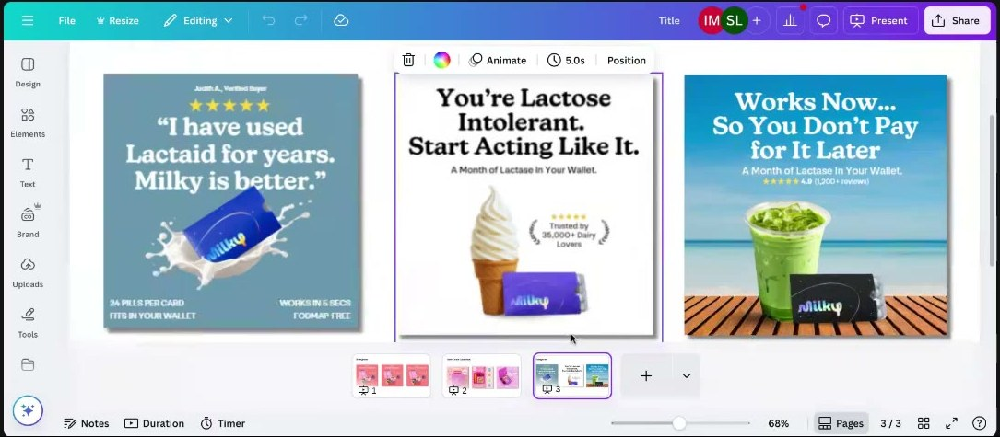

# Milky
> Wallet-sized card of lactase pills ("A Month of Lactase In Your Wallet", "24 pills per card") for lactose-intolerant dairy lovers, positioned against Lactaid; **member's client**, statics submitted by [Bren Harper](../people/community-members.md#bren-harper) to [Roast My Ads #3](../courses/tether-lab/05-live-recordings/2025-07-23-roast-my-ads-3.md).

## 🤖 Agent use
- **Use when:** a winning static format is "tired" and you need variations; writing tough-love / guilt-nudge hooks for a health condition; planning visual variations of a product-centre static.
- **Inputs → outputs:** an evergreen product-centre static → a ladder of one-variable product treatments (close-up, side, pair, tiny, in hand, crop, personified) + next copy lines in the same zone.
- **Rules:**
  - DON'T call it fatigue at frequency ≈2: "I've seen it twice now in my whole life… that's no time"; often it's the creator who's bored ([0:51:41–0:54:47](../courses/tether-lab/05-live-recordings/2025-07-23-roast-my-ads-3.md)).
  - DO keep the format, zone and intensity that work; vary **one** product treatment at a time ([0:52:41–0:55:52](../courses/tether-lab/05-live-recordings/2025-07-23-roast-my-ads-3.md)).
  - DON'T stack many trigger foods in one shot ("matcha, ice cream and candy… in one shot") ([0:52:41](../courses/tether-lab/05-live-recordings/2025-07-23-roast-my-ads-3.md)).
  - DO try personification: "weird works… because it jumps out at you" ([0:56:53–0:58:59](../courses/tether-lab/05-live-recordings/2025-07-23-roast-my-ads-3.md)).
  - DO use moderate-intensity Zone 3/4 tough love for long-time sufferers: "You're Lactose Intolerant. Start Acting Like It." ([0:50:35](../courses/tether-lab/05-live-recordings/2025-07-23-roast-my-ads-3.md)).
- **See also:** [Ought self](../concepts/ought-self.md) · [Emotional zones](../concepts/emotional-zones.md) · [Social proof](../concepts/heuristics/social-proof.md) · [Anthropomorphism](../concepts/heuristics/anthropomorphism.md)

## At a glance
| Field | Value |
|---|---|
| Niche | Supplements: digestive health / lactase |
| Relationship | Member's client (Bren Harper), Roast My Ads #3 |
| Ads / pages discussed | 3 evergreen statics (one board) |
| Heuristics seen | [social proof](../concepts/heuristics/social-proof.md) ("Trusted by 35,000+ Dairy Lovers", 4.9 / 1,200+ reviews, verified-buyer quote), competitor comparison (Lactaid), [loss aversion](../concepts/heuristics/loss-aversion.md) ("So You Don't Pay for It Later") |
| Zones | Zone 3, "a bit of Zone 4", moderate intensity (Sarah) |
| Selves | [Ought](../concepts/ought-self.md) ("start acting like it") (wiki tag) |
| Sessions | [Roast My Ads #3](../courses/tether-lab/05-live-recordings/2025-07-23-roast-my-ads-3.md) |

## Ads and pages discussed

### 1. Evergreen product-centre statics (three headlines)

*Product-centre statics beside a trigger food (ice cream, iced matcha, milk splash) on clean backgrounds; they hold most of the account's spend. [0:51:00]*

| Brand / product (niche) | Format | Hook / opening | What works | What fails | Fix suggested | Principle | Source |
|---|---|---|---|---|---|---|---|
| Milky, wallet-sized lactase card (supplements) | Static, single product beside a trigger food, clean background | "You're Lactose Intolerant. Start Acting Like It." / "Works Now… So You Don't Pay for It Later" / "I have used Lactaid for years. Milky is better." | Proven format for the account; Zone 3–4 copy, "guilt-tripping them into changing behaviour"; speaks to long-time sufferers (older audience); competitor comparison + social proof | Creator fatigue more than audience fatigue (frequency ≈2); product never shown close up, in hand or in pairs | Keep format/zone/intensity; vary the product: close-up crop, one side, two products ("one for you, one for another"), shrink to ~80%, in hand (size), top-of-cup crop, cherry on top; personify (evil-eyed ice cream, Darian's AI cow) | A frequency of 2 isn't fatigue; vary one visual variable at a time; weird stops the scroll | [0:50:35–1:00:02](../courses/tether-lab/05-live-recordings/2025-07-23-roast-my-ads-3.md) |

- Next copy line Sarah suggested: "I know you don't want to be lactose intolerant, but you are, honey." [0:50:35–1:00:02]
- Personification idea (Darian): an AI cow "punching someone in the stomach", like the Chick-fil-A cows. Sarah: "That would crush this… I would click." [0:56:53–0:57:59]
- **Transfer:** Darian (chat) will test "You're on a diet, start acting like it" on his low-carb pasta brand. Sarah: "Oh Darian, that's so good." [1:00:00]

## Transferable lessons (remix for our product)
- "You're [condition]. Start acting like it." is a portable tough-love hook for any product that fixes a known, accepted problem (moderate intensity, Ought self).
- "Works now… so you don't pay for it later" pairs immediate benefit with avoided pain.
- When a static format wins, build a variation ladder on the **product** (position, scale, count, crop, character) before inventing new concepts.
- A real "I used [market leader] for years. [Brand] is better." review is a ready-made comparison hook; use only verified quotes.

## Backlinks
| Where | Timestamp(s) | What |
|---|---|---|
| [Roast My Ads #3](../courses/tether-lab/05-live-recordings/2025-07-23-roast-my-ads-3.md) | 0:50:35–1:00:02 | Evergreen statics, format-fatigue ladder, personification |

## Related
[OmieBox](omiebox.md) (same member) · [AG1](ag1.md) · [VITUS](vitus.md) · [Community members](../people/community-members.md#bren-harper)
