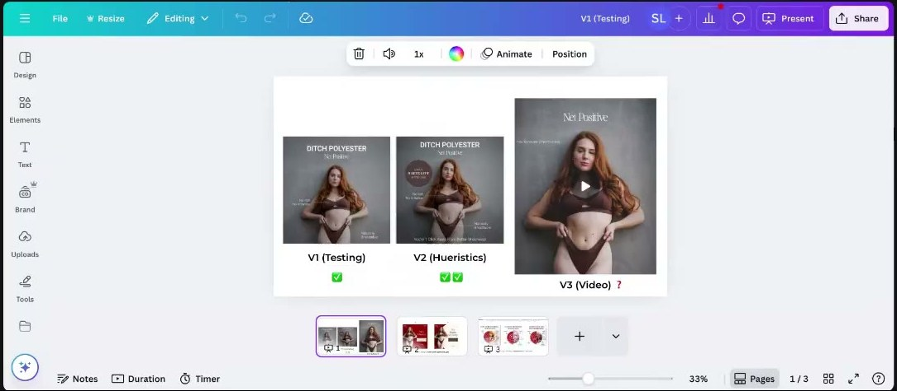
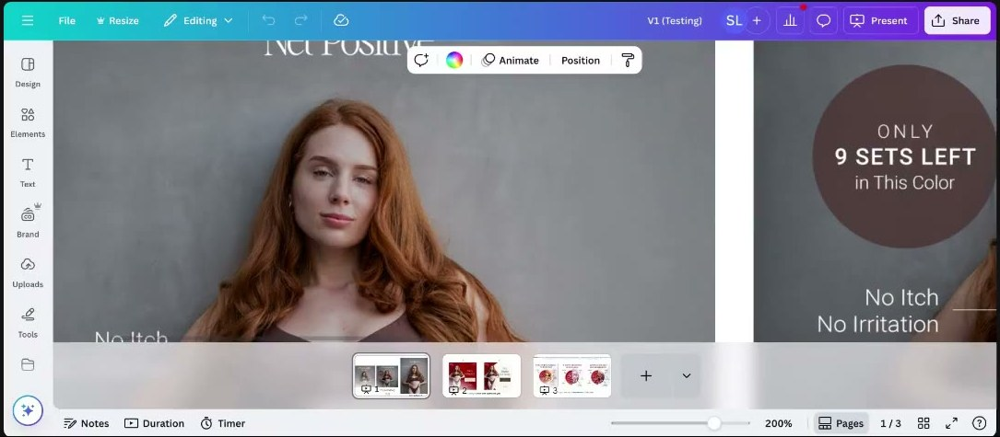
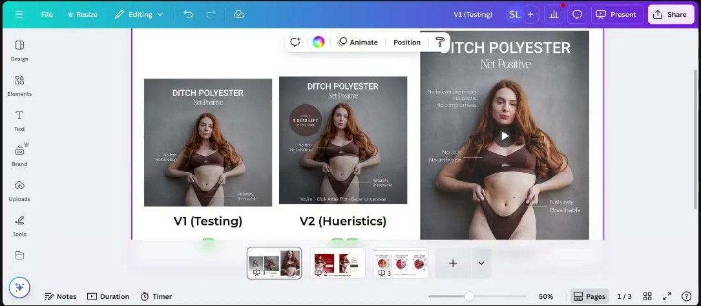
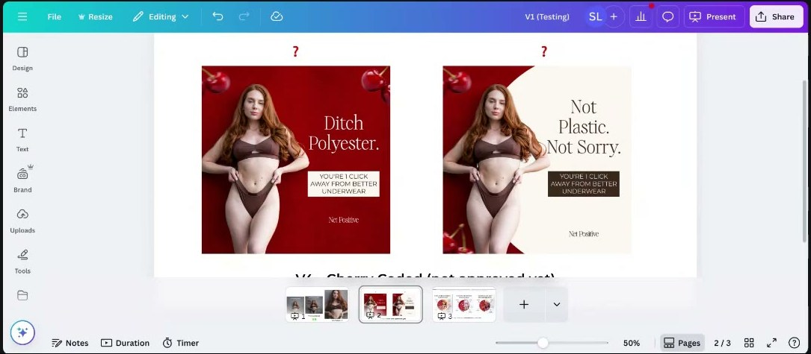

# Net Positive
> Natural-fibre women's underwear ("Ditch Polyester"). A **member's client brand: Darian James**, roasted in [Roast My Ads #3](../courses/tether-lab/05-live-recordings/2025-07-23-roast-my-ads-3.md). The course's best case on model-image psychology, moving purchase-stage copy up-funnel, and why a static winner died as a video.

## 🤖 Agent use
- **Use when:** tearing down apparel / intimates / body-positive statics; choosing or briefing a model; turning a winning static into a video; adding heuristic badges to a winner; trend-skin tests.
- **Inputs → outputs:** a winning static → model brief (face, hair, posture), a V2 with one supporting heuristic, a video storyboard that opens on the winning message, a trend-colour variant.
- **Rules:**
  - DO make face, hair, body language and text say one thing; "the image gets processed before everything else" ([0:32:37–0:33:42](../courses/tether-lab/05-live-recordings/2025-07-23-roast-my-ads-3.md)).
  - DO brief "confident" precisely: both brows centred and pulled in, lowered lids, smirk not smile, chest out; normal un-airbrushed body ([0:06:55–0:12:36](../courses/tether-lab/05-live-recordings/2025-07-23-roast-my-ads-3.md)).
  - DO copy purchase-stage winners ("You're 1 Click Away From Better Underwear") onto net-new tests ([0:12:36–0:14:42](../courses/tether-lab/05-live-recordings/2025-07-23-roast-my-ads-3.md)).
  - DON'T invent scarcity. Darian admitted "Only 9 sets left in this color" was made up ([0:15:00](../courses/tether-lab/05-live-recordings/2025-07-23-roast-my-ads-3.md)); Sarah elsewhere says fake scarcity backfires ([July 9](../courses/tether-lab/05-live-recordings/2025-07-09-live-with-sarah.md)). Use only true stock counts, and echo them on the landing page.
  - IF a static wins THEN its video must open on the winning message (frame 1), not the model ([0:18:56–0:21:32](../courses/tether-lab/05-live-recordings/2025-07-23-roast-my-ads-3.md)).
  - DON'T change several variables in one trend test; "not plastic" next to a full body can be misread ([0:28:25–0:30:30](../courses/tether-lab/05-live-recordings/2025-07-23-roast-my-ads-3.md)).
- **See also:** expected [Model image psychology](../concepts/model-image-psychology.md) · [TEEP journey](../frameworks/teep-journey.md) · [Format variation ladder](../frameworks/format-variation-ladder.md) · [Pinterest Predicts](../tools/pinterest-predicts.md) · [Darian James](../people/community-members.md#darian-james)

## At a glance
| Field | Value |
|---|---|
| Niche | Apparel: natural-fibre women's underwear |
| Relationship | Member's client (Darian James), roasted live |
| Ads / pages discussed | 4 (2 statics V1/V2, 1 motion video V3, 2-layout trend static) |
| Heuristics seen | [Scarcity](../concepts/heuristics/scarcity-heuristic.md) + implied [social proof](../concepts/heuristics/social-proof.md), [framing](../concepts/heuristics/framing-effect.md), [salience](../concepts/heuristics/salience-bias.md) (red) |
| Zones | Zone 2-ish confidence/pride (wiki tag) |
| Selves | Ideal/Actual: a confident woman leaving behind what doesn't serve her (wiki tag) |
| Sessions | [Roast My Ads #3](../courses/tether-lab/05-live-recordings/2025-07-23-roast-my-ads-3.md) |

## Ads and pages discussed

*Darian's test history: V1 static (won), V2 static with heuristics (won bigger), V3 video (unclear). Same redhead model, grey wall, brown set. [0:04:30]*

### 1. V1 "DITCH POLYESTER" (static, traffic campaign)
| Brand / product (niche) | Format | Hook / opening | What works | What fails | Fix suggested | Principle | Source |
|---|---|---|---|---|---|---|---|
| Net Positive (natural-fibre women's underwear) | Static, V1 headline test run as a traffic campaign | "DITCH POLYESTER" + "No Itch / No Irritation", "Naturally Breathable" | **6.5–7% CTR.** Redhead with a confident face, normal un-airbrushed body, chest-out posture; every element says "confident; leave behind what doesn't serve you", a millennial-women trend | Same message on other "same vibe" models underperformed | Find or AI-generate more redhead models; keep the "ditch" message | The image is processed first; one message across all signals | [0:04:08–0:12:36](../courses/tether-lab/05-live-recordings/2025-07-23-roast-my-ads-3.md) |

- Sarah: "One woman's confident face will just crush and another woman's confident face will be like nobody paid attention at all." Blondes, in her experience, work with a *seductive* face, not a confident one (her observation, not a cited study) ([0:06:17–0:06:55](../courses/tether-lab/05-live-recordings/2025-07-23-roast-my-ads-3.md)).
- Faraz (chat): redheads and bright blondes "always performed super well" in his hair-care video ads ([0:09:29](../courses/tether-lab/05-live-recordings/2025-07-23-roast-my-ads-3.md)).

### 2. V2 "heuristics" static

*Badge "ONLY 9 SETS LEFT in This Color" + purchase-ad footer "You're 1 Click Away From Better Underwear". Beat V1. The count was invented. [0:07:30]*

| Brand / product (niche) | Format | Hook / opening | What works | What fails | Fix suggested | Principle | Source |
|---|---|---|---|---|---|---|---|
| Net Positive | Static, V1 + badge + footer | "DITCH POLYESTER" + "Only 9 sets left in this color" + "You're 1 Click Away From Better Underwear" | Beat V1. Footer imported from purchase-phase ads. "**In this color**" crushes the brain's "reason not to buy" checklist; implied social proof without stars; diagnostic (brown is valued) | **Scarcity claim was invented.** Not echoed on the landing page. | Put the same message on the landing page. (Wiki: use only true stock counts.) | Heuristics are supporting characters; copy purchase-stage winners up-funnel | [0:12:36–0:18:56](../courses/tether-lab/05-live-recordings/2025-07-23-roast-my-ads-3.md) |

- Testing note (Q2): Darian puts heuristic variants as a batch in a **new ad set**; Khalid sets a $50/day ad-set minimum spend; Sarah: "pick a method and stick with it" ([0:21:32–0:24:54](../courses/tether-lab/05-live-recordings/2025-07-23-roast-my-ads-3.md)).

### 3. V3 motion video

*Opening: model first, headline not yet on screen. [0:02:15]*

*"DITCH POLYESTER / No forever chemicals. No plastic. No compromises." arrives about halfway. [0:19:30]*

| Brand / product (niche) | Format | Hook / opening | What works | What fails | Fix suggested | Principle | Source |
|---|---|---|---|---|---|---|---|
| Net Positive | Short motion video of the static, lo-fi music | Model in underwear, no headline; text later | Same strong image | Clicks, no early sales. Winning message arrives after the scroll decision; skin with no context reads "weird" (US, women's products); badge dropped | Open on "Ditch Polyester" over the grey background, then bring the model in; keep the badge | "Once we got to the video we actually ditched everything that was working" | [0:18:56–0:21:32](../courses/tether-lab/05-live-recordings/2025-07-23-roast-my-ads-3.md) |

### 4. "Cherry-coded" trend statics (not yet live)

*Left: full red "Ditch Polyester." Right: red circle on cream "Not Plastic. Not Sorry." Sarah bets on the right. [0:27:45]*

| Brand / product (niche) | Format | Hook / opening | What works | What fails | Fix suggested | Principle | Source |
|---|---|---|---|---|---|---|---|
| Net Positive | Static, trend skin (cherries), 2 layouts | "Ditch Polyester." / "Not Plastic. Not Sorry." + "You're 1 click away from better underwear" | Cheap trend test (cherries = [Pinterest Predicts](../tools/pinterest-predicts.md) 2025 trend); red is [salient](../concepts/heuristics/salience-bias.md); circle keeps focus on the model; high "hit score" (easy to make) | Several variables at once; "Not plastic" next to a full body may read as "she's had no surgery" | Run both, compare, test incrementally | Trend colour as a cheap test; layout directs the eye | [0:26:19–0:30:30](../courses/tether-lab/05-live-recordings/2025-07-23-roast-my-ads-3.md) |

## Transferable lessons (remix for our product)
1. **Brief the face**: specify brows, lids, smirk, posture and body realism to match the headline's emotion.
2. **When one model wins, clone the attributes** (hair colour, expression), not the "vibe".
3. **Up-funnel your purchase lines**: footer CTAs that convert at purchase stage can lift exploration ads.
4. **"In this colour" qualifiers** answer objections and double as a colour-demand test, but only with real stock.
5. **Static → video**: frame 1 = the winning headline on the winning background; add the model second; keep the badge.
6. **Trend skins** (Pinterest Predicts colours/motifs) are cheap variants; change one variable at a time.

## Backlinks
| Where | Timestamp(s) | What |
|---|---|---|
| [Roast My Ads #3](../courses/tether-lab/05-live-recordings/2025-07-23-roast-my-ads-3.md) | 0:02:05–0:30:30 | V1, V2, V3, cherry statics; model-image psychology; ad-set structure Q |

## Related
[Darian James](../people/community-members.md#darian-james) · [Barks & Brownies (slow-feeder bowls)](barks-and-brownies.md) · [LEGENDS](legends.md) · [Scarcity](../concepts/heuristics/scarcity-heuristic.md) · [Brands index](README.md)
