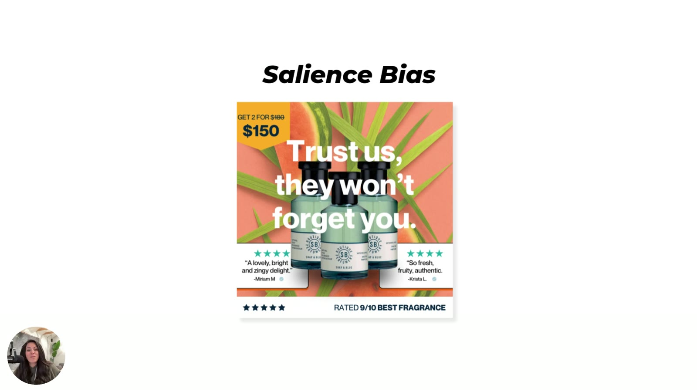

# Shay & Blue (fragrance)
> Fragrance ad used as Sarah's **salience-bias example** in Heuristics 101. The brand name is read off the bottle labels on the slide ("Shay & Blue"); Sarah does not name the brand aloud (wiki identification).

## 🤖 Agent use
- **Use when:** designing a static that must pull the eye to the product; choosing background vs product colours.
- **Inputs → outputs:** product shot + palette → one-colour field with a drastic contrasting product in the centre.
- **Rules:**
  - DO surround the product with one colour (or white space) and put "something dead in the center, another color that's pretty drastic. So red, orange, black" ([01:22–01:34](../courses/tether-lab/02-heuristics-101/04-hook-attention-guide-behavior.md)).
  - DON'T rely on muted palettes; "muted colors in particular tend to kind of wash together" ([01:38](../courses/tether-lab/02-heuristics-101/04-hook-attention-guide-behavior.md)).
  - DO use odd formats, odd objects or bold colour contrast to trigger novelty ([01:47–02:07](../courses/tether-lab/02-heuristics-101/04-hook-attention-guide-behavior.md)).
- **See also:** [Salience bias](../concepts/heuristics/salience-bias.md)

## At a glance
| Field | Value |
|---|---|
| Niche | Beauty: fragrance |
| Relationship | Heuristics 101 example ad (brand ID from bottle label) |
| Ads / pages discussed | 1 static |
| Heuristics seen | [salience bias](../concepts/heuristics/salience-bias.md); also a price tag ("Get 2 for ~~$180~~ $150") and review cards on the ad (not discussed) |
| Zones / Selves | Not classified |
| Sessions | [Heuristics 101 L4](../courses/tether-lab/02-heuristics-101/04-hook-attention-guide-behavior.md) |

## Ads and pages discussed

### 1. "Trust us, they won't forget you." (static, Heuristics 101 L4)

*Bright coral/watermelon field with darker bottles in the centre; "Get 2 for $150" tag, review cards, "Rated 9/10 best fragrance". [00:16]*

| Brand / product (niche) | Format | Hook / opening | What works | What fails | Fix suggested | Principle | Source |
|---|---|---|---|---|---|---|---|
| Fragrance, bottles labelled Shay & Blue (perfume) | Static | "Trust us, they won't forget you." | A bright peachy field with darker centre bottles: the brain "is going to kind of get sucked into the middle where this kind of black color is" | — | Best practice: a single-colour / white field + one drastic centre colour | Contrast captures attention ("shiny quarter syndrome") | [00:16–01:34](../courses/tether-lab/02-heuristics-101/04-hook-attention-guide-behavior.md) |

**Related, different ad (not Shay & Blue):** the same lesson's framing-effect example is an unnamed fragrance ad Tether designed with a bottle labelled "149", headline "Premium fragrance, properly priced.", and spray-duration boxes (3 sprays/day = 1 year…) plus "Now 60% off" ([04:59–06:15](../courses/tether-lab/02-heuristics-101/04-hook-attention-guide-behavior.md); image `../assets/tether-lab/02-heuristics-101/04-framing-sprays-0400.jpg`).

## Transferable lessons (remix for our product)
- For a product-hero static, pick the background first: saturated single field, darker product, nothing else competing.
- In UGC, the same rule applies to the set: plain wall, product in a contrasting colour at frame centre.

## Backlinks
| Where | Timestamp(s) | What |
|---|---|---|
| [Heuristics 101 L4](../courses/tether-lab/02-heuristics-101/04-hook-attention-guide-behavior.md) | 00:16–02:07 | Salience example |
| [Heuristics 101 L5](../courses/tether-lab/02-heuristics-101/05-stacking-psychology-for-growth.md) | 07:00 | Nine-example recap slide |

## Related
[Salience bias](../concepts/heuristics/salience-bias.md) · [Framing effect](../concepts/heuristics/framing-effect.md) · [Maelove](maelove.md)
