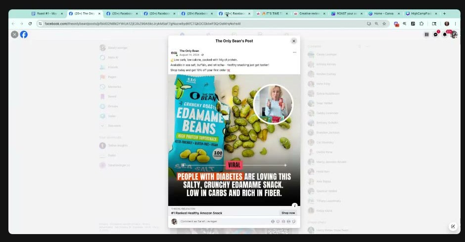

# The Only Bean
> Crunchy dry-roasted edamame snacks (high protein, low carb, "#1 Ranked Healthy Snack on Amazon"). **Community member [Sofia Tataurova](../people/community-members.md#sofia-tataurova)'s brand**, roasted in Roast My Ads #1. Its year-long winning video is the only hook in the account framed as a **gain** ("feed your cravings") rather than a loss.

## 🤖 Agent use
- **Use when:** writing hooks for snacks, diet, weight-loss or any niche where every competitor sells "lose / quit / kick" something; comparing a winner against losers to find the driving word.
- **Inputs → outputs:** the account's winning hook + losing hooks → the word-level difference → a batch of new hooks using the winning frame.
- **Rules:**
  - DO compare the winner with the losers **word by word**; here one word ("feed") carried "a huge chunk of the performance" [0:56:40](../courses/tether-lab/05-live-recordings/2025-05-28-roast-my-ads-1.md).
  - DO flip loss frames into gain frames for craving-driven buyers: "Keep your potato chip craving, just switch out the chip" [0:58:42](../courses/tether-lab/05-live-recordings/2025-05-28-roast-my-ads-1.md).
  - IF you test video hooks THEN vary them deliberately; otherwise "the reason something is winning will be elusive" [0:54:32](../courses/tether-lab/05-live-recordings/2025-05-28-roast-my-ads-1.md).
  - DON'T assume [loss aversion](../concepts/heuristics/loss-aversion.md) always wins: "no human on the planet wants to stop eating potato chips" [0:56:53–0:58:42](../courses/tether-lab/05-live-recordings/2025-05-28-roast-my-ads-1.md).
- **See also:** [Framing effect](../concepts/heuristics/framing-effect.md) · [Reframing](../concepts/heuristics/reframing.md) · [Curiosity gap](../concepts/heuristics/curiosity-gap.md) · [Creative testing system](../frameworks/creative-testing-system.md)

## At a glance
| Field | Value |
|---|---|
| Niche | Food & beverage: healthy snacks |
| Relationship | Member's brand (Sofia Tataurova), Roast My Ads #1 |
| Ads / pages discussed | 5 (3 videos, 1 UGC creator video, 1 static post) |
| Heuristics seen | [Framing](../concepts/heuristics/framing-effect.md) (gain vs loss), [curiosity](../concepts/heuristics/curiosity-gap.md) ("secret", "should be illegal"), [social proof](../concepts/heuristics/social-proof.md) (viral badge, "people with diabetes are loving") |
| Zones | Winner: Zone 2, indulgence without guilt (wiki tag) |
| Selves | Winner: [Actual](../concepts/actual-self.md) (keeps the craving) (wiki tag) |
| Sessions | [Roast My Ads #1](../courses/tether-lab/05-live-recordings/2025-05-28-roast-my-ads-1.md) |

## Ads and pages discussed

### 1. "My secret to feed junk food cravings 🤫" (video, winner)

*Edamame in a bowl, text-overlay hook; post copy "#1 Ranked Healthy Snack On Amazon / Crush your chip cravings…". Top spender for almost a year. [0:55:40]*

| Brand / product (niche) | Format | Hook / opening | What works | What fails | Fix suggested | Principle | Source |
|---|---|---|---|---|---|---|---|
| The Only Bean (dry-roasted edamame snack) | Short video, product close-up in a bowl, text-overlay hook | "My secret to feed junk food cravings 🤫" | **Gain framing**: you keep the craving and swap the chip. "Feed" is the one different word. "Secret" adds curiosity | Why it won was "elusive" because hooks weren't varied carefully | Test more "feed your craving with something healthy" hooks instead of "kick the craving" | [Framing](../concepts/heuristics/framing-effect.md): gain over loss for craving-driven buyers | [0:54:32–0:58:42](../courses/tether-lab/05-live-recordings/2025-05-28-roast-my-ads-1.md) |

### 2. Loss-framed comparisons (videos + static)

*"This protein hack should be illegal 🤫". [0:56:00]*

*UGC creator POV video. [0:56:15]*

*"They're loving this salty crunchy snack… but we're still talking about losing something." [0:57:00]*

| Brand / product (niche) | Format | Hook / opening | What works | What fails | Fix suggested | Principle | Source |
|---|---|---|---|---|---|---|---|
| The Only Bean | Video, product close-up | "The crunchy way to lose weight" | Clear benefit | Loss frame like everyone in the niche | Reframe as gain/keep | Loss frames are the category default | [0:55:37–0:56:40](../courses/tether-lab/05-live-recordings/2025-05-28-roast-my-ads-1.md) |
| The Only Bean | Video, product in bowl | "This protein hack should be illegal 🤫" | Curiosity / "forbidden" hook | Still "a secret to losing" frame | Gain frame | same | [0:55:37–0:56:40](../courses/tether-lab/05-live-recordings/2025-05-28-roast-my-ads-1.md) |
| The Only Bean | UGC creator video | "POV: you never have to think about protein again 😮" | Creator + POV, effort removal | Not the winner; removes a problem | Gain frame | same | [0:55:37–0:56:40](../courses/tether-lab/05-live-recordings/2025-05-28-roast-my-ads-1.md) |
| The Only Bean | Static post, viral badge + creator inset | "People with diabetes are loving this salty, crunchy edamame snack. Low in carbs and rich in fiber." | [Social proof](../concepts/heuristics/social-proof.md) + audience call-out | "Still talking about losing something" | Gain frame | same | [0:56:40](../courses/tether-lab/05-live-recordings/2025-05-28-roast-my-ads-1.md) |

## Transferable lessons (remix for our product)
- In "lose/quit" niches, write the hook as **keep the desire, swap the product**: "My secret to feed [craving]", "Keep your [habit], just switch out the [thing]".
- Pull the account's top spender and its losers into one table; find the single word that differs; brief the next batch around it.
- Pair the gain frame with a curiosity cue ("my secret") and a close-up of the product.

## Backlinks
| Where | Timestamp(s) | What |
|---|---|---|
| [Roast My Ads #1](../courses/tether-lab/05-live-recordings/2025-05-28-roast-my-ads-1.md) | 0:11:31; 0:54:32–0:59:45 | Winner vs losers, gain vs loss flip |

## Related
[Canvas Gelato](canvas-gelato.md) · [Milky](milky.md) · [Loss aversion](../concepts/heuristics/loss-aversion.md) · [Sofia Tataurova](../people/community-members.md#sofia-tataurova) · [Brands index](README.md)
