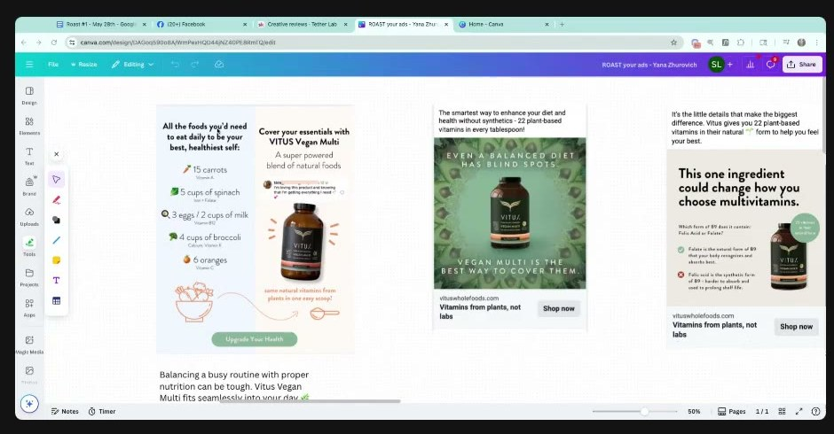
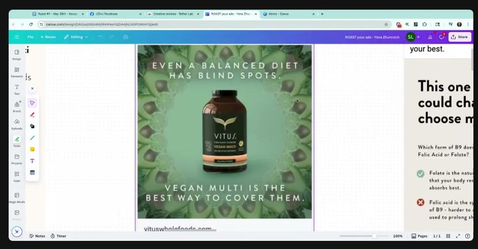

# VITUS Vegan Multi
> Whole-food, plant-based multivitamin powder ("22 vitamins in their natural form", "Vitamins from plants, not labs"; vituswholefoods.com); **member's brand**: statics submitted by [Yana Zhurovich](../people/community-members.md#yana-zhurovich) to [Roast My Ads #1](../courses/tether-lab/05-live-recordings/2025-05-28-roast-my-ads-1.md).

## 🤖 Agent use
- **Use when:** designing supplement statics (testimonial, comment-screenshot, comparison, pattern-background); visualizing a metaphor; checking visual weight and CTA wording.
- **Inputs → outputs:** a supplement static → shorter headline (4–7 words), a literal visual for any metaphor, a loss line, a definitive CTA.
- **Rules:**
  - DO give every metaphor a literal visual: OFF→ON needs a **light switch** on the bottle in the ON position ([0:12:35–0:14:42](../courses/tether-lab/05-live-recordings/2025-05-28-roast-my-ads-1.md)).
  - DO keep headlines to 4–7 words and snip long quotes to the emotional core ("Gets me through rough PMS") ([0:14:42–0:16:53](../courses/tether-lab/05-live-recordings/2025-05-28-roast-my-ads-1.md)).
  - DO name what they'll miss: "You notice the difference when you don't have it" ([0:16:53](../courses/tether-lab/05-live-recordings/2025-05-28-roast-my-ads-1.md)).
  - DO design by visual weight (heaviest → next heaviest), not the Z-pattern; test by removing elements one at a time ([0:18:54–0:23:01](../courses/tether-lab/05-live-recordings/2025-05-28-roast-my-ads-1.md)).
  - DON'T break your own metaphor in the second line ("blind spots… cover them" → "uncover them") ([0:23:01–0:26:52](../courses/tether-lab/05-live-recordings/2025-05-28-roast-my-ads-1.md)).
  - DON'T use "Shop now"; write a definitive CTA in the copy ("See how it works") ([0:26:52–0:29:09](../courses/tether-lab/05-live-recordings/2025-05-28-roast-my-ads-1.md)).
- **See also:** [Loss aversion](../concepts/heuristics/loss-aversion.md) · [Cognitive load](../concepts/heuristics/cognitive-load.md) · [Processing fluency](../concepts/heuristics/processing-fluency.md) · [Social proof](../concepts/heuristics/social-proof.md)

## At a glance
| Field | Value |
|---|---|
| Niche | Supplements: vegan whole-food multivitamin |
| Relationship | Member's brand (Yana Zhurovich), Roast My Ads #1 |
| Ads / pages discussed | 5 statics shown (4 critiqued, 1 shown but not discussed) |
| Heuristics seen | [social proof](../concepts/heuristics/social-proof.md), [loss aversion](../concepts/heuristics/loss-aversion.md), [contrast](../concepts/heuristics/contrast.md) ("plants, not labs"), [processing fluency](../concepts/heuristics/processing-fluency.md), [cognitive load](../concepts/heuristics/cognitive-load.md), [curiosity gap](../concepts/heuristics/curiosity-gap.md) |
| Zones | Zone 3 on the loss line (wiki tag) |
| Selves | [Actual](../concepts/actual-self.md) (wiki tag) |
| Sessions | [Roast My Ads #1](../courses/tether-lab/05-live-recordings/2025-05-28-roast-my-ads-1.md) |

## Ads and pages discussed

### 1–2. "One scoop a day…" testimonial and "You notice the difference…" comments (statics)

*Yana's Canva board "ROAST your ads – Yana Zhurovich". Meta headline "Health support you can count on 💪". [0:18:00]*

| Brand / product (niche) | Format | Hook / opening | What works | What fails | Fix suggested | Principle | Source |
|---|---|---|---|---|---|---|---|
| VITUS Vegan Multi (supplements) | Static, headline + 5 stars + long testimonial + bottle + "22 vitamins in their natural form" seal | "One scoop a day is all it takes to go from feeling OFF to feeling ON" | OFF→ON metaphor; use case (morning smoothie); natural-form badge; social proof | Headline too long; metaphor not visualised; long quote; five stars losing power | Light switch on the bottle in the ON position; cut headline to 4–7 words; snip quote to "Gets me through rough PMS" | Metaphors need a literal visual; weird = attention; short = fluent | [0:12:35–0:16:53](../courses/tether-lab/05-live-recordings/2025-05-28-roast-my-ads-1.md) |
| VITUS (supplements) | Static, comment screenshots around bottle | "YOU NOTICE THE DIFFERENCE WHEN YOU DON'T HAVE IT" | "Freaking love this emotional copy": loss if you stop; comments = social proof | Not stated | Optional: blur the reviews + "Click to see what people are saying" linking to the PDP | Name what they'll miss; blur creates curiosity | [0:16:53–0:18:54](../courses/tether-lab/05-live-recordings/2025-05-28-roast-my-ads-1.md) |

- Sarah referenced her own past **Alpha Lion** light-switch ad as the model for visualizing on/off [0:13:39].
- Transfer to another member: "You'll notice the disconnection when you don't come to these style of parties anymore" [0:16:53].

### 3. "All the foods you'd need to eat daily…" (us-vs-them comparison static)

*Left: the visual-weight example. Middle: mandala ad. Right: shown but not discussed. [0:22:30]*

| Brand / product (niche) | Format | Hook / opening | What works | What fails | Fix suggested | Principle | Source |
|---|---|---|---|---|---|---|---|
| VITUS (supplements) | Static, split: food list (15 carrots, 5 cups of spinach…) vs one scoop, arrow, "Upgrade Your Health" pill button | "All the foods you'd need to eat daily to be your best, healthiest self:" | Busy but a natural eye path heaviest → heaviest down the arrow; concrete quantified comparison; "Keep it and test it" | High cognitive load; small lines get skipped; unclear if the top-right headline is read | Keep it, test it; A/B remove elements one at a time | Design by visual weight, not the Z-pattern | [0:18:54–0:23:01](../courses/tether-lab/05-live-recordings/2025-05-28-roast-my-ads-1.md) |

### 4. "Even a balanced diet has blind spots" (pattern-background static)

*The subconscious reads "mandala / yoga / balance". Meta headline "Vitamins from plants, not labs". [0:23:32]*

| Brand / product (niche) | Format | Hook / opening | What works | What fails | Fix suggested | Principle | Source |
|---|---|---|---|---|---|---|---|
| VITUS (supplements) | Static, product on repeating food mandala; CTA Shop now | "Even a balanced diet has blind spots." / "Vegan Multi is the best way to cover them." | "Freaking amazing" pattern that visualises **balance**; background supports the text; contrast "plants, not labs" | "Cover them" breaks the blind-spot metaphor; "Shop now" invites browsing | "…the best way to **uncover** them"; definitive CTA in copy ("See how it works") | Patterns of known objects; metaphor consistency | [0:23:01–0:29:09](../courses/tether-lab/05-live-recordings/2025-05-28-roast-my-ads-1.md) |

### 5. "This one ingredient could change how you choose multivitamins." (static, shown, not discussed)
| Brand / product (niche) | Format | Hook / opening | What works | What fails | Fix suggested | Principle | Source |
|---|---|---|---|---|---|---|---|
| VITUS (supplements) | Static, folate vs folic acid ✓/✗ comparison | "This one ingredient could change how you choose multivitamins." | Not discussed. Wiki read: curiosity hook + education comparison | — | — | — | [0:22:30](../courses/tether-lab/05-live-recordings/2025-05-28-roast-my-ads-1.md) |

## Transferable lessons (remix for our product)
- Comment-screenshot statics + a loss headline is a cheap, strong supplement format; keep the comments real.
- Quantified "you'd have to eat all this" comparisons work if the eye path is weighted; strip anything small.
- Pick backgrounds made of objects that **mean** the promise (food mandala = balance).
- Read every second line against the first for metaphor breaks.

## Backlinks
| Where | Timestamp(s) | What |
|---|---|---|
| [Roast My Ads #1](../courses/tether-lab/05-live-recordings/2025-05-28-roast-my-ads-1.md) | 0:12:35–0:29:09 | All VITUS teardowns |
| [Live June 11](../courses/tether-lab/05-live-recordings/2025-06-11-live-with-sarah.md) | 0:22:19, 0:54:59 | Yana runs ads in the AG1 space; Sarah: Yana is "amazing" at patterns |

## Related
[AG1](ag1.md) · [Milky](milky.md) · [Ankhway](ankhway.md) · [Community members](../people/community-members.md#yana-zhurovich)
