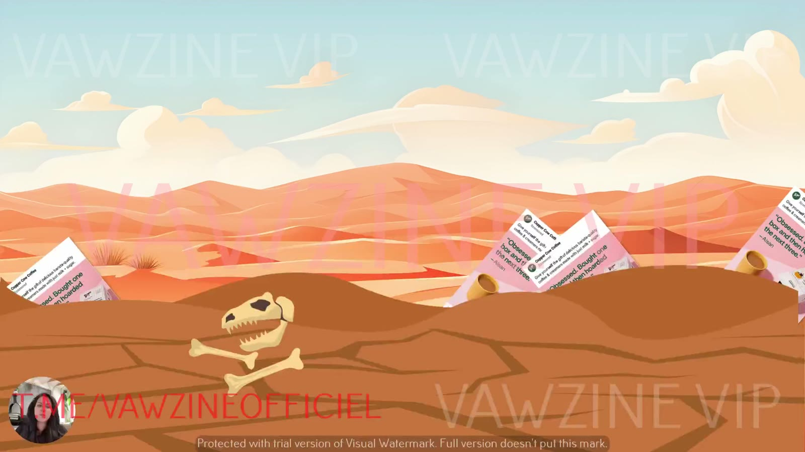

# Angle Rut
> **Angle rut** is Sarah Levinger's name for ad fatigue caused by repeating the same few angles (usually Ideal-Self aspiration) until the segment dries up and the brain learns to ignore you. The cure is to rotate *which self* you target **before** fatigue hits.

## 🤖 Agent use
- **Use when:** auditing a competitor's or our ad library for staleness, or explaining why a winner is fading and what variant to make next.
- **Inputs → outputs:** an ad set with dates, spend and self scores → a rut diagnosis (dominant self %, spend concentration, repetition) and a prescription (which selves to add, from which winners).
- **Rules:**
  - IF 2–3 ads carry most of the spend **THEN** flag angle-rut risk and start self variants now [L1 00:50].
  - IF ≥ ~70% of ads score highest on the same self **THEN** call it a rut and brief the other two selves. *(The threshold is an agent heuristic, not from the course.)*
  - DO rotate before performance drops: "if you wait until performance drops, you've already lost" [L1 02:29].
  - DON'T fix a rut by iterating format only. Iterate core messaging by self [L6 01:45].
  - DON'T change offer or funnel to escape it. Change the self [L1 03:33].
- **See also:** [Self-targeting](self-targeting.md) · [Three selves diagnostic](../frameworks/three-selves-diagnostic.md) · [Rewriting ads for new selves](../frameworks/rewriting-ads-for-new-selves.md)

## Definition
- "We call this kind of like rinse and repeat style of strategy, **angle rut**… you get stuck in a rut with your angles and you can't seem to get out of it. We're just constantly using the same angles over and over again." [L1 01:41]
- It's universal: "one of the only media buying and… creative strategy issues I see across the board, all the way from startups up to the nine figure guys." [L1 01:46]
- Sarah also calls it "angle fatigue" [L8 05:30].

*Lesson 3's metaphor: the same ad, aimed at the same segment, eventually dries up.*

## Why it happens (causes)
1. **Winner-chasing.** "We are constantly in kind of this mode of we just need to find winners, find winners, find winners." [L1 02:04]
2. **One-self messaging.** Most ads target one self, "almost always the ideal self", and "at some point that segment is going to get tapped. It's going to dry up." [L3 00:40–00:58]
3. **The brain learns to ignore you.** If creative repeats, "the brain, especially if it's ignored your ads in the past, it's going to keep ignoring them because you're teaching it to ignore you." The brain uses ~20% of daily energy and filters ruthlessly [L3 04:14–04:48]. See [subconscious vs conscious mind](subconscious-vs-conscious-mind.md).
4. **Marketer bias.** "We're targeting the same version of the same customer over and over and over. And the worst part is we don't even realize we're doing it… Marketers are human too." [L8 04:21]
5. **Format-only iteration.** Teams "try and iterate format, but they don't know how to iterate core messaging." [L6 01:45]

## Symptoms
- The account "kind of feels like you guys are chunking out the same exact thing"; ads "look, feel… drive the same results every time" [L1 00:21].
- Rising ad costs. Anxiety that "those three ads that are propping up the entire ad account" will stop [L1 00:50].
- Angles start to "blend or… beige out" and "look the same over time" [L1 02:19], [L3 01:33].
- "Your ads may be working, but maybe they're not scaling… your angles might be converting, but then they tend to fatigue." [L8 04:40]

## Why waiting is fatal
"Trying to recover an ad account after it starts losing its winners is really just like **slamming on the brakes after you've already hit the ice**… Once the winners start to fatigue, it's going to be way too late to put any fail stops in place." [L1 01:26]

## How to get out (the fix)
1. Rotate creative **before** fatigue: "great marketers… rotate creative before the fatigue sets in." [L1 02:24]
2. Run the [three selves diagnostic](../frameworks/three-selves-diagnostic.md) to find your default self.
3. [Rewrite winners](../frameworks/rewriting-ads-for-new-selves.md) for the missing selves with the offer unchanged.
4. [Test](../frameworks/testing-ads-by-self-type.md) all three in one ad set and keep rotating.

## Where it's taught
- [L1 Why Your Ads Stop Working Over Time](../courses/tether-lab/04-self-targeting-system/01-why-your-ads-stop-working-over-time.md) [00:21–03:45]
- [L2](../courses/tether-lab/04-self-targeting-system/02-diagnose-which-self-your-ads-target.md) [02:40] · [L3](../courses/tether-lab/04-self-targeting-system/03-why-one-self-isnt-enough-to-scale.md) [00:00–01:40], [04:09], [07:50] · [L6](../courses/tether-lab/04-self-targeting-system/06-how-to-use-the-prompts-for-instant-insights.md) [01:45] · [L7](../courses/tether-lab/04-self-targeting-system/07-how-to-rewrite-winning-ads-for-new-selves.md) [00:25] · [L8](../courses/tether-lab/04-self-targeting-system/08-how-to-test-your-ads-by-self-type.md) [04:16–05:36]

## Related concepts
[Self-targeting](self-targeting.md) · [3 selves](three-selves.md) · [Ideal Self](ideal-self.md) · [Subconscious vs conscious mind](subconscious-vs-conscious-mind.md) · [Heuristics](heuristics.md)
