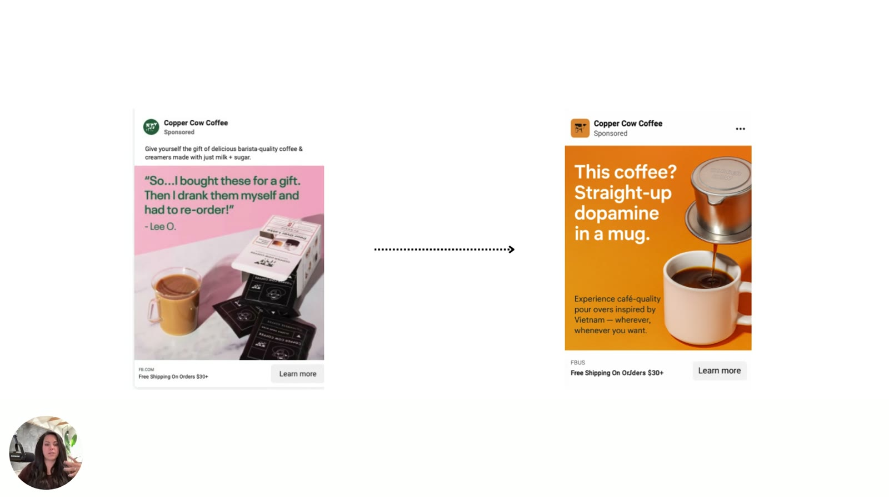

# Emotional Promise (the emotion you're selling)
> **The emotional promise is the emotional payoff an ad sells, such as indulgence, safety, control, stimulation, instant reward or empowerment.** It's separate from the product and the words. Sarah Levinger calls changing it the most important of the three tone-shifting levers: "Change that, and the whole ad pivots."

## 🤖 Agent use
- **Use when:** extracting the emotional payoff a competitor ad sells (teardown), or choosing the payoff our UGC creator should testify to.
- **Inputs → outputs:** ad/script → one-phrase promise (e.g., "indulgence, surprise & delight") + zone; target zone → new promise + headline set.
- **Rules:**
  - DO name the promise currently sold and the one that *should* be sold before rewriting.
  - DO align the promise with the purchase motive (coffee = boost → stimulation, not indulgence).
  - IF the message isn't landing at all THEN change the promise. Verbs and visuals won't fix it.
  - DON'T pick fear/loss promises that aren't grounded in the buyer's real experience.
- **See also:** [Tone-shifting](../frameworks/tone-shifting.md) · [Prompts](../resources/valence-intensity-prompts.md)

## Definition
- "We need to focus on **which emotion we're currently selling and which one we should be selling**. This is kind of what it comes down to." ([L5](../courses/tether-lab/03-valence-intensity-model/05-fixing-the-tone-without-rebuilding-the-ad.md) [03:51–04:03])
- E-book, Step 3 "Shift the Emotional Promise": "Ask: **What emotional payoff are we selling? Indulgence? Safety? Control?** Change that, and the whole ad pivots."
- Verbs and visuals mainly change *how strongly* you say something ([intensity](intensity.md)). The emotional promise changes *what* you're promising emotionally, so it can move both [valence](valence.md) and intensity.

## Why it matters
- Levers 1 and 2 (verbs, visuals) "help a ton if you're trying to make these quick switches… but **this is the one I wanna focus on most**." (L5 [03:42–03:51])
- Choosing the emotion and intensity deliberately "gives us much more control over how we're activating the brain itself, and it kind of drives the message further into the **subconscious**." (L5 [04:40–04:53])

## How to use it
1. **Read the current promise** off the ad's headline and image. Copper Cow's testimonial ("bought these for a gift… drank them myself… had to reorder") sells **indulgence, surprise and delight**: "super calm, super nice." (L5 [04:04–04:30])
2. **Ask what the customer actually buys the product for.** Coffee = "a boost". ([L4](../courses/tether-lab/03-valence-intensity-model/04-diagnosing-emotional-misfires.md) [05:04])
3. **Pick the promise for the target zone.** E.g., from indulgence to "**stimulation, instant rewards**, something that will drive them a little bit farther" (Zone 2), or to "panic, sadness, or loss or anxiety" (Zone 4, carefully). (L5 [04:53–05:57])
4. **Generate new headlines for that quadrant** with the [zone prompts](../resources/valence-intensity-prompts.md). (L5 [05:57])
5. Use this lever when the problem is bigger than tone: "If you're just at the point where you're like, oh my gosh, **we weren't even communicating that message at all**. Shift the emotional promise." ([L6](../courses/tether-lab/03-valence-intensity-model/06-map-and-move-your-messaging.md) [02:10–02:19])

## Examples

| Ad | Emotional promise | Zone |
|---|---|---|
| "So…I bought these for a gift. Then I drank them myself and had to re-order!" | Indulgence, surprise & delight | 1 |
| "This coffee? Straight-up dopamine in a mug." | Stimulation / instant reward | 2 |
| "Finally, a coffee that slows you down—in the best way." | Relief, calm | 1 |
| "It's 2025. Why are we still drinking stale beans?" | Quiet dissatisfaction, a truth avoided | 3 |
| "The coffee you should have gifted—before it sold out." | Regret / scarcity (loss) | 4 |
| Lesson 6 example target | Empowerment (fixed via verbs if the emotion is just weakly expressed) | — |

*Swapping the promise from indulgence to stimulation (L5 [05:30]).*

## Common mistakes
- Polishing words and visuals when the underlying promise is wrong for the customer's motive.
- Choosing fear or loss promises that manipulate rather than reflect the customer's real experience. "We're not trying to trigger people's traumas." (L5 [05:03])

## Where it's taught
- [L5 Fixing the Tone Without Rebuilding the Ad](../courses/tether-lab/03-valence-intensity-model/05-fixing-the-tone-without-rebuilding-the-ad.md) [03:42–06:03]
- [L6 Map + Move Your Messaging](../courses/tether-lab/03-valence-intensity-model/06-map-and-move-your-messaging.md) [00:43–00:48, 02:10–02:19]
- [E-book Chapter 5](../resources/diagnose-why-your-ads-arent-working-ebook.md#chapter-5-fixing-the-tone-without-rebuilding-the-ad)

## Related
[Tone-shifting](../frameworks/tone-shifting.md) · [Valence](valence.md) · [Intensity](intensity.md) · [Emotional zones](emotional-zones.md) · [Emotional misfire](emotional-misfire.md)
