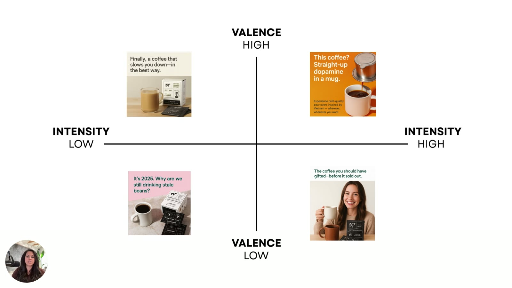

# The 4 Emotional Zones (Valence × Intensity Target Map)
> Cross [valence](valence.md) (positive ↔ negative) with [intensity](intensity.md) (low ↔ high) and you get four emotional zones. Every feeling an ad creates lives in one of them, and **each zone leads to different buyer behavior**. Sarah Levinger calls it "your target map": pick the zone that matches the emotional context your customer is in.

## 🤖 Agent use
- **Use when:** tagging any ad by zone in a teardown; choosing the zone for a new script/brief; picking which zone prompt to run.
- **Inputs → outputs:** valence + intensity labels (or product/buyer context) → zone (Z1–Z4) + emotion vocabulary + visual cues + prompt opener + warnings.
- **Rules:**
  - DO tag every teardown with a zone and a one-line *why it fits this buyer*.
  - DO pick the zone from the buyer's state at exposure, purchase motive and category saturation.
  - DON'T default to Zone 3 in saturated categories. DON'T use Zone 4 manipulatively.
  - DO match visuals to the zone (see table), not just copy.
  - DON'T let a whole account (ours or a competitor's) sit in one zone. That's [emotional stagnation](emotional-stagnation.md), "what will tank the account". Test all four zones at once ([Live, June 11](../courses/tether-lab/05-live-recordings/2025-06-11-live-with-sarah.md) [0:07:22–0:09:27; 0:18:05–0:19:08]).
  - IF two emotions each win on their own THEN merge them into one headline + subhead ([blended emotions](blended-emotions.md)). Otherwise keep [one core emotion per ad](one-core-emotion-per-ad.md).
- **See also:** [Valence-Intensity diagnostic](../frameworks/valence-intensity-diagnostic.md) · [Tone-shifting](../frameworks/tone-shifting.md) · [Prompts](../resources/valence-intensity-prompts.md)

## The map


*Sarah's target map ([lesson 3](../courses/tether-lab/03-valence-intensity-model/03-the-4-emotional-zones.md) [04:00]). Valence: HIGH at the top, LOW at the bottom. Intensity: LOW on the left, HIGH on the right.*

```
                     VALENCE HIGH (positive)
                ┌──────────────────┬──────────────────┐
                │ ZONE 1           │ ZONE 2           │
                │ Feel-good        │ Hype/anticipation│
 INTENSITY LOW  │ Cozy · Calm ·    │ Joy · Thrill ·   │  INTENSITY HIGH
   (whisper)    │ Supportive ·     │ Excitement ·     │    (scream)
                │ Reassuring       │ Pride            │
                ├──────────────────┼──────────────────┤
                │ ZONE 3           │ ZONE 4           │
                │ Pain-point       │ Danger zone      │
                │ whisper          │ (fear & urgency) │
                │ Annoyance ·      │ Panic · Sadness ·│
                │ Disappointment · │ Loss · Anxiety   │
                │ Fatigue ·        │                  │
                │ Irritation       │                  │
                └──────────────────┴──────────────────┘
                     VALENCE LOW (negative)
```

## Summary table

| | Zone 1 | Zone 2 | Zone 3 | Zone 4 |
|---|---|---|---|---|
| **Valence / intensity** | High / Low | High / High | Low / Low | Low / High |
| **Nickname** | Feel-good zone | Hype & anticipation ("hype zone") | Subtle frustration ("pain-point whisper") | Fear & urgency ("danger zone") |
| **Emotions (video slide)** | Cozy, calm, supportive, reassuring | Joy, thrill, excitement, pride | Annoyance, disappointment, fatigue, irritation | Panic, sadness, loss, anxiety |
| **Emotions (e-book)** | Calm, cozy, supportive | Pride, thrill, anticipation | Frustration, fatigue, unmet expectations | Fear, scarcity, urgency |
| **Best for (video)** | Wellness, luxury, intimacy, safety, belonging. "Feel okay inside." | Launches, performance products/industries, achievement, momentum. Getting people to *move* / "do something physical". | Pain-point building, before/after contrast, setting up relief | Limited-time offers, health/safety-focused industries |
| **Best for (e-book)** | Wellness, belonging, safety | Product launches, performance gear, celebratory moments | Soft problem awareness. Industries with thoughtful buyers. | High-stakes industries (safety, financial risk) |
| **Visual / copy cues (e-book "Think:")** | Morning light, soft pastels, gentle copy | Bold type, energy visuals, verbs that punch | Sighs, subtle sarcasm, the tension before the solution | Harsh lighting, high contrast, jarring visuals |
| **Warnings** | Can land in "save for later / ignore" if customer wants energy | none | Avoid in **saturated industries** ("a lot of marketers live" here) | **Use with care, can backfire.** Don't trigger trauma. |
| **Rewrite prompt opener** | "…as if your product is a sigh of relief they didn't know they needed." | "…as if the reader is about to have their breakthrough moment — and your product is the catalyst." | "…as if your product is quietly calling out a truth they've been avoiding." | "…as if the reader is about to make a big mistake — and your product is the only thing that stops it." |
| **Course example (Copper Cow)** | "Finally, a coffee that slows you down—in the best way." | "This coffee? Straight-up dopamine in a mug." | "It's 2025. Why are we still drinking stale beans?" | "The coffee you should have gifted—before it sold out." |

Sources: L3 [01:23–04:13]; L5 [06:03–08:31]; e-book pp6–7, 10; prompts PDF.

## Zone details

### Zone 1: High valence + low intensity (feel-good)
- "These are like really high emotions, but the intensity on them is really low… **feel-good energy**." "All about like reassuring, calm, supportive messaging." (L3 [01:33–01:45])
- "Anytime you're selling a product where you want someone to **feel okay inside**, you want to be in zone one." (L3 [01:54])
- Caveat from the Copper Cow diagnosis: Zone 1 can put you in the "save for later" or "ignore" category if your customer wants something else (coffee = a boost). But "if you have a customer who wants to feel cozy, this might work incredibly well." ([L4](../courses/tether-lab/03-valence-intensity-model/04-diagnosing-emotional-misfires.md) [03:24–03:58])

### Zone 2: High valence + high intensity (hype & anticipation)
- "All about like joy, thrill, excitement, pride." For launching, performance, achievement, momentum. "If you're trying to **push them to move**… do something physical in their world." (L3 [02:04–02:29])
- Moving Z1 → Z2 keeps valence high and adds intensity: "good vibes, but… more intensity with the good vibes." ([L5](../courses/tether-lab/03-valence-intensity-model/05-fixing-the-tone-without-rebuilding-the-ad.md) [01:43–01:57])

### Zone 3: Low valence + low intensity (pain-point whisper)
- "That kind of subtle frustration." Annoyance, unmet expectations, fatigue, irritation, disappointment. Good for pain-point building, before/after contrast, "setting up for a relief". (L3 [02:31–03:10])
- "A lot of marketers live in low intensity, low valence. So I **don't suggest you use this one if you're in a saturated industry**." (L3 [03:10])
- Rewrite intent: "We're not trying to make people feel bad. We just want to **increase longing**." (L5 [07:59–08:07])

### Zone 4: Low valence + high intensity (danger zone)
- "Where your fear and urgency lives… panic, scarcity… threats or loss." For limited-time offers, health/safety industries. (L3 [03:27–03:45]) Related heuristics: [loss aversion](heuristics/loss-aversion.md) and scarcity ([heuristics hub](heuristics.md)).
- "You have to be very careful… it is not our job to make people feel bad… You don't want to try and like trigger traumas." (L3 [03:45–04:05])
- Image direction: "an interruption in their feed… something that feels **visually wrong**… that looks weird", to stop the scroll. (L5 [08:19–08:31])

## Why it matters
- "Each zone is going to work because it **matches the emotional context your audience is in** when they see your ad." (L3 [04:31])
- "You can write the smartest ad in the world. But if it's shouting the wrong emotional language, it's not going to land." (L3 [04:40])
- Small errors matter: an ad "might be about **10% off** on the valence intensity map, but that's really all it takes to feel completely wrong." (L5 [05:17])

## How to use it
1. **Map** the current ad: valence first, then intensity → zone. ([diagnostic](../frameworks/valence-intensity-diagnostic.md))
2. **Choose** the target zone from the customer's emotional state, product motive and industry (e.g., saturation).
3. **Move** the ad with verbs, visuals or the emotional promise. ([tone-shifting](../frameworks/tone-shifting.md))
4. **Rewrite** with the zone prompt. ([prompts](../resources/valence-intensity-prompts.md))


*The same Copper Cow Coffee product expressed in each zone (L5 [08:30]).*

## Common mistakes
- Thinking a zone is "bad". "None of these quadrants are wrong or right." (L5 [08:31]; L3 [04:13])
- Defaulting to Zone 3 in a crowded category.
- Using Zone 4 as manipulation. The e-book's closing line: "Not to manipulate—but to resonate."
- Using the e-book's Chapter 3 graphic, whose quadrant labels (Frustration/Inspiration/Indifference/Satisfaction) contradict the model. Use the video map. ([details](../resources/diagnose-why-your-ads-arent-working-ebook.md#chapter-3-the-4-emotional-zones-aka-your-target-map))

## Live-session additions
*From the May–July 2025 live calls.*
- **Zones belong to people, not brands.** "The zones aren't technically attributed to the brand, they're attributed to the person." AG1's 15–20 ads all sit in Zone 1, so it only recruits people "real happy but not very intense about their happiness". Run all zones at the same time and keep testing the losing ones, because zones stop working when seasons, life or the market change ([Live, June 11](../courses/tether-lab/05-live-recordings/2025-06-11-live-with-sarah.md) [0:17:00–0:19:08]). → [Emotional stagnation](emotional-stagnation.md)
- **Going negative without attacking the self.** Call out a true *industry* belief and praise the viewer for noticing ("you're smart for noticing"). "I don't want to trigger a negative sense of self." ([Live, June 11](../courses/tether-lab/05-live-recordings/2025-06-11-live-with-sarah.md) [0:19:08–0:21:13])
- **End negative zones with hope.** Women's hair loss: the industry is stuck in aspirational Zone 2 while Reddit shows Zone 3/4 feelings. Use Zones 3 and 4 carefully and "always, always, always end it with hope" ([Live, June 4](../courses/tether-lab/05-live-recordings/2025-06-04-live-with-sarah.md) [0:28:12–0:30:17]).
- **Most ads are too soft.** "We're either being too soft with our messages or we just have entirely the wrong message." Think personal trainer, not cheerleader ([Live, May 7](../courses/tether-lab/05-live-recordings/2025-05-07-live-with-sarah.md) [0:35:37–0:38:29]).
- **Intensity is word choice, not harshness:** happy → elated, sad → depressed ([Live, July 16](../courses/tether-lab/05-live-recordings/2025-07-16-live-with-sarah.md) [0:17:47–0:19:00]). Prose's PDP is "very neutral Zone 1… not very motivated" [0:11:28–0:17:47].
- **Blend after testing.** Test emotions in separate ad sets, then merge two winners into headline + subhead (Maelove's achievement + security static ran 8 months) ([Live, June 4](../courses/tether-lab/05-live-recordings/2025-06-04-live-with-sarah.md) [0:46:18–0:49:22]). → [Blended emotions](blended-emotions.md)
- **Name the precise emotion inside the zone.** "It's not fear that they're feeling, it's disappointment." Generic emotions make ads expensive ([Live, June 4](../courses/tether-lab/05-live-recordings/2025-06-04-live-with-sarah.md) [0:36:36–0:39:49]). → [Emotion specificity](emotion-specificity.md)
- **Zone tags from roasts:** OmieBox "The Coolest Lunch in the Room" = Zone 2 (pride, popularity); Milky "You're Lactose Intolerant. Start Acting Like It." = Zone 3, a bit of Zone 4 ([Roast My Ads #3](../courses/tether-lab/05-live-recordings/2025-07-23-roast-my-ads-3.md) [0:40:57; 0:55:52]). An info-product hook moved from Zone 2 to Zone 1 ("Turn your organization skills into the college fund") and "completely changed" results ([Live, May 7](../courses/tether-lab/05-live-recordings/2025-05-07-live-with-sarah.md) [0:24:05–0:25:43]).
- **Keep the zone when you vary visuals.** When a format wins, change the product treatment but keep the zone and intensity that work ([Roast My Ads #3](../courses/tether-lab/05-live-recordings/2025-07-23-roast-my-ads-3.md) [0:58:59–0:59:30]).

## Where it's taught
- [L2](../courses/tether-lab/03-valence-intensity-model/02-understanding-valence-and-intensity.md) [00:14–00:26]: every feeling lives in one of four zones
- [L3 The 4 Emotional Zones](../courses/tether-lab/03-valence-intensity-model/03-the-4-emotional-zones.md) [00:17–05:02]: the main lesson
- [L4](../courses/tether-lab/03-valence-intensity-model/04-diagnosing-emotional-misfires.md) [02:11–03:58]: Copper Cow mapped to Zone 1
- [L5](../courses/tether-lab/03-valence-intensity-model/05-fixing-the-tone-without-rebuilding-the-ad.md) [04:30–09:17]: moving between zones, four prompts, four rewrites
- [L6](../courses/tether-lab/03-valence-intensity-model/06-map-and-move-your-messaging.md) [01:06]: "identify the zone your ad lives in"
- [E-book Chapter 3](../resources/diagnose-why-your-ads-arent-working-ebook.md#chapter-3-the-4-emotional-zones-aka-your-target-map)
- [Live With Sarah, May 7, 2025](../courses/tether-lab/05-live-recordings/2025-05-07-live-with-sarah.md): Zone 2 → Zone 1 info-product rewrite [0:24:05–0:25:43]; "too soft" [0:35:37–0:38:29]
- [Live With Sarah, June 4, 2025](../courses/tether-lab/05-live-recordings/2025-06-04-live-with-sarah.md): hair loss, Zones 3/4 + hope [0:28:12–0:30:17]; mindstates mapped to zones, specificity [0:36:36–0:39:49]; blended emotions [0:46:18–0:51:32]
- [Live With Sarah, June 11, 2025](../courses/tether-lab/05-live-recordings/2025-06-11-live-with-sarah.md): AG1 zone audit, emotional stagnation, test all four zones [0:03:10–0:23:27]
- [Live With Sarah, July 16, 2025](../courses/tether-lab/05-live-recordings/2025-07-16-live-with-sarah.md): intensity via word choice; Prose Zone 1, Nutrafol Zone 2 [0:11:28–0:19:56; 0:29:19]
- [Roast My Ads #1, May 28, 2025](../courses/tether-lab/05-live-recordings/2025-05-28-roast-my-ads-1.md): FireClub low valence / low intensity concepts; one core emotion per ad [0:29:09–0:43:52]
- [Roast My Ads #3, July 23, 2025](../courses/tether-lab/05-live-recordings/2025-07-23-roast-my-ads-3.md): OmieBox Zone 2, Milky Zone 3/4, keep the zone when varying visuals [0:40:57; 0:55:52–0:59:30]

## Related
[Valence](valence.md) · [Intensity](intensity.md) · [Emotional misfire](emotional-misfire.md) · [Emotional promise](emotional-promise.md) · [Valence-Intensity diagnostic](../frameworks/valence-intensity-diagnostic.md) · [Tone-shifting](../frameworks/tone-shifting.md) · [Valence + Intensity prompts](../resources/valence-intensity-prompts.md)
- Live-session concepts: [Emotional stagnation](emotional-stagnation.md) · [Blended emotions](blended-emotions.md) · [Emotion specificity](emotion-specificity.md) · [One core emotion per ad](one-core-emotion-per-ad.md) · [Core brand emotion](core-brand-emotion.md) · [Mirror effect](mirror-effect.md)
