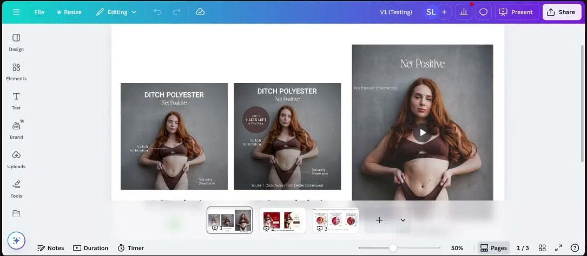

# Hero Image ↔ Copy Congruence (and Context Priming)

> **"Whenever you choose a piece of text to go over a hero image, make sure it matches whatever the facial expression and body language of your models is doing. The brain… will compare them: do these match? If yes, it will just keep scrolling."** ([Roast My Ads #2](../courses/tether-lab/05-live-recordings/2025-06-25-roast-my-ads-2.md) [0:06:23–0:06:50]). The image, its props and its background prime the meaning; the copy must say the same thing, the ad must match its landing page, and the winning message must survive every format change.

## 🤖 Agent use
- **Use when:** QA-ing any static, thumbnail, UGC opening frame or landing-page hero; briefing props and backgrounds for creators; converting a winning static into video; checking that a competitor's (or our) ad matches the page it sends traffic to.
- **Inputs → outputs:** the headline/core message + the image (or shot list) + the landing page → a congruence check (face ↔ text, props ↔ customer life stage, metaphor ↔ literal visual, background ↔ text, ad ↔ page vibe, message order) and a list of swaps.
- **Rules:**
  - DO make the image show what the headline promises: "POV: your friends are coming" needs friends in the frame, not three bowls. [Roast #1 0:04:13]
  - DO give every metaphor a **literal visual** (OFF→ON = a light switch on the bottle, set to ON); otherwise "they're reading the text but they can't see it in their mind." [Roast #1 0:13:39–0:15:00]
  - DO check metaphor logic ("blind spots" → "uncover", not "cover"). [Roast #1 0:25:34–0:26:52]
  - DO audit every **prop**: visitors read the scene "based upon their own experiences"; a basketball beside a nursing-dress model reads "boy mom". [Roast #2 0:25:31–0:27:32]
  - DO make the background support the text: "the images are going to get processed 60,000 times faster than the text" (popular stat, uncited). [Roast #1 0:25:02]
  - DO put the core message on the **first** hero/carousel slide; people see one or two. [Roast #2 0:16:49–0:17:58]
  - DO match the ad's **vibe** to the post-click page (Chase: a Dr. Squatch-style ad landing on Venus et Fleur → "I'm out"). [Chase 0:08:26–0:09:38]
  - DON'T drop the winning message when a static becomes a video. **Show the message in frame 1**, model/product second. [Roast #3 0:19:01–0:21:32]
  - DON'T stack claims that tell different stories ("6 Day Results" + "30 Doses") or reference an offer before it appears. "Order your messaging very, very carefully." [July 16 0:55:36–0:59:47]
  - DO weight the part of the sentence that *is* the message ("backwards weight": "He put up the tent, but **you brought the flask**"). [Roast #1 0:39:40]
- **See also:** [Model image psychology](model-image-psychology.md) · [Sight smell](sight-smell.md) · [One core emotion per ad](one-core-emotion-per-ad.md) · [Processing fluency](heuristics/processing-fluency.md) · [Cognitive load](heuristics/cognitive-load.md) · [Cognitive dissonance](heuristics/cognitive-dissonance.md) · [Visual weight hierarchy](../frameworks/visual-weight-hierarchy.md) · [3 Vs of Creative](../frameworks/three-vs-of-creative.md)

## Definition
**Congruence**: every element of an ad and its destination (face, body language, props, background, metaphor, headline, landing page) communicates the *same* message, so the brain's quick "do these match?" check passes. **Context priming**: the props and setting supply meaning the viewer applies to the product ("Be very careful about what's in the background, because that [gives] entirely all the context", [Roast #2](../courses/tether-lab/05-live-recordings/2025-06-25-roast-my-ads-2.md) [0:27:32]).

## Why it matters
- "Whatever you have in that hero section is what people are going to base the rest of their opinion on" ([Roast #2](../courses/tether-lab/05-live-recordings/2025-06-25-roast-my-ads-2.md) [0:17:30]). "Any image at the top has to tell people exactly what they should feel" [0:23:24–0:23:57].
- The image is processed first ([Roast #3](../courses/tether-lab/05-live-recordings/2025-07-23-roast-my-ads-3.md) [0:32:37]); a text that contradicts it costs a scroll.
- If two concepts don't make sense together, the brain makes "a very quick judgment call… and if they don't… skip on out" ([Roast #1](../courses/tether-lab/05-live-recordings/2025-05-28-roast-my-ads-1.md) [0:25:34–0:26:52]).
- Post-click, "you have less than half a second to get [them] to stick with you" ([Chase](../courses/tether-lab/05-live-recordings/2025-06-guest-session-02-chase-mohseni.md) [0:09:33]). Vibe is "the first port of call" of the 3 Vs.

## How to use it (congruence checklist)
1. **Promise ↔ picture:** does the image literally show the headline's promise (people, situation, result)?
2. **Face ↔ text:** does the overlay describe what the face and body are doing? ([model image psychology](model-image-psychology.md))
3. **Props ↔ customer:** list every object in frame; what life stage/identity does each imply? Swap any that send the wrong signal.
4. **Metaphor ↔ visual:** each metaphor gets a literal visual; check the verb fits the metaphor.
5. **Background ↔ text:** pattern/scene supports, not competes ([color psychology](color-psychology.md)).
6. **Weight ↔ message:** the heaviest element is the message ([visual weight hierarchy](../frameworks/visual-weight-hierarchy.md)).
7. **Ad ↔ page:** same tone, palette, emotion zone, self and promise on the landing page; echo the ad's key line (Net Positive's scarcity line "probably would have worked better" mirrored on the page, [Roast #3](../courses/tether-lab/05-live-recordings/2025-07-23-roast-my-ads-3.md) [0:17:00]).
8. **Format change ↔ winner:** when remixing to video, the winning message appears in frame 1.
9. **Claims ↔ claims:** no competing numbers; introduce offers before referencing them.

## Deploy in a UGC script / creator brief
| Slot | Pattern | Example |
|---|---|---|
| Opening frame | Winning static's message on screen first, creator second | "Ditch Polyester" card → model enters ([Roast #3](../courses/tether-lab/05-live-recordings/2025-07-23-roast-my-ads-3.md) [0:20:01]) |
| Setting / props brief | Props that match the buyer's life stage | Newborn props (baby ball, blanket, teether, wooden play gym), not a basketball ([Roast #2](../courses/tether-lab/05-live-recordings/2025-06-25-roast-my-ads-2.md) [0:46:56–0:47:34]) |
| Situation hook | Show the situation the line names | "POV: your friends are coming" → friends arriving on camera (built on [Roast #1](../courses/tether-lab/05-live-recordings/2025-05-28-roast-my-ads-1.md) [0:04:13]) |
| Metaphor beat | Literal prop for the metaphor | Creator flips a light switch, then holds the bottle (illustrative, from Roast #1 [0:13:39]) |
| On-screen text | Matches the creator's expression in that shot | Excited face → excited line; deadpan face → deadpan line (illustrative) |

**Visual cues:** people present when the copy is social; props sized to the customer's stage; literal metaphor objects; message-first video; one consistent palette from ad to page.

## Spot it in a competitor ad
- Read the image alone, then the headline alone: same message? If not, flag `congruence-mismatch`.
- Props that imply the wrong customer; metaphors with no visual; a video whose best line arrives late.
- Click through: does the page's hero, tone and first line match the ad? Flag `vibe-mismatch` if not.
- Tags: `congruence-match`, `congruence-mismatch`, `context-prop`, `metaphor-visualised`, `message-first-video`, `vibe-mismatch`.

## Ad teardowns
| Brand / product (niche) | Format | Hook / opening | What works | What fails | Fix suggested | Principle | Source |
|---|---|---|---|---|---|---|---|
| Canvas Gelato (dessert) | Static | "POV: your friends are coming and you order gelato." | Social promise | Image shows only product bowls | Put friends in the frame | Image must carry the promise | [Roast #1](../courses/tether-lab/05-live-recordings/2025-05-28-roast-my-ads-1.md) [0:03:09–0:05:15] |
| VITUS (supplements) | Static testimonial | "…go from feeling OFF to feeling ON" | Metaphor + use case | Metaphor not visualised | Light switch on the bottle, ON position (match the market's switch type) | Literal visual for metaphor | [Roast #1](../courses/tether-lab/05-live-recordings/2025-05-28-roast-my-ads-1.md) [0:12:35–0:15:00] |
| VITUS | Static, mandala pattern | "Even a balanced diet has blind spots… best way to cover them" | Background supports "balance" | "Cover" breaks the metaphor | "Uncover them" | Metaphor logic | [Roast #1](../courses/tether-lab/05-live-recordings/2025-05-28-roast-my-ads-1.md) [0:23:01–0:26:52] |
| Illusion Nursing Dress (maternity) | Lander hero | "Feed and Feel Beautiful Everyday." | Contrast hero | Basketball → "boy mom", older-kid context; "feed" not customer word | Newborn props; "Nurse and feel beautiful every day" | Context priming | [Roast #2](../courses/tether-lab/05-live-recordings/2025-06-25-roast-my-ads-2.md) [0:23:24–0:27:32; 0:46:20–0:47:34] |
| ANATATI (fashion) | Lander hero | "Style that speaks" / "Attitude that defines" | Text matches the models' expressions | 5 rotating messages; viewers see 1–2 | One image + one message on slide 1 | Face ↔ text; front-load | [Roast #2](../courses/tether-lab/05-live-recordings/2025-06-25-roast-my-ads-2.md) [0:05:18–0:06:50; 0:16:49–0:17:58] |
| Dr. Squatch-style ad → Venus et Fleur page (hypothetical) | Ad → LP | Fun, irreverent ad | — | Serious luxury page: "yo, what are we… I'm out" | Align vibe | Vibe (1st V) | [Chase](../courses/tether-lab/05-live-recordings/2025-06-guest-session-02-chase-mohseni.md) [0:08:37–0:09:38] |
| Net Positive V3 (underwear) | Motion video | Model first, headline halfway | Same image | Winning message arrives too late; skin without context reads "weird" | Message first on grey, model second | Keep the winner in frame 1 | [Roast #3](../courses/tether-lab/05-live-recordings/2025-07-23-roast-my-ads-3.md) [0:18:56–0:21:32] |
| High Camp Flasks (Sarah's) | Static | "He put up the tent, but you brought the flask." | Second clause weighted heavier = the message | — | — | Backwards weight | [Roast #1](../courses/tether-lab/05-live-recordings/2025-05-28-roast-my-ads-1.md) [0:39:40–0:40:44] |
| AMA Biolabs Yerba Magic (weight-loss tea) | Mobile PDP | "It's not magic, it makes sense." | Calm Zone 1, social proof | "6 Day Results" vs "30 Doses"; discount referenced before introduced | Drop/reframe "30 doses"; re-order | Claims must agree | [July 16](../courses/tether-lab/05-live-recordings/2025-07-16-live-with-sarah.md) [0:55:36–0:59:47] |

*The basketball primes "boy mom" and an older child; Sarah swaps it for newborn props. [Roast #2 0:24:00]*

*The static's winning line is missing from the video's opening frame. [Roast #3 0:02:15]*

## Rewrites (before → after)
| Before | After | What changed | Source |
|---|---|---|---|
| POV line over three bowls | Same line with friends in the frame | Visual matches promise | [Roast #1 0:04:13] |
| OFF→ON headline, plain bottle | + light switch on the bottle, ON | Metaphor visualised | [Roast #1 0:13:39–0:15:00] |
| "…best way to cover them" | "…best way to uncover them" | Verb fits metaphor | [Roast #1 0:25:34] |
| Basketball on the lawn | Baby ball / blanket + teether + wooden play gym | Props match newborn stage | [Roast #2 0:46:56–0:47:34] |
| Video: model first, message halfway | Message first, model second | Message order | [Roast #3 0:20:01] |
| "6 Day Results" + "30 Doses" | "6 Day Results*" (*not typical results), drop "30 doses" | Remove competing claim | [July 16 0:56:36–0:57:43] |

## Rules of thumb
- **DO** read image and text separately, then together. [Roast #1 0:04:13]
- **DO** treat every prop as copy. [Roast #2 0:27:32]
- **IF** you use a metaphor **THEN** show it literally; the weirder the pairing, the more people look. [Roast #1 0:32:15–0:33:21]
- **IF** converting a static to video **THEN** the static's message is frame 1. [Roast #3 0:21:13–0:21:32]
- **DO** review mobile separately: crops change props and meaning. [Roast #2 0:32:52–0:33:30]

## Common mistakes
- Social copy over a product-only image.
- Props chosen for aesthetics that imply the wrong customer.
- "Fixing" a video by adding the model first and the message last.
- Ads that send a fun, loud promise to a quiet luxury page.

## Where it's taught
- [Roast My Ads #2](../courses/tether-lab/05-live-recordings/2025-06-25-roast-my-ads-2.md): hero text ↔ face [0:06:23]; hero sets the feeling [0:16:49–0:17:58; 0:23:24]; props/basketball [0:25:26–0:27:32]; mobile crop [0:32:52]
- [Roast My Ads #1](../courses/tether-lab/05-live-recordings/2025-05-28-roast-my-ads-1.md): POV image [0:04:13]; light switch [0:13:39–0:15:00]; background supports text [0:25:02]; uncover [0:25:34]; backwards weight [0:39:40]
- [Guest Session 02: Chase Mohseni](../courses/tether-lab/05-live-recordings/2025-06-guest-session-02-chase-mohseni.md): vibe = ad ↔ post-click page [0:08:26–0:09:38]
- [Roast My Ads #3](../courses/tether-lab/05-live-recordings/2025-07-23-roast-my-ads-3.md): message-first video [0:18:56–0:21:32]; mirror the line on the LP [0:17:00]
- [Live With Sarah, July 16](../courses/tether-lab/05-live-recordings/2025-07-16-live-with-sarah.md): competing claims, message order [0:55:36–0:59:47]

## Related
[Model image psychology](model-image-psychology.md) · [Sight smell](sight-smell.md) · [Color psychology](color-psychology.md) · [One core emotion per ad](one-core-emotion-per-ad.md) · [Active CTA language](active-cta-language.md) · [Cognitive load](heuristics/cognitive-load.md) · [Cognitive dissonance](heuristics/cognitive-dissonance.md) · [Iteration vs variation](iteration-vs-variation.md) · [Landing-page psychology audit](../frameworks/landing-page-psychology-audit.md)
