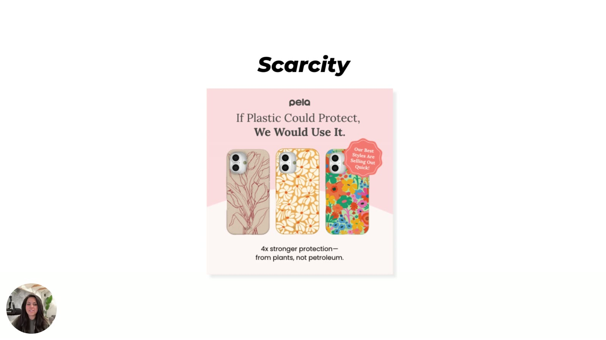

# Scarcity Heuristic

> **"If it's about to be gone, we want it more."** (Heuristics 101 e-book, p.7). Shortcut #1 of the nine in [Heuristics 101](../../courses/tether-lab/02-heuristics-101/README.md). Limited availability triggers a primal fear of missing out.

## 🤖 Agent use
- **Use when:** writing the offer/CTA beat of a UGC script or static, adding an urgency badge, or tearing down a competitor ad that leans on "selling out" or "limited" language.
- **Inputs → outputs:** real stock/quantity/time constraints for our product → a scarcity line (badge, CTA, or creator VO), preferably quantity-based.
- **Rules:**
  - DO prefer **quantity** limits ("only 100 made," "max 2 per customer") over time limits. They "often outperform" because "people trust a number they can see."
  - DO use per-customer limits to anchor how many people should buy and to imply demand (the KFC "4 per customer" mechanism).
  - DO keep scarcity true. DON'T fake it ("Customers aren't dumb. Make it easier, not sneakier.").
  - DON'T stop at "limited time offer." It's the category default and goes unnoticed.
  - DON'T use scarcity as the only heuristic. Stack it with 1–2 others ([Heuristic stacking](../heuristic-stacking.md)).
  - DO write scarcity as **evidence, not urgency**: "The golden milk that keeps selling out" beat four other heuristics on ROAS and scaled ([Live, July 9](../../courses/tether-lab/05-live-recordings/2025-07-09-live-with-sarah.md) [0:26:20]).
  - DO use **"drop"** language and give every sale a **reason**. DON'T run fake "closing down" or recurring 10-day countdowns. See [Real vs fake scarcity](#real-vs-fake-scarcity-and-drop-language).
  - IF the buyer is premium or luxury THEN don't say "limited spaces" (it pulls "lack-mode" shoppers). Use time windows or qualification instead ([Live, June 18](../../courses/tether-lab/05-live-recordings/2025-06-18-live-with-sarah.md) [0:17:43–0:20:52]).
- **See also:** [Temporal discounting](temporal-discounting.md), [Social proof](social-proof.md), [Heuristics hub](../heuristics.md), [Prompt Library](../../courses/tether-lab/07-prompt-library/README.md) ("Gamification + Time-Sensitive Offer").

## Definition
When something feels limited (it won't be here for long, or stock or quantity is limited), we want it more. It works off the thought "I'm going to miss out on something" ([L2 00:40]–[00:51]).

## Why it works
- "It triggers kind of a survival instinct in us, a primal fear of missing out" ([L2 00:54]).
- E-book: "Scarcity triggers survival instincts. It tells the brain: act fast or miss out."
- Quantity limits work because they tell people "exactly how much you expect them to buy" and help them "make a judgment call as to how many packs of things other people are also buying" ([L2 02:04]–[02:15]).

## How to use it in ads (from the course)

| Type | Example copy | Notes | Source |
|---|---|---|---|
| Stock badge | "Our best stock is almost out" / "Our best styles are selling out quickly" | The standard, correct use, already common | [L2 01:00] |
| Time limit | "Limited time offer," "Only 24 hours left!," "This is never coming back" | The default most brands use | [L2 01:11]; e-book |
| Total quantity | "We only have 100 of these" | "Even more powerful" than time | [L2 01:31] |
| Per-customer limit | "Limited to four packs per customer" (KFC), "Max 2 per customer" | Anchors purchase quantity and implies demand | [L2 01:41]–[02:15]; e-book |
| Visible counter | Red sticker "Only 8 units left!" | "People trust a number they can see" | e-book p.7 |

## Deploy in a UGC script
*Derived guidance: the course teaches scarcity on statics. Placement and line patterns below adapt those course rules to UGC video. They are not stated in the course.*

| Script slot | Pattern | Example line (fill in our product) |
|---|---|---|
| Hook (only if the drop *is* the news) | "They only made [N] of these and I got one." | "They only made 500 of the fall colourway and I got one." |
| Mid-script proof | Creator shows a "low stock" screen or empty shelf, or says how fast the last batch sold | "Last batch sold out in [X] days, so I ordered two." |
| CTA / end card | Quantity or per-customer limit + CTA | "They cap it at 2 per order, link's below." |
| On-screen text | Red circular sticker "Only [N] left!" in a corner | — |

**Visual cues:** a red/bright circular sticker, a stock counter, a "selling out" badge near the product.

## Spot it in a competitor ad
- Badge or sticker text: "selling out," "almost gone," "only N left," "limited edition," "back for a limited time," "never coming back."
- Per-customer caps or numbered editions (stronger than time limits). Note when a competitor uses quantity rather than time.
- Countdown timers and "ends tonight." Classify as **time scarcity**. If it's about how soon the *benefit* arrives, classify it as [temporal discounting](temporal-discounting.md) instead.
- Tag the teardown with `scarcity-quantity`, `scarcity-per-customer` or `scarcity-time`.

## Ad teardowns

| Brand / product (niche) | Format | Hook / opening | What works | What fails | Fix suggested | Principle | Source |
|---|---|---|---|---|---|---|---|
| Pela (eco phone cases) | Static | "If Plastic Could Protect, We Would Use It." | Badge "Our Best Styles Are Selling Out Quick!" adds scarcity to a contrarian headline | — (shown as a correct example) | — | Standard badge scarcity done right | [L2 00:27] |
| KFC (fast food, 2014 per Sarah) | Campaign | $1 fries | "Limited to four packs of fries per customer" | — | — | Quantity scarcity anchors purchase size and implies demand | [L2 01:44] |
| Mock moisturizer (e-book) | Static | "TikTok's Most Viral Moisturizer" | Red "Only 8 units left!" sticker | — | — | A visible number builds trust | e-book p.7 |

## Rules of thumb
- **DO** use quantity scarcity before time scarcity ([L2 01:31]; e-book pro tip).
- **DO** use per-customer limits to tell buyers how much to buy ([L2 02:04]).
- **DON'T** treat scarcity as only "limited time." It "goes in a lot of different directions" ([L2 00:34]).
- **DON'T** manipulate. "Make it easier, not sneakier." (e-book p.17)

## Real vs fake scarcity and drop language
*From the live sessions (May–July 2025). This folds in the planned "real vs fake scarcity" page.*

### Why fake scarcity fails
- A friend's lamp store announced it was **closing**. The Meta ads drew crowds who bought sale items *and* full-price items, enough that the shop stayed open. That was **actual scarcity**: "You won't be able to get this ever again." Brands that run perpetual "we're closing" ads "are being shady" ([Live, July 9](../../courses/tether-lab/05-live-recordings/2025-07-09-live-with-sarah.md) [0:42:38–0:44:53]).
- Manufactured deadlines don't work: "We're only running this sale for the next 10 days… customers don't care. They're like, you're gonna run another one in six weeks anyway… I'll just wait." [0:44:53–0:45:34]
- The add-on full-price buys came from [commitment and sunk cost](commitment-and-consistency.md) ("I'm already here"), not from the scarcity itself [0:45:34] → [sunk-cost fallacy](sunk-cost-fallacy.md).

### How to create real scarcity (without lying)
| Move | What Sarah said | Source |
|---|---|---|
| **Limited, never-restocked drop** (art-gallery model) | "We have brought in 101 pieces of inventory that are all very special… once these are gone we're never bringing in this specific inventory again." Hide inventory, sort it into logical buckets (e.g. lamps with shells), release specific pieces, rotate. | [Jul 9 0:45:58–0:47:00](../../courses/tether-lab/05-live-recordings/2025-07-09-live-with-sarah.md) |
| **Precise, odd counts** | "We have **53** of these left… **57** left" raises likelihood to buy *and* AOV ("this is part of an actual set"). Study cited from Twitter, no reference. | [Jul 9 0:47:00–0:48:04](../../courses/tether-lab/05-live-recordings/2025-07-09-live-with-sarah.md) |
| **Quiet demand evidence** | Aazar's 5-heuristic test: "The Golden Milk That Keeps Selling Out" won on ROAS and scaled. His write-up: "scarcity doesn't need urgency. It needs evidence." | [Jul 9 0:25:48–0:28:55](../../courses/tether-lab/05-live-recordings/2025-07-09-live-with-sarah.md) |
| **"Drop" language** | "Whenever I do any sort of new colour test we always use the drop language… it's not going to be here very long." "New colours" alone implies it'll be there forever, so people come back later. | [Roast #3 0:46:24–0:47:27](../../courses/tether-lab/05-live-recordings/2025-07-23-roast-my-ads-3.md) |
| **A reason for the sale** | "Giving a reason for your sale can increase conversions astronomically": the Fourth of July sale, the Father's Day sale. | [Roast #3 0:46:24](../../courses/tether-lab/05-live-recordings/2025-07-23-roast-my-ads-3.md) |
| **Time context, not delay** | A member's page said shipping takes four weeks. Sarah: "just tell them the next drop comes in a week". CVR rose "like overnight". | [Roast #3 0:47:27–0:48:00](../../courses/tether-lab/05-live-recordings/2025-07-23-roast-my-ads-3.md) |
| **Time windows for premium offers** | "This only opens up once every six months" is "a lack of time, not a lack of spaces". It recruits committed buyers. "Very limited spaces" recruits "lack shopping mode" customers who "probably don't have the cash to continue". | [Jun 18 0:17:43–0:19:49](../../courses/tether-lab/05-live-recordings/2025-06-18-live-with-sarah.md) |
| **Qualification ("not for everyone")** | "This hair care product doesn't work for everyone… but it might work for you" creates competition: "you're building automatic scarcity." | [Jul 9 0:37:31–0:38:09](../../courses/tether-lab/05-live-recordings/2025-07-09-live-with-sarah.md) |
| **Luxury: price, not "limited"** | "Maserati doesn't do limited anything. They just jack that price up." | [Jun 18 0:19:49](../../courses/tether-lab/05-live-recordings/2025-06-18-live-with-sarah.md) → [luxury positioning](../luxury-positioning.md) |
| **Scarcity that doubles as social proof** | "Only 9 sets left **in this color**": implies others bought, clears the "reason not to buy" checklist, and tests how much buyers value the colour. | [Roast #3 0:14:42–0:17:51](../../courses/tether-lab/05-live-recordings/2025-07-23-roast-my-ads-3.md) |
| **A more visceral urgency icon** | Nutrafol's "limited time" offer uses a **plane** icon instead of a clock: "it's leaving soon… very visceral reactions to missing out". | [Jul 16 0:29:19–0:30:50](../../courses/tether-lab/05-live-recordings/2025-07-16-live-with-sarah.md) |

> ⚠ **Contradiction / integrity flag.** The "Only 9 sets left in this color" badge that Sarah praises in [Roast #3](../../courses/tether-lab/05-live-recordings/2025-07-23-roast-my-ads-3.md) [0:15:00] was invented ("I just made that up", Darian). Sarah didn't object, but two weeks earlier she argued that fake scarcity backfires ([July 9](../../courses/tether-lab/05-live-recordings/2025-07-09-live-with-sarah.md) [0:44:53]). **Agents must only use true stock counts, real drop sizes and real deadlines.** If the client can't confirm a number, use a reason-why or drop framing without a number.

### Hooks and badges (real-scarcity versions)
| Hook (verbatim or near) | Heuristic(s) | Emotion / zone | Self targeted | Why it works | Source |
|---|---|---|---|---|---|
| "The Golden Milk That Keeps Selling Out" | Scarcity as evidence + implied [social proof](social-proof.md) | FOMO, Zone 2 | Actual | Demand evidence with no countdown | [Jul 9 0:26:20](../../courses/tether-lab/05-live-recordings/2025-07-09-live-with-sarah.md) |
| "Once these are gone, we're never bringing them in again." | Real limited drop | Anticipation, Zone 2 | Actual | True one-off inventory | [Jul 9 0:45:58](../../courses/tether-lab/05-live-recordings/2025-07-09-live-with-sarah.md) |
| "New drop: [colour]" / "Just dropped" | Drop language | Anticipation, Zone 2 | not specified | Signals it won't be around long | [Roast #3 0:46:24](../../courses/tether-lab/05-live-recordings/2025-07-23-roast-my-ads-3.md) |
| "The next drop comes in a week." | Time framing | Anticipation | not specified | Replaces "ships in 4 weeks"; CVR up | [Roast #3 0:47:27](../../courses/tether-lab/05-live-recordings/2025-07-23-roast-my-ads-3.md) |
| "This only opens up once every six months." | Time scarcity | Urgency without panic | Actual | Pulls committed, higher-level buyers | [Jun 18 0:18:44](../../courses/tether-lab/05-live-recordings/2025-06-18-live-with-sarah.md) |
| "Back to school is almost here" (badge) | Seasonal reason | Mild urgency | Ought | A real reason to buy now | [Roast #3 0:40:57](../../courses/tether-lab/05-live-recordings/2025-07-23-roast-my-ads-3.md) |

### Rewrites
| Before | After | What changed (verb / visual / promise / self / intensity) | Source |
|---|---|---|---|
| "Sale ends in 10 days" (repeating) | "We brought in 101 special pieces. Once they're gone we're never bringing them in again." | Fake deadline → real limited inventory | [Jul 9 0:44:53–0:46:30](../../courses/tether-lab/05-live-recordings/2025-07-09-live-with-sarah.md) |
| "We have 20 / 50 left" | "We have 53 / 57 left" (true count) | Round → precise odd number | [Jul 9 0:47:52](../../courses/tether-lab/05-live-recordings/2025-07-09-live-with-sarah.md) |
| "New colours!" | "New drop: Unicorn Pink" + a reason (occasion) | Permanent-sounding → drop | [Roast #3 0:46:24–0:47:27](../../courses/tether-lab/05-live-recordings/2025-07-23-roast-my-ads-3.md) |
| "Ships in 4 weeks" | "The next drop comes in a week" | Delay → anticipation | [Roast #3 0:47:27](../../courses/tether-lab/05-live-recordings/2025-07-23-roast-my-ads-3.md) |
| "We have very limited spaces" | "This only opens up once every six months" | Quantity → time window | [Jun 18 0:18:44](../../courses/tether-lab/05-live-recordings/2025-06-18-live-with-sarah.md) |
| Clock icon + "limited time" | Plane icon + "limited time" | Visual: more visceral loss cue | [Jul 16 0:29:40–0:30:50](../../courses/tether-lab/05-live-recordings/2025-07-16-live-with-sarah.md) |

### Spot it in a competitor ad (real vs fake)
- **Likely fake:** a "closing down" or "last chance" sale that keeps running; round counts that never move; countdowns that reset. Note it but don't copy it.
- **Likely real (copyable mechanism):** numbered drops, named colourways with an end, "keeps selling out" with visible restock waits, occasion-based sales.
- Tag `scarcity-drop`, `scarcity-evidence`, `scarcity-time-window`, or `scarcity-fake` (for teardown notes only).

## Where it's taught
- [Using Biases That Sell](../../courses/tether-lab/02-heuristics-101/02-using-biases-that-sell.md): [00:27]–[02:26]
- [Heuristics 101 e-book](../../resources/heuristics-101-ebook.md), p.7
- The CreativeOS Copy Grader flagged a demo ad as needing "a little bit more scarcity" ([CreativeOS bonus](../../courses/tether-lab/02-heuristics-101/08-bonus-creativeos.md) [03:54])
- [Live With Sarah, May 7, 2025](../../courses/tether-lab/05-live-recordings/2025-05-07-live-with-sarah.md): scarcity and urgency as two of the 4–5 heuristics DTC uses today; "secondary characters" [0:12:45–0:13:29]
- [Live With Sarah, June 4, 2025](../../courses/tether-lab/05-live-recordings/2025-06-04-live-with-sarah.md): gelato "sold out… it's fine" meme, 3.5× CTR [0:30:17–0:32:26]
- [Live With Sarah, June 18, 2025](../../courses/tether-lab/05-live-recordings/2025-06-18-live-with-sarah.md): "limited spaces" vs "opens once every six months"; Maserati doesn't do limited [0:17:43–0:20:52]
- [Roast My Ads #2, June 25, 2025](../../courses/tether-lab/05-live-recordings/2025-06-25-roast-my-ads-2.md): Illusion Dress "sold out quickly, now available for pre-order" in the buy box (wiki tag) [0:37:00]
- [Live With Sarah, July 9, 2025](../../courses/tether-lab/05-live-recordings/2025-07-09-live-with-sarah.md): Aazar's scarcity winner [0:24:56–0:29:12]; real vs fake scarcity, limited drops, odd numbers [0:42:38–0:48:04]; "this isn't for everybody" [0:37:31]
- [Live With Sarah, July 16, 2025](../../courses/tether-lab/05-live-recordings/2025-07-16-live-with-sarah.md): Nutrafol plane icon [0:29:19–0:30:50]; Jaxxon's stacked urgency [0:44:40–0:51:30]
- [Roast My Ads #3, July 23, 2025](../../courses/tether-lab/05-live-recordings/2025-07-23-roast-my-ads-3.md): "Only 9 sets left in this color" [0:12:36–0:17:51]; drop language, reason for sale, "next drop in a week" [0:46:24–0:48:30]

*E-book p.7: definition, "Use it by" list and pro tip, next to the "Only 8 units left!" moisturizer mock-up.*

*Pela: "If Plastic Could Protect, We Would Use It." with an "Our Best Styles Are Selling Out Quick!" badge ([L2 00:27]).*

## Related
- [Heuristics hub](../heuristics.md) · [Temporal discounting](temporal-discounting.md) (urgency from the reward side) · [Social proof](social-proof.md) · [Heuristic stacking](../heuristic-stacking.md)
- [Loss aversion](loss-aversion.md) · [Commitment and consistency](commitment-and-consistency.md) · [Sunk-cost fallacy](sunk-cost-fallacy.md) · [Bandwagon effect](bandwagon-effect.md) · [Specificity](specificity.md) (odd counts) · [Luxury positioning](../luxury-positioning.md)
