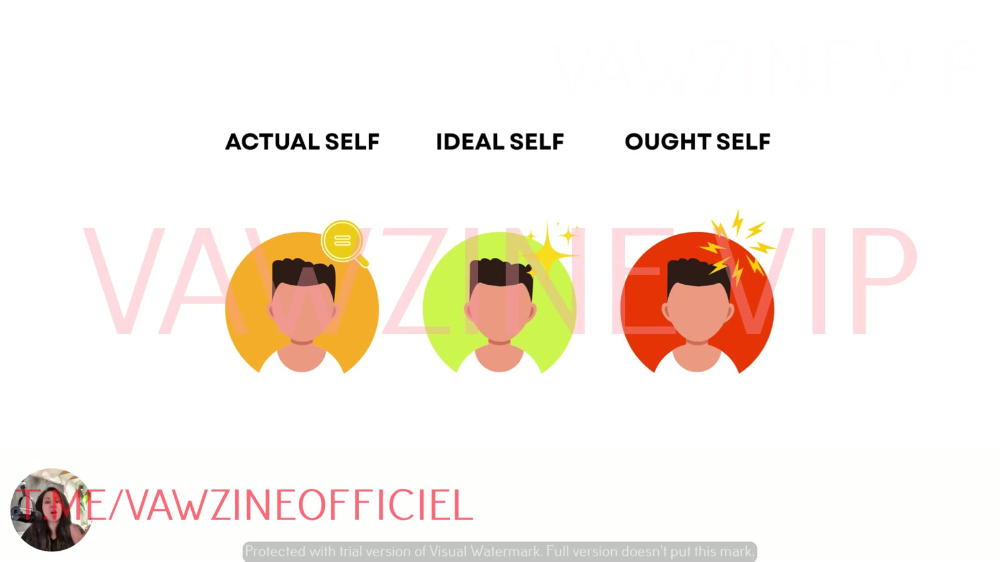

# The 3 Selves (Actual, Ideal, Ought)
> Every customer carries three versions of themselves: who they **are** (Actual), who they **want to be** (Ideal) and who they think they **should be** (Ought). Whichever is active when they see your ad decides which message converts. This is the core model of the [Self Targeting System](../courses/tether-lab/04-self-targeting-system/README.md).

## 🤖 Agent use
- **Use when:** tagging any hook, script or ad by the identity it activates, choosing which self a new UGC script should speak to, or generating angle variants from one proven ad.
- **Inputs → outputs:** ad copy, script or visual description → `Actual / Ideal / Ought` scores (0–10) + dominant self + the missing selves. Or: target self + product → copy register (language, emotion, proof type).
- **Rules:**
  - DO classify by the *motivation frame*, not surface words: present identity → Actual · future becoming → Ideal · duty/should/standard → Ought.
  - DO assume most competitor ads over-index on Ideal [L4 02:56]. The other two selves are usually the open lanes.
  - DO pair each self with its proof type: peer reviews/identity callouts (Actual) · transformation/legend status (Ideal) · authority, press, "dermatologist-approved", safety (Ought).
  - DO pick the funnel stage per self (e-book): Awareness = Ideal/Ought · Consideration = Actual/Ideal · Conversion = Actual/Ought.
  - DO, per Sarah's later live guidance, keep **cold ads on Actual/Ideal** ("I see you") and save **Ought** ("you know you should…") for prospects who have qualified (sales call, retargeting, post-opt-in). This contradicts the e-book's "Awareness = Ought". See [Which self at which funnel stage](#which-self-at-which-funnel-stage-live-sessions) ([Live, June 18](../courses/tether-lab/05-live-recordings/2025-06-18-live-with-sarah.md) [0:05:15–0:10:29]).
  - DON'T label "your future self will thank you" as Ideal. It's Ought (duty).
  - DON'T change the offer when you switch selves.
- **See also:** [Three selves diagnostic](../frameworks/three-selves-diagnostic.md) · [Rewriting ads for new selves](../frameworks/rewriting-ads-for-new-selves.md) · [Testing ads by self type](../frameworks/testing-ads-by-self-type.md) · [Three selves prompts](../resources/three-selves-prompts.md)

## Definition
The model comes from **Self-Discrepancy Theory (SDT)**, introduced by psychologist **E. (Edward) Tory Higgins in 1987** [L4 01:04]. It says our emotions and behaviour are shaped by the **gap between different versions of ourselves**:

> "When there's a gap between these selves, you feel uncomfortable. That discomfort motivates you to change—or buy things that help you feel closer to your ideal or ought self." (lesson 4 slide)

| Self | Short definition (e-book) | Prompt definition (prompt doc) | Hub page |
|---|---|---|---|
| **Actual** | "Who I am right now." | "Reinforces who the customer *already is*. Seeks identity validation, consistency, and alignment." | [Actual Self](actual-self.md) |
| **Ideal** | "Who I want to be." | "Speaks to who they *want to become*. Aspirational, future-focused, emotionally rewarding." | [Ideal Self](ideal-self.md) |
| **Ought** | "Who I think I should be." | "Speaks to who they *think they should be*. Driven by duty, pressure, and risk avoidance." | [Ought Self](ought-self.md) |

*The course's icons: Actual (orange, magnifier), Ideal (green, sparkles), Ought (red, lightning).*

## Key properties
- **All three exist all the time** in the subconscious, at different intensities. "Depending on the self that's currently activated… you're going to respond differently to ads." [L4 01:53]
- **Only one buys.** "When your ad shows up, there's only one customer mind that's going to be well-suited to seeing that ad, liking what they see, attaching emotionally to it and buying." [L1 03:05]
- **They are built from identity banks.** The brain turns experiences into emotions, emotions into memories, and memories into "banks" that harden into habits, behaviours and identities. "Those selves are created based upon all of these identity banks." [L3 06:15–07:12]
- **The customer is a system, not an avatar.** "Some days they're going to try and become somebody new [Ideal], other days they're going to be holding tight to… who they are [Actual]… sometimes they're under immense amount of pressure and all they want to do is live up to the expectations of who they think they should be [Ought]." [L3 07:25]
- **Orientation:** Ideal = future · Actual = present · Ought = social/duty [L4 05:44].

## Why it matters for ads
- **Mismatch kills ads.** "Each self creates a different kind of emotional pull. When your ad doesn't match the customer's dominant self, it falls flat. When it does? It converts." (e-book p. 3)
- **Brands default to one self, usually Ideal.** "I can't even think of a brand that doesn't currently message to ideal self." [L4 02:56] That pool dries up and causes [angle rut](angle-rut.md) [L3 00:58].
- **Selling selves, not benefits.** "People aren't buying benefits. They're buying a version of themselves." (e-book p. 1)
- **More reach from the same ads and offer.** Repositioning to other selves "open[s] up our TAM… so that way we can target more people with the same amount of ads." [L4 07:28]

## How to use it
1. **Diagnose** which self your ads speak to: [Three selves diagnostic](../frameworks/three-selves-diagnostic.md).
2. **Rewrite** winners for the missing selves: [Rewriting ads for new selves](../frameworks/rewriting-ads-for-new-selves.md).
3. **Test** the three versions in one ad set: [Testing ads by self type](../frameworks/testing-ads-by-self-type.md).
4. Optionally **layer emotion** on top: once you know the self, choose [valence](valence.md) and [intensity](intensity.md) [L6 01:59].
5. Match the self to **funnel stage** (e-book ch. 6): Awareness = Ideal or Ought · Consideration = Actual or Ideal · Conversion = Actual or Ought.

## Which self at which funnel stage (live sessions)
*From [Live With Sarah, June 18, 2025](../courses/tether-lab/05-live-recordings/2025-06-18-live-with-sarah.md) [0:05:15–0:17:43], plus related live observations.*

**The case.** Jamie Ahmed's coaching client scaled with ads built on the availability heuristic ("we were there too, and this is how we fixed it") that move **actual → ideal**. Transcribed sales calls showed buyers who **pay in full** use much more **ought** language ("I should be doing better"). Should the ad CTAs switch to ought? [0:05:15–0:08:25]

**Sarah's answer: no, keep ought at the back end.**
- "Ought is a weird marketing tactic. When you speak to the ought self… you're often telling people something that they already know… 'you should want this, you know it's good for you, why aren't you doing it?' Oftentimes that's something a close friend would do for you." [0:08:25]
- In an ad it "feels too accusatory… 'well I know I should, but don't tell me'". From a stranger, "you're basically trying to be a very good friend with somebody when you haven't really made that relationship yet." [0:08:25–0:09:27]
- Front end: "create this relationship of care: **I see you**." After the prospect gets past "whatever wall you've put up just to qualify people", you can add "I see you, and also, girl, you know you should be doing that… then you can start to push a little bit." [0:09:27–0:10:29]

| Funnel stage / asset | Self to lead with | Example line | Source |
|---|---|---|---|
| Cold ads, top of funnel | **Actual** first ("I see you"), Ideal as a second test layer | "You've checked the dashboard 20 times today and you still don't know what to do. That's okay." / "You're 70% of the way there right now." | [Jun 18 0:15:40–0:17:43](../courses/tether-lab/05-live-recordings/2025-06-18-live-with-sarah.md) |
| Lead magnet, landing page | Actual/Ideal; qualify the buyer ("see if you qualify") | "See if you qualify." | [Jun 18 0:19:49–0:20:52](../courses/tether-lab/05-live-recordings/2025-06-18-live-with-sarah.md) |
| After qualification: sales call, follow-up, retargeting | **Ought** ("you know you should be doing this") | "I see you, and also… you know you should be doing that." | [Jun 18 0:09:27–0:10:29](../courses/tether-lab/05-live-recordings/2025-06-18-live-with-sarah.md) |
| Luxury / exclusive offers | Ought "gets activated differently": no bundles, no discounts, hard access | (see [luxury positioning](luxury-positioning.md)) | [Jun 18 0:11:31–0:12:31](../courses/tether-lab/05-live-recordings/2025-06-18-live-with-sarah.md) |
| On-site bundle choice | Actual ("making a guesstimate… three seems like a lot"); buyers morph through all three selves while deciding | — | [Jul 2 0:27:15–0:28:17; 0:40:48](../courses/tether-lab/05-live-recordings/2025-07-02-live-with-sarah.md) |

**Other self-targeting observations from the live calls (account-specific, not laws)**
- "Ought self gets activated every single time we run an ad with the word **'confidence'** in it." "Ideal self really responds well if we put **prices** in it." ([Live, June 11](../courses/tether-lab/05-live-recordings/2025-06-11-live-with-sarah.md) [0:38:09])
- Any "should" line is an ought line: "Anytime you use the word *should* in your marketing, you're trying to activate ought." ([Live, June 18](../courses/tether-lab/05-live-recordings/2025-06-18-live-with-sarah.md) [0:12:31–0:13:34])
- Guilt-flavoured ought hooks *can* win in cold ads when they confront a denial the buyer already feels: "You're Lactose Intolerant. Start Acting Like It." (Zone 3, a bit of Zone 4) ([Roast My Ads #3](../courses/tether-lab/05-live-recordings/2025-07-23-roast-my-ads-3.md) [0:55:52–0:59:01]). Treat this as a tested exception, not the default.
- Self-discrepancy tells you **whose ability** to talk to in the Fogg model: "Self-discrepancy… does a better job of choosing whose abilities." ([Live, July 16](../courses/tether-lab/05-live-recordings/2025-07-16-live-with-sarah.md) [0:32:40–0:35:00]) → [Fogg Behavior Model](../frameworks/fogg-behavior-model.md)
- Most cold acquisition problems are a mid-funnel message aimed at a top-of-funnel buyer ([Live, May 7](../courses/tether-lab/05-live-recordings/2025-05-07-live-with-sarah.md) [0:20:05–0:20:58]).

> ⚠ **Contradiction.** The e-book (ch. 6) maps **Awareness = Ideal or Ought**. On June 18 Sarah says ought in front-end ads feels accusatory and belongs after qualification. The live guidance is newer and more specific: default to Actual/Ideal in cold ads, and test ought up front only if the front end already meets its metrics ("you could test it", [0:08:25–0:10:29]).

## Cheat sheet
| | Actual | Ideal | Ought |
|---|---|---|---|
| Language customers use (e-book) | "This is so me." "Exactly what I needed." | "One day I'll…" "Finally becoming…" | "I should really…" "It's about time I…" |
| Emotion | Comfort, pride | Hope, inspiration | Guilt, pressure |
| Trigger | Seeking validation or alignment | Comparing themselves to who they want to be | Social norms or inner expectations |
| What you sell (L4) | Reassurance that "you're already this type of person" | Hope, aspiration, thrill of emotion, progress | Relief and reassurance: meeting a standard |
| E-book prompt emphasis | Identity, comfort, ease | Transformation, possibility, pride | Responsibility, social proof, consequences |
| Funnel analogy (e-book) | "Calm their nerves with familiarity" | "Pull them in with possibility" | "Nudge them off the fence with pressure or logic" |
| Test signature (L8) | Lower CTR, higher AOV, stable returns | High CTR, low AOV, faster clicks | Slow starts, strong intent, high LTV |

## Examples
| Brand / product | Actual | Ideal | Ought |
|---|---|---|---|
| High Camp Flasks (L5) | "He put up the tent, but you brought the flask." | "For campfire legends only." | "Because details matter, even outdoors." |
| Parkside wine flask (L7) | "For Wine Lovers Who Know… You Already Bring the Good Stuff" | "Spill The Tea, Not Your Wine." | "Don't Risk the Bottle… Real Adults Bring a Flask" |
| Cookware (e-book) | "Finally, cookware that gets *you*." | "Cook like the version of you who doesn't cut corners." | – |
| Skincare (e-book) | "Skin that feels like you again." | "The skincare routine your future self deserves." | "You know you should be doing this." |
| Self-care (e-book) | – | – | "You know you should be taking better care of yourself." |

## Common mistakes
- **Treating "future" words as automatically Ideal.** "Do what your future self will thank you for" is an **Ought** line (L4), and "No more skipping workouts. Your future self will thank you." scores **Ought 9** vs Ideal 7 (e-book). Duty framing wins over the time reference.
- **Over-indexing on one self without noticing.** It's normal ("This is how human bias works", L6 08:28). The diagnostic shows *your* default, not necessarily the customer's [L2 02:40].
- **Changing the offer while testing selves.** That confounds the result [L7 00:38].
- **Mixing up Ideal and Actual.** Sarah herself slips once [L4 06:41]. Ideal = future, Actual = present.

## Where it's taught
- [L1 Why Your Ads Stop Working Over Time](../courses/tether-lab/04-self-targeting-system/01-why-your-ads-stop-working-over-time.md): "they're actually three", "only one buys" [02:54–03:20]
- [L2 Diagnose Which Self Your Ads Target](../courses/tether-lab/04-self-targeting-system/02-diagnose-which-self-your-ads-target.md): nine ad identity scan [01:13–02:50]
- [L3 Why One Self Isn't Enough to Scale](../courses/tether-lab/04-self-targeting-system/03-why-one-self-isnt-enough-to-scale.md): customer as a system, identity banks [01:55–08:16]
- [L4 The 3 Selves That Drive Every Buying Decision](../courses/tether-lab/04-self-targeting-system/04-the-3-selves-that-drive-every-buying-decision.md): full definitions [01:04–07:28]
- [L5](../courses/tether-lab/04-self-targeting-system/05-run-the-3-selves-diagnostic-on-your-ads.md), [L6](../courses/tether-lab/04-self-targeting-system/06-how-to-use-the-prompts-for-instant-insights.md), [L7](../courses/tether-lab/04-self-targeting-system/07-how-to-rewrite-winning-ads-for-new-selves.md), [L8](../courses/tether-lab/04-self-targeting-system/08-how-to-test-your-ads-by-self-type.md): applying the model
- [E-book: Which 'You' Are You Selling To?](../resources/which-you-are-you-selling-to-ebook.md) · [Three selves prompts](../resources/three-selves-prompts.md)
- [Live With Sarah, June 11, 2025](../courses/tether-lab/05-live-recordings/2025-06-11-live-with-sarah.md): analyse emotion → intensity → self; "confidence" triggers ought, prices trigger ideal [0:36:06–0:40:14]
- [Live With Sarah, June 18, 2025](../courses/tether-lab/05-live-recordings/2025-06-18-live-with-sarah.md): self per funnel stage (ought after qualification) [0:05:15–0:10:29]; SDT refresher [0:12:31–0:13:34]; actual-self situational hooks [0:15:40–0:17:43]
- [Live With Sarah, July 2, 2025](../courses/tether-lab/05-live-recordings/2025-07-02-live-with-sarah.md): buyers morph through the selves while choosing a bundle [0:27:15; 0:40:48]
- [Live With Sarah, July 16, 2025](../courses/tether-lab/05-live-recordings/2025-07-16-live-with-sarah.md): Fogg × SDT, Nutrafol split between ideal and actual [0:32:40–0:35:00]
- [Roast My Ads #3, July 23, 2025](../courses/tether-lab/05-live-recordings/2025-07-23-roast-my-ads-3.md): concept tags zone · intensity · self · need · TEEP phase [0:34:44; 0:36:00]

## Related concepts
[Actual Self](actual-self.md) · [Ideal Self](ideal-self.md) · [Ought Self](ought-self.md) · [Self-targeting](self-targeting.md) · [Angle rut](angle-rut.md) · [Subconscious vs conscious mind](subconscious-vs-conscious-mind.md) · [Valence](valence.md) · [Intensity](intensity.md) · [Emotional zones](emotional-zones.md)

> (Context, not from course:) In Higgins' original theory, the gaps are linked to specific emotions: an actual–ideal gap to dejection-type feelings (disappointment, sadness), and an actual–ought gap to agitation-type feelings (anxiety, guilt). That fits the course's pairing of Ought with guilt and pressure, and Ideal with hope as the positive pull.
