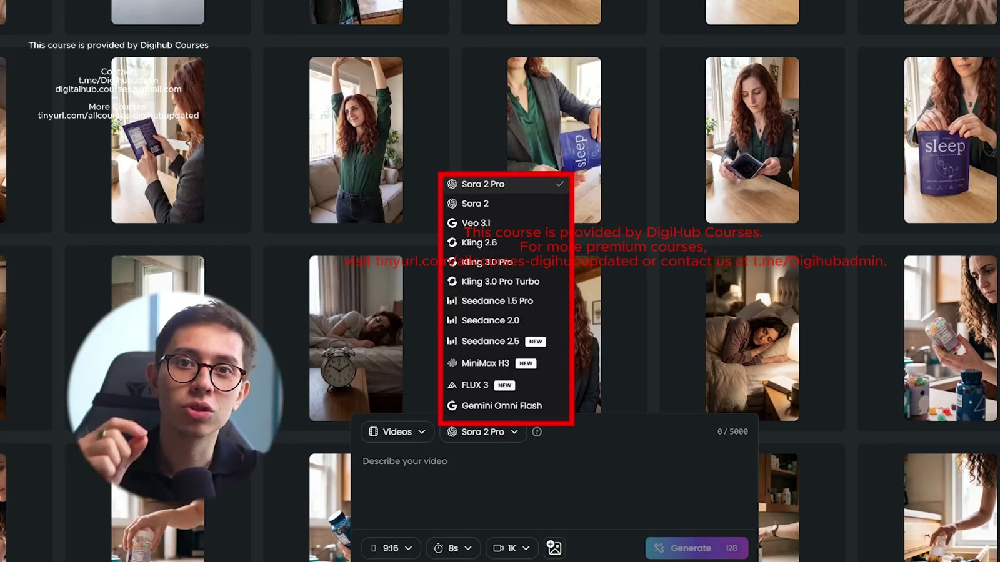
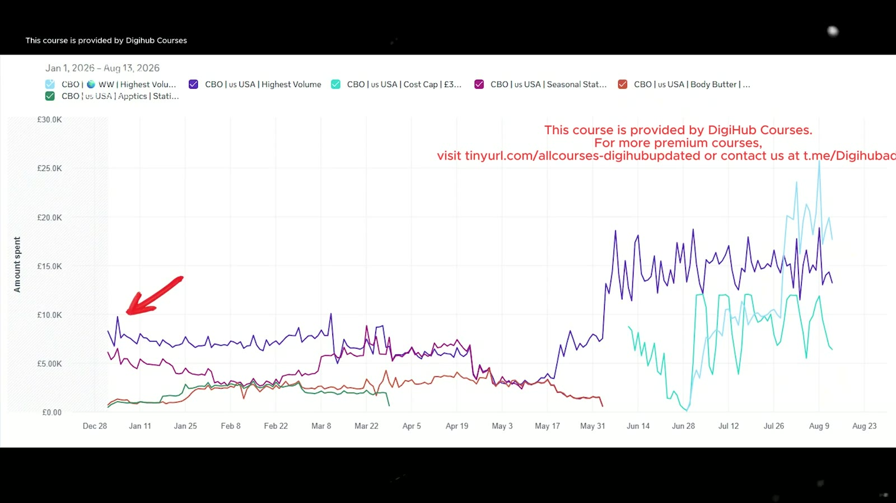

# 1. Watch this if you want to win
> Course welcome: what the program is (a production system plus community, not a passive course), the agency's claims about why AI ads, and the "3 C's" loop (Course, Calendar, Community) the instructor says drives results.

## 🤖 Agent use
- **Use when:** you need the course's overall structure, which module holds what, or the instructor's stated rationale for AI ad production.
- **Inputs → outputs:** none to produce; use it to route to the right module (Toolbox → AI UGC / AI Animated Ads / Static Ads) and to know which claims are instructor claims.
- **Rules:**
  - **DO** run the loop the instructor says top members run: "watch a module, take action, submit their videos for reviews, complete a full feedback loop, and then do it again" [02:00] (instructor claim).
  - **DO** treat the AI-vs-UGC reasoning as marketing from the agency: "uncapped imagination" [00:01–01:01] (instructor claim).
  - **DON'T** treat the revenue and spend numbers as verified; no account data is shown beyond one unlabelled spend chart [00:46] (see limitations).
  - **IF** you need the production fundamentals (platforms, models, credits) **THEN** start in The Toolbox [02:00]: [diversified ads](008-how-to-make-diversified-ads.md), [make AI look less fake](012-make-ai-look-less-fake.md).
- **See also:** [24H challenge](002-the-24h-challenge.md) · [Levels & unlocks](003-levels-unlocks.md) · [Meet the team](004-meet-the-team.md) · [AI UGC tools](../../../../tools/ai-ugc-tools.md)

## Key ideas
### Not a course, a production system [00:02–01:01]
- "This is not a course or a get-rich-quick scheme. It's not something you can watch passively. And no, there is no Discord." The page says: "It's a production system and a community."
- Source of the material: the agency Epic Ads Lab. Video: its UGC ads "have spent over $100 million of meta alone" (instructor claim); the lesson page says "$150M through Meta" and "scaled brands past $1M/mo on meta on AI ads alone" (instructor claim). The two figures disagree; the page is likely newer.
- Video claim: one brand went "from $100K a month to $1 million a month with just our AI ads" [00:46] (instructor claim; the chart shown has no brand name, axis is amount spent in GBP, Jan 1 to Aug 13, 2026).

### Why AI ads: "uncapped imagination" [00:46–01:01]
- Claims it is not only that AI ads work, or that they are cheaper than UGC ("you can spend some money on credits"): "It's actually because of two words. Uncapped imagination." CGI was "gated behind Hollywood production houses" for 20 years; now "with a few keystrokes" you get cinematic videos, animations and realistic AI avatars (instructor claim).
- "AI is the worst it's ever going to be right now" [01:01].
- Formats named on screen: claymation, "Zack D Films" style animation, AI UGC, a Claude skill + Seedance 2.0 lesson, a model picker (see screenshot). See [020. Claude Skill + Seedance 2.0 AI UGC](020-claude-skill-seedance-2-0-ai-ugc.md).

### The 3 C's [01:01–04:55]
| C | What it is | What the instructor says drives results | Source |
|---|---|---|---|
| Course | Framework that "is constantly evolving"; AI UGC and AI animation modules are "proven ad formats that are working right now" with client results (instructor claim); Toolbox = "what platforms to use and what AI models to select" | watch → act → submit for review → full feedback loop → repeat | [02:00] |
| Calendar | Weekly calls (see Community tab → Calendar). Coaches named: Justin (copywriter), "Howie" (= Hao, ad psychology and formats), the speaker, plus video editors and AI devs | "attend as many calls as possible during the first two weeks" | [02:58] |
| Community | Skool posts with headline + category tag; feedback and hiring tags; "the best place to find talent for your team or even get jobs" | tight feedback loops, ask questions, "no such thing as a dumb question" | [03:57] |

- Three modules are locked behind levels; Level 5 "gets the test lab" in the video, while the Levels page says Level 4 [02:00] (see [003](003-levels-unlocks.md); contradiction noted below).
- Member mix: "experts doing million dollars every single month" to "people who have never touched an AI platform" [04:55].

## Steps / framework
1. Pick the format module (AI UGC, AI Animated Ads, Static Ads); make one ad.
2. Post it for feedback (category tag for ad reviews).
3. Attend at least one live call in the first two weeks.
4. Apply the feedback, report results, repeat the loop.

## Prompts / templates (verbatim)
- Not included in the course files (no prompts on this lesson).

## Screenshots

*Video-model dropdown shown while explaining the toolbox: Sora 2 Pro, Sora 2, Veo 3.1, Kling 2.6, Kling 3.0 Pro, Kling 3.0 Pro Turbo, Seedance 1.5 Pro, Seedance 2.0, Seedance 2.5 (new), MiniMax H3 (new), FLUX 3 (new), Gemini Omni Flash; settings bar 9:16, 8s, 1K, 128 credits. Tool names at recording (Aug-Sep 2026). [00:37]*

*The scaling "proof": campaign spend lines in an ad-platform chart with a red arrow at the early baseline; no brand, no revenue, no attribution shown. Treat as an unverified claim. [00:46]*

## How to apply
- [ ] Read [002](002-the-24h-challenge.md) to [007](007-how-to-get-support.md) only if you need community/admin facts.
- [ ] Keep production lessons separate from claims: log every "$ spent" or "scaled to" statement as an instructor claim.

## Related
- Next: [2. The 24H Challenge](002-the-24h-challenge.md)

## Sources and limitations
- [Transcript](<../../../../../raw/ad-creators-lab/ai-ads-ugc-animations/_transcripts/Ad Creators Lab - Create Viral AI Ads, UGC & Animations That Convert Into Sales(September 2026)/1. HOW TO WIN/1. 🔥 Watch this if you want to win.txt>) (Whisper large-v3-turbo; ends 5:13 = full length). "Howie" is Hao (lesson 4 page). The video carries a third-party reseller watermark overlay; ignore it.
- [Lesson page](<../../../../../raw/ad-creators-lab/ai-ads-ugc-animations/_extracted/Ad Creators Lab - Create Viral AI Ads, UGC & Animations That Convert Into Sales(September 2026)/1. HOW TO WIN/1.🔥 Watch this if you want to win - HOW TO WIN · Ad Creators Lab (02_09_2026 18：22：36).html.md>). Page images (production-loop diagram, calendar and post screenshots) are in a shared folder whose files were overwritten across pages, so they are not used here; the loop is described by the text only.
- Contradictions: spend $100M (video) vs $150M (page); test lab unlock Level 5 (video) vs Level 4 (page and lesson 3).
- Compliance (derived): "AI avatars" and any realistic AI creator used as a real customer must not be presented as a real testimonial.
