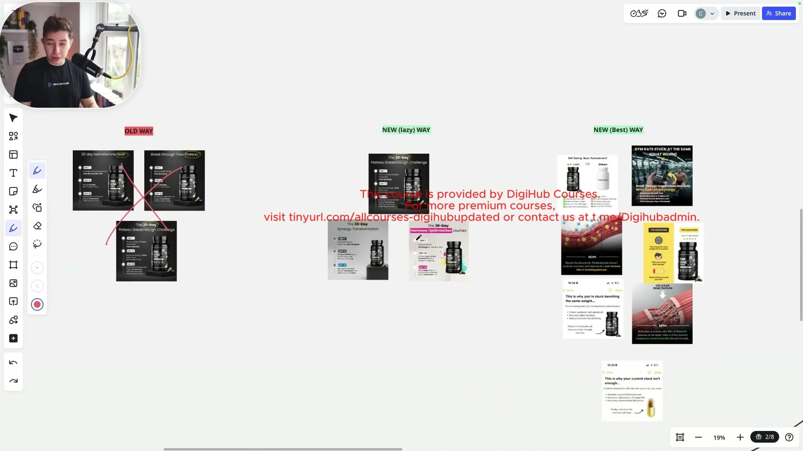
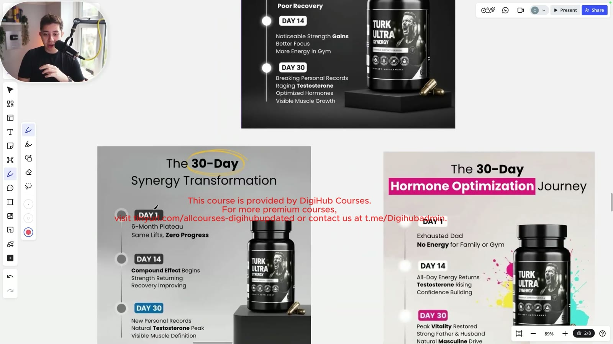

# 8. How To Make Diversified Ads
> Why changing a headline or the first 3-5 seconds no longer gives Meta a "different" ad, and the cheaper (lazy) and best ways to make genuinely diversified statics and video.

## 🤖 Agent use
- **Use when:** planning a creative batch for Meta, deciding what counts as a new ad vs a variation, or briefing editors/AI tools for more variants.
- **Inputs → outputs:** one winning concept or product + offer → a batch of ads that look different at a glance (statics in different formats; videos with different hooks, B-roll and endings; or longer 20-30 s hooks).
- **Rules:**
  - **DON'T** make "diversified" ads by changing headline wording, text size or one element: "No, they're not" different [00:03] (instructor claim).
  - **DON'T** vary video only by swapping the first 3-5 seconds: "This doesn't work anymore" [03:33–04:26] (instructor claim).
  - **DO** (lazy static method) make three versions of everything in the ad: different text, different colours, different headline concept, so that zoomed out "these three are all very different" [01:56–02:43].
  - **DO** (best static method) make literal different creative formats: us-vs-them, product shot with text, unaware-audience/news, problem-solution, notepad [02:43].
  - **DO** (lazy video method) change the hook AND the B-roll after it; the ending may stay the same or change [03:33–04:26].
  - **DO** (video) make the hooks "20 to 30 seconds", not 3-5 [04:26].
  - **IF** you are tempted to spend more on new creative than on ad spend **THEN** use the lazy method above to get distinct-looking variants from one concept [00:03].
- **See also:** [Meta ads algorithm (Andromeda)](../../../../tools/meta-andromeda.md) · [Iteration vs variation](../../../../concepts/iteration-vs-variation.md) · [Make AI look less fake](012-make-ai-look-less-fake.md) · [UGC concepts that print](106-ugc-concepts-that-print.md)

## Key ideas
### What the update changed [00:03–01:56]
- Context: "the Meta Andromeda algorithm that came out in July of this year" (instructor claim; year not stated, course dated Sep 2026). He says people are "angry" when told to make more diversified ads [00:03].
- How he says the system used to read an ad: it identifies "different groups of information" in the creative (the example image is red, so it registers "blood sugar" as a keyword), then finds people and groups for each category. That is what "used to work" [01:01].
- Now: with so much data and content "going into these ad accounts", the algorithm works faster. Zoom out and ads that look alike get treated as one: "these all look the same. Let me just pick this one" and take it into the ranking stage to see how it performs against others [01:01–01:56] (instructor claim; mechanism described by the instructor, not documented by Meta in the files).
- Consequence: "you can't just change headlines and expect to get a completely different result" [01:56].

### Statics: old way, lazy way, best way [01:56–03:33]
| Way | What you do | Example on screen | Instructor verdict | Source |
|---|---|---|---|---|
| Old | Same layout, change headline wording slightly ("30 day testosterone reset", "Break through your plateau") | Three near-identical dark product-with-bullets ads | Finished | [01:56] |
| New (lazy) | Three variants of everything: changed headline concept, colours, copy | "The 30-Day Plateau Breakthrough Challenge" in dark grey; "30-Day Synergy Transformation" in light grey; "30-Day Hormone Optimization Journey" with pink/colour burst | "This is the lazy way... isn't the best way" | [02:43] |
| New (best) | Literal different creatives: us vs them, product image with text, news/unaware, problem-solution, notepad | Comparison table, "gym rats stuck at the same squat weight" news image, yellow problem/solution, phone-notes screenshot | Gives the algorithm "more to play with"; may find that "news angles" get served more [02:43] | [02:43] |

### Video: hooks and B-roll [03:33–04:26]
- Old: one ad, many hooks that only change the first 3-5 seconds.
- Lazy new: ad 1 = hook 1; variation = a different hook plus a different set of B-roll after it so it is "somewhat different"; same ending, or change the ending too [03:33].
- Alternative: make the hook itself much longer, "20 to 30 seconds. That is the only way you're going to be able to make these diversified" [04:26] (instructor claim).

### Upsell and what the community offers [04:26–05:23]
- Pitch for the community: a research doc on buyers, scripting prompts and frameworks, statics, a talent pool of trained editors and UGC creators; or have the agency make ads. Next lesson suggested: static ads "in minutes" [05:23].

## Steps / framework
1. Take one winning concept (e.g. a challenge angle).
2. Statics (lazy): produce 3 versions where headline concept, colour palette and body copy all change; check by zooming out/squinting that the three look different.
3. Statics (best): produce one ad per format: comparison, product + text, news/unaware, problem-solution, notes-app.
4. Video (lazy): for each variant write a new hook and cut a different B-roll set; vary the ending.
5. Video (alternative): write 20-30 s hooks as the differentiator.
6. Launch variants together and read results at the concept level, not the headline level (derived).

## Examples
- Supplement example (a testosterone-support product on the board): 30-day challenge framing in 3 skins vs 5 different formats. The board labels the columns "OLD WAY", "NEW (lazy) WAY", "NEW (Best) WAY" [02:08–02:46].
- Compliance (derived): the example ads make body-change and hormone claims; do not reuse their claims for a supplement without substantiation, and avoid "before/after body" or condition claims that Meta's health policies restrict. Copy the format structure only.

## Structured units
### Rewrites (before to after)
| Before | After | What changed | Source |
|---|---|---|---|
| Same static, headline tweaked ("30 day testosterone reset" vs "Break through your plateau") | Three differently styled ads with different headline concepts and colours | Colour, copy concept and layout, not just words | [01:56–02:43] |
| One UGC video, 3-5 s hook swapped | New hook + new B-roll set + optional new ending | Everything after the hook | [03:33] |
| 3-5 s hook | 20-30 s hook | Length and content of the opening | [04:26] |

### Rules of thumb
- **DON'T** judge "different" at the pixel level; judge "when I zoom out and squint" [01:56].
- **IF** unsure what to add to a batch **THEN** add a different format, not a different headline [02:43].

## Prompts / templates (verbatim)
- Not included in the course files. The lesson page contains only one image (a board screenshot) and no text.

## Screenshots

*Board used throughout: red-crossed old way (headline tweaks), lazy way (three restyled variants), best way (comparison, news, problem-solution, notes-app formats). [03:03]*

*The lazy method: one concept in three colour/copy treatments. [02:34]*

## How to apply
- [ ] For each concept list the formats you have not yet made (comparison, news, problem-solution, notes) and make one of each.
- [ ] If budget is thin, make 3 restyled variants per concept (colour, concept headline, copy).
- [ ] For video, brief editors for new hook + new B-roll set, not hook-only swaps.
- [ ] Try one batch with a 20-30 s hook.

## Related
- Previous: [7. How To Get Support](007-how-to-get-support.md) · Next: [9. AI Ad Prompt Super-Doc](009-ai-ad-prompt-super-doc.md)

## Sources and limitations
- [Transcript](<../../../../../raw/ad-creators-lab/ai-ads-ugc-animations/_transcripts/Ad Creators Lab - Create Viral AI Ads, UGC & Animations That Convert Into Sales(September 2026)/2. The Toolbox/1. Foundations/1. How To Make Diversified Ads.txt>) (Whisper large-v3-turbo; ends 5:36 = full length). Whisper wrote "Chad Scaler" (probably "chat scaler"/unclear) and "Camilla".
- [Lesson page](<../../../../../raw/ad-creators-lab/ai-ads-ugc-animations/_extracted/Ad Creators Lab - Create Viral AI Ads, UGC & Animations That Convert Into Sales(September 2026)/2. The Toolbox/1. Foundations/1. How To Make Diversified Ads.htm.md>): one image only. The video was recorded on a whiteboard; the algorithm explanation is the instructor's, with no performance data shown. The video is also a sales funnel for the community and the agency.
- Tool/algorithm facts date fast: at recording (Aug-Sep 2026).
