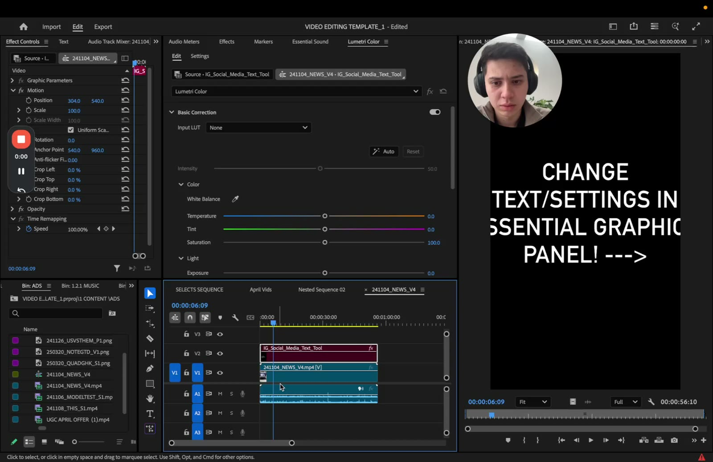

# 11. Native Social Titles Premiere Pro (1)
> How to make hook captions look like real Instagram/TikTok text (not like an ad) using a provided Premiere Pro Motion Graphics Template, and which settings and font to use.

## 🤖 Agent use
- **Use when:** briefing or checking on-screen hook text and captions for paid social video; deciding whether text looks "native".
- **Inputs → outputs:** a video + hook line → a hook caption in a native platform style (classic box, modern, neon, typewriter, bubble) with the right font and colour.
- **Rules:**
  - **DO** use the provided template for hook captions: "don't try and make it yourself... it's just not going to look as native" [02:44] (instructor claim).
  - **DO** set the classic style's font to Roboto Black [00:55]; if missing, download it free (Google Fonts, Adobe Fonts) [00:55].
  - **DO** use the template's native colour options and its two background styles [01:54]; place the box away from the product or speaker's face (page).
  - **DON'T** ship captions with a drop shadow, wrong font or a line through the middle, or that "look like someone tried to use DaVinci Resolve": it makes the ad "look like ads" instead of organic content (page, marked VERY IMPORTANT).
  - **IF** you do not use Premiere Pro **THEN** find an equivalent caption template or ask the course team [02:44] (page).
- **See also:** [13. LIVE Edit](013-live-edit.md) (subtitles and safe zone) · [12. Make AI look less fake](012-make-ai-look-less-fake.md) · [Native advertising](../../../../concepts/native-advertising.md) · [Font psychology](../../../../concepts/font-psychology.md)

## Key ideas
### Why this matters [page; 02:44]
- Page: "Getting the text type wrong will make your ads 'Look like ads' and not like organic content." Bad examples listed: a dropshadow, incorrect font, a line in the middle. A swipe file of organic text styles is linked (Figma board; not fetched).
- The presenter says to use this template only for the hook caption [02:44].

### Install and use the template [00:00–01:54]
- Premiere Pro: Graphics Templates (Essential Graphics browse) panel, click **+**, find the provided .mogrt, install [00:00].
- Drag onto the timeline; double-click the text to edit; read the on-template instructions (which fonts to use) [00:00]. The in-video template shows "CHANGE TEXT/SETTINGS IN ESSENTIAL GRAPHIC PANEL" as placeholder text (see screenshot).
- Pick a style (the demo uses "classic": a rounded box with the curves "on the side without having to make it yourself") [00:55–01:54]; scale it down; press Enter to break a long line (demo text: "replace your current toothbrush") [00:55].
- Classic needs Roboto Black; select it in the font dropdown [01:54].
- Colour: Color Selection (demo picks red and calls it the native Instagram red); Background Style 1 or 2 [01:54].
- Other styles in the template: classic, modern, neon, typewriter, bubble [02:44]; the presenter says some need a different font (the font name is unclear in the transcript).

## Steps / framework
1. Install the .mogrt (Graphics Templates → +).
2. Drag onto the timeline above the hook clip.
3. Essential Graphics: edit text, choose a style, set the font (Roboto Black for classic), pick the colour and background style.
4. Resize and position the box clear of the product or face.
5. Check for forbidden marks: drop shadow, centre line, wrong font.

## Prompts / templates (verbatim)
- Premiere template controls read from the attached binaries (derived from their `definition.json`; not shown in the video):
  - **Native Social Titles Premiere Pro (1).mogrt**, capsule `IG_Social_Media_Text_Tool`: Text, Text Style, Color Selection, Text Alignment, Background Style, Scale, Rotation, Position, Primary Custom Color, Secondary Custom Color, Tertiary Custom Color (Style 5).
  - **Native Social Titles Premiere Pro (2).mogrt**, capsule `Social_Text_Free_v2`: Text, Font Size, Position Adjustments, X Alignment, Y Alignment, Paragraph, Text Color, Box Color. The video does not show or mention this second template.
- The templates themselves are binary files kept under `originals/` (ignored by Git).

## Screenshots

*The template on a timeline layer (IG_Social_Media_Text_Tool); the placeholder text tells you to edit text and settings in the Essential Graphics panel. Effect Controls (left) and Lumetri (top centre) are open. [00:00]*

## How to apply
- [ ] Install the template; test with a hook line.
- [ ] Audit every ad's hook text against the four "bad example" marks.
- [ ] Keep captions out of face and product areas (see platform safe zones in [13](013-live-edit.md)).
- [ ] Use only the hook-caption style from the template; do not hand-build it.

## Related
- Previous: [10. AI Inspo Deck](010-ai-inspo-deck.md) · Next: [12. Make AI Look Less Fake](012-make-ai-look-less-fake.md)

## Sources and limitations
- [Transcript](<../../../../../raw/ad-creators-lab/ai-ads-ugc-animations/_transcripts/Ad Creators Lab - Create Viral AI Ads, UGC & Animations That Convert Into Sales(September 2026)/2. The Toolbox/2. Editing & Post-Production/1. Native Social Titles Premiere Pro (1).txt>) (Whisper; ends 3:02 of 3:03). Whisper wrote "Mogart", "Mogurt" for .mogrt.
- [Lesson page](<../../../../../raw/ad-creators-lab/ai-ads-ugc-animations/_extracted/Ad Creators Lab - Create Viral AI Ads, UGC & Animations That Convert Into Sales(September 2026)/2. The Toolbox/2. Editing & Post-Production/1. Native Social Titles Premiere Pro (1).htm.md>). Page images (bad and good examples) sit in a shared folder overwritten across pages and are not used. The Figma swipe file link was not fetched. The 2nd .mogrt (file "(2)") is an attachment on the page with no explanation.
- The video was recorded in a Premiere project and browser; the presenter is not named.
