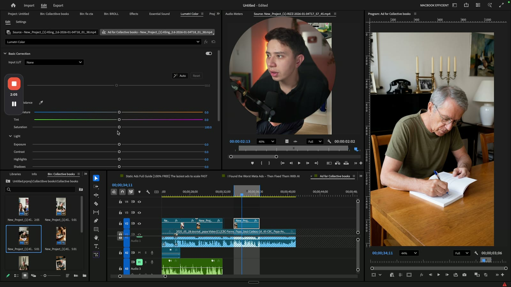
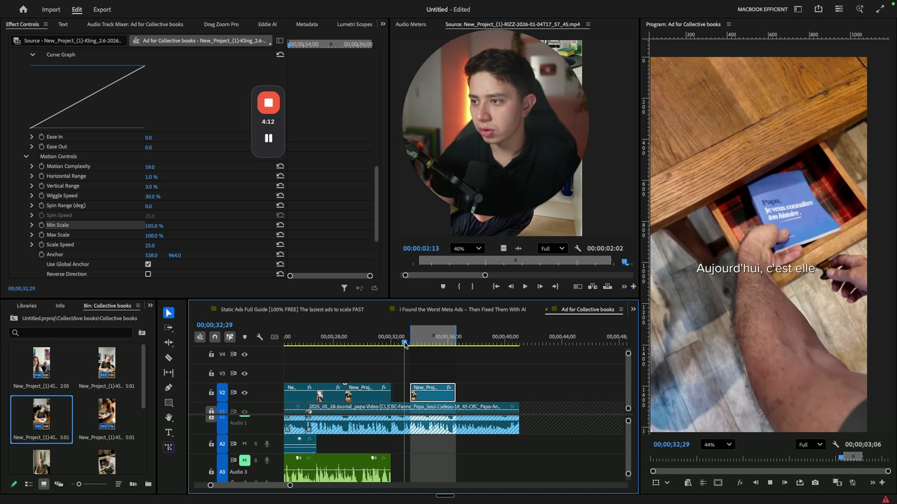

# 12. Make AI Look Less Fake
> A four-step Premiere Pro recipe (lower contrast and saturation, drop sharpness, add faded film, add a subtle Wiggle shake) that makes AI footage read as phone-shot, with the exact values shown.

## 🤖 Agent use
- **Use when:** AI-generated video comes out too sharp, contrasty and static ("very AI-y") and you need it to pass as organic phone footage; also when briefing an editor.
- **Inputs → outputs:** raw AI clip (e.g. Kling/Seedance output, 9:16) → graded, softened, slightly shaky clip.
- **Rules:**
  - **DO** drop Contrast in Lumetri Color "completely"/"to nothing": "typically a lot of AI shots come with really high contrast, which doesn't look nice" [01:01].
  - **DO** drop Saturation "just slightly" [01:01]; raising Highlights (a little blown out) is optional [01:01].
  - **DO** reduce Sharpen in the Creative tab: "drop it to like 12" [01:01–02:00].
  - **DO** add a little Faded Film: it raises the blacks; going fully up is too much [02:00].
  - **DO** add Impact Motion Effects "Wiggle" for phone-hand movement [02:00–02:57]; static AI shots look "a bit weird" [02:57].
  - **DON'T** leave AI footage static and high-res: "you can see it looks a lot more like iPhone footage as opposed to super high res" after the fix [00:00].
  - **IF** a clip already has low contrast **THEN** still drop it a bit more [02:57] (instructor).
- **See also:** [13. LIVE Edit](013-live-edit.md) · [11. Native social titles](011-native-social-titles-premiere-pro-1.md) · [AI UGC tools](../../../../tools/ai-ugc-tools.md) · [20. Claude Skill + Seedance 2.0 AI UGC](020-claude-skill-seedance-2-0-ai-ugc.md)

## Key ideas
### The before/after [00:00–01:01]
- Demonstration on an AI-generated ad (older man at a table writing in a book, sink scene). Voiceover line shown: "Your dad already has everything, and you never know what to give him. Watch this video." [00:00]. He re-creates the grade on the first shot and applies the same treatment to others.
- Goal: "a lot more like some kind of iPhone footage" than high-res AI output.

### Step 1: colour (Lumetri Color, Basic Correction) [01:01–02:00]
- Contrast: drop it fully; saturation: slightly down; highlights up a bit if you want (not necessary). "This applies to whatever editor you're using."

### Step 2: sharpness [01:01–02:00]
- Creative tab, Sharpen: decrease to about 12 ("you don't want it to be too sharp").

### Step 3: Faded Film [02:00]
- Creative tab: raise a small amount; full slider "raises all the blacks".

### Step 4: Wiggle (fake handheld) [02:00–02:57]
- Effects panel: search "wiggle" (Impact Motion Effects > Wiggle) and drag onto the clip. Default is too much.
- Settings as stated: Motion range 1% horizontal and 1% vertical; Scale 110 then "105" ("a bit much actually"); speed reduced to 30% (from 38%); can raise complexity and vertical range "to like 3" because "people typically hold their phone and they kind of wobble a little bit" [02:00–02:57].
- Settings as shown in the Effect Controls at ~03:00 (screenshot): Motion Complexity 59, Horizontal Range 1.0%, Vertical Range 3.0%, Wiggle Speed 30.0%, Min Scale 105%, Max Scale 100%, Scale Speed 25.
- Applied "throughout this video"; static AI shots "looked a bit weird" without movement [02:57].

## Steps / framework
| # | Tool | Setting | Check | Source |
|---|---|---|---|---|
| 1 | Lumetri Color, Basic Correction | Contrast to minimum; Saturation slightly down; Highlights up optional | Looks less produced | [01:01] |
| 2 | Lumetri Color, Creative | Sharpen about 12 | Not crunchy | [02:00] |
| 3 | Lumetri Color, Creative | Faded Film up a little | Blacks lifted, not milky | [02:00] |
| 4 | Effects > Impact Motion Effects > Wiggle | H 1%, V 1% (to 3%), speed 30%, min scale 105, complexity ~59 | Reads as hand-held phone | [02:00–02:57] |

## Examples
| Attempt | Setting | Result | Source |
|---|---|---|---|
| Wiggle default | Scale high, range large | "Crazy things, a bit much" | [02:00] |
| Wiggle tuned | Range 1%/1%, scale 105, speed 30% | "Looks like someone's holding it on their phone, which is nice" | [02:57] |
| Static shot with no movement | None | "Looked a bit weird" | [02:57] |

## Structured units
### Rules of thumb
- **DO** lower contrast on every AI shot, not only some [02:57].
- **IF** footage looks "AI-y" **THEN** reduce resolution feel (sharpen down), add blacks lift, add micro-shake [01:01–02:57].
- Compliance (derived): AI-generated "customers" or relatives must not be presented as real testimonials; follow platform AI-disclosure rules.

## Prompts / templates (verbatim)
- Not included in the course files (no text on the lesson page; settings are above).

## Screenshots

*Start of the grade: Lumetri Color Basic Correction open (Temperature, Tint, Saturation 100, Light section) on an AI-generated clip in a Premiere timeline. [01:00]*

*Wiggle parameters: Complexity 59, Horizontal 1.0%, Vertical 3.0%, Wiggle Speed 30%, Min Scale 105%, Max Scale 100%, Scale Speed 25. [03:00]*

## How to apply
- [ ] Apply the 4 steps to every AI clip before captions and music.
- [ ] Save as a preset or adjustment layer (derived) and reuse.
- [ ] Compare against the raw clip side by side at phone size.

## Related
- Previous: [11. Native Social Titles Premiere Pro (1)](011-native-social-titles-premiere-pro-1.md) · Next: [13. LIVE Edit](013-live-edit.md)

## Sources and limitations
- [Transcript](<../../../../../raw/ad-creators-lab/ai-ads-ugc-animations/_transcripts/Ad Creators Lab - Create Viral AI Ads, UGC & Animations That Convert Into Sales(September 2026)/2. The Toolbox/2. Editing & Post-Production/2. Make AI Look Less Fake.txt>) (Whisper; ends at full length 3:49). "Highlights" and "Sharpen" values spoken: only Sharpen (12), range values and speed numbers; contrast and saturation amounts are not numerically given ("completely", "slightly").
- [Lesson page](<../../../../../raw/ad-creators-lab/ai-ads-ugc-animations/_extracted/Ad Creators Lab - Create Viral AI Ads, UGC & Animations That Convert Into Sales(September 2026)/2. The Toolbox/2. Editing & Post-Production/2. Make AI Look Less Fake.htm.md>): no lesson text. Before/after clips are visible in the video only;
- Wiggle numbers shown on screen at 03:00 differ slightly from those spoken earlier (Scale 110 to 105, speed 38 to 30%); the screen is the final state.
