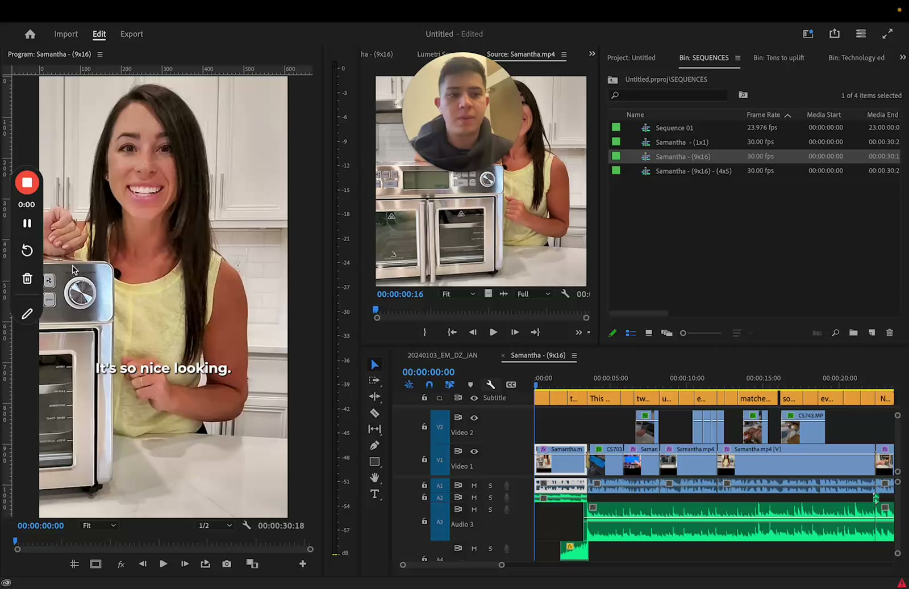
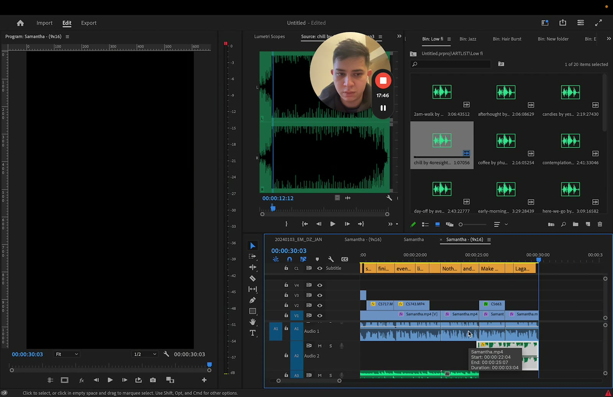

# 13. LIVE Edit
> A real-time Premiere Pro edit of one UGC A-roll plus studio B-roll into a finished direct-response vertical ad in under 30 minutes, with a 13-step workflow, the shortcuts used and the editorial decisions (hook choice, cuts, B-roll matching, captions, music, SFX).

## 🤖 Agent use
- **Use when:** briefing or checking a UGC edit (human or AI): choosing the hook, trimming, layering B-roll, captions, music, transitions, CTA.
- **Inputs → outputs:** A-roll UGC clip (talking creator) + B-roll folder + music and SFX libraries → 9:16 ad with hook, USP lines with matching B-roll, captions, music per section, transitions with SFX, CTA end card.
- **Rules:**
  - **DO** pick the hook from the creator's most appealing line, not a tutorial opener: he cut "I'll make a delicious and nutritious meal with me using..." because "I don't know if anyone wants to see a tutorial on how to use a product; it looks too much" [01:02].
  - **DO** choose the hook that appeals to an identity/desire: "it's so nice looking, it's the only appliance I leave out on my counter" targets people who want a nice kitchen [01:02–02:22].
  - **DO** remove breaths, pauses and non-essential lines (tutorial parts) and keep USP/feature lines [02:22–03:54].
  - **DO** put B-roll over the exact words it illustrates ("12-in-1" over the open-door shot; "matches cook time" over serving shots) [03:54–09:41].
  - **DO** prefer B-roll "with movement"; save staged/professional-looking shots for the end [03:54–05:32].
  - **DO** stabilise shaky B-roll with Warp Stabilizer [10:57].
  - **DO** add a whip transition with a matching whoosh SFX [17:18].
  - **DON'T** let a CTA get lost: close with a "Shop now" graphic after the final VO [17:18–18:29].
- **See also:** [12. Make AI look less fake](012-make-ai-look-less-fake.md) · [11. Native social titles](011-native-social-titles-premiere-pro-1.md) · [14. SFX pack](014-sfx-pack.md) · [Video editors](103-video-editors.md) · [Train your video editor](108-train-your-video-editor.md)

## Key ideas
### Setup [00:00–01:02]
- Goal: "a live recreation of a direct response ad" from UGC; logos and brand fonts are missing on purpose: "just to show how quickly you can actually get some of these videos done" [00:00]. Result in "less than half an hour" [19:56] (instructor claim). He is using a general project file, not the course templates [00:00].
- Product in the demo: a dual-zone air fryer by a real kitchen-appliance brand; the ad is an editing exercise, not that brand's own creative (see compliance note).

### Import and reframe [01:02]
- Drag the A-roll onto the Project panel New Item icon to auto-create a sequence; Sequence > Auto Reframe Sequence > Vertical 9:16; name it; make sure "Analyze clips" is enabled; Create [01:02].

### Cut the hook and the core [01:02–03:54]
- Hook decision: reject the tutorial opener; keep the "so nice looking" line for the "nice kitchen" desire [01:02–02:22].
- Cut with **Q** (ripple trim to the playhead, backwards) and **W** (forwards): "your ring finger and your middle finger should really just be hovering next to the Q and the W key" [02:22–03:54]. **Shift+S** brings back audio when scrubbing [02:22].
- Remove tutorial lines ("making crispy chicken with fries and roasted vegetables all at the same time"): "I don't think we need a tutorial exactly" [02:22]. Keep feature lines [02:22].

### B-roll [03:54–10:57]
- Search B-roll by scrubbing. "Doors opening" shot over "this super versatile"; a shot with movement over "12 in 1"; "Sometimes the footage is zoomed in because it's shot in 4K": right-click > Set to Frame Size (his shortcut Ctrl+F) [05:32].
- Jump cuts inside long action takes (taking things out): razor, delete mid-section, drag clips together [07:06].
- Slow down fast clips: shot at 60 fps, set speed to 50% (Cmd+R on Mac) [08:20]. Cut where the creator says a new point [08:20].
- Meat and veg served together are shown for "matches cook time" [09:41].

### Visual emphasis [10:57–11:59]
- "Nothing's worse than hot vegetables and cold chicken and fries": he makes the clip black and white to signal the negative [10:57].
- Closing shot added for "make your meal time quicker and easier"; shaky clip fixed with Warp Stabilizer [10:57].
- Zoom after Auto Reframe: nest the clip (right-click > Nest), then keyframe Position/Scale for a slow zoom on a key phrase ("so they both end up exactly how you want them"); re-sync audio by option-dragging [11:59].

### Captions [13:10]
- Window > Text > Transcribe; Captions > Create captions from transcript; he sets "1.5 to 1.6" (field unclear in transcript) and single line; then resizes into the Instagram safe zone ("everything inside this space is safe"), and saves the first caption as a style ("Subs 1") so all captions share it [13:10].
- For hook caption look, use the template in [11](011-native-social-titles-premiere-pro-1.md).

### Music [13:10–16:09]
- Hook: "interesting, poppy" or "funny, playful" track from his own folder; he mentions a music subscription (transcribed "art list", likely Artlist; unverified) [13:10–14:55].
- Feature section: a "technological educational sound"; auditioned by playing fast with **L** [14:55].
- Break ("nothing's worse..."): a playful track [16:09]. CTA: a "high note" that rises from the last shot; edit the music so it peaks at the end [16:09].

### Transitions, SFX, colour, CTA [17:18–19:56]
- Whip transition effect plus a whoosh sound effect "at the same time" [17:18].
- Colour: add contrast, saturation, brightness; grade a few shots [17:18].
- CTA: "Shop now" graphic or an asset pack's call-to-action titles; logo added last [17:18–19:56].
- Speed ramp: nest the clip, Time Remapping > Speed, Ctrl/Cmd-click to add a keyframe [18:29].

## Steps / framework
Page checklist (13 steps), with video detail:

| # | Step | Detail | Source |
|---|---|---|---|
| 1 | Import A-roll | Drag clip to New Item; rename sequence | page; [01:02] |
| 2 | Reframe to 9x16 | Sequence > Auto Reframe Sequence > Vertical 9x16, Analyze Clips, Create | page; [01:02] |
| 3 | Select and cut the hook | Find best opening line; Q to ripple-trim before/after | page; [01:02–02:22] |
| 4 | Trim core feature clips | Key USP lines ("12-in-1 air fryer", "QuickSync technology"); Q removes pauses and breaths, W extends edit points | page; [03:54] |
| 5 | Add B-roll and frame it | Import studio B-roll; Set to Frame Size (Ctrl+F) | page; [05:32] |
| 6 | Jump cuts and speed ramps | Razor and delete mid-sections; nest then Speed/Duration 50% for slow motion | page; [07:06–08:20] |
| 7 | Nest and zoom | Nest, then Position and Scale on key phrases | page; [11:59] |
| 8 | Subtitles | Window > Text > Transcribe > Create Captions from Transcript; font/size; Instagram safe zone; save style "Subs 1" | page; [13:10] |
| 9 | Music and SFX | Hook: playful/pop; educational/tech under features; playful on "nothing's worse..."; high note on CTA | page; [13:10–16:09] |
| 10 | Transitions and SFX | Whip/slide transitions; matching SFX under each | page; [17:18] |
| 11 | Colour grade and stabilise | Warp Stabilizer on shaky clips; brightness, contrast, saturation | page; [10:57; 17:18] |
| 12 | Final CTA and logo | Shop Now or end card after the closing VO | page; [17:18–19:56] |
| 13 | Export | Page: H.264, 9x16, about 30 fps ("Instagram-optimized"); the video does not show the export | page |

## Examples
**Source UGC script as spoken (A-roll, kitchen appliance):**
"It's so nice looking, it's the only appliance that I leave out on my counter. This super versatile 12-in-1 air fryer oven lets you cook two foods in two different ways using different zones, so they both end up exactly how you want them. Its QuickSync technology matches cook times and settings per zone so your entire meal finishes at the same time, even with some starting off frozen, like the chicken and fries that I'm using today. Nothing's worse than hot vegetables and cold chicken and fries. Make your mealtime quicker and easier. Order your [brand] Dual Zone Air Fryer today." [00:00] (final cut as read by the narrator; brand name omitted)

| Beat | Line | Visual treatment | Source |
|---|---|---|---|
| Hook | "so nice looking... only appliance I leave out on my counter" | Creator on camera, appliance on counter | [01:02–02:22] |
| USP 1 | "super versatile 12-in-1" | Door-opening shot, motion shot | [05:32] |
| USP 2 | "cook two foods... different zones" | Taking-out food shots with jump cuts, 50% slow-mo | [07:06–08:20] |
| USP 3 | "QuickSync matches cook times" | Serving shots | [08:20–09:41] |
| Pain | "Nothing's worse than hot vegetables and cold chicken and fries" | Black and white | [10:57] |
| CTA | "Order your... today" | Final shot, rising music, Shop Now graphic, logo | [16:09–19:56] |

## Structured units
### Hooks
| Hook (verbatim) | Heuristic(s) | Emotion / zone | Self targeted | Why it works | Source |
|---|---|---|---|---|---|
| "It's so nice looking, it's the only appliance that I leave out on my counter." | design/status benefit, identity (derived) | pride (derived) | home-cook who wants a nice kitchen | Appeals to a desire (nice kitchen) instead of tutorial | [01:02–02:22] |
| (Rejected) "I'll make a delicious and nutritious meal with me using this..." | tutorial opener | low | — | "Looks too much" like a tutorial when scrolling Facebook/Instagram | [01:02] |

### Rules
- **DO** use **Q** and **W** to ripple-trim; keep fingers on them [02:22–03:54].
- **DO** set B-roll to frame size after reframing [05:32].
- **IF** footage is 60 fps **THEN** slow it to 50% [08:20].
- **IF** a section is a negative pain point **THEN** make the visual B&W [10:57].
- **DO** save a caption style and apply it to all captions [13:10].

## Prompts / templates (verbatim)
- Not included in the course files beyond the page checklist above. The "asset pack with CTAs and titles" is mentioned but not attached to this lesson.

## Screenshots

*The finished ad at the start: creator in a kitchen, caption "It's so nice looking.", multitrack timeline with captions (yellow), B-roll and music. [00:00]*

*Audio bins (music and sound effects) open in the project panel while adding the transitions sound effects. [17:12]*

## How to apply
- [ ] Reframe to 9:16 first; analyze clips.
- [ ] Pick a desire-led hook; cut tutorial openers.
- [ ] Cover each USP with B-roll on the matching word; slow 60 fps clips to 50%.
- [ ] Caption style saved once, safe-zone checked.
- [ ] Music per section; whip + whoosh on each transition; CTA card last.

## Related
- Previous: [12. Make AI Look Less Fake](012-make-ai-look-less-fake.md) · Next: [14. SFX PACK](014-sfx-pack.md)

## Sources and limitations
- [Transcript](<../../../../../raw/ad-creators-lab/ai-ads-ugc-animations/_transcripts/Ad Creators Lab - Create Viral AI Ads, UGC & Animations That Convert Into Sales(September 2026)/2. The Toolbox/2. Editing & Post-Production/3. LIVE Edit.txt>) (Whisper; ends 20:16 of 20:17). Whisper wrote "Emerald agassi" for the brand name and "Doneness clips" for "Analyze clips". Several keyboard shortcuts were said fast; Q/W/Shift+S/Ctrl+F match Premiere defaults or the presenter's own mapping, not verified.
- [Lesson page](<../../../../../raw/ad-creators-lab/ai-ads-ugc-animations/_extracted/Ad Creators Lab - Create Viral AI Ads, UGC & Animations That Convert Into Sales(September 2026)/2. The Toolbox/2. Editing & Post-Production/3. LIVE Edit.htm.md>) (13-step checklist).
- Compliance (derived): the demo uses a real appliance brand's product name and a UGC creator's footage for an editing exercise; do not publish it as the brand's ad without authorization and creator usage rights. "Under 30 minutes" is the instructor's claim.
