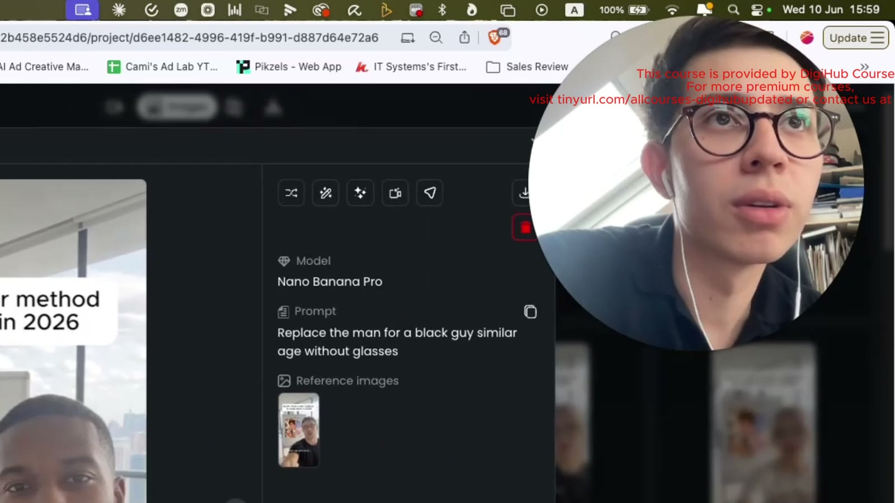
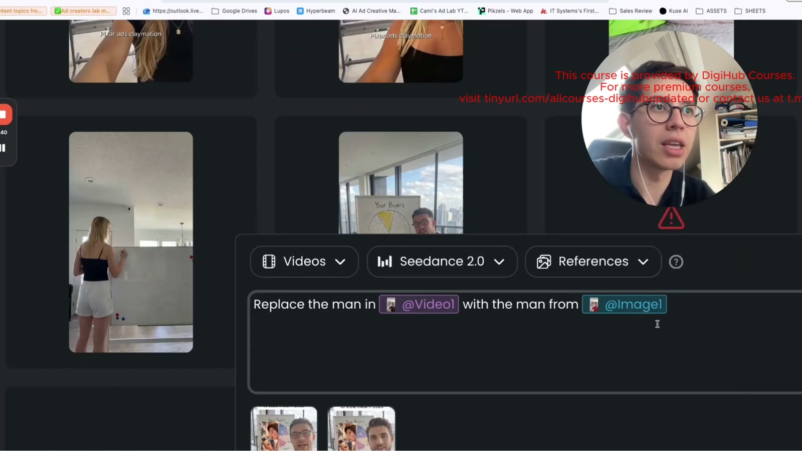
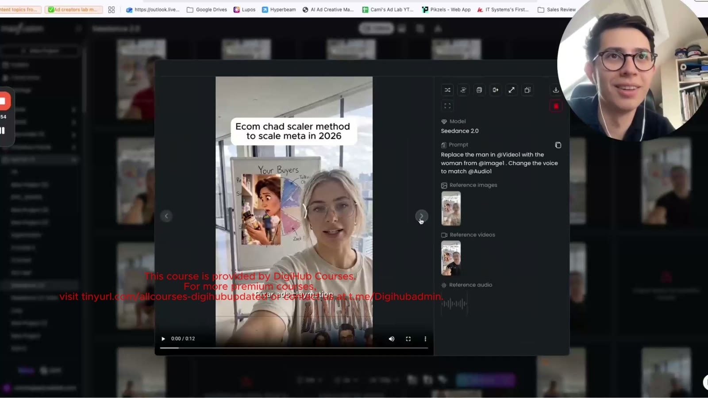

# 15. Change Creators With AI
> Take a talking-head ad that already works, swap the on-screen person for a different AI-generated one with Nano Banana Pro + Seedance 2.0 reference video, and fix the voice, so one proven script can be tested with several creators.

## 🤖 Agent use
- **Use when:** you own a talking-head ad (or have written usage rights to it) with a proven script and want the same ad with a different creator (look, age, ethnicity, outfit) to widen the audience pool; or you need a same-gender creator variant fast.
- **Inputs → outputs:** source clip (≤15 s, see limits in [016](016-clone-broll-ugc-ads.md)) + one screenshot of it → Nano Banana Pro edit of the screenshot (new creator, same pose) → Seedance 2.0 reference-video job (video + new image, optional designed voice) → swapped clip.
- **Rules:**
  - **DO** screenshot a frame of the original and edit that frame, not a blank-slate image [00:03].
  - **DO** use Nano Banana Pro for the edit: "there is a certain consistency in the lighting… it just looks more real" than GPT Image 2 on his tests [00:03–00:59] (instructor claim).
  - **DO** keep the new creator in a very similar pose to the original (same arm position); "this one would not work, but this one where the arm is the same as the original one will work" [00:59–01:38].
  - **DO** set the video length "one second above the length of the video" [01:38]. On the page: "about one second longer than the original".
  - **DO** keep the swap the same gender as the original: gender swaps keep the original voice, so a woman "doesn't sound like a girl" even with extra prompting [01:38–02:29].
  - **IF** the voice does not match the new face **THEN** replace it: Max Fusion "replace voice" (search a stock voice) or design a new voice from a text description, then reference it as `@Audio1` [02:29–03:19].
  - **DON'T** name a real person in the face prompt (the page example says "Change his face to look like xyz"). Describe attributes only (derived, see compliance).
  - **DON'T** clone another brand's ad this way. See "Compliance" below.
- **See also:** [016 Clone B-roll UGC ads](016-clone-broll-ugc-ads.md) · [020 Claude skill + Seedance 2.0](020-claude-skill-seedance-2-0-ai-ugc.md) · [AI UGC tools](../../../../tools/ai-ugc-tools.md) · [LLM output claim audit](../../../stefan-georgi/rmbc-ii/rubrics/llm-output-claim-audit.md)

## Key ideas
### Why swap creators [00:03, 01:38]
- Same script and visuals, new face: "Your audience pool gets larger as more people will buy because of different formats" [01:38] (instructor claim; no data shown).
- The demo source is a talking-head ad about scaling on Meta with Pixar/claymation ads on a whiteboard behind the speaker (on screen). Whether the clip is the course's own is not stated.

### Step 1: image edit, not a new image [00:03–01:38]
- Frame screenshot → image generator (Create image → Nano Banana Pro). He compared GPT Image 2 results first and judged Nano Banana Pro the most realistic [00:03–00:59].
- Prompt style: short replacement commands (see prompts). Demographic changes he names: "different white attractive male… Hispanic guy… black male" [00:59].
- Variants shown on screen: black man "similar age without glasses", man in bright red polo without glasses [00:53–01:07].

### Step 2: Seedance 2.0 reference-video job [00:59–02:29]
- Max Fusion → Videos → Seedance 2.0 → References. Upload the video and the new image; prompt "replace the man in @Video1 with the man from @Image1" [01:51].
- Same input limits as lesson 016 ("same limitations") [00:59]. A first job returned "content could not be processed because it contained material flagged by a content checker" (on screen, 00:22), so expect some inputs to be rejected.

### Step 3: the voice problem and fix [01:38–03:19]
- Seedance keeps the original voice. With a woman swapped in, "she doesn't sound like a girl", even after adding references and prompting [02:29].
- Fix A: Max Fusion "replace voice", search a female voice. He prefers B.
- Fix B: "design a new voice" from a description ("Hey what's up everyone just chilling in my living room"), generate, then use it as the reference audio. Final prompt on screen: "Replace the man in @Video1 with the woman from @Image1. Change the voice to match @Audio1" [02:27].
- Result is "just like the original version of the video" and "you can actually change the voice" [03:19] (instructor claim; judge it yourself).

## Steps / framework
| # | Step | Tool → setting | Check | Source |
|---|---|---|---|---|
| 1 | Pick the source ad | Talking head, speaker clearly framed | Own ad / rights cleared | page step 1 |
| 2 | Screenshot a frame | Pose you want to keep | Hands and arms visible | [00:03] |
| 3 | Edit the frame | Nano Banana Pro, prompt below | Lighting and skin look like a phone photo | [00:03–01:07] |
| 4 | Pick the image that matches the original pose | — | Arm/body position matches | [01:38] |
| 5 | Seedance 2.0 → References | Video + image (+ audio) | Length = source + 1 s | [01:38] |
| 6 | If gender changed or voice off | Replace voice or design voice | Voice matches face | [02:29] |
| 7 | Review | — | Realism, lip-sync, same script | page step 7 |

## Examples
| Attempt | Input | Prompt | Result | Source |
|---|---|---|---|---|
| Man to black man | frame of source | "Replace the man for a black guy similar age without glasses" | usable, arm pose matches | [00:53] |
| Man to man in red polo | frame | "give him a bright red polo top and remove the glasses" | usable | [01:05] |
| Man to blonde woman | frame | "Replace the man for a blonde genz girl she is also holding the camera like the image reference" | works visually; voice stays male until fixed | [02:19–02:29] |
| Pose mismatch | different arm position | — | "would not work" | [01:38] |

## Structured units
### Compliance (required reading for "clone winning ads" work)
- **DO** clone only your own ads, or footage you have written rights to modify with AI (including a creator's consent for face and voice in a contract).
- **DO** use a generated, non-real face and a designed voice. The compliant version of "clone a winner" is: extract the mechanism (hook type, shot order, pacing, claim type) into a brief, write your own script with your own substantiated claims, and generate your own creator.
- **DON'T** take another brand's ad and swap the face: that is copying the asset (script, visuals, claims) and the swap does not make it yours.
- **DON'T** prompt "make him look like [real person]" or reuse a real person's voice (celebrity look-alike, cloned voice).
- **DON'T** present an AI creator as a real customer giving a testimonial; claims in the script still need proof (claim audit).
- **IF** you run the swapped ad on a platform **THEN** check its current AI-content disclosure rules (derived).

## Prompts / templates (verbatim)
Nano Banana Pro (image edit), from the page and screen:
```text
Replace the man for a black guy similar age without glasses
give him a bright red polo top and remove the glasses
Replace the man for a blonde genz girl she is also holding the camera like the image reference
Replace the man with a different white attractive male
```
Seedance 2.0 reference job:
```text
Replace the man in @Video1 with the man from @Image1
Replace the man in @Video1 with the woman from @Image1. Change the voice to match @Audio1
```
Page wording: "Replace the man in video 1 with the man in image 1." Voice design sample line used: "Hey what's up everyone just chilling in my living room".

## Screenshots

*Image step: Nano Banana Pro, prompt "Replace the man for a black guy similar age without glasses", source frame as reference. A third-party course watermark overlays the recording. [00:53]*


*Max Fusion → Videos → Seedance 2.0 → References: `@Video1` and `@Image1` chips in the prompt, two thumbnails attached. [01:54]*


*Finished swap (0:12 clip): prompt "…Change the voice to match @Audio1", with reference image, video and audio listed. [02:27]*

## How to apply
- [ ] Confirm rights to the source clip and that the new face is generated, not a real person.
- [ ] Screenshot a frame; edit with Nano Banana Pro; keep pose and framing.
- [ ] Keep gender; design a voice if you must change it; reference it as `@Audio1`.
- [ ] Source length + 1 s; run the claim audit on the unchanged script before spending.

## Related
- Previous: none in this batch (module start) · Next: [016. Clone B-roll UGC ads](016-clone-broll-ugc-ads.md)

## Sources and limitations
- [Transcript](<../../../../../raw/ad-creators-lab/ai-ads-ugc-animations/_transcripts/Ad Creators Lab - Create Viral AI Ads, UGC & Animations That Convert Into Sales(September 2026)/3. AI UGC/1. 🔥NEW Clone Winning Ads/1. Change Creators With AI.txt>) (Whisper large-v3-turbo; complete, 3:20). Whisper wrote "Seed Dance", "Nana Banana", "Puppy". The spoken demo lines are the clip's own audio.
- [Lesson page](<../../../../../raw/ad-creators-lab/ai-ads-ugc-animations/_extracted/Ad Creators Lab - Create Viral AI Ads, UGC & Animations That Convert Into Sales(September 2026)/3. AI UGC/1. 🔥NEW Clone Winning Ads/1. Change Creators With AI.htm.md>). The Loom is the same video as the MP4.
- The female-voice limitation is as of recording (Aug–Sep 2026) and may have changed. Max Fusion link is an affiliate link on sibling pages.
