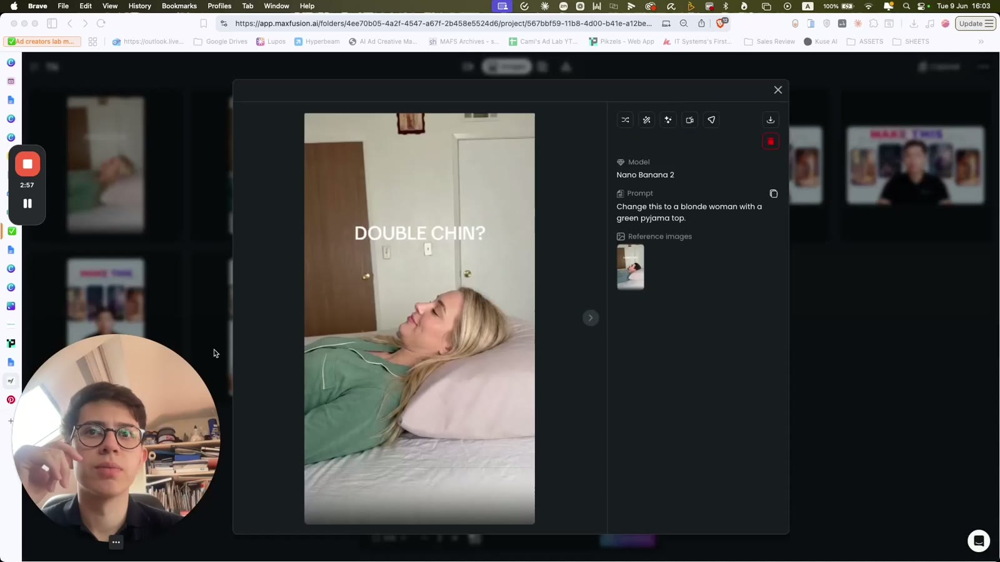
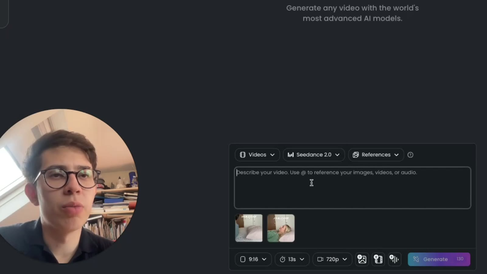
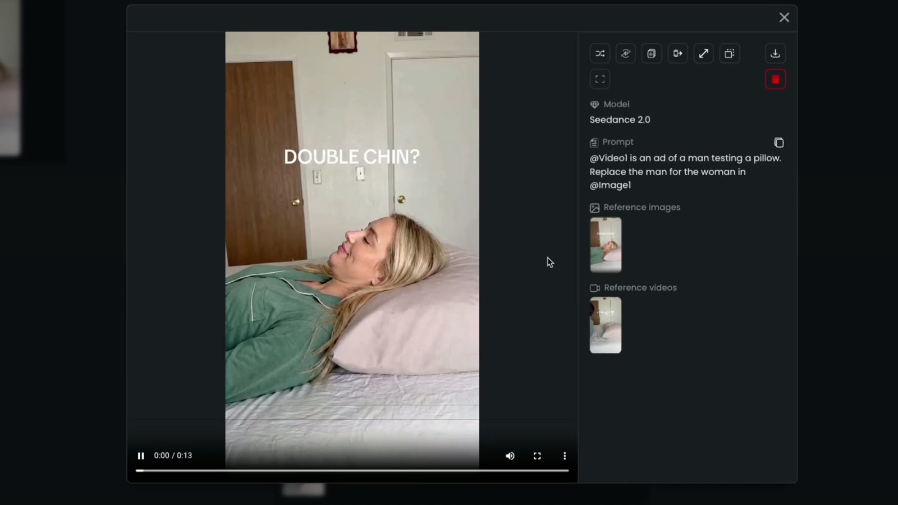

# 16. Clone Broll UGC Ads
> The same creator-swap workflow as lesson 015 applied to a B-roll style UGC clip (a person lying on a pillow with an on-screen hook), including the Seedance reference-video limits.

## 🤖 Agent use
- **Use when:** you have your own proven short UGC/B-roll clip and want the same angle with another AI creator to test whether the angle (not the person) wins.
- **Inputs → outputs:** clip 2–15 s and ≤50 MB → screenshot → new-creator image (Nano Banana) → Seedance 2.0 reference job → cloned clip.
- **Rules:**
  - **DO** "find a proven winning angle with a certain creator" first, then test it with a different avatar [00:00].
  - **DO** trim the source to fit: 2 to 15 seconds and up to 50 MB; his was cut to 13 s [00:00–00:56].
  - **DO** generate two image versions and pick the better one [00:56].
  - **DO** reference what you just made: in Max Fusion "inside references you can actually reference the content you've just added" [01:31].
  - **DO** describe the source in the prompt, then the swap: "video one is an ad of a man testing a pillow… replace the man for the woman in image one" [01:31].
  - **DON'T** clone someone else's winning ad. Compliance below.
- **See also:** [015 Change creators](015-change-creators-with-ai.md) · [020 Claude skill + Seedance 2.0](020-claude-skill-seedance-2-0-ai-ugc.md) · [AI UGC tools](../../../../tools/ai-ugc-tools.md) · [write-ugc-script skill](../../../../../../.claude/skills/write-ugc-script/SKILL.md)

## Key ideas
### Clone the angle, change the avatar [00:00–00:16]
- Side-by-side demo: original vs cloned; "it literally follows it verbatim" (instructor claim) [00:00]. A Canva-style slide titled "Clone ads with AI in minutes" shows two "DOUBLE CHIN?" clips side by side (frame 00:00).

### Workflow in Max Fusion [00:16–01:56]
1. Videos → Seedance 2.0 → References [00:16].
2. Upload the clip; limits 2–15 s, ≤50 MB; he cut the demo to 13 s [00:30].
3. Open the clip, screenshot a frame [00:47].
4. Images section: upload the screenshot, prompt "change this to a blonde woman with a green pajama top", run two versions [00:56–01:18].
5. Back in Videos: add the chosen image as an image reference, write the prompt, generate [01:31].
- Settings on screen at generate: 9:16, 13 s, 720p, 130 credits (at recording) [01:35].

## Steps / framework
| # | Step | Detail | Source |
|---|---|---|---|
| 1 | Choose own winning clip | Angle proven | page 1 |
| 2 | Seedance 2.0 + References | Max Fusion | page 2; [00:16] |
| 3 | Check limits | 2–15 s, ≤50 MB | [00:30] |
| 4 | Screenshot frame | Frame to modify | [00:47] |
| 5 | Image tool edit | New person, new outfit | [00:56] |
| 6 | Pick best | Not the same-looking person | [01:18] |
| 7 | Video prompt | Describe source + replace | [01:31] |

## Examples
| Source | Edit prompt | Video prompt | Result | Source |
|---|---|---|---|---|
| Man lying on a pillow, text "DOUBLE CHIN?" (13 s) | "Change this to a blonde woman with a green pajama top" | "@Video1 is an ad of a man testing a pillow. Replace the man for the woman in @Image1" | Woman in green pajama top, same room, pillow and text; 0:13 clip | [01:31]; frame 01:56 |

## Structured units
### Compliance
- **DO** use this only on your own clips or clips with documented rights; the lesson never says whose pillow ad the demo is.
- **DO** rewrite, not copy: if the winning clip belongs to someone else, take the mechanism (problem-first on-screen hook, in-bed demo, product test) and film or generate your own scene, product and claims.
- **DON'T** reuse a competitor's script, claims or on-screen text under a new face. A swapped face does not remove the copying.
- **DON'T** present the generated woman as a real customer with a real result (derived).

## Prompts / templates (verbatim)
```text
Change this to a blonde woman with a green pajama top
```
```text
@Video1 is an ad of a man testing a pillow. Replace the man for the woman in @Image1
```
Page structure: reference the video ("video 1 is an ad of a man testing a pillow"), instruct the change ("replace the man for the woman"), add the image reference ("image 1").

## Screenshots

*Image step: Nano Banana, prompt "Change this to a blonde woman with a green pajama top", source frame attached. [01:18]*


*Videos → Seedance 2.0 → References with source clip and new image attached; 9:16, 13 s, 720p, Generate shows 130 credits. [01:35]*


*Result panel: Seedance 2.0, prompt and the reference image and video listed; 0:13 clip. [01:56]*

## How to apply
- [ ] Confirm rights; trim clip to 2–15 s, ≤50 MB.
- [ ] Screenshot, edit to the new creator (two versions), choose one.
- [ ] Prompt "`@Video1` is an ad of …. Replace … in `@Image1`"; 9:16, 720p.
- [ ] Compare to the original on hook retention before scaling; run claim audit on the script.

## Related
- Previous: [015. Change creators with AI](015-change-creators-with-ai.md) · Next: [017. AI podcasts: what we are making](017-ai-podcasts-that-look-real-what-we-are-making.md)

## Sources and limitations
- [Transcript](<../../../../../raw/ad-creators-lab/ai-ads-ugc-animations/_transcripts/Ad Creators Lab - Create Viral AI Ads, UGC & Animations That Convert Into Sales(September 2026)/3. AI UGC/1. 🔥NEW Clone Winning Ads/2. Clone Broll UGC Ads.txt>) (ends 1:57 of 2:00; the video ends right after "I just hit generate", so the generation wait and result review are not narrated). "Seed Dance", "app video one" = `@Video1`.
- [Lesson page](<../../../../../raw/ad-creators-lab/ai-ads-ugc-animations/_extracted/Ad Creators Lab - Create Viral AI Ads, UGC & Animations That Convert Into Sales(September 2026)/3. AI UGC/1. 🔥NEW Clone Winning Ads/2. Clone Broll UGC Ads.htm.md>). Credits and limits are as of recording (Aug–Sep 2026).
