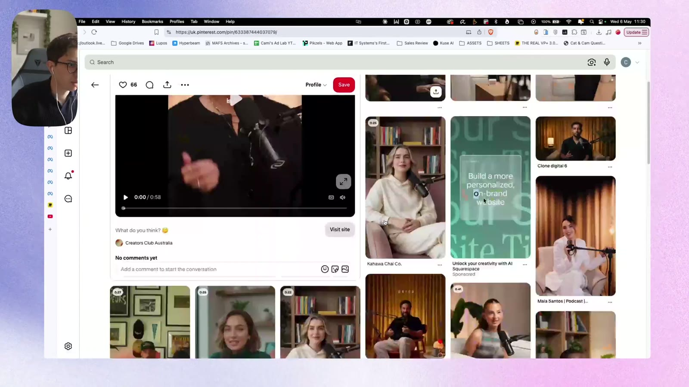
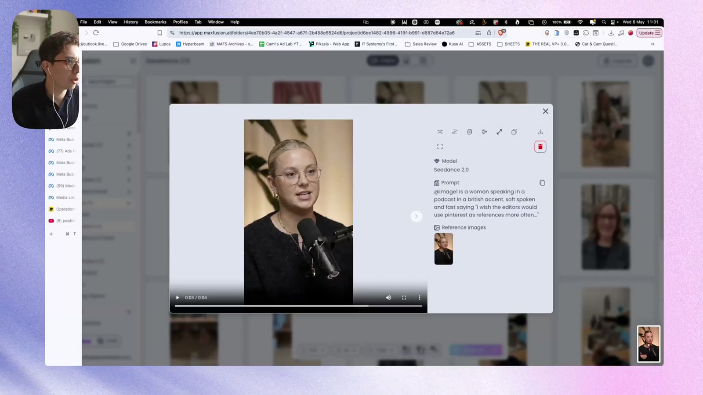
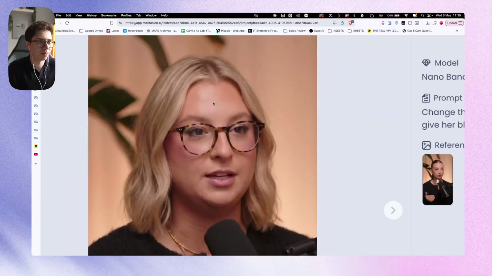
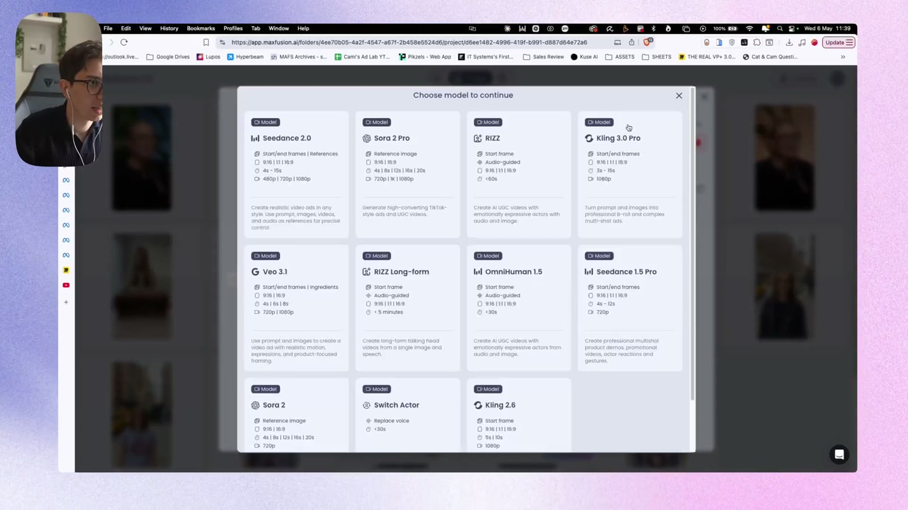
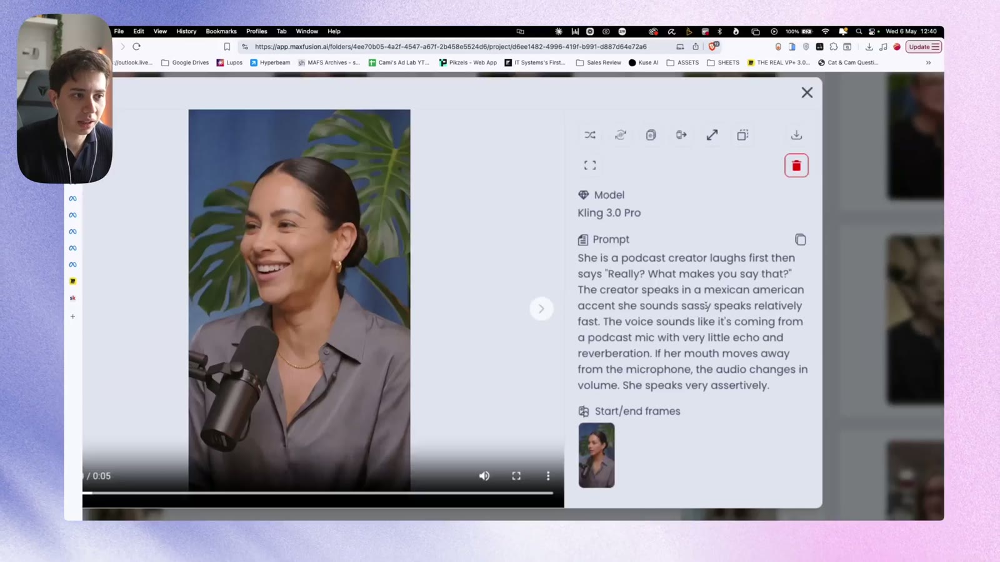

# 18. Realistic AI Podcasts Tutorial
> Build a believable two-person podcast ad: find a niche podcast look on Pinterest, change the faces and set so no real person is recognisable, animate each speaker with a detailed voice prompt so the audio matches across clips, then stitch.

## 🤖 Agent use
- **Use when:** making a podcast-format AI ad ("two people talking at mics") for a niche; any time two AI speakers must keep consistent voices across separate generations.
- **Inputs → outputs:** niche podcast reference (Pinterest/YouTube Shorts) + script lines → edited speaker images (A and mirrored B) → short speaking clips + reaction clips → stitched ad (see the target in [017](017-ai-podcasts-that-look-real-what-we-are-making.md)).
- **Rules:**
  - **DO** start from a real, popular podcast look in your niche: "if you do bodybuilding podcast… find a podcast setup that looks similar to the content that people watch"; check YouTube Shorts search (e.g. "peptides podcast") for what viewers watch [00:55].
  - **DO** reject AI-looking references: "you can actually tell an AI one from a mile away" [01:54].
  - **DO** change "as much of the image as possible whilst maintaining the style", and change the face to "the opposite of what it is" (long face to round) [02:24–03:16].
  - **DO** edit in stages. "When I tried to do too much in one go, it looked weird" [07:40]; page: "AVOID DOING ALL IN ONE PROMPT".
  - **DO** prompt the voice every time: accent, speed, mic sound, echo, volume change when moving off the mic, delivery. "When you generate a lot of different scenes and you don't give it exact details on how the audio is going to sound… she's going to sound different" [05:08].
  - **DO** make speaker B by flipping the edited image horizontally and changing identity, so both speakers face each other in the same plane [06:02–06:56].
  - **DO** test with ~5 s clips first [05:08].
  - **DON'T** use a real, famous creator's face or iconic set (e.g. a well-known podcast curtain): "we don't want to use her face at all… it's not going to work and probably reject it" [02:24, 04:11].
  - **DON'T** use Pinterest images that are already AI-generated as references [00:00–00:55].
  - **IF** the model rejects or the background is too iconic **THEN** change plant, background colour, clothes in separate edits [04:11].
- **See also:** [017 target ad](017-ai-podcasts-that-look-real-what-we-are-making.md) · [020 Seedance skill](020-claude-skill-seedance-2-0-ai-ugc.md) · [AI UGC tools](../../../../tools/ai-ugc-tools.md) · [ElevenLabs](../../../../tools/elevenlabs.md) (alternative voice route)

## Key ideas
### Why most AI podcasts fail [00:00–00:55]
- "AI podcasts are by far the ones that get butchered the most… you're not following a proper process" [00:00]. The fix is references first (Pinterest), then edits, then audio prompting.

### Reference hunting [00:55–02:24]
- Pinterest search (e.g. "girly podcast" for a female audience), click an image to get related suggestions, "go down the rabbit hole" [00:55]. Mix images and videos [00:00].

### Image edits [02:24–04:11]
- Screenshot reference → Nano Banana Pro (he likes it best; GPT Image 2 also works) [02:24]. GPT Image 2 made the face "quite high quality" and lost the camera/lens texture he wanted to keep [03:16].
- Sequence for speaker A: (1) face/hair/glasses edit; (2) remix "edit with prompt": plant with bigger leaves, background blue [04:11]; (3) clothes (grey blouse) [07:40].

### Animate speaker A [04:11–06:02]
- From the image: Generate video → Seedance 2.0 → References; image appears as `@Image1`; prompt "is a podcast creator saying" + quoted line + voice block; 5 s [04:11–05:08]. Frame shows: "@image1 is a woman speaking in a podcast in a british accent, soft spoken and fast saying…" [02:26 on frame].
- He also ran Kling 3.0 Pro and judged "the best one was the Kling one" [06:56]. Max Fusion model list at recording (screen clock 6 May): Seedance 2.0 (start/end frames, references; 9:16/1:1/16:9; 4–15 s; 480p–1080p), Sora 2 Pro, RIZZ, Kling 3.0 Pro (start/end frames; 3–15 s; 1080p), Veo 3.1, RIZZ Long-form, OmniHuman 1.5, Seedance 1.5 Pro, Sora 2, Switch Actor (replace voice), Kling 2.6 [frame 04:49].
- Alternative to voice prompts: clone the voice in Max Fusion (menu → clone voice / replace voice). He prefers detailed voice prompting "to save so much time" and stitch with consistent sound [06:02].

### Speaker B and reactions [06:02–08:36]
- Prompt on the edited image: flip horizontally, new age/hair/glasses/look (see below). Then change clothes/background; a background change took several tries and he accepted one [06:02–06:56].
- Animate B with a different accent in the same voice template. Reactions: simple prompts, e.g. "She is a podcast creator laughs first then says 'Really? What makes you say that?'" [08:36 and frame 08:28]; another frame shows an "impressed expression… 'mhhhmm'" variant.

### Edit [08:36–09:43]
- Timeline: hook clip A → B "Really? What makes you say that?" → A's proof line, with cut-aways; "the voice is very consistent even though this is one generation and this is another… because we prompted the audio very, very well" [09:07] (instructor claim).
- Editor shown on screen is a desktop timeline editor (not named by him).

## Steps / framework
| # | Step | Tool → setting | Check | Source |
|---|---|---|---|---|
| 1 | Find niche podcast look | Pinterest, YouTube Shorts | Not AI-made | [00:55] |
| 2 | Pick realistic reference, screenshot | — | Layout/lighting adaptable | [02:08] |
| 3 | Remove likeness | Nano Banana Pro | Face unrecognisable, camera texture kept | [02:24–03:16] |
| 4 | Change set in stages | Remix → edit with prompt | One change per prompt | [04:11, 07:40] |
| 5 | Speaker A clip | Seedance 2.0 refs or Kling 3.0 Pro, ~5 s | Voice block present | [04:11–05:08] |
| 6 | Speaker B image | Flip + identity prompt | Same plane, different look | [06:02–06:56] |
| 7 | B clip + reactions | Same voice template, new accent | Accent consistent per speaker | [07:40–08:36] |
| 8 | Stitch | Timeline | Hook first, tight pacing, audio consistent | [08:36–09:43] |

## Examples
| Item | What he did | Result | Source |
|---|---|---|---|
| Speaker A face | "round… blonde hair and glasses" | clearly different from reference; GPT Image 2 version too sharp | [03:16] |
| Background | plant bigger leaves, background blue | "doesn't look like AI" | [04:11] |
| Seedance vs Kling | same line, same image | OK vs "the best one was the Kling one" | [06:56] |
| Speaker B | flip + Latina late 30s brunette no glasses | distinct second host; clothes/background edited after | [06:02] |
| Too many edits in one go | multiple changes | "a bit… what on earth" artefacts | [07:40] |
| Final | hook → challenge → proof | consistent voices across generations | [08:36–09:07] |

## Structured units
- **DO** use "Pinterest as a fast reference library"; **DO** search YouTube Shorts for real examples (page, Tips).
- **DO** reuse the same voice-style prompt across scenes (page).
- **IF** the background or prop is iconic **THEN** modify it enough to avoid direct copying (page).
- **DON'T** keep an over-polished image: "overly polished visuals can make the content look artificial" (page).

### Compliance
- The reference is a real person's podcast frame. The lesson itself removes likeness; make that mandatory: the finished speaker must not resemble the source person, brand set, or any recognisable creator, and no cloned real voice. Use the reference for composition and mood only (copy the mechanism, not the asset).
- AI hosts voicing testimonial lines are not real customers; see [017](017-ai-podcasts-that-look-real-what-we-are-making.md).

## Prompts / templates (verbatim)
Speaker A face edit (Nano Banana Pro):
```text
Change the persons face so it's more round, give her blonde hair and glasses. Replace her top for a grey blouse.
```
Background edit:
```text
change the plant so that it has bigger leaves and the background color so that it's blue
```
Speaker B image:
```text
flip the creator horizontally and change her to be a woman in her late 30s brunette no glasses she's different looks latina
```
Page template:
```text
Flip the creator horizontally and change it to be a [age range] [gender], [hair color/style], [glasses or no glasses], [ethnicity/look]. [Optional: any other identity markers].
```
Speaker voice prompt (page example):
```text
The creator speaks in a soft English British accent at a normal speed. The voice sounds like it's coming from a podcast mic with little echo and reverberation. As her mouth moves away from the microphone, the audio changes in volume. She speaks very assertively.
She says: "Ad Creators Lab is the best place to learn how to make high-converting AI ads, hands down."
```
Template:
```text
The creator speaks in a [accent] accent at [speed]. The voice sounds like it's coming from a podcast mic with little echo and reverberation. As her mouth moves away from the microphone, the audio changes in volume. She speaks [delivery style].
She says: "[line]"
```
Reaction (on screen, Kling 3.0 Pro): "She is a podcast creator laughs first then says "Really? What makes you say that?" The creator speaks in a mexican american accent she sounds sassy speaks relatively fast. The voice sounds like it's coming from a podcast mic with very little echo and reverberation. If her mouth moves away from the microphone, the audio changes in volume. She speaks very assertively." Page reaction example: `She laughs then nods and agrees.`
He mentions a Claude skill for best prompts and prompt examples for audio behind a link below; neither is in this lesson's files (the Seedance skill is in [020](020-claude-skill-seedance-2-0-ai-ugc.md)).

## Screenshots

*Pinterest "girl podcast" results with related suggestions: how to hunt a realistic reference. [01:59]*


*Seedance 2.0 result: prompt "`@image1` is a woman speaking in a podcast in a british accent, soft spoken and fast saying…" with one reference image. [02:26 on screen; frame of the 0:04 clip]*


*Nano Banana Pro edit: round face, blonde hair, glasses; reference image attached. [03:53]*


*Model list with duration, resolution and aspect options (at recording): Seedance 2.0, Sora 2 Pro, RIZZ, Kling 3.0 Pro, Veo 3.1, OmniHuman 1.5, Switch Actor, etc. [04:49]*


*Speaker B: Kling 3.0 Pro, 5 s, start frame, laugh-then-line prompt with accent and mic description. [08:28]*

## How to apply
- [ ] Collect 3 real podcast looks from your niche; discard AI-made ones.
- [ ] Edit speaker A in 3 separate prompts (face/hair, set, clothes); then mirror for B.
- [ ] Write one voice block per speaker; reuse it on every clip; 5 s tests, then full lines.
- [ ] Add reaction clips and B-roll; stitch hook-first; run the claim audit on every spoken line.

## Related
- Previous: [017. What we are making](017-ai-podcasts-that-look-real-what-we-are-making.md) · Next: [019. Realistic AI UGC: the ad we are making](019-realistic-ai-ugc-the-ad-we-are-making.md)

## Sources and limitations
- [Transcript](<../../../../../raw/ad-creators-lab/ai-ads-ugc-animations/_transcripts/Ad Creators Lab - Create Viral AI Ads, UGC & Animations That Convert Into Sales(September 2026)/3. AI UGC/2. AI Podcasts (that look real)/2. Realistic AI Podcasts Tutorial.txt>) (complete, 9:43). Whisper: "Seed Dance", "Nana Banana", "GPT-2" = GPT Image 2, "Latina from yeah" is the speaker's aside.
- [Lesson page](<../../../../../raw/ad-creators-lab/ai-ads-ugc-animations/_extracted/Ad Creators Lab - Create Viral AI Ads, UGC & Animations That Convert Into Sales(September 2026)/3. AI UGC/2. AI Podcasts (that look real)/2. Realistic AI Podcasts Tutorial.htm.md>) (step list, prompt templates; its images are not reliably mapped, so frames were used). The page says Kling 3.0 or Seedance 2.0; the page numbering skips step 8.
- The detailed speaker-B accent prompts ("Mexican accent") describe ethnicity-linked voice styling; keep such prompts non-stereotyped (derived). Model list and durations are as of recording.
