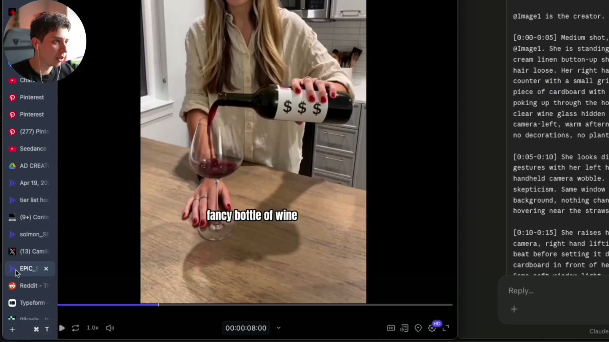

# 19. Realistic AI UGC: The Ad We Are Making
> Shows the finished 30-second blind-taste-test ad that lessons 020 to 023 build, and states the module goal: "freakishly realistic" Seedance 2.0 UGC, "avoiding SLOP".

## 🤖 Agent use
- **Use when:** you need the output spec for the AI UGC module (what "realistic" means here) before running [020](020-claude-skill-seedance-2-0-ai-ugc.md).
- **Inputs → outputs:** none; outcome reference only.
- **Rules:**
  - **DO** target phone-filmed realism, not "plastically" polished output; the page: "the best method to get AI UGC that looks real and not plastically… we are avoiding SLOP".
  - **DO** build the ad as hook → tasting beats with reactions → reveal, as in the finished example [00:00–00:30].
  - **DON'T** copy the example's claims as facts: the product facts come from the brand's own brief (see 020).
- **See also:** [020 Claude skill + Seedance 2.0](020-claude-skill-seedance-2-0-ai-ugc.md) · [021 Street interviews](021-street-interviews.md) · [023 Live edit](023-18-mins-uncut-live-editing-ai-ugc-video.md)

## Key ideas
### The finished ad [00:00–00:30]
- Verbatim audio: "No freaking way! My Italian husband just bet me $100. I can't tell the difference between his fancy bottle wine and boxed wine. So we're doing this. Yeah, it's fine. Not sure. It's very dry and strong. Ooh, I like this one. Ooh, this one is also good. No, absolutely not that one. I love number three, that's my favorite, and number four. Number three is boxed wine, and number four is a 150 bottle of wine. No!" [00:00–00:30]
- Visual: woman at a kitchen counter, a bottle poured into a glass with the on-screen text "fancy bottle of wine" (frame 00:00), reaction close-up with "NO!" caption (frame 00:01).
- Structure: bet hook → four tastings with escalating reactions → reveal (favourite is boxed wine, the $150 bottle is number four) → reaction.

## Examples
| Beat | Line | Source |
|---|---|---|
| Hook | "My Italian husband just bet me $100…" | [00:00] |
| Taste 1–2 | "it's fine. Not sure. It's very dry and strong" / "Ooh, I like this one" | [00:00] |
| Taste 3–4 | "this one is also good" / "No, absolutely not that one" | [00:00] |
| Reveal | "Number three is boxed wine, and number four is a 150 bottle" | [00:00] |

## Screenshots

*Final ad opening: wine poured at a counter with caption "fancy bottle of wine"; a Claude prompt panel is open beside it. [00:00]*

## How to apply
- [ ] Watch the finished ad, then follow [020](020-claude-skill-seedance-2-0-ai-ugc.md) for the prompts and [023](023-18-mins-uncut-live-editing-ai-ugc-video.md) for the edit.
- [ ] Judge your output against it: handheld phone look, natural audio, no plastic skin.

## Related
- Previous: [018. Realistic AI podcasts tutorial](018-realistic-ai-podcasts-tutorial.md) · Next: [020. Claude skill + Seedance 2.0](020-claude-skill-seedance-2-0-ai-ugc.md)

## Sources and limitations
- [Transcript](<../../../../../raw/ad-creators-lab/ai-ads-ugc-animations/_transcripts/Ad Creators Lab - Create Viral AI Ads, UGC & Animations That Convert Into Sales(September 2026)/3. AI UGC/3. Realistic AI UGC/1.The Ad We Are Making.txt>) (ends 0:31 of 0:32). [Lesson page](<../../../../../raw/ad-creators-lab/ai-ads-ugc-animations/_extracted/Ad Creators Lab - Create Viral AI Ads, UGC & Animations That Convert Into Sales(September 2026)/3. AI UGC/3. Realistic AI UGC/1.The Ad We Are Making.htm.md>).
- No performance data. The "Italian husband" persona and $100 bet are scripted fiction voiced by an AI creator; present as dramatisation, not a real customer story (derived compliance note).
