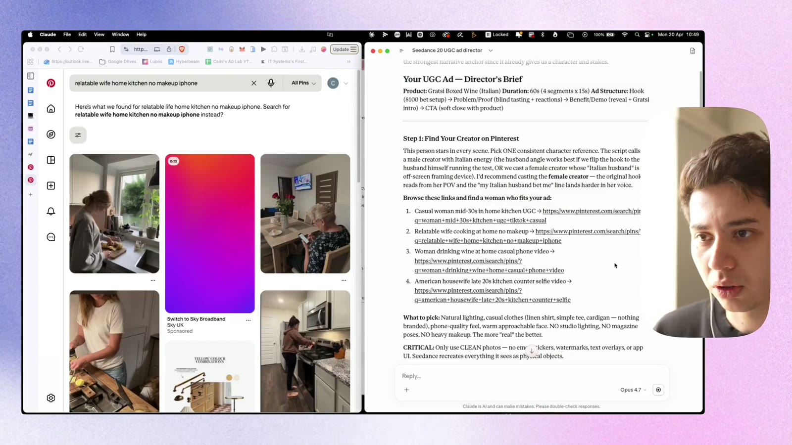
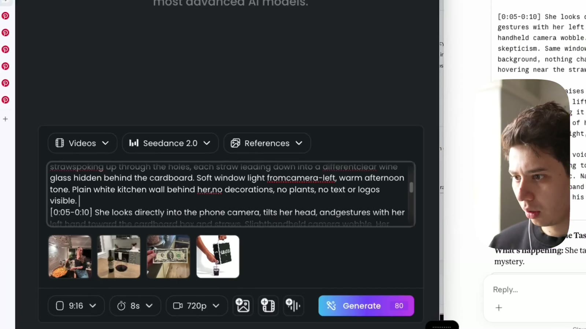
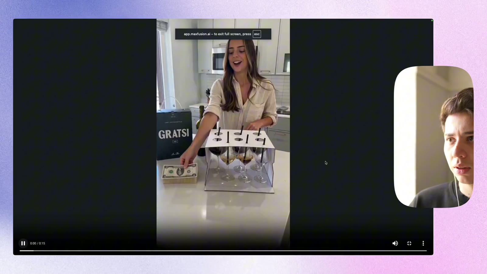

# 20. Claude Skill + Seedance 2.0 AI UGC
> Turn a normal UGC creator brief into a realistic AI UGC ad: a Claude skill converts the script into 15-second Seedance 2.0 prompts plus Pinterest reference searches, you pick a creator photo and scene references, generate each segment in Max Fusion, then tighten the prompt until the shot matches the brief.

## 🤖 Agent use
- **Use when:** producing AI UGC video from an existing UGC script or creator brief; writing Seedance 2.0 prompts; keeping one AI "creator" consistent across segments.
- **Inputs → outputs:** UGC script or brief (hooks, body points, B-roll list) + product photo → director's brief (Pinterest searches for creator and scenes, one prompt per 15 s segment with timed actions and dialogue) → generated segments → stitched ad.
- **Rules:**
  - **DO** treat the video model "like an actual UGC creator": feed it the same brief you would give a human creator [00:54].
  - **DO** check that Claude actually reads the skill before answering; "if it's not doing that and it's just giving you an output it's wrong, you need to try again" [00:54].
  - **DO** lock the look with real photo references (Pinterest): one creator image reused in every segment, plus location, prop and product references [01:46–03:32].
  - **DO** split the script into ≤15 s segments, because Seedance generates at most 15 s per clip [02:35]; set 15 s and 720p ("We don't want it to look too high definition") [05:59].
  - **DO** iterate by editing the prompt and pressing Remix rather than rebuilding the job [06:41].
  - **DO** cut what the model can't render cleanly: he dropped the cardboard-and-straws prop after two failed attempts, "I think it'll even convert better" [09:14] (instructor claim).
  - **DO** carry the creator into the next segment by extracting a frame from the finished clip and using it as the new creator reference [12:26].
  - **DON'T** use reference photos with emoji, watermarks, text overlays or app UI: "Seedance recreates everything it sees as physical objects" (skill file).
  - **DON'T** write "cinematic" or film-camera language; UGC prompts say iPhone handheld, natural light, slight shake (skill file).
- **See also:** [AI UGC tools](../../../../tools/ai-ugc-tools.md) · [write-ugc-script skill](../../../../../../.claude/skills/write-ugc-script/SKILL.md) (write the script first) · [LLM output claim audit](../../../stefan-georgi/rmbc-ii/rubrics/llm-output-claim-audit.md) · [AI song-ad pipeline (Loom)](../../../../resources/ai-song-ad-pipeline-loom.md)

## Key ideas
### Install the skill and confirm it runs [00:00–00:54]
- Download the skill zip (Google Drive link on the lesson page), then in Claude Desktop: side menu → Customize → Skills → **+** → Create skill → Upload skill, and drag in the zip. It installs as "Seedance 2.0 UGC Ad Director"; call it with `/seedance` or "Try in chat" [00:00].
- He uploads an existing UGC brief and runs it on Opus [00:54]. The proof the skill is working is the visible step where Claude reads the skill file first.

### Think like a director: references before prompts [01:46–03:32]
- The skill returns four Pinterest searches for the creator. Pick "clean photos, no emojis, no watermarks"; he chooses a phone-shot photo because "you can see the ray of light… the quality of everything, we want to lock in this style" [01:46–02:35].
- Pinterest's "more like this" results under an image help find a closer match [02:35].
- Save files with clear names ("creator", "kitchen counter reference") — "you have to be very organized" [02:35–03:32].
- Then pull references per scene: location (kitchen counter) and props ($100 bill) [03:32]. "We're basically thinking like a director who's giving… a Hollywood production team… what we want to create" [03:32].

### Generate in Max Fusion → Seedance 2.0 [04:03–06:41]
- Max Fusion → Videos → Seedance 2.0 → References: up to nine images. Upload creator, setting and prop images; refer to them in the prompt with `@` (e.g. "@Image1 is the creator") [04:03–05:01].
- Paste the skill's prompt, read it as if you were shooting it, and add the product if you want it in frame (he adds the boxed wine "on the side of the counter" by reference) [05:01].
- Settings: 9:16, 15 s, 720p [05:59]. (The screenshot shows 8 s still selected before he changes it.)
- First result: "a very realistic iPhone looking shot", but hand actions, some words, and the straw-and-holes prop "don't really make sense" [06:41].

### Iterate on the prompt, not the tool [06:41–11:28]
- Attempt 2: change "single continuous shot" to "multiple shots", add camera moves (medium shot, hand places the bill, pan up to the creator) and a new prop reference found by searching "blind drink taste test" [06:41–09:14].
- Attempt 2 still had product-consistency problems (stemless glasses, empty glasses), so he simplified: remove the cardboard prop, show boxed wine and bottle wine being poured instead [09:14–10:15].
- "Seedance 2.0… follows everything to the T. Everything about the prompt, it absolutely follows" [11:28] (instructor claim). So vague prompts produce random details: describe each hand, the surface, and what is **not** in frame.

### Keep the creator consistent across segments [11:28–13:33]
- For segment 2, extract a frame from the finished segment-1 clip, save it, and upload it as the creator reference; prompt "same person, slightly closer to the shot" [12:26].
- The final ad: hook, four tastings with reactions, the reveal that the favourite is the boxed wine [12:26–13:18].

## Steps / framework
From the lesson page (verbatim order) with the video detail added:

| # | Step | Detail | Source |
|---|---|---|---|
| 1 | Get the Claude skill | Drive zip linked on the page (extracted below) | page; [00:00] |
| 2 | Install to Claude Desktop | Customize → Skills → + → Upload skill | [00:00] |
| 3 | Upload your UGC brief | Use a strong model; confirm it reads the skill | [00:54] |
| 4 | Use Pinterest for visual ideation | One creator photo; scene and prop photos per segment | [01:46–03:32] |
| 5 | Download references | Clean images only, named clearly | [02:35] |
| 6 | Max Fusion → Seedance 2.0 → References | Upload references; `@ImageN` in the prompt | [04:03] |
| 7 | Copy the prompt from Claude and double-check | Add product placement if wanted; 9:16, 15 s, 720p | [05:01–05:59] |
| 8 | Run and iterate | Remix; add camera moves and missing references; drop props that fail | [06:41–11:28] |
| 9 | Complete the ad creative | Next segment from an extracted frame; stitch | [12:26] |

## Examples
**Brand in the brief:** Gratsi boxed wine. Concept: blind taste test of four wines (American bottle and box, Italian bottle and box) where the creator's favourite turns out to be the boxed Italian wine (PDF p.1).

| Version | What changed | Result | Source |
|---|---|---|---|
| Attempt 1 | Skill prompt as written + creator, counter, $100 bill references | Realistic; hand action, some words and the straw prop wrong | [05:59–06:41] |
| Attempt 2 | Multiple shots; bill placed by a hand then pan up; new prop reference | Looks real; stemless or empty glasses, product inconsistency | [06:41–09:14] |
| Attempt 3+ | Prop removed; pour shots of box and bottle | The shot he wanted; one remaining issue (one hand on the box tap, one on the glass) | [10:15–11:28] |

## Structured units
### Hooks (from the brief PDF)
| Hook (verbatim) | Heuristic(s) | Emotion / zone | Self targeted | Why it works | Source |
|---|---|---|---|---|---|
| "My Italian husband bet me $100 I couldn't tell the difference between his fancy bottle and boxed wine..." | stakes, curiosity gap (derived) | playful challenge (derived) | — | A bet with money creates a stake and an open loop | PDF p.1 |
| "I've been a wine snob my whole life... so when my friend made me do a blind taste test, I was NOT expecting this..." | identity + expectation break (derived) | surprise (derived) | wine snob | The expert being surprised implies the result is real | PDF p.1 |
| "Can you actually taste the difference between a $30 bottle and a $10 boxed wine? I tested it..." | question hook, price anchor (derived) | curiosity (derived) | value-conscious drinker | Price gap makes the test feel useful | PDF p.1 |
| "I put American wine against Italian wine in a blind test... and what won completely shocked me" | competition, curiosity gap (derived) | surprise (derived) | — | Outcome withheld | PDF p.2 |
| "My husband made me taste 4 wines blindfolded and my favorite was the one he said he'd never drink..." | expectation reversal (derived) | vindication (derived) | — | The "never drink" option winning is the twist | PDF p.2 |

### Rules from the brief and skill
- **DON'T** show the product in hooks unless stated (PDF p.1, p.5).
- **DON'T** use "game changer", "skyrocketed", "level up", "elevate", "boost", "synergy" (PDF p.2).
- **DO** give product facts as talking points, not lines: "Touch on 2-3 of these points conversationally (don't list them)" (PDF p.3).
- **DO** frame benefits as personal experience, "not a brand claim" (PDF p.3).
- **DON'T** say "link below" or "link in bio"; soft CTA such as "Find it at gratsi.com" (PDF p.3).
- **DO** keep one action arc per prompt; "don't describe two scene changes in one prompt" (skill file).
- **IF** a detail is not described **THEN** "Seedance invents it — and you get random artifacts" (skill file).

## Prompts / templates (verbatim)
### The Claude skill: "Seedance 2.0 UGC Ad Director" (`SKILL.md`, from the linked Drive zip)
```markdown
---
name: Seedance 2.0 UGC Ad Director
description: Create hyper-realistic AI UGC video ad prompts for Seedance 2.0. Give it a script or product concept and get Pinterest reference links and detailed Seedance prompts ready to copy-paste.
---

# Seedance 2.0 UGC Ad Director

**MANDATORY RULES — read these before doing anything:**

1. Follow the EXACT output format below. Do NOT invent your own format, tabs, categories, or "director notes."
2. Seedance 2.0 DOES generate speech and dialogue natively with lipsync. NEVER tell users to add voiceover in post.
3. NEVER use the word "cinematic" anywhere. These are UGC ads that look like iPhone footage.
4. Every output MUST include Pinterest links. Never skip them.
5. Do NOT ask clarifying questions. Make creative decisions yourself and output everything in ONE response.

---

## EXACT OUTPUT FORMAT — follow this structure every time:

When the user gives you a script or concept, output this EXACT structure:

# Your UGC Ad — Director's Brief

**Product:** [name]
**Duration:** [total]s ([N] segments x 15s)
**Ad Structure:** Hook → Problem/Proof → Benefit/Demo → CTA

---

## Step 1: Find Your Creator on Pinterest

This person stars in every scene. Pick ONE consistent character reference.

**Browse these links and find a person who fits your ad:**

1. [Description] → [Pinterest URL: https://www.pinterest.com/search/pins/?q=QUERY]
2. [Description] → [Pinterest URL]
3. [Description] → [Pinterest URL]
4. [Description] → [Pinterest URL]

**What to pick:** Natural lighting, casual clothes, phone-quality feel. NO studio lighting, NO magazine poses, NO heavy makeup. The more "real" the better.

**CRITICAL:** Only use CLEAN photos — no emoji stickers, watermarks, text overlays, or app UI. Seedance recreates everything it sees as physical objects.

Your chosen image becomes **@Image1** — upload it to Seedance 2.0 as a reference for every segment.

---

## Step 2: Setting & Product References (Optional)

Grab additional Pinterest references for settings and product interaction poses:

**Scene 1 — [Hook]:**
1. [Setting search] → [Pinterest URL]
2. [Product interaction search] → [Pinterest URL]

**Scene 2 — [next section]:**
1. [Setting search] → [Pinterest URL]
2. [Product interaction search] → [Pinterest URL]

[Continue for each scene. Only clean photos — no overlays.]

---

## Step 3: Seedance 2.0 Prompts — Copy & Paste

Upload your Pinterest creator as @Image1 and your product photo as @Image3 for EVERY segment.

### Segment 1 of [N] — [Hook] (0:00-0:15)

**What's happening:** [One sentence]

    9:16. 15 seconds. Single continuous shot. UGC style. iPhone handheld.

    @Image1 is the creator. @Image3 is the product.

    [0:00-0:05] [Rich, detailed description — 3-4 sentences. Camera position,
    the person's full appearance, what they're wearing, their expression, what
    their hands are doing, what's on the surface in front of them and what's
    NOT there, the specific light source and direction, the background details.]

    [0:05-0:10] [Rich, detailed description — 3-4 sentences. What changes,
    what the person does with the product, hand movements, facial expression
    shift, what's visible, what's not. Same light source. Background consistent.]

    [0:10-0:15] [Rich, detailed description — 3-4 sentences. Final movement,
    expression, eye contact, body position, product position. Describe the
    final moment clearly.]

    Audio: [Voice character — age, gender, tone, energy. E.g., "Warm male voice,
    early 40s, genuine and relaxed, dad-energy, not performative"]. [Room tone
    matching the setting — e.g., "Open kitchen acoustics, subtle ambient hum,
    warm room tone"]. Natural speech rhythm with pauses. "[Full dialogue with
    filler words, contractions, and casual pacing]."

### Segment 2 of [N] — [Problem/Proof] (0:15-0:30)

[Same detailed format — @Image1 stays the SAME]

[Continue for all segments]

---

## Step 4: Generate & Review

1. Generate all segments in Seedance 2.0 (on Max Fusion or Jianying)
2. Check: Does the creator look consistent across segments?
3. Check: Does it look like a real person filmed this on their phone?
4. If anything looks off, regenerate that segment with the same @Image1
5. Stitch segments in order and export

---

## END OF OUTPUT FORMAT

Everything above between "# Your UGC Ad — Director's Brief" and "## END OF OUTPUT FORMAT" is the EXACT structure to follow. Now here are the rules for writing the prompts:

---

## Prompt Writing Rules

### Anti-Cinematic Rules (NON-NEGOTIABLE)

**ALWAYS use:** `iPhone handheld`, `natural lighting` / `window light`, `UGC style`, `slight camera shake`, `casual`, `authentic`, `9:16`

**NEVER use:** `cinematic`, camera brands (`ARRI`, `RED`, `Blackmagic`), `anamorphic`, `film grain`, `dramatic lighting`, `speed ramp`, `bloom flash`, `lens flare`, `whip pan`, `crane`, `dolly`, `steadicam`, `gimbal`, `Dutch angle`, `color grade`, `LUT`, `bokeh`, `epic`, `breathtaking`, `stunning`, `slow motion` (unless "iPhone slow-mo"), `depth of field` alone (say "phone camera depth of field")

### Detail Level

Be VERY descriptive. Every 5-second block needs 3-4 sentences of specific detail:
- What the person is doing with EACH hand
- Their exact facial expression
- What's on the surface and what's NOT there
- Background details
- Specific light source and direction
- If you don't describe it, Seedance invents it — and you get random artifacts

### Audio Direction

Every prompt MUST include detailed audio. Seedance 2.0 generates audio natively.

**Voice:** Match to demographic. E.g., "Warm female voice, mid-20s, casual, talking to a friend" or "Deep male voice, 40s, genuine dad energy, not a narrator"

**Room tone — must match the setting:**
- Bathroom: slight reverb from tiled walls
- Bedroom: soft close acoustics, carpeted, minimal echo
- Kitchen: open space feel, subtle ambient sounds
- Car: muffled close acoustics
- Outdoors: natural ambience, slight wind
- Living room: warm room tone, furnished space

**Speech pattern:** Natural with pauses, filler words, contractions. NOT scripted.

### Dialogue Rules

Write dialogue that sounds REAL, not scripted:
- Use contractions: "I've been," "it's literally," "you're gonna"
- Include filler words: "like," "honestly," "so basically"
- Casual grammar — fragments and run-ons are fine
- Sound genuinely excited or skeptical, not rehearsed

**Good:** "Okay so I've been using this for like two weeks and honestly? It actually works."
**Bad:** "This revolutionary product has transformed my routine completely."

### Pinterest URL Format

`https://www.pinterest.com/search/pins/?q=WORDS+SEPARATED+BY+PLUS+SIGNS`

Make searches specific to the scene: combine the person demographic + action + setting.

### Reference Image Mapping

    @Image1 = creator from Pinterest (same across ALL segments)
    @Image2 = setting reference if needed
    @Image3 = product photo (user provides this)

### Seedance 2.0 Facts

- Input: up to 9 images + 3 videos + 3 audio (12 total)
- Output: 4-15 seconds per generation, up to 2K, 9:16 for UGC
- Native audio: dialogue with lipsync, ambient sounds, room tone — all generated together
- Handles long detailed prompts well, especially with @Image references
- One action arc per prompt — don't describe two scene changes in one prompt
```
*(Inner code fences in the original are shown indented here so the block renders.)*

### Creator brief structure (PDF, Gratsi)
```text
1) Script - Hooks: 5 hooks, each with script + additional (visual) instructions. Hooks are filmed separately so editors can build variations; no product in hooks unless stated.
2) Talking Head / Body: script points, not lines — The Setup → The Tasting Journey → The Reveal & Reaction → The Gratsi Introduction (2-3 product facts, conversational; personal experience, "not a brand claim") → Soft CTA. Body about a minute or less. Banned words list.
3) B-roll Shot List: tick-off list (15 shots), no voiceover, change outfit, labels hidden until the reveal.
4) Filming requirements: 9:16, eye level, iPhone HDR off, centre frame, no edits/captions, no background noise, no shadows on face, no branded clothes.
5) Sending files: raw only, Google Drive, three folders (Hooks / Talking Head / B-rolls), file names "Hook 1", "B-roll 1_Description of action", "Talking-head video".
```

## Screenshots

*Left: the creator brief's hook table. Right: Claude's "Your UGC Ad — Director's Brief" with four Pinterest searches for the creator and the "only clean photos" warning. [02:08]*


*Max Fusion → Videos → Seedance 2.0 → References: creator, wine-glass, $100-bill and product images uploaded, the timed prompt pasted, 9:16 and 720p set (duration still on 8 s; he switches to 15 s), 80 credits per generation. [05:42]*


*Attempt 1: phone-style kitchen shot with the box, the bottle and the bill; the straw prop and hand action are wrong, which drives the prompt edits that follow. [06:19]*

## How to apply
- [ ] Write (or reuse) a human-style UGC brief first: hooks, body points, B-roll list. Run it through the claim audit; the AI creator will say whatever the brief says.
- [ ] Install the skill (verbatim above) as a Claude skill; check the first step of the reply is the skill being read.
- [ ] Pick one clean creator photo; save setting, prop and product references per segment with clear names.
- [ ] Generate segment 1 at 9:16, 15 s, 720p. Review hands, props, product label and spoken words.
- [ ] Edit the prompt (camera moves, what each hand does, what is not in frame) and Remix; drop any prop that fails twice.
- [ ] Extract a frame from the approved clip as the creator reference for the next segment; stitch at the end.

## Related
- Previous: [019. Realistic AI UGC: the ad we are making](019-realistic-ai-ugc-the-ad-we-are-making.md) · Next: [021. Street interviews](021-street-interviews.md)
- [AI UGC tools](../../../../tools/ai-ugc-tools.md) · [write-ugc-script skill](../../../../../../.claude/skills/write-ugc-script/SKILL.md)

## Sources and limitations
- [Transcript](<../../../../../raw/ad-creators-lab/ai-ads-ugc-animations/_transcripts/Ad Creators Lab - Create Viral AI Ads, UGC & Animations That Convert Into Sales(September 2026)/3. AI UGC/3. Realistic AI UGC/2. Claude Skill Seedance 2.0 AI UGC.txt>) (faster-whisper large-v3-turbo; ends at 13:33 = full length). Whisper wrote "seed dance", "C-Dance", "CDAN" for Seedance and "Seat Dance"; fixed in prose.
- [Lesson page](<../../../../../raw/ad-creators-lab/ai-ads-ugc-animations/_extracted/Ad Creators Lab - Create Viral AI Ads, UGC & Animations That Convert Into Sales(September 2026)/3. AI UGC/3. Realistic AI UGC/2. Claude Skill + Seedance 2.0 AI UGC.htm.md>) · [Creator brief PDF](<../../../../../raw/ad-creators-lab/ai-ads-ugc-animations/_extracted/Ad Creators Lab - Create Viral AI Ads, UGC & Animations That Convert Into Sales(September 2026)/3. AI UGC/3. Realistic AI UGC/2. Claude Skill + Seedance 2.0 AI UGC.pdf.md>) · [Skill file](<../../../../../raw/ad-creators-lab/ai-ads-ugc-animations/_extracted/_linked/drive/1hhpDrCG--seedance-20-ugc-ad-director__SKILL.md>) (fetched from the public Drive link on 2026-11-13).
- The Max Fusion link on the page is an affiliate link (`?via=camilo`). Credit cost (80 per generation) is read from the screen at that resolution and length; prices change.
- The finished ad is shown, but no performance data. The Gratsi product facts (zero sugar, made in France and Italy, 30 days fresh) are the brand's claims in its own brief, not verified here.
- The AI "creator" is a stranger's Pinterest photo used as a likeness reference (derived caution): using a real, identifiable person's face in an ad without permission is a legal and platform risk. Prefer licensed or generated faces.
