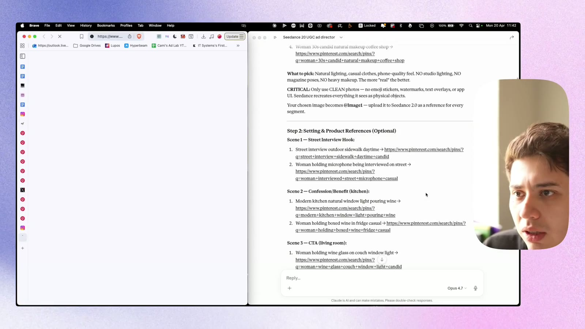
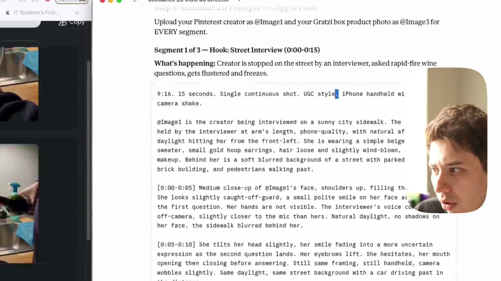
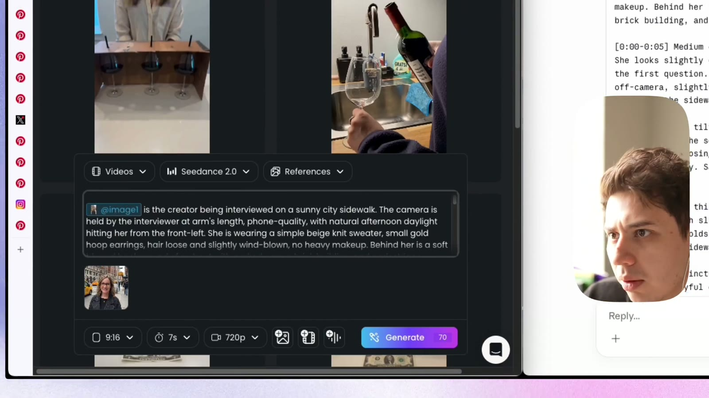
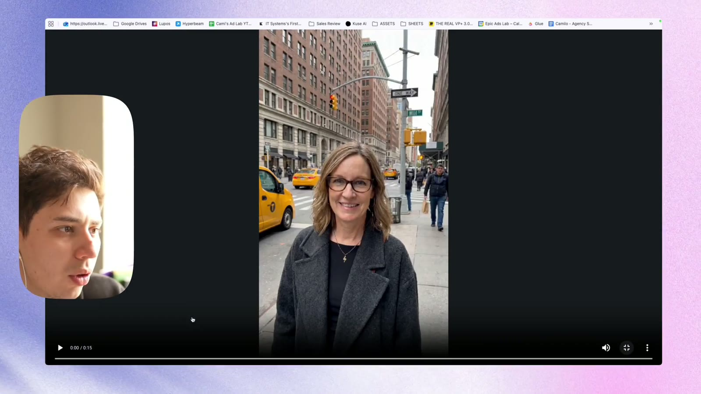

# 21. Street Interviews
> Recreate a street-interview hook with Seedance 2.0 using the same Claude skill as lesson 020, a street-scene creator reference edited with Nano Banana Pro, and prompts that fix the "tinny, too-perfect mic" tell of AI interviews.

## 🤖 Agent use
- **Use when:** making a man-on-the-street or interview-style hook/ad (question, confusion, cut to confession) with AI.
- **Inputs → outputs:** street-interview brief (script below) + a real street-interview reference frame + product photo → Claude skill director's brief (Pinterest searches, per-segment Seedance prompts) → creator image placed in a street scene → 15 s Seedance clip with two voices and city ambience.
- **Rules:**
  - **DO** design the audio, not just the picture: AI interviews fail because "the mic is too perfect. There's no street sound… it just sounds like AI" [00:00]. The skill's prompt includes two distinct voices (off-camera interviewer vs interviewee) and outdoor city ambience [03:13].
  - **DO** study a real interview for feel ("it feels raw, authentic") before generating [00:00–00:47].
  - **DO** run the skill from [020](020-claude-skill-seedance-2-0-ai-ugc.md) in a fresh chat with the brief attached, command `/seedance 2.0 UGC director` (spoken; on-screen skill name "Seedance 2.0 UGC ad director") [00:47].
  - **DO** pick the creator on Pinterest, save it as "character reference", then put her into the street look with Nano Banana Pro: "replace the girl on the street for the middle-aged woman and change the background to be New York"; run a few generations [01:45–02:15].
  - **DO** use the skill's prompt as is: 9:16, 15 s, iPhone UGC; `@Image1` is the creator; set references in Max Fusion [02:15–03:13].
  - **DO** add emojis, subtitles and black-and-white in the edit, not in the generation: an emoji-in-prompt version "kind of didn't work" [04:12].
  - **DON'T** use a real interview creator's clip, face, voice or questions; copy the format only (compliance below).
- **See also:** [020 Claude skill + Seedance 2.0](020-claude-skill-seedance-2-0-ai-ugc.md) (skill file and Max Fusion steps) · [022 Poppy users](022-for-poppy-users.md) · [023 Live edit](023-18-mins-uncut-live-editing-ai-ugc-video.md) · [AI UGC tools](../../../../tools/ai-ugc-tools.md)

## Key ideas
### The problem with AI interviews [00:00–00:47]
- Demo clips (other people's AI interviews) sound "very tinny"; a real street interview by a well-known creator (named "Josh Suggs" in the transcript, spelling unverified) feels raw because of ambient sound and real mic handling [00:00–00:47].

### The brief [00:47]
- Hook: street interview, "red wine or white wine?" → confusion → cut to her saying "Every time I pick wine, I have no idea what I'm doing." Brand Gratzi (spelled "Gratsi" in 020). Full script in the attachment below.
- Body: B-roll with product PNGs kept in frame and shown from another angle (reference reel link in the attachment).

### Claude step [00:47–01:45]
- New Claude chat, upload the street-interview brief, run the skill: "It's reading the skill. It's building out the director's brief. It understands the product. It's going to find some creators on Pinterest" [00:47]. He picks "daylight" results and saves one woman as the character reference.

### Image step [01:45–02:15]
- He screenshots a frame of the real street interview and, in Max Fusion Images with Nano Banana Pro ("a lot better results" than GPT Image 2), edits it with the street frame + creator image as references [01:45–02:15]. Pinterest also supplies street-interview scene references; "our skill is very good at understanding content" [02:15].

### Video step [02:15–04:12]
- Generate video → Seedance 2.0 → References; `@Image1` = the creator being interviewed; prompt copied from Claude: 9:16, 15 seconds, UGC style, iPhone handheld with slight camera shake; sunny city sidewalk; camera held at arm's length by the interviewer; she is "face, shoulders up" [02:15–03:13]. Screen shows 9:16, 7 s, 720p, 70 credits before he sets the length to 15 s [frame 03:02] (at recording).
- Audio per skill: "Two distinct voices, off-camera interviewer, warm friendly female voice"; interviewee voiced by the referenced image; "outdoor city ambient" [03:13].
- Result dialogue: "Red wine or white wine? White wine. Dry or sweet? Dry. Oaky or tannic?" ending on a frozen face [03:13–04:12].

## Steps / framework
| # | Step | Detail | Source |
|---|---|---|---|
| 1 | Get the Claude skill | Drive link on page (see 020) | page step 1 |
| 2 | Install to Claude Desktop | as in 020 | page step 2 |
| 3 | Upload street-interview brief | attachment below | page step 3 |
| 4 | Pinterest for visual ideation | creator + street scenes | page step 4; [00:47] |
| 5 | Download references | clean images only | page step 5 |
| 6 | Max Fusion → Seedance 2.0 → References | upload references | page step 6 |
| 7 | Copy prompt from Claude, double-check | `@Image1` = creator | page step 7; [02:15] |
| 8 | Run and iterate | regenerate for the right take | page step 8; [03:13] |
| 9 | Complete the ad creative | emojis, subtitles, B&W, cut to body | page step 9; [04:12] |

## Examples
| Element | Detail | Source |
|---|---|---|
| Hook | three rapid questions, third makes her freeze (freeze-frame, "pause") | brief; [03:13] |
| Creator | middle-aged woman, beige knit sweater, gold hoop earrings, loose slightly wind-blown hair, no heavy makeup (from prompt on screen) | frame 02:52 |
| Edit plan | emojis + subtitles + black and white, then cut to the confession | [04:12] |

## Structured units
### Hook
| Hook (verbatim or near) | Heuristic(s) | Emotion / zone | Self targeted | Why it works | Source |
|---|---|---|---|---|---|
| "Red wine or white wine? / White wine. / Dry or sweet? / Dry…? / Oaky or tannic?" (freeze) | pattern interrupt, relatable incompetence (derived) | embarrassment, recognition (derived) | the person who "has no idea what they're doing" about wine | A rapid quiz exposes not knowing; sets up "every time I pick wine, I have no idea what I'm doing" | attachment; [00:47] |

### Compliance
- **DO** copy the interview format and rhythm; write your own questions, setting, person and claims.
- **DON'T** reuse a real street-interview creator's footage, face or voice, or recreate their set pieces one for one.
- **DON'T** present the AI interviewee as a real stranger or a real customer; the lesson's script contains an invented "Italian friend" and a hangover-style claim ("You wake up the next day feeling totally fine"). Substantiate or cut it (claim audit); the brand facts (zero sugar, 30 days fresh) are from the brand's brief, not verified here.
- **DON'T** use a stranger's photo from Pinterest as the creator without rights (see 020); prefer a generated face.

## Prompts / templates (verbatim)
### Attachment: Street interview brief (`3.Street Interviews.txt`)
```text
Street interview (hook): based on winning concept (interview)


Red wine or white wine?
White wine.
Dry or sweet?
Dry…?
Oaky or tannic?
(pause — freeze frame)


Body: (Actress turns head away from the camera, or just VO https://www.instagram.com/reel/DTcbKxvDrOz/?igsh=bXoxZXliMHlneXIz
my idea is to keep the pngs in frame and show them from another angle, check the inspo here)


Every time I pick wine, I have no idea what I’m doing.
Tannins? Oak? What am I even supposed to say?


I always end up grabbing the cheapest bottle and hoping for the best.


All I wanted was a wine that’s easy to drink — no stress, no overthinking, and no waking up the next day feeling terrible.


Then an Italian friend of mine put me onto Gratzi.


It’s a zero-sugar white wine that’s perfect for literally any occasion.
And it comes in a box, which honestly makes life so much easier.


You can bring it to a party — no carrying a bunch of bottles, no worrying if people will like it.
And the best part? You wake up the next day feeling totally fine.


It stays fresh in your fridge for up to 30 days, so you can just pour a glass whenever you want — no pressure to finish a bottle.


CTA:


So if you’re like me — you love wine, but choosing one feels way too complicated — Gratzi is for you.
Check out their website to see all the options.
```

### Seedance prompt as visible on screen (partial; copied from Claude's output, 02:15–03:13)
The Claude skill is the one in [lesson 020](020-claude-skill-seedance-2-0-ai-ugc.md). The segment 1 prompt on screen reads (end of the prompt and the audio block are not fully legible in the recording):
```text
9:16. 15 seconds. Single continuous shot. UGC style. iPhone handheld with slight camera shake.

@Image1 is the creator being interviewed on a sunny city sidewalk. The camera is held by the interviewer at arm's length, phone-quality, with natural afternoon daylight hitting her from the front-left. She is wearing a simple beige knit sweater, small gold hoop earrings, hair loose and slightly wind-blown, no heavy makeup. Behind her is a soft blurred background of a street with parked cars, a brick building, and pedestrians walking past.

[0:00-0:05] Medium close-up of @Image1's face, shoulders up, filling the 9:16 frame. She looks slightly caught-off-guard, a small polite smile on her face as she answers the first question. Her hands are not visible. The interviewer's voice comes from off-camera, slightly closer to the mic than hers. Natural daylight, no shadows on her face, the sidewalk blurred behind her.

[0:05-0:10] She tilts her head slightly, her smile fading into a more uncertain expression as the second question lands. Her eyebrows lift. She hesitates, her mouth opening then closing before answering. Still same framing, still handheld, camera wobbles slightly. Same daylight, same street background with a car driving past in the distance.
```
Nano Banana Pro edit (spoken, 01:45): `replace the girl on the street for the middle-aged woman and change the background to be New York`.

## Screenshots

*Skill output "Seedance 2.0 UGC ad director": Step 1 creator searches, "CRITICAL: only use clean photos", Step 2 scene references for the street hook, kitchen confession and living-room CTA. Model selector shows Opus 4.7. [02:31]*


*Segment 1 of 3, "Hook: Street Interview (0:00-0:15)", with timed 5 s blocks. [02:52]*


*`@image1` creator thumbnail attached, prompt pasted; 9:16, 7 s, 720p, 70 credits at that moment (he sets 15 s). [03:02]*


*Generated creator placed in a New York street scene, used as `@Image1`. [03:58]*

## How to apply
- [ ] Write the quiz-style hook and a confession body in the attached format; no unsupported claims.
- [ ] Run the 020 skill; pick a clean creator reference; edit her into a real-looking street frame.
- [ ] Paste the segment prompt; confirm two voices and ambience; regenerate until the freeze lands.
- [ ] Add emojis, captions, black and white in the edit; cut to the body.

## Related
- Previous: [020. Claude skill + Seedance 2.0](020-claude-skill-seedance-2-0-ai-ugc.md) · Next: [022. For Poppy users](022-for-poppy-users.md)

## Sources and limitations
- [Transcript](<../../../../../raw/ad-creators-lab/ai-ads-ugc-animations/_transcripts/Ad Creators Lab - Create Viral AI Ads, UGC & Animations That Convert Into Sales(September 2026)/3. AI UGC/3. Realistic AI UGC/3.Street Interviews.txt>) (complete, 4:37). Whisper: "C Dance", "cdance 2.0 UGCR director", "none other than a pro" = Nano Banana Pro.
- [Lesson page](<../../../../../raw/ad-creators-lab/ai-ads-ugc-animations/_extracted/Ad Creators Lab - Create Viral AI Ads, UGC & Animations That Convert Into Sales(September 2026)/3. AI UGC/3. Realistic AI UGC/3.Street Interviews.htm.md>) · [attachment](<../../../../../raw/ad-creators-lab/ai-ads-ugc-animations/_extracted/Ad Creators Lab - Create Viral AI Ads, UGC & Animations That Convert Into Sales(September 2026)/3. AI UGC/3. Realistic AI UGC/3.Street Interviews.txt>). The Max Fusion link is an affiliate link.
- Only part of the Seedance prompt is legible on screen; the rest comes from running the skill on the brief. The finished clip's audio quality is judged by the instructor only.
