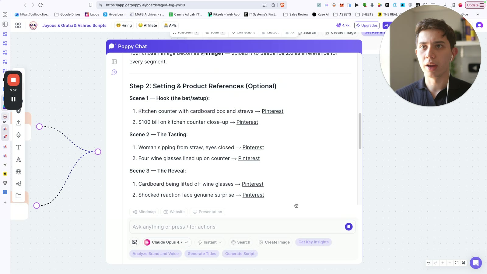
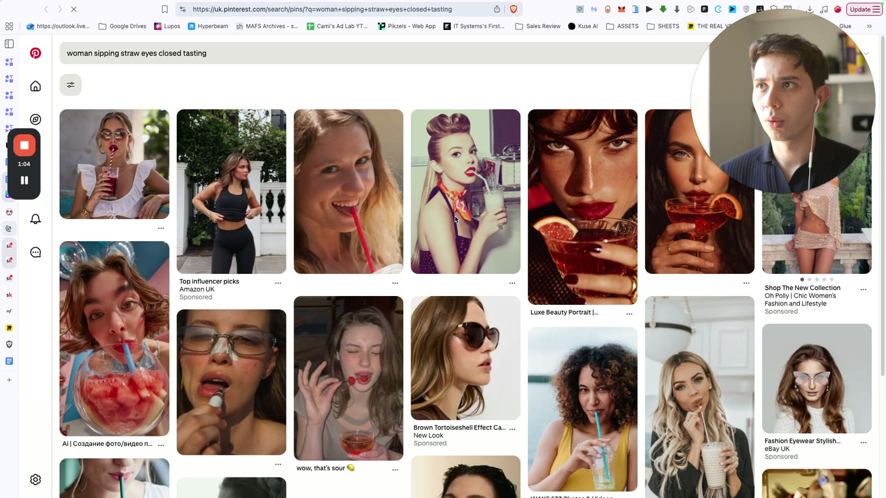

# 22. For Poppy Users
> Run the Seedance 2.0 UGC director skill inside Poppy (a canvas/chat app) instead of Claude Desktop: attach the skill as a prompt file plus your UGC script, pick Opus 4.7, and get the same director's brief with Pinterest references.

## 🤖 Agent use
- **Use when:** the team works in Poppy and cannot install a Claude skill; you need the director's brief for a UGC script from [020](020-claude-skill-seedance-2-0-ai-ugc.md).
- **Inputs → outputs:** skill text file (below) + UGC script → director's brief (creator and scene Pinterest searches, per-segment Seedance prompts).
- **Rules:**
  - **DO** connect both files (skill and script) to Poppy chat before running [00:00].
  - **DO** choose Opus 4.7 in the model selector: "It's going to get you the best results" [00:00] (instructor claim).
  - **DO** run: "execute the skill for this UGC script" [00:00].
  - **DO** open the Pinterest links per shot (wine, woman sipping wine, kitchen) and lock the creator first: "just like the other one, you can find that realistic creator… shot on an iPhone" [00:57].
  - **IF** the references do not match the script **THEN** re-check the files are attached and the skill ran (page).
  - **DON'T** pick staged or cinematic creators or references (page).
- **See also:** [020 Claude skill + Seedance 2.0](020-claude-skill-seedance-2-0-ai-ugc.md) · [021 Street interviews](021-street-interviews.md) · [AI UGC tools](../../../../tools/ai-ugc-tools.md)

## Key ideas
### Same skill, different host [00:00–00:57]
- Download the Seedance 2.0 skill "as a prompt" and an example UGC script from the page (the attachment is the skill text; the script example is the Gratzi/wine brief from 020 and 021), Chat → connect both, model Opus 4.7, run the instruction [00:00].
- Output follows the Claude workflow: director's brief → Pinterest references, e.g. "kitchen counter woman sipping wine", wine and sipping-shot references [00:00–00:57]. On screen the Poppy chat shows Step 2 of the brief: Scene 1 hook (kitchen counter with cardboard box and straws; $100 bill close-up), Scene 2 the tasting (woman sipping from straw eyes closed; four wine glasses lined up), Scene 3 the reveal, Scene 4 CTA (frame 00:57).
- "It's shot on an iPhone. It looks like an iPhone. And it works perfectly." [00:57] (instructor claim).

## Steps / framework
| # | Step | Source |
|---|---|---|
| 1 | Download the skill file and the UGC script | page step 1 |
| 2 | Poppy → Chat; connect both; model Opus 4.7 | page step 2; [00:00] |
| 3 | "Execute the skill for this UGC script." | page step 3 |
| 4 | Review the director's brief and Pinterest references | page step 4 |
| 5 | Open shot-specific references (wine, sipping) | page step 5 |
| 6 | Lock one realistic creator | page step 6; [00:57] |

Then continue as in 020 steps 6 to 9 (Max Fusion → Seedance 2.0 → References, 9:16, 15 s, 720p).

## Prompts / templates (verbatim)
### Attachment: "Seedance 2.0 UGC Ad Director" as plain text (`4. For Poppy Users.txt`)
Same content as the `SKILL.md` in lesson 020, with the formatting flattened.
```text
Seedance 2.0 UGC Ad Director
MANDATORY RULES — read these before doing anything:
1. Follow the EXACT output format below. Do NOT invent your own format, tabs, categories, or "director notes."
2. Seedance 2.0 DOES generate speech and dialogue natively with lipsync. NEVER tell users to add voiceover in post.
3. NEVER use the word "cinematic" anywhere. These are UGC ads that look like iPhone footage.
4. Every output MUST include Pinterest links. Never skip them.
5. Do NOT ask clarifying questions. Make creative decisions yourself and output everything in ONE response.
________________


EXACT OUTPUT FORMAT — follow this structure every time:
When the user gives you a script or concept, output this EXACT structure:
Your UGC Ad — Director's Brief
Product: [name] Duration: [total]s ([N] segments x 15s) Ad Structure: Hook → Problem/Proof → Benefit/Demo → CTA
________________


Step 1: Find Your Creator on Pinterest
This person stars in every scene. Pick ONE consistent character reference.
Browse these links and find a person who fits your ad:
1. [Description] → [Pinterest URL: https://www.pinterest.com/search/pins/?q=QUERY]
2. [Description] → [Pinterest URL]
3. [Description] → [Pinterest URL]
4. [Description] → [Pinterest URL]
What to pick: Natural lighting, casual clothes, phone-quality feel. NO studio lighting, NO magazine poses, NO heavy makeup. The more "real" the better.
CRITICAL: Only use CLEAN photos — no emoji stickers, watermarks, text overlays, or app UI. Seedance recreates everything it sees as physical objects.
Your chosen image becomes @Image1 — upload it to Seedance 2.0 as a reference for every segment.
________________


Step 2: Setting & Product References (Optional)
Grab additional Pinterest references for settings and product interaction poses:
Scene 1 — [Hook]:
1. [Setting search] → [Pinterest URL]
2. [Product interaction search] → [Pinterest URL]
Scene 2 — [next section]:
1. [Setting search] → [Pinterest URL]
2. [Product interaction search] → [Pinterest URL]
[Continue for each scene. Only clean photos — no overlays.]
________________


Step 3: Seedance 2.0 Prompts — Copy & Paste
Upload your Pinterest creator as @Image1 and your product photo as @Image3 for EVERY segment.
Segment 1 of [N] — [Hook] (0:00-0:15)
What's happening: [One sentence]
9:16. 15 seconds. Single continuous shot. UGC style. iPhone handheld.


@Image1 is the creator. @Image3 is the product.


[0:00-0:05] [Rich, detailed description — 3-4 sentences. Camera position,
the person's full appearance, what they're wearing, their expression, what
their hands are doing, what's on the surface in front of them and what's
NOT there, the specific light source and direction, the background details.]


[0:05-0:10] [Rich, detailed description — 3-4 sentences. What changes,
what the person does with the product, hand movements, facial expression
shift, what's visible, what's not. Same light source. Background consistent.]


[0:10-0:15] [Rich, detailed description — 3-4 sentences. Final movement,
expression, eye contact, body position, product position. Describe the
final moment clearly.]


Audio: [Voice character — age, gender, tone, energy. E.g., "Warm male voice,
early 40s, genuine and relaxed, dad-energy, not performative"]. [Room tone
matching the setting — e.g., "Open kitchen acoustics, subtle ambient hum,
warm room tone"]. Natural speech rhythm with pauses. "[Full dialogue with
filler words, contractions, and casual pacing]."
Segment 2 of [N] — [Problem/Proof] (0:15-0:30)
[Same detailed format — @Image1 stays the SAME]
[Continue for all segments]
________________


Step 4: Generate & Review
1. Generate all segments in Seedance 2.0 (on Max Fusion or Jianying)
2. Check: Does the creator look consistent across segments?
3. Check: Does it look like a real person filmed this on their phone?
4. If anything looks off, regenerate that segment with the same @Image1
5. Stitch segments in order and export
________________


END OF OUTPUT FORMAT
Everything above between "# Your UGC Ad — Director's Brief" and "## END OF OUTPUT FORMAT" is the EXACT structure to follow. Now here are the rules for writing the prompts:
________________


Prompt Writing Rules
Anti-Cinematic Rules (NON-NEGOTIABLE)
ALWAYS use: iPhone handheld, natural lighting / window light, UGC style, slight camera shake, casual, authentic, 9:16
NEVER use: cinematic, camera brands (ARRI, RED, Blackmagic), anamorphic, film grain, dramatic lighting, speed ramp, bloom flash, lens flare, whip pan, crane, dolly, steadicam, gimbal, Dutch angle, color grade, LUT, bokeh, epic, breathtaking, stunning, slow motion (unless "iPhone slow-mo"), depth of field alone (say "phone camera depth of field")
Detail Level
Be VERY descriptive. Every 5-second block needs 3-4 sentences of specific detail:
* What the person is doing with EACH hand
* Their exact facial expression
* What's on the surface and what's NOT there
* Background details
* Specific light source and direction
* If you don't describe it, Seedance invents it — and you get random artifacts
Audio Direction
Every prompt MUST include detailed audio. Seedance 2.0 generates audio natively.
Voice: Match to demographic. E.g., "Warm female voice, mid-20s, casual, talking to a friend" or "Deep male voice, 40s, genuine dad energy, not a narrator"
Room tone — must match the setting:
* Bathroom: slight reverb from tiled walls
* Bedroom: soft close acoustics, carpeted, minimal echo
* Kitchen: open space feel, subtle ambient sounds
* Car: muffled close acoustics
* Outdoors: natural ambience, slight wind
* Living room: warm room tone, furnished space
Speech pattern: Natural with pauses, filler words, contractions. NOT scripted.
Dialogue Rules
Write dialogue that sounds REAL, not scripted:
* Use contractions: "I've been," "it's literally," "you're gonna"
* Include filler words: "like," "honestly," "so basically"
* Casual grammar — fragments and run-ons are fine
* Sound genuinely excited or skeptical, not rehearsed
Good: "Okay so I've been using this for like two weeks and honestly? It actually works." Bad: "This revolutionary product has transformed my routine completely."
Pinterest URL Format
https://www.pinterest.com/search/pins/?q=WORDS+SEPARATED+BY+PLUS+SIGNS
Make searches specific to the scene: combine the person demographic + action + setting.
Reference Image Mapping
@Image1 = creator from Pinterest (same across ALL segments)
@Image2 = setting reference if needed
@Image3 = product photo (user provides this)
Seedance 2.0 Facts
* Input: up to 9 images + 3 videos + 3 audio (12 total)
* Output: 4-15 seconds per generation, up to 2K, 9:16 for UGC
* Native audio: dialogue with lipsync, ambient sounds, room tone — all generated together
* Handles long detailed prompts well, especially with @Image references
* One action arc per prompt — don't describe two scene changes in one prompt
```

## Screenshots

*Poppy canvas: chat panel with "Step 2: Setting & Product References (Optional)" by scene, each with a Pinterest link; model Claude Opus 4.7 in the chat bar. [00:57]*


*A Pinterest search from the brief ("woman sipping drink eyes closed tasting"): note that many results are polished or stylised, so choose phone-quality ones only. [01:04]*

## How to apply
- [ ] Paste or attach the skill text; attach your approved UGC script.
- [ ] Select Opus 4.7; run "Execute the skill for this UGC script."
- [ ] Pick one creator and scene references; then generate per 020.

## Related
- Previous: [021. Street interviews](021-street-interviews.md) · Next: [023. 18 mins uncut live editing AI UGC video](023-18-mins-uncut-live-editing-ai-ugc-video.md)

## Sources and limitations
- [Transcript](<../../../../../raw/ad-creators-lab/ai-ads-ugc-animations/_transcripts/Ad Creators Lab - Create Viral AI Ads, UGC & Animations That Convert Into Sales(September 2026)/3. AI UGC/3. Realistic AI UGC/4. For Poppy Users.txt>) (ends 1:24, complete). Whisper wrote "Puppy"/"Opus 4.7" correctly; "Puppy" = Poppy. "SeedDance" = Seedance.
- [Lesson page](<../../../../../raw/ad-creators-lab/ai-ads-ugc-animations/_extracted/Ad Creators Lab - Create Viral AI Ads, UGC & Animations That Convert Into Sales(September 2026)/3. AI UGC/3. Realistic AI UGC/4. For Poppy Users.htm.md>) · [skill attachment](<../../../../../raw/ad-creators-lab/ai-ads-ugc-animations/_extracted/Ad Creators Lab - Create Viral AI Ads, UGC & Animations That Convert Into Sales(September 2026)/3. AI UGC/3. Realistic AI UGC/4. For Poppy Users.txt>). The example UGC script download is not an attachment of this lesson; use [021](021-street-interviews.md) or 020's brief.
- The skill file inherits the compliance caveats of 020: Pinterest photos are stranger likenesses; prefer generated or licensed faces.
