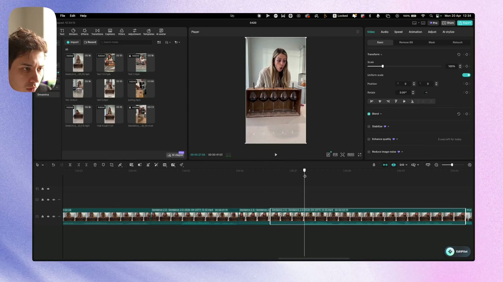
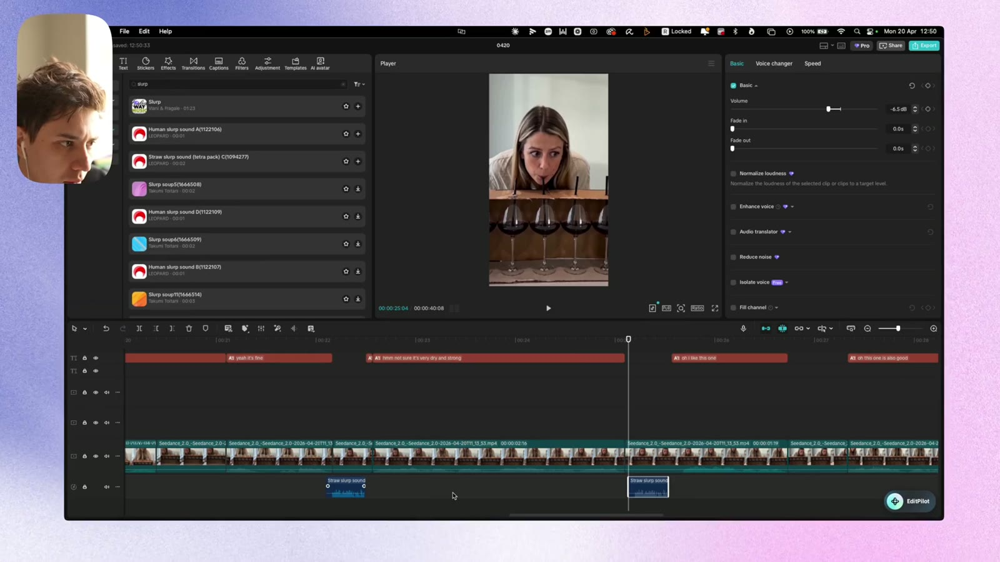
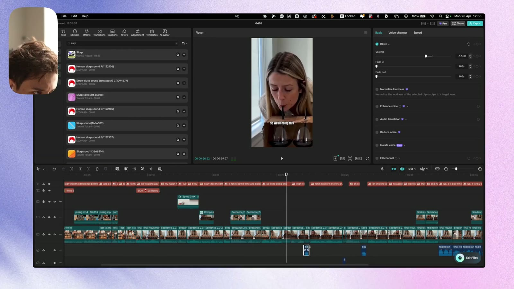

# 23. 18 mins Uncut Live Editing AI UGC Video
> A real-time edit of the wine taste-test ad from raw Seedance segments: reaction cut-ins matched to new audio, a hook rebuilt, captions, zooms and sound effects.

## 🤖 Agent use
- **Use when:** assembling generated Seedance segments into a finished UGC ad, or briefing an editor how to make AI UGC feel real.
- **Inputs → outputs:** raw segments (taste test, reactions, pour shots, boxed and bottle shots) → timeline with hook, tastings, reveal, captions and SFX → [the 0:30 ad in 019](019-realistic-ai-ugc-the-ad-we-are-making.md).
- **Rules:**
  - **DO** reuse a reaction clip against a different line by extracting its audio and isolating the voice so the reaction matches the new moment: "I want to extract the audio here, isolate voice… because these reactions I want them to match something different" [04:04].
  - **DO** add insert shots that explain the line: finger pointing to number three, a shot of the boxed wine and the 150 bottle, a reaction after "number four" [02:16–05:42].
  - **DO** cut slack: "The pacing is so slow" then tighten [07:34].
  - **DO** add on-screen text for the hook ("My Italian husband just bet me $100…") and captions for every line [07:34–11:12].
  - **DO** zoom into the sips and add a slurp sound effect ("Audio slurp") [11:12–11:50].
  - **DON'T** let audio and captions drift: after an edit "everything got out of sync", so recheck sync after each change [09:26].
  - **IF** a clip looks real in the cut **THEN** keep going; his own check: "it feels like she's real… I feel like I'm editing an actual UGC" [06:34].
- **See also:** [019 the finished ad](019-realistic-ai-ugc-the-ad-we-are-making.md) · [020 generating the segments](020-claude-skill-seedance-2-0-ai-ugc.md) · [104 Bad UGC](104-bad-ugc.md) · [103 Video editors](103-video-editors.md)

## Key ideas
### Reaction matching and inserts [00:00–06:34]
- Starting timeline: segments from the taste-test generations (frames 00:00 to 04:30 show many near-identical clips on one track).
- Per line, he picks the best reaction frame: number three favourite (finger "jumps" onto number three), number four reaction [02:16–02:55]. He extracts and isolates the voice of a clip so a different reaction can sit under new audio [04:04–04:44]. He inserts the boxed-wine shot at "number three is boxed wine" and the bottle at "number four is a 150 bottle" [04:44–05:42].

### Hook, titles, captions [06:34–11:12]
- Opening hook line placed as text: "My Italian husband just bet me $100. I can't tell the difference between his fancy bottle wine and boxed wine." [07:34–08:11]. Adds a title style, then captions [09:26–11:12]. His editor's caption tool glitched, "What's wrong with these subtitles?" [10:07]; he complains about the editor, whose name Whisper heard as "Capcom" (probably CapCut; unverified) [13:42].

### Zooms and SFX [11:12–14:47]
- Zoom into sip shots; slurp SFX on the first taste; subtitle timing re-checked [11:12–11:50]. Frames at 12:00 and 16:30 show multiple SFX tracks under the video and red clips on an upper track (probably captions; derived).

### Final pass [14:47–18:50]
- Repeated playback and nudging of the number-three / number-four / reveal beats; "Big zoom here. Slurp." [16:26]; final: "all right this is good" [18:50].

## Steps / framework
| # | Step | Detail | Source |
|---|---|---|---|
| 1 | Lay raw segments on one track | pour, tasting, reveal | [00:00] |
| 2 | Select reactions per line | finger on number three; number-four reaction | [02:16–02:55] |
| 3 | Rebind reaction to new audio | extract audio, isolate voice | [04:04] |
| 4 | Insert product shots | boxed wine, bottle | [04:44–05:42] |
| 5 | Fix pacing | cut dead air | [07:34] |
| 6 | Hook text + captions | verify sync | [07:34–11:12] |
| 7 | Zoom + SFX | sip zoom, slurp | [11:12–11:50] |
| 8 | Final review pass | re-watch whole ad | [14:47–18:50] |

## Examples
| Moment | Edit decision | Source |
|---|---|---|
| "Ooh, I like this one" | zoom into the sip | [11:12] |
| "number three is boxed wine" | cut to boxed-wine shot | [04:44] |
| Hook | text overlay + captions | [07:34–11:12] |
| Sync loss | re-sync after edit | [09:26] |

## Screenshots

*Timeline with the taste-test segments on the main track and audio below. [01:00]*

*Mid-edit: caption list at left, red caption/text clips above, SFX clips under the main track. [12:00]*

*Late edit with zoom keyframes and sound effects placed per sip. [16:30]*

## How to apply
- [ ] Import all generated segments; mark the best reaction per line.
- [ ] Isolate voice where a reaction must match another line; add product inserts.
- [ ] Add hook text, captions, zoom and SFX; recheck sync.
- [ ] Watch once without sound for pacing, once with sound for audio.

## Related
- Previous: [022. For Poppy users](022-for-poppy-users.md) · Next: lessons of the rizz-model sub-module (not in this batch)

## Sources and limitations
- [Transcript](<../../../../../raw/ad-creators-lab/ai-ads-ugc-animations/_transcripts/Ad Creators Lab - Create Viral AI Ads, UGC & Animations That Convert Into Sales(September 2026)/3. AI UGC/3. Realistic AI UGC/5.18 mins Uncut Live Editing AI UGC Video.txt>) (complete, 19:00). Whisper loops on scrubbed audio, so repeated phrases are playback, not content; timestamps are approximate to the nearest 30 s block. [Lesson page](<../../../../../raw/ad-creators-lab/ai-ads-ugc-animations/_extracted/Ad Creators Lab - Create Viral AI Ads, UGC & Animations That Convert Into Sales(September 2026)/3. AI UGC/3. Realistic AI UGC/5.18 mins Uncut Live Editing AI UGC Video.htm.md>) holds one line only.
- No exact SFX names, caption fonts or editor settings are legible; the editor is unnamed. Edit choices are his, no performance data. The ad's persona and claims are scripted fiction (see 019).
