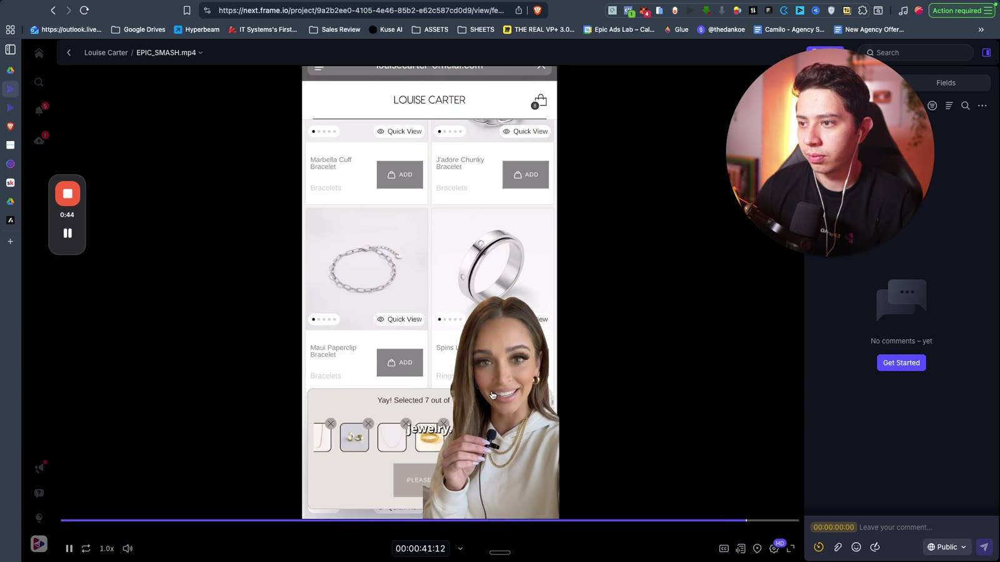

# 24. The video we are making
> Preview of the finished "rizz model" realistic AI UGC ad (a jewelry comparison story) and the five-part production chain the next seven lessons teach: realistic hook, character consistency, consistent voice, lip-synced talking creator, AI B-roll, edit.

## 🤖 Agent use
- **Use when:** planning a realistic AI UGC ad that must look like one creator's phone video (hook + story + B-roll + CTA) before opening any tool; deciding which lesson of the chain to open.
- **Inputs → outputs:** a finished UGC script with a story arc and a product → the production plan below (hook clip, creator stills, voice, talking clips, B-roll clips, edit).
- **Rules:**
  - **DO** run the chain in this order: Sora 2 Pro hook → recreate the same character as stills → clone or design the voice → make the stills talk → generate B-roll → edit [00:48].
  - **DO** make the same person speak again after the hook: "a character that can speak again but looks exactly like the other ones from before" [00:48].
  - **DO** make the audio "consistent with the original video" [00:48].
  - **DO** treat the tool stack as a snapshot: "two tools… Eleven Labs and Max Fusion. Yes, you can try and do this with other softwares but I'm just showing you up to date what's working right now" [00:48].
  - **DON'T** copy the example's proof claims into your own ad (see Sources and limitations).
- **See also:** Rizz-model chain: [24 the video](024-realistic-ai-ugc-rizz-model-the-video-we-are-making.md) → [25 hook](025-realistic-ai-ugc-rizz-model-generating-realistic-hook.md) → [26 character consistency](026-character-consistency.md) → [27 voice method 1](027-consistent-voices-method-1.md) → [28 voice method 2](028-consistent-voices-method-2.md) → [29 make creators talk](029-make-ai-creators-talk.md) → [30 B-roll](030-generate-realistic-ai-broll.md) → [31 editing](031-realistic-ai-ugc-rizz-model-editing-breakdown.md) · [AI UGC tools](../../../../tools/ai-ugc-tools.md) · [ElevenLabs](../../../../tools/elevenlabs.md) · [write-ugc-script skill](../../../../../../.claude/skills/write-ugc-script/SKILL.md)

## Key ideas
### The target ad [00:00–00:48]
- Format: first-person creator story. Hook: "My boyfriend just spent $300 on jewelry that I'm about to destroy" [00:00].
- Story device: a seven-day wear test of two jewelry sets (boutique vs the Louise Carter brand): Day 1 shower test, Day 3 beach day, Day 5 hot yoga class, Day 7 "still haven't taken them off" [00:00].
- Payoff: boutique bracelet "already tarnishing", the brand's piece "still looks brand new because it's 18 karat PVD gold which literally cannot tarnish" (transcript; the ElevenLabs script on screen in [lesson 27](027-consistent-voices-method-1.md) says 14 Karat, so the figure is unverified) [00:00].
- CTA: "for Christmas go to this page, pick out seven pieces… of waterproof jewelry" [00:00].

### What the module covers [00:48–01:16]
1. How to make a hook that looks very realistic ([25](025-realistic-ai-ugc-rizz-model-generating-realistic-hook.md)).
2. Character consistency so the same creator can speak again ([26](026-character-consistency.md)).
3. Consistent voice, two methods ([27](027-consistent-voices-method-1.md), [28](028-consistent-voices-method-2.md)) and lip-sync ([29](029-make-ai-creators-talk.md)).
4. B-roll shots ([30](030-generate-realistic-ai-broll.md)) and the edit ([31](031-realistic-ai-ugc-rizz-model-editing-breakdown.md)).
- Tools named: ElevenLabs (voice) and Max Fusion (images and video) [00:48]. In the later videos Max Fusion hosts Sora 2 Pro, Nano Banana Pro, Seedance 2.0, Rizz and Kling 2.6 (see each lesson).

## Steps / framework
| # | Stage | Tool (at recording, Aug–Sep 2026) | Lesson |
|---|---|---|---|
| 1 | Realistic hook clip, 8 or 12 s | Max Fusion → Sora 2 Pro | [25](025-realistic-ai-ugc-rizz-model-generating-realistic-hook.md) |
| 2 | Same creator as stills across many scenes | Max Fusion images (Nano Banana Pro) | [26](026-character-consistency.md) |
| 3 | Voice that matches the hook | ElevenLabs instant clone (clip over ~10 s) or Voice Design (shorter) | [27](027-consistent-voices-method-1.md), [28](028-consistent-voices-method-2.md) |
| 4 | Stills that speak the script | Max Fusion → Rizz + ElevenLabs voice | [29](029-make-ai-creators-talk.md) |
| 5 | B-roll | Max Fusion → Kling 2.6 | [30](030-generate-realistic-ai-broll.md) |
| 6 | Edit | Premiere Pro, TikTok-comment overlay, subtitles | [31](031-realistic-ai-ugc-rizz-model-editing-breakdown.md) |

## Examples
Transcript script of the finished ad (machine transcription, [00:00]): "My boyfriend just spent $300 on jewelry that I'm about to destroy. So here's the deal. I have two sets of jewelry. This one from a boutique and this one from Louise Carter. I'm going to wear them both for one week straight and see which one survived. Day one, shower test. Day three beach day. Day five hot yoga class. Day seven still haven't taken them off. So after one week the boutique bracelet is already tarnishing but this still looks brand new… here's the girl math right now for Christmas go to this page pick out seven pieces yes seven of waterproof jewelry."

## Structured units
### Hook (from the finished ad)
| Hook (verbatim or near) | Heuristic(s) | Emotion / zone | Self targeted | Why it works | Source |
|---|---|---|---|---|---|
| "My boyfriend just spent $300 on jewelry that I'm about to destroy." | stakes, open loop, "I'm about to…" (derived) | playful dread / curiosity (derived) | gift-receiving partner, jewelry buyer (derived) | A pending act of destruction with a price tag forces the question "why?" (derived) | [00:00] |

### Rules
- **DO** structure the AI ad like a creator story with a wear test and a before/after reveal, not a product spec read (derived from [00:00]).
- **IF** the hook clip cannot be re-generated with the same face **THEN** plan the creator stills and voice before you accept the hook ([25](025-realistic-ai-ugc-rizz-model-generating-realistic-hook.md) [02:54]).

## Screenshots

*The CTA segment of the finished ad: the brand's collection page with the AI creator in the corner and the "selected 7 out of 7" step. [00:30]*

## How to apply
- [ ] Write the creator-story script first ([write-ugc-script skill](../../../../../../.claude/skills/write-ugc-script/SKILL.md)) with a hook, day-by-day proof beats and a CTA; run it through the [LLM output claim audit](../../../stefan-georgi/rmbc-ii/rubrics/llm-output-claim-audit.md).
- [ ] Open lessons 25 to 31 in order; do not skip the voice lessons, because voice and face must be generated separately.
- [ ] List every claim in the script and mark it verified or cut it.

## Related
- Previous: [020. Claude Skill + Seedance 2.0 AI UGC](020-claude-skill-seedance-2-0-ai-ugc.md) · Next: [25. Generating realistic hook](025-realistic-ai-ugc-rizz-model-generating-realistic-hook.md)
- Rizz-model chain: [24 the video](024-realistic-ai-ugc-rizz-model-the-video-we-are-making.md) → [25 hook](025-realistic-ai-ugc-rizz-model-generating-realistic-hook.md) → [26 character consistency](026-character-consistency.md) → [27 voice method 1](027-consistent-voices-method-1.md) → [28 voice method 2](028-consistent-voices-method-2.md) → [29 make creators talk](029-make-ai-creators-talk.md) → [30 B-roll](030-generate-realistic-ai-broll.md) → [31 editing](031-realistic-ai-ugc-rizz-model-editing-breakdown.md)

## Sources and limitations
- [Transcript](<../../../../../raw/ad-creators-lab/ai-ads-ugc-animations/_transcripts/Ad Creators Lab - Create Viral AI Ads, UGC & Animations That Convert Into Sales(September 2026)/3. AI UGC/4. Realistic AI UGC (rizz model)/1. The video we are making - AI UGC Ad Creators Lab.txt>) (faster-whisper large-v3-turbo; ends 1:15.76 of 1:15.9, complete). [Lesson page](<../../../../../raw/ad-creators-lab/ai-ads-ugc-animations/_extracted/Ad Creators Lab - Create Viral AI Ads, UGC & Animations That Convert Into Sales(September 2026)/3. AI UGC/4. Realistic AI UGC (rizz model)/1. The video we are making.htm.md>): only the Max Fusion affiliate banner (50 extra free credits on Pro, `?via=camilo`) and a link "READ THIS TUTORIAL INSTEAD" to a Notion page "The G.E.M. Framework: Creating High Quality AI Ads"; that Notion page is not included in the course files.
- Compliance flags: the ad is a fictional first-person story ("my boyfriend") told by an AI creator and presented as real; "literally cannot tarnish", "lifetime color warranty", "$180 vs $35" and "ends in 48 hours" are unverified claims and scarcity. Do not reuse them without proof; label or avoid fabricated personal stories where platform or local ad rules require disclosure (derived).
