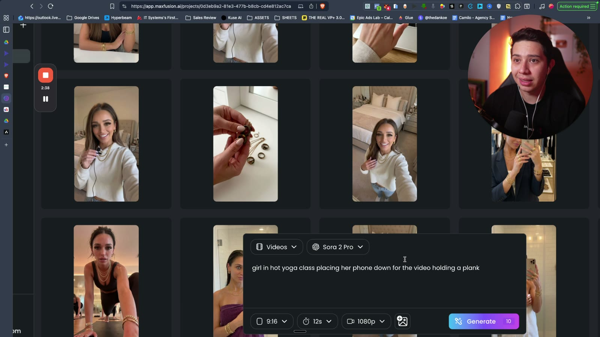
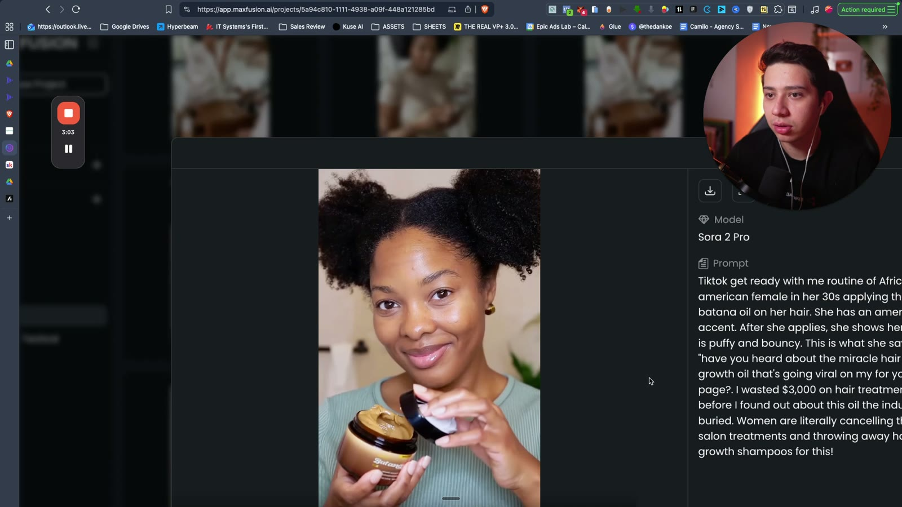
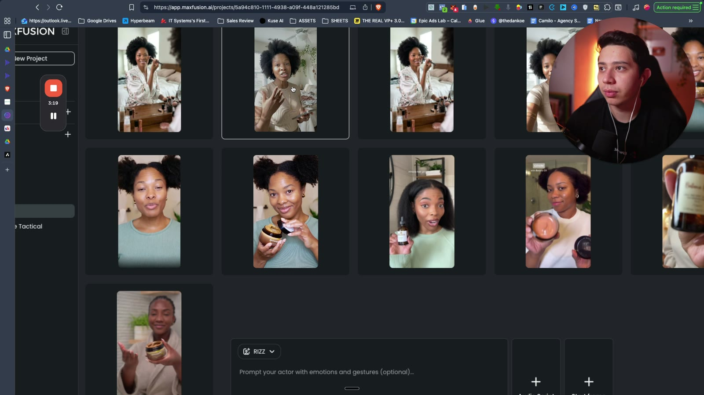

# 25. Generating Realistic Hook
> Use Sora 2 Pro inside Max Fusion to generate a 12-second hook that looks like organic TikTok footage: name the video format in the prompt, add a background-free product image, and accept that the face cannot be regenerated afterward.

## 🤖 Agent use
- **Use when:** you need the opening 8 to 12 seconds of an AI UGC ad to pass as a real phone video, or you are choosing the first tool of the rizz-model chain.
- **Inputs → outputs:** hook line + creator description + format + product image (no faces) → several 12 s, 9:16, 1080p Sora 2 Pro clips; you pick one and carry its look and voice into lessons 26 to 29.
- **Rules:**
  - **DO** state the video format in the prompt: "selfie FaceTime video", "TikTok video", "get ready with me video" [00:00].
  - **DO** keep prompts simple: creator look, place, action, the spoken line [00:00].
  - **DO** add the product with Upload image; "make sure there's no background as much as possible" [02:05].
  - **DO** set 12 seconds and 1080p, then generate "many versions" [02:05].
  - **DO** expect on-screen text artifacts and remove them (Vmake, "free for a very short video") [01:32].
  - **DON'T** skip the format words: "if you don't use that thing, you're going to get really bad results… really weird videos" because Sora 2 Pro "is trained on videos organically online that do very well" [00:58] (instructor claim).
  - **DON'T** upload an image with a human face as a reference: it "will get flagged" and fail (lesson page; also [lesson 29](029-make-ai-creators-talk.md) [00:00]).
  - **IF** you need the same creator again **THEN** do not re-prompt Sora: "You can't use the same face even if you prompt it the same way" [02:54]; follow [26](026-character-consistency.md).
- **See also:** Rizz-model chain: [24 the video](024-realistic-ai-ugc-rizz-model-the-video-we-are-making.md) → [25 hook](025-realistic-ai-ugc-rizz-model-generating-realistic-hook.md) → [26 character consistency](026-character-consistency.md) → [27 voice method 1](027-consistent-voices-method-1.md) → [28 voice method 2](028-consistent-voices-method-2.md) → [29 make creators talk](029-make-ai-creators-talk.md) → [30 B-roll](030-generate-realistic-ai-broll.md) → [31 editing](031-realistic-ai-ugc-rizz-model-editing-breakdown.md) · [AI UGC tools](../../../../tools/ai-ugc-tools.md) · [Arcads Sora 2 Pro hooks](033-sora-2-pro-hooks.md) (same ten prompts)

## Key ideas
### Format words steer the realism [00:00–01:32]
- First attempt shown: "attractive Gen Z blonde girl that's wearing a yellow builder's helmet. She's outside her house and a sunny day… is holding a hammer. She looks at the camera and says my boyfriend just spent $300 on jewelry" (transcript, [00:00]).
- Other prompts opened with the format: "selfie FaceTime video", "TikTok video", "get ready with me" [00:00]. Prompts without it gave odd results he showed on screen [00:58–01:32].
- Failed or text-covered outputs: some generations show an "Something went wrong" tile or baked-in subtitle text; remove text in post [01:32].

### Settings [02:05]
- Max Fusion → Videos → Sora 2 Pro; reference image = product only; length 12 s ("takes a little bit longer, but not that much"); 1080p; 9:16 shown on screen.

### The consistency problem [02:54]
- Two videos with the same prompt ("TikTok African lady") produced different women; the model will not recreate a face. Solution is the next lesson.

## Steps / framework
1. Write the prompt: format + creator (age, look) + setting + action + the exact spoken line.
2. Max Fusion → Videos → Sora 2 Pro → upload product image (no face, transparent or plain background) → 9:16, 12 s, 1080p → Generate.
3. Generate several versions; discard clips with overlaid text unless you can remove it (Vmake).
4. Pick the best hook; keep its audio for voice cloning ([27](027-consistent-voices-method-1.md) needs a clip over ~10 s; shorter clips go to [28](028-consistent-voices-method-2.md)).
5. Screenshot a clean frame of the creator for lesson 26.

## Examples
| Prompt (visible on screen or transcript) | Format words | Note | Source |
|---|---|---|---|
| "attractive Gen Z blonde girl… yellow builder's helmet… holding a hammer… says my boyfriend just spent $300 on jewelry" | selfie / TikTok | The jewelry-ad hook | [00:00] |
| "girl in hot yoga class placing her phone down for the video holding a plank" | (scene prompt) | Typed in Videos → Sora 2 Pro, 9:16, 1080p; used to build the yoga scene | frame [02:38] |
| Hair-oil prompt (below) | "TikTok get ready with me routine" | 12 s result shown with the product in hand | frame [03:03] |

## Structured units
### Hooks (spoken lines on screen)
| Hook (verbatim or near) | Heuristic(s) | Emotion / zone | Self targeted | Why it works | Source |
|---|---|---|---|---|---|
| "My boyfriend just spent $300 on jewelry" | stakes, open loop (derived) | curiosity (derived) | — | A price plus a pending reaction | [00:00] |
| "Have you heard about the miracle hair growth oil that's going viral on my For You page?" | social proof via platform ("going viral"), question hook (derived) | curiosity (derived) | hair-growth seekers (derived) | Names a trend the viewer may have seen | [00:00] of [27](027-consistent-voices-method-1.md); frame [03:03] |
| "I wasted $3,000 on hair treatments before I found out about this oil the industry buried." | blame the industry, sunk cost (derived) | frustration (derived) | people who spent on treatments (derived) | Compliance risk: invented spend, "industry buried" claim | frame [03:03] |

## Prompts / templates (verbatim)
### Hair-oil Sora 2 Pro prompt (text on screen; the right edge is cut off in the frame, so the middle of the sentence is partly missing)
```text
TikTok get ready with me routine of African american female in her 30s applying the batana oil on her hair. She has an American accent. After she applies, she shows her hair is puffy and bouncy. This is what she says: "have you heard about the miracle hair growth oil that's going viral on my for you page?. I wasted $3,000 on hair treatments before I found out about this oil the industry buried. Women are literally cancelling their salon treatments and throwing away their hair growth shampoos for this!"
```
*(The frame shows the lines truncated on the right; the words "American accent", "she shows her hair", "This is what she says" are inferred across the cut and should be checked against a re-run.)*

### Important rule from the lesson page
```text
Do Not Upload Faces as Reference Images
When using Sora 2 Pro, never upload screenshots or images containing human faces. These platforms do not allow facial data for generation. Doing so will cause the render to fail and get flagged by the system.
Only upload product images, packaging, or background references (like a desk, gym, or kitchen).
Any image containing a person's face will not process and may trigger a compliance flag.
```

### Ten prompt examples from the lesson page ("PROMPTS")
### 1. "TikTok Made Me Buy It" Review
Product: Cordless handheld vacuum
```text
Create a TikTok-style "TikTok made me buy it" video. A young woman in her apartment is testing a mini vacuum on a messy desk. She's impressed and laughing at how well it works. Show close-ups of dust being cleaned, fast cuts, natural daylight, upbeat tone.
```

### 2. "Get Ready With Me" (GRWM) Routine
Product: Mineral-based lip balm
```text
Make a soft-lighting "Get Ready With Me" TikTok video. A Gen Z creator applies Holistica Sweet Mints while doing her morning skincare. Include product close-up and voiceover mentioning zinc oxide and grass-fed tallow. Calm, morning aesthetic.
```

### 3. "Unboxing First Impression"
Product: Supplement gummies (e.g., Goli Ashwagandha)
```text
Generate a cozy unboxing video. A young fitness creator opens a small box of Goli gummies in his kitchen, talks about stress relief and taste. Show natural hand movements, kitchen background, camera panning slightly, casual vlog tone.
```

### 4. "Before & After Energy Boost"
Product: Pre-workout drink
```text
Create a TikTok ad showing a fitness influencer in gym clothes at home and at the gym. Show him yawning, then taking the pre-workout, then doing squats and bench press with energy. Include text overlay "Before vs After my pre-workout".
```

### 5. "Mini Try-On Haul"
Product: Embroidered jacket or statement clothing item
```text
Make a quick try-on haul video. A girl stands in her bedroom, trying on an embroidered jacket. She comments on details ("the stitching, the colors"). Natural hand-held camera feel, mirror shots, upbeat music, 10-second edit.
```

### 6. "POV: My Morning Routine Changed Everything"
Product: Sleep or wellness supplement
```text
Create a vlog-style "POV" video. A creator films morning light through a window, stretches, takes the wellness supplement, and says "my morning routine actually feels calm now." Gentle tone, ambient music, cozy apartment.
```

### 7. "Product in Hand Testimonial"
Product: Smart ring (e.g., Oura Ring)
```text
Generate a video of a tech-savvy creator holding up a sleek smart ring, showing it on his finger, and explaining how it tracks sleep. Filmed in minimal studio lighting with reflections. Confident tone, futuristic vibe.
```

### 8. "FaceTime-Style Story"
Product: Skincare serum
```text
Make a FaceTime-style vertical video where a creator speaks directly to camera as if chatting with a friend. She talks about trying a new serum and shows results up close. Include slight movement, off-center framing, real-life energy.
```

### 9. "The Aesthetic Product Shot"
Product: Candle or diffuser
```text
Create a moody aesthetic ad. Slow-motion clips of lighting a candle, soft smoke, cozy background music. Include close-up of label, desk setup, and someone reading a book. Minimal dialogue, highly visual.
```

### 10. "Planned High-Production Feel"
Product: Fitness apparel or lifestyle brand
```text
Generate a high-production ad as if shot with a team. Multiple camera angles, outdoor walking scenes, someone filming the creator working out, laughing, putting on headphones. Tone: cinematic, energetic, lifestyle-focused.
```

## Screenshots

*Videos → Sora 2 Pro with a short scene prompt, aspect ratio, length and resolution controls and the reference-image button. [02:38]*


*A finished hair-oil hook with the model name and full prompt shown, a template for format-first prompting. [03:03]*


*The project library after many generations; the Rizz panel at the bottom is where the stills later become talking clips ([29](029-make-ai-creators-talk.md)). [03:20]*

## How to apply
- [ ] Pick the platform format (selfie FaceTime, TikTok, GRWM, unboxing) before writing the prompt.
- [ ] Use a plain product image with no person; never a face.
- [ ] Generate at least three versions at 12 s and 1080p; check for baked-in text, wrong product shape and mouth sync.
- [ ] Remove any invented numbers or "industry buried" style claims before filming or voicing the line ([LLM output claim audit](../../../stefan-georgi/rmbc-ii/rubrics/llm-output-claim-audit.md)).

## Related
- Previous: [24. The video we are making](024-realistic-ai-ugc-rizz-model-the-video-we-are-making.md) · Next: [26. Character consistency](026-character-consistency.md)
- [Sora 2 Pro hooks in Arcads](033-sora-2-pro-hooks.md)

## Sources and limitations
- [Transcript](<../../../../../raw/ad-creators-lab/ai-ads-ugc-animations/_transcripts/Ad Creators Lab - Create Viral AI Ads, UGC & Animations That Convert Into Sales(September 2026)/3. AI UGC/4. Realistic AI UGC (rizz model)/2. Generating Realistic Hook - AI UGC Ad Creators Lab.txt>) (machine-transcribed; complete, 3:23.47 of 3:23.95) · [Lesson page](<../../../../../raw/ad-creators-lab/ai-ads-ugc-animations/_extracted/Ad Creators Lab - Create Viral AI Ads, UGC & Animations That Convert Into Sales(September 2026)/3. AI UGC/4. Realistic AI UGC (rizz model)/2. Generating Realistic Hook.htm.md>) (affiliate banner, a link to a Notion tutorial that is not in the course files, face-upload warning, ten prompts).
- The transcript says "African lady" and "sunny den"; "sunny day" is inferred. Tool facts (12 s, 1080p, Sora 2 Pro availability in Max Fusion, Vmake free tier) are as at recording (Aug–Sep 2026).
- Compliance: generated "customers" must not be presented as real reviewers; the hair-oil lines contain unsupported efficacy and spend claims ("miracle", "$3,000", "industry buried"). Treat them as format examples only.
