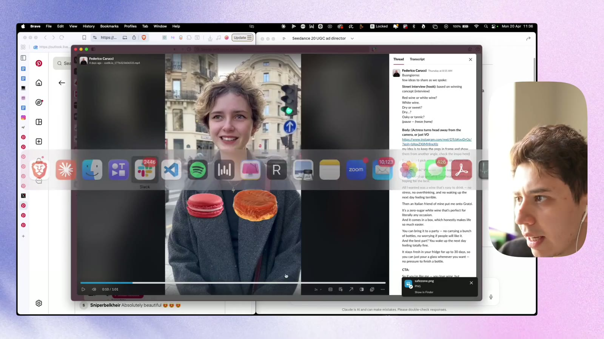
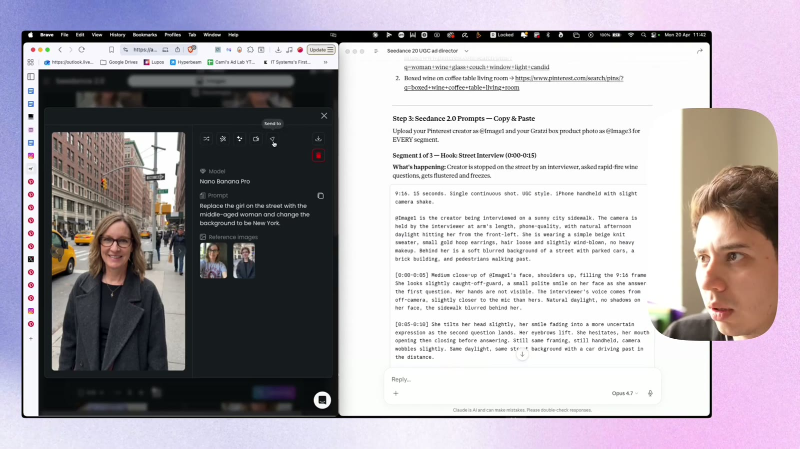
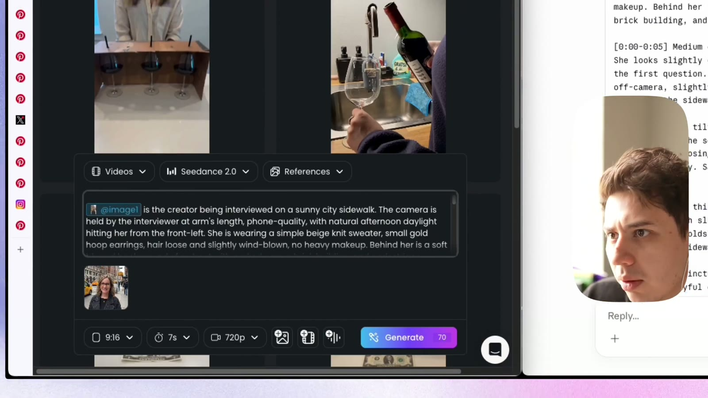
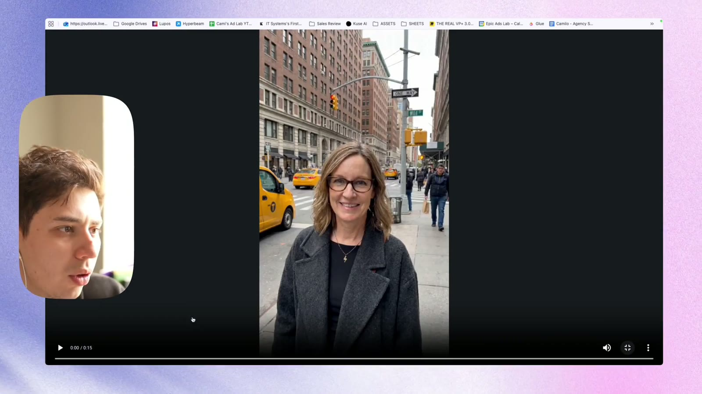

# 26. Character Consistency
> Keep one AI creator across scenes by turning a reference frame plus a chosen face into a new still (Nano Banana Pro in Max Fusion) and then using that still as the creator reference for the video model; the on-video demo is a Seedance 2.0 street interview.

## 🤖 Agent use
- **Use when:** the video model will not regenerate a face (Sora 2 Pro, [25](025-realistic-ai-ugc-rizz-model-generating-realistic-hook.md)) or you need the same person in many scenes, or you are building an AI street-interview ad.
- **Inputs → outputs:** a reference video frame (the scene you want) + a clean creator photo + a UGC script → a still of your creator in that scene → a Seedance 2.0 clip with synchronized dialogue and street sound.
- **Rules:**
  - **DO** save the chosen face as the "character reference" and reuse it for every segment [00:47].
  - **DO** match the scene to a real reference: screenshot a frame of the real street interview, then "replace the girl on the street for the middle-aged woman and change the background to be New York" [01:45].
  - **DO** generate "a few generations just so that we get the right one" [02:15].
  - **DO** prefer Nano Banana Pro over the standard Nano Banana 2 when results are better: "I got a lot better results" [02:15].
  - **DO** direct audio: two distinct voices (off-camera interviewer, creator) and outdoor city ambience [03:13].
  - **DON'T** accept a "too perfect" mic: "the problem with most AI UGC interviews is that they end up sounding very tinny… There's no street sound" [00:00].
  - **IF** the first generation breaks the face or props **THEN** remix the same references and prompt [02:15]; see also [lesson 20](020-claude-skill-seedance-2-0-ai-ugc.md) for the Seedance iteration loop.
- **See also:** Rizz-model chain: [24 the video](024-realistic-ai-ugc-rizz-model-the-video-we-are-making.md) → [25 hook](025-realistic-ai-ugc-rizz-model-generating-realistic-hook.md) → [26 character consistency](026-character-consistency.md) → [27 voice method 1](027-consistent-voices-method-1.md) → [28 voice method 2](028-consistent-voices-method-2.md) → [29 make creators talk](029-make-ai-creators-talk.md) → [30 B-roll](030-generate-realistic-ai-broll.md) → [31 editing](031-realistic-ai-ugc-rizz-model-editing-breakdown.md) · [Claude skill + Seedance 2.0 AI UGC](020-claude-skill-seedance-2-0-ai-ugc.md) · [Change creators with AI](015-change-creators-with-ai.md) · [AI UGC tools](../../../../tools/ai-ugc-tools.md)

## Key ideas
### Why the example is a street interview [00:00–00:47]
- Weak AI interviews sound "tinny", have a perfect mic and no street noise, "it just sounds like AI" [00:00]. A real street interview (he shows a well-known creator's clip; name unverified in the transcript) feels "raw… authentic… legit" [00:47].
- Goal: copy that feel. The example script: an interview about red or white wine; the interviewee gets confused; she then says "every time I pick wine, I have no idea what I'm doing" [00:47].

### Pipeline [00:47–03:13]
1. New Claude chat, upload the street-interview script, call the Seedance 2.0 UGC director skill with the slash command; Claude "reading the skill… building out the director's brief… find some creators on Pinterest" [00:47].
2. Pick a creator ("Let's do daylight. Okay, so I quite like this woman") and save as character reference [00:47].
3. Screenshot a frame from the real street-interview video; in Max Fusion → Images upload both the frame and the creator image; prompt the swap [01:45].
4. Generate several images; the chosen one is the creator reference [02:15].
5. Generate video → Seedance 2.0 → paste the skill's prompt (9:16, 15 s, iPhone UGC) → References → map image 1 to the creator [02:15].
6. Read the prompt and script before generating; confirm two voices and ambient city sound [03:13].
- On screen the video settings read 9:16, 7 s, 720p, cost 70 credits at that moment [03:02]; the skill's text says 15 s. (Settings may differ from the narration.)

### Result and finishing [03:57–04:32]
- Output: realistic street-interview exchange ("Red wine or white wine?" "White wine." "Dry or sweet?" "Dry." "Oaky or tannic?") [03:57].
- In the edit he adds emojis, subtitles and black and white, then cuts to the next part [04:12]. A version where he asked the model to add emojis itself "kind of didn't work" [04:12].

## Steps / framework
| # | Tool | Setting / action | Check |
|---|---|---|---|
| 1 | Claude + Seedance 2.0 UGC Director skill | Upload script; `/` command; read the director's brief | Skill file is read before the answer |
| 2 | Pinterest | Pick a clean daylight creator photo | No watermarks, no overlays |
| 3 | Real reference video | Screenshot the scene frame | Looks like the genre you want |
| 4 | Max Fusion → Images → Nano Banana Pro | Frame + creator image; swap prompt | Face matches; background correct |
| 5 | Max Fusion → Videos → Seedance 2.0 → References | Prompt from skill; image 1 = creator; 9:16 | Voices distinct; street ambience present |
| 6 | Edit | Emojis, subtitles, black and white as styling | Cut before artifacts show |

## Examples
- Source script (shown on screen, brief for the Gratsi wine product [00:47]): Street interview hook, then body ("Every time I pick wine I have no idea what I'm doing"), soft CTA.
- Generated clip: interviewee answers three rapid questions; in the prompt the third question makes her "completely freeze" mid-expression (shown on screen) [03:57].

## Structured units
### Rules
- **DO** build the new still from a real reference frame, not from words only [01:45].
- **DO** include "off-camera interviewer" and "outdoor city ambient" in the audio direction [03:13].
- **DON'T** judge on a single generation; compare several [02:15].

## Prompts / templates (verbatim)
Visible start of the Seedance 2.0 prompt in Max Fusion (text on screen, cut off in the frame) [03:02]:
```text
@image1 is the creator being interviewed on a sunny city sidewalk. The camera is held by the interviewer at arm's length, phone-quality, with natural afternoon daylight hitting her from the front-left. She is wearing a simple beige knit sweater, small gold hoop earrings, hair loose and slightly wind-blown, no heavy makeup. Behind her is a soft […]
```
Image edit prompt (spoken, [01:45]): "replace the girl on the street for the middle-aged woman and change the background to be New York".
The full skill file that generates these prompts is reproduced in [lesson 20](020-claude-skill-seedance-2-0-ai-ugc.md).

## Screenshots

*Claude's brief for the street-interview script and Pinterest creator searches next to the reference frame. [01:43]*


*Images → Nano Banana Pro prompt "Replace the girl on the street with the middle-aged woman and change the background to the New York" with the creator and the reference frame attached. [02:39]*


*Videos → Seedance 2.0 → References with the prompt, the creator image and wine references; settings 9:16, 7 s, 720p, 70 credits. [03:02]*


*Generated result: the Pinterest-derived creator on a street corner with taxis behind her. [03:59]*

## How to apply
- [ ] Choose a real reference clip of the genre and capture a still.
- [ ] Use a creator photo you have the right to use or a fully generated face ([Compliance note](#sources-and-limitations)).
- [ ] Run the image swap with several generations; keep the best as the single creator reference.
- [ ] Generate the video with that reference mapped as image 1 and explicit audio direction.

## Related
- Previous: [25. Generating realistic hook](025-realistic-ai-ugc-rizz-model-generating-realistic-hook.md) · Next: [27. Consistent voices, method 1](027-consistent-voices-method-1.md)
- Rizz-model chain: [24 the video](024-realistic-ai-ugc-rizz-model-the-video-we-are-making.md) → [25 hook](025-realistic-ai-ugc-rizz-model-generating-realistic-hook.md) → [26 character consistency](026-character-consistency.md) → [27 voice method 1](027-consistent-voices-method-1.md) → [28 voice method 2](028-consistent-voices-method-2.md) → [29 make creators talk](029-make-ai-creators-talk.md) → [30 B-roll](030-generate-realistic-ai-broll.md) → [31 editing](031-realistic-ai-ugc-rizz-model-editing-breakdown.md)

## Sources and limitations
- [Transcript](<../../../../../raw/ad-creators-lab/ai-ads-ugc-animations/_transcripts/Ad Creators Lab - Create Viral AI Ads, UGC & Animations That Convert Into Sales(September 2026)/3. AI UGC/4. Realistic AI UGC (rizz model)/3. Character Consistency - AI UGC Ad Creators Lab.txt>) (machine-transcribed; complete, 4:36.83 = full length). [Lesson page](<../../../../../raw/ad-creators-lab/ai-ads-ugc-animations/_extracted/Ad Creators Lab - Create Viral AI Ads, UGC & Animations That Convert Into Sales(September 2026)/3. AI UGC/4. Realistic AI UGC (rizz model)/3. Character Consistency.htm.md>): affiliate banner only.
- Mismatch: this lesson is titled "Character Consistency" for the rizz-model jewelry ad, but the video shows a wine street-interview built with the Seedance 2.0 skill; the jewelry creator's own consistency method (rebuilding Sora hook frames as stills with Nano Banana, then Rizz) is only visible in [29](029-make-ai-creators-talk.md) and [31](031-realistic-ai-ugc-rizz-model-editing-breakdown.md) [05:35]. Whisper wrote "C Dance" and "seed dance" for Seedance, "none other than a pro" for Nano Banana Pro.
- Compliance: the "creator" is a stranger's Pinterest photo used as a likeness; using a real identifiable person's face in an ad without permission is a legal and platform risk. Use licensed or fully generated faces. Do not copy the competitor's ad 1:1; reuse the mechanism (street format, rapid questions) only.
