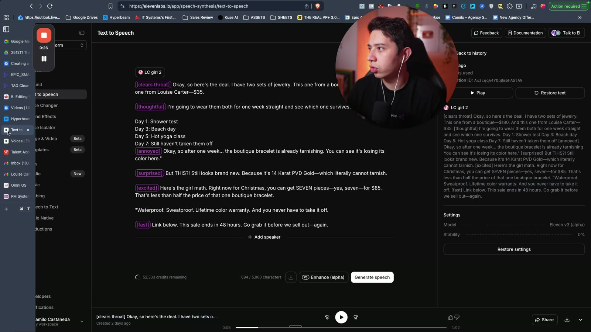

# 27. Consistent Voices Method 1
> Clone the voice of a Sora 2 Pro hook with ElevenLabs instant clone (audio-only export under the 10 MB limit) so the creator sounds the same in every later clip.

## 🤖 Agent use
- **Use when:** your Sora 2 Pro hook is about 12 seconds (long enough to clone) and you need that exact voice for the rest of the ad.
- **Inputs → outputs:** hook video (Sora 2 Pro, 12 s) → audio-only file under 10 MB → saved ElevenLabs voice → text-to-speech lines or Max Fusion Rizz speech ([29](029-make-ai-creators-talk.md)).
- **Rules:**
  - **DO** aim for "coherent, congruent voices" across the ad [00:00].
  - **DO** go ElevenLabs → clone voice → instant clone → upload audio; video files are limited to "10 megabytes each", so export audio only [00:00–00:47].
  - **DO** remove music if the clip has any; if there is none, skip the cleanup step (it "actually ruins the video" when applied to a clean clip; the exact toggle is not named) [00:47].
  - **DO** name and save the voice; check it against the original sentence [00:47].
  - **DO** write the script with ElevenLabs v3 audio tags and "Enhance (alpha)" (see Prompts) [frame 00:28].
  - **DON'T** use method 1 on clips shorter than about 10 seconds; use [28](028-consistent-voices-method-2.md) [01:46].
  - **DON'T** clone a voice you do not have the rights to (see Sources and limitations).
- **See also:** Rizz-model chain: [24 the video](024-realistic-ai-ugc-rizz-model-the-video-we-are-making.md) → [25 hook](025-realistic-ai-ugc-rizz-model-generating-realistic-hook.md) → [26 character consistency](026-character-consistency.md) → [27 voice method 1](027-consistent-voices-method-1.md) → [28 voice method 2](028-consistent-voices-method-2.md) → [29 make creators talk](029-make-ai-creators-talk.md) → [30 B-roll](030-generate-realistic-ai-broll.md) → [31 editing](031-realistic-ai-ugc-rizz-model-editing-breakdown.md) · [ElevenLabs](../../../../tools/elevenlabs.md) · [AI UGC tools](../../../../tools/ai-ugc-tools.md)

## Key ideas
### Instant clone from the hook [00:00–00:47]
- Example hook voice: "Have you heard about the miracle hair growth oil that's going viral on my For You page?" (12 s video) [00:00].
- Export only the audio from the video (he uses the player's File → Export as → Audio only), drag it into the ElevenLabs instant clone dialog, name it, save [00:47].

### Test and reuse [00:47–01:46]
- First test text: "Like a cat avoids water, it jumps with elegance…". "It sounds like the original" [00:47].
- Use the saved voice either in ElevenLabs text-to-speech or in Max Fusion's speech generation when animating images with Rizz [00:47].
- The hair-oil ad he finished was built exactly this way (he plays three lines from it) [01:46].

### When not to use it [01:46]
- Sora 2 clips under about 10 seconds are too short ("less than 12 seconds, which can happen") so use Voice Design, "a better option" [01:46].

## Steps / framework
1. Generate the hook ([25](025-realistic-ai-ugc-rizz-model-generating-realistic-hook.md)) at 12 s.
2. Export audio only (stay under 10 MB).
3. ElevenLabs → Voices → create/clone → Instant clone → upload → remove music only if present → name → save.
4. Paste the script into Text to Speech with the cloned voice (model Eleven v3 alpha, audio tags) → Generate speech.
5. Compare the new line with the hook line; keep the voice if the difference is not audible.

## Examples
| Case | Input | Result | Source |
|---|---|---|---|
| Hair-growth oil ad | 12 s Sora 2 Pro hook | "Botanic female" voice; later lines sound like the original | [00:47–01:46] |
| Jewelry ad hook | 8 s Sora clip | Too short, so [28](028-consistent-voices-method-2.md) | [01:46] |

## Prompts / templates (verbatim)
### ElevenLabs Text to Speech script with audio tags (screen, [00:28]; voice shown "LC girl 2", model Eleven v3 (alpha), Stability 0%, 894 / 5,000 characters)
```text
[clears throat] Okay, so here's the deal. I have two sets of jewelry. This one from a boutique—$180. And this one from Louise Carter—$35.

[thoughtful] I'm going to wear them both for one week straight and see which one survives.

Day 1: Shower test
Day 3: Beach day
Day 5: Hot yoga class
Day 7: Still haven't taken them off
[annoyed] Okay, so after one week... the boutique bracelet is already tarnishing. You can see it's losing its color here."

[surprised] But THIS?! Still looks brand new. Because it's 14 Karat PVD Gold—which literally cannot tarnish.

[excited] Here's the girl math. Right now for Christmas, you can get SEVEN pieces—yes, seven—for $85. That's less than half the price of that one boutique bracelet.

"Waterproof. Sweatproof. Lifetime color warranty. And you never have to take it off.

[fast] Link below. This sale ends in 48 hours. Go grab it before we sell out—again.
```
*The 14 Karat PVD, "cannot tarnish", "lifetime color warranty" and "sell out" lines are unverified brand claims (see the compliance note).*

## Screenshots

*The jewelry ad script in ElevenLabs with [clears throat], [thoughtful], [annoyed], [surprised], [excited], [fast] tags, Enhance (alpha) and Generate speech. [00:28]*

## How to apply
- [ ] Check clip length first; over about 10 s of speech use instant clone, otherwise [28](028-consistent-voices-method-2.md).
- [ ] Keep the original hook audio and the cloned test line side by side; ship only if they match.
- [ ] Save the voice under a clear name for reuse in Rizz ([29](029-make-ai-creators-talk.md)).

## Related
- Previous: [26. Character consistency](026-character-consistency.md) · Next: [28. Consistent voices, method 2](028-consistent-voices-method-2.md)
- Rizz-model chain: [24 the video](024-realistic-ai-ugc-rizz-model-the-video-we-are-making.md) → [25 hook](025-realistic-ai-ugc-rizz-model-generating-realistic-hook.md) → [26 character consistency](026-character-consistency.md) → [27 voice method 1](027-consistent-voices-method-1.md) → [28 voice method 2](028-consistent-voices-method-2.md) → [29 make creators talk](029-make-ai-creators-talk.md) → [30 B-roll](030-generate-realistic-ai-broll.md) → [31 editing](031-realistic-ai-ugc-rizz-model-editing-breakdown.md)

## Sources and limitations
- [Transcript](<../../../../../raw/ad-creators-lab/ai-ads-ugc-animations/_transcripts/Ad Creators Lab - Create Viral AI Ads, UGC & Animations That Convert Into Sales(September 2026)/3. AI UGC/4. Realistic AI UGC (rizz model)/4. Consistent Voices Method 1 - AI UGC Ad Creators Lab.txt>) (machine-transcribed; complete) · [Lesson page](<../../../../../raw/ad-creators-lab/ai-ads-ugc-animations/_extracted/Ad Creators Lab - Create Viral AI Ads, UGC & Animations That Convert Into Sales(September 2026)/3. AI UGC/4. Realistic AI UGC (rizz model)/4. Consistent Voices Method 1.htm.md>) (affiliate banner only).
- Ambiguity: the instruction about removing background noise ("if it doesn't have music… it actually ruins the video") does not name the control; confirm in the ElevenLabs dialog. The sample "cat avoids water" text is a throwaway test line.
- Compliance: only clone voices you have the rights to (your own, a hired voice actor with a written agreement, or a voice generated by the platform for your project). The cloned voice here belongs to an AI-generated creator hook, not a real person. Never clone a customer, a celebrity or any real person's voice to imitate them.
- Tool facts (10 MB limit, Eleven v3 alpha, credits) as at recording (Aug–Sep 2026).
