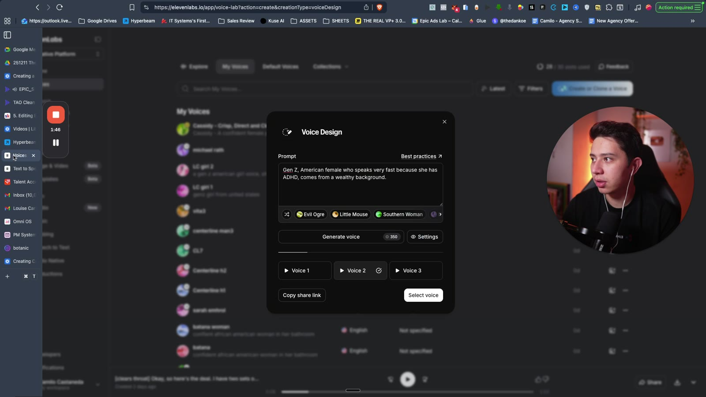

# 28. Consistent Voices Method 2
> When the Sora 2 Pro hook is too short to clone (8 s), design a matching voice in ElevenLabs Voice Design from a text description, compare it to the hook line, and use Enhance (alpha) to get a natural read.

## 🤖 Agent use
- **Use when:** the hook clip is under about 10 seconds (Sora gives 8 and 12 s), or you want a cleaner voice than the clip's audio.
- **Inputs → outputs:** the hook's audio and a description of the speaker → three Voice Design previews → one selected voice → speech for the full script.
- **Rules:**
  - **DO** write a short description of the speaker: age, country, speed, background [00:00–00:52].
  - **DO** compare each preview with the original line and iterate "until I heard one that sounded very similar" [01:43]; "If you can't hear a difference, then it's perfect" [01:43].
  - **DO** paste the script, click Enhance (alpha), then Generate speech: "it doesn't sound like a bot… you don't want anything to sound like a bot including the audio" [01:43].
  - **DON'T** rely on method 1 for an 8 s clip: "I can't actually clone it in ElevenLabs" [00:00].
  - **DON'T** describe a speaker by a medical condition; use the observable trait instead (derived): the shown prompt uses "has ADHD" to get fast speech, say "speaks very fast".
  - **IF** the result sounds good but flat **THEN** add audio tags and regenerate ([27](027-consistent-voices-method-1.md) script).
- **See also:** Rizz-model chain: [24 the video](024-realistic-ai-ugc-rizz-model-the-video-we-are-making.md) → [25 hook](025-realistic-ai-ugc-rizz-model-generating-realistic-hook.md) → [26 character consistency](026-character-consistency.md) → [27 voice method 1](027-consistent-voices-method-1.md) → [28 voice method 2](028-consistent-voices-method-2.md) → [29 make creators talk](029-make-ai-creators-talk.md) → [30 B-roll](030-generate-realistic-ai-broll.md) → [31 editing](031-realistic-ai-ugc-rizz-model-editing-breakdown.md) · [ElevenLabs](../../../../tools/elevenlabs.md) · [AI UGC tools](../../../../tools/ai-ugc-tools.md)

## Key ideas
### Voice Design instead of cloning [00:00–00:52]
- Original hook line: "My boyfriend just spent $300 on jewelry that I'm about to destroy" (8 s Sora clip) [00:00].
- In ElevenLabs he chose create voice → Voice Design, which gives a prompt box [00:00]. Observed traits: American, young, speaks fast, soft-spoken, rich background [00:00–00:52].

### Compare and select [00:52–01:43]
- Prompt used: "Gen Z, American female who speaks very fast because she has ADHD, comes from a wealthy background." (screen) [00:52].
- Three previews per generation (Voice 1, 2, 3); he picked Voice 2, then played test lines against the original: "My dad booked us this insane…", "Okay so I literally just got back from Aspen and it was so good" [00:52].
- When it matches, Select voice [01:43].

### Generate the full script [01:43–02:15]
- Paste the script into text to speech, use Enhance (alpha), generate. The output opens "Okay, so here's the deal. I have two sets of jewelry." [01:43].

## Steps / framework
1. ElevenLabs → Voices → Create or Clone a Voice → Voice Design.
2. Prompt (age, accent, pace, tone, background) → Generate voice (350 credits at recording) → listen to Voice 1 to 3.
3. Play the original hook line, then the same words in each preview; regenerate with an adjusted prompt if different.
4. Select voice → Text to Speech → paste script → Enhance (alpha) → Generate speech.
5. Keep the voice name for use inside Max Fusion Rizz ([29](029-make-ai-creators-talk.md)).

## Examples
| Attempt | Prompt idea | Result | Source |
|---|---|---|---|
| Version 1 | Gen Z American female, very fast, wealthy background | "My dad booked us this insane…" (usable) | [00:52] |
| Version 2 | Same | "Okay, so like I literally just got back from Aspen…" (selected) | [00:52] |

## Structured units
### Rules
- **DO** treat the original hook audio as the reference and judge by ear against it [01:43].
- **DON'T** ship a voice that reads like a narrator (derived from [01:43]).

## Prompts / templates (verbatim)
```text
Gen Z, American female who speaks very fast because she has ADHD, comes from a wealthy background.
```
*(Text from the Voice Design box on screen; the spoken description at [00:52] adds "soft-spoken". The ADHD phrasing is quoted for fidelity; use "speaks very fast" instead.)*

## Screenshots

*Voice Design: prompt box, Generate voice (350 credits), Voice 1/2/3 previews and Select voice. [01:30]*

## How to apply
- [ ] Describe the target speaker in one line (age, accent, pace, background).
- [ ] A/B each preview against the hook audio; select only when the difference is inaudible.
- [ ] Run the final script with Enhance (alpha) and audio tags.

## Related
- Previous: [27. Consistent voices, method 1](027-consistent-voices-method-1.md) · Next: [29. Make AI creators talk](029-make-ai-creators-talk.md)
- Rizz-model chain: [24 the video](024-realistic-ai-ugc-rizz-model-the-video-we-are-making.md) → [25 hook](025-realistic-ai-ugc-rizz-model-generating-realistic-hook.md) → [26 character consistency](026-character-consistency.md) → [27 voice method 1](027-consistent-voices-method-1.md) → [28 voice method 2](028-consistent-voices-method-2.md) → [29 make creators talk](029-make-ai-creators-talk.md) → [30 B-roll](030-generate-realistic-ai-broll.md) → [31 editing](031-realistic-ai-ugc-rizz-model-editing-breakdown.md)

## Sources and limitations
- [Transcript](<../../../../../raw/ad-creators-lab/ai-ads-ugc-animations/_transcripts/Ad Creators Lab - Create Viral AI Ads, UGC & Animations That Convert Into Sales(September 2026)/3. AI UGC/4. Realistic AI UGC (rizz model)/5. Consistent Voices Method 2 - AI UGC Ad Creators Lab.txt>) (machine-transcribed; complete) · [Lesson page](<../../../../../raw/ad-creators-lab/ai-ads-ugc-animations/_extracted/Ad Creators Lab - Create Viral AI Ads, UGC & Animations That Convert Into Sales(September 2026)/3. AI UGC/4. Realistic AI UGC (rizz model)/5. Consistent Voices Method 2.htm.md>) (affiliate banner only).
- Compliance: generate a synthetic voice; do not design or "match" a real person's voice, and do not clone voices you lack rights to. Prompt wording about a medical condition (ADHD) and "wealthy background" is stereotyping, so avoid it in your own prompts.
- Credits and UI as at recording (Aug–Sep 2026).
