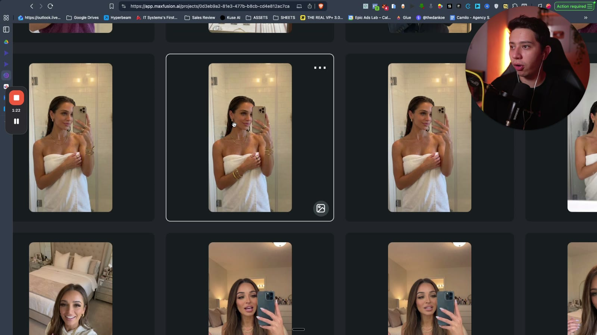
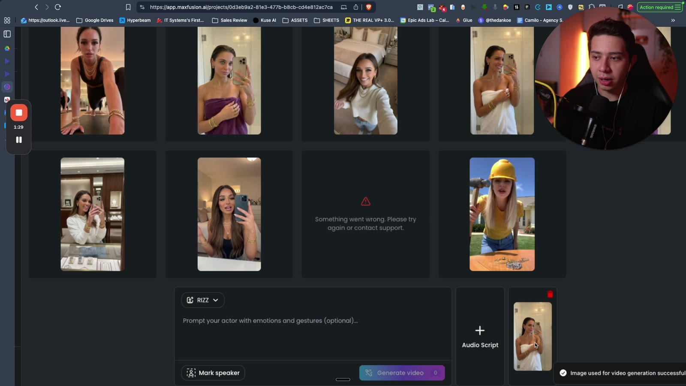

# 29. Make AI Creators Talk
> In Max Fusion pick a still of your creator, open Rizz, attach an ElevenLabs voice and script, and generate a lip-synced talking clip; closed-mouth source images pronounce "P" words better.

## 🤖 Agent use
- **Use when:** you have a creator still (from [26](026-character-consistency.md) or Nano Banana) and a voice ([27](027-consistent-voices-method-1.md) or [28](028-consistent-voices-method-2.md)) and need the creator to speak lines.
- **Inputs → outputs:** creator image + saved ElevenLabs voice + script lines → a talking clip per line (generate several, keep the best).
- **Rules:**
  - **DO** use the Rizz model for talking creators: "this is the biggest selling point for Riz… A lot of other AI engines don't have this" [00:51] (instructor claim).
  - **DO** work from images, not from the Sora clip: "if I add an image that's a person and not just your product, it'll get flagged" in Sora 2 Pro [00:00].
  - **DO** go: image → three dots → Generate video → Rizz; or save her as an actor and load her [00:51].
  - **DO** choose the ElevenLabs voice, use v3 alpha and emotion tags (curious, examining, disappointed) [01:41].
  - **DO** choose source images with the mouth closed: wide-open mouths struggle with "pieces", "pretend" and other P words [03:37].
  - **DO** regenerate or change the shot when it "does sometimes mess up" [02:38].
  - **DON'T** assume cost is fixed: "the tokens depend a lot on the length of the video"; short clips cost about 5 tokens in his run [02:38].
  - **DON'T** make real people say things: Rizz can "make anybody speak anything" [04:07], so only animate creators and voices you have rights to.
- **See also:** Rizz-model chain: [24 the video](024-realistic-ai-ugc-rizz-model-the-video-we-are-making.md) → [25 hook](025-realistic-ai-ugc-rizz-model-generating-realistic-hook.md) → [26 character consistency](026-character-consistency.md) → [27 voice method 1](027-consistent-voices-method-1.md) → [28 voice method 2](028-consistent-voices-method-2.md) → [29 make creators talk](029-make-ai-creators-talk.md) → [30 B-roll](030-generate-realistic-ai-broll.md) → [31 editing](031-realistic-ai-ugc-rizz-model-editing-breakdown.md) · [ElevenLabs](../../../../tools/elevenlabs.md) · [AI UGC tools](../../../../tools/ai-ugc-tools.md) · [Change creators with AI](015-change-creators-with-ai.md)

## Key ideas
### Why a second model [00:00–00:51]
- Because a Sora 2 Pro character cannot be recreated and face images fail there, the face is rebuilt as stills and animated with Rizz, which is built into Max Fusion [00:00–00:51].

### The Rizz flow [00:51–02:38]
1. Images → open a still (he picks the one to speak from) → ⋯ → Generate video → Rizz; optionally save the person as an actor [00:51].
2. Audio script → Generate speech → he refers to the earlier voice lessons [00:51].
3. Max Fusion connects to ElevenLabs: design a voice, use v3 alpha, or pick one of "your voices" ("Oh my god like literally…" was the voice he built) → Confirm [01:41].
4. Apply the script; tags such as curious, examining or disappointed tone can be added from a dropdown; he keeps expressions "pretty chill" [01:41–02:38].
5. Save audio; optionally write emotions and gestures in the prompt box; Generate [02:38].

### Quality checks [02:38–04:07]
- Variations differ; some break the mouth. Regenerate or change the framing [02:38].
- The mouth rule for "P" words [03:37].
- Final: "Come on… that's sick" on the talking result, then "do that many times, experiment" [04:07].

## Steps / framework
| # | Action | Detail | Source |
|---|---|---|---|
| 1 | Pick still | Closed mouth, front-facing, clean skin and lighting | [03:37] |
| 2 | Rizz | Image → Generate video → Rizz (or actor library) | [00:51] |
| 3 | Audio script | Script text per clip; Generate speech | [00:51] |
| 4 | Voice | ElevenLabs: your saved voice, or v3 alpha | [01:41] |
| 5 | Emotion | Dropdown tags (curious, examining, disappointed) | [01:41] |
| 6 | Generate | Optional gesture/emotion prompt; several variants | [02:38] |
| 7 | Check | Lip-sync on P words; cost per run | [03:37] |

## Examples
Lines made to talk (from the script in [27](027-consistent-voices-method-1.md)):
- "I'm going to wear them both for one week straight and see which one survives."
- "Okay, so after one week, the expensive bracelet is already tarnishing." (with an examining or disappointed tag)
Result judged natural enough for a voiceover [02:38].

## Structured units
### Rules
- **DO** generate speech per line and keep each clip short (cost scales with length) [02:38].
- **DO** pick source frames with the mouth shut for P-heavy lines [03:37].
- **IF** the lip-sync fails on a word **THEN** change the shot or regenerate [02:38].

## Prompts / templates (verbatim)
Rizz prompt box placeholder on screen: `Prompt your actor with emotions and gestures (optional)…`. Script lines with tags are shown in [27](027-consistent-voices-method-1.md). No further prompt text is shown in this lesson.

## Screenshots

*A still selected in the library with the image-to-video entry point; Nano Banana Pro creates the stills. [01:21]*

*The Rizz generator: prompt box for emotions and gestures, "Mark speaker", Audio Script and Start frame slots; the toast confirms the image was used for video generation. [01:28]*

## How to apply
- [ ] Select a closed-mouth still and the saved voice; write the line with tags.
- [ ] Generate three variants; reject mouth glitches and dead eyes.
- [ ] Log the credits per clip; keep clips under about 10 s.

## Related
- Previous: [28. Consistent voices, method 2](028-consistent-voices-method-2.md) · Next: [30. Generate realistic AI B-roll](030-generate-realistic-ai-broll.md)
- Rizz-model chain: [24 the video](024-realistic-ai-ugc-rizz-model-the-video-we-are-making.md) → [25 hook](025-realistic-ai-ugc-rizz-model-generating-realistic-hook.md) → [26 character consistency](026-character-consistency.md) → [27 voice method 1](027-consistent-voices-method-1.md) → [28 voice method 2](028-consistent-voices-method-2.md) → [29 make creators talk](029-make-ai-creators-talk.md) → [30 B-roll](030-generate-realistic-ai-broll.md) → [31 editing](031-realistic-ai-ugc-rizz-model-editing-breakdown.md)

## Sources and limitations
- [Transcript](<../../../../../raw/ad-creators-lab/ai-ads-ugc-animations/_transcripts/Ad Creators Lab - Create Viral AI Ads, UGC & Animations That Convert Into Sales(September 2026)/3. AI UGC/4. Realistic AI UGC (rizz model)/6. Make AI Creators Talk - AI UGC Ad Creators Lab.txt>) (machine-transcribed; ends 4:24.69 of 4:25.02) · [Lesson page](<../../../../../raw/ad-creators-lab/ai-ads-ugc-animations/_extracted/Ad Creators Lab - Create Viral AI Ads, UGC & Animations That Convert Into Sales(September 2026)/3. AI UGC/4. Realistic AI UGC (rizz model)/6. Make AI Creators Talk.htm.md>) (affiliate banner only). Whisper wrote "Riz" for Rizz and "tokens" for credits.
- Not shown: how the creator stills were generated from the Sora frames (only "the Nanobanana prompting section that I showed you earlier" is referenced in [31](031-realistic-ai-ugc-rizz-model-editing-breakdown.md) [05:35]).
- Compliance: lip-syncing any face to any voice can impersonate real people. Only animate AI-generated or licensed faces with voices you have rights to; do not present AI creators as real customers.
