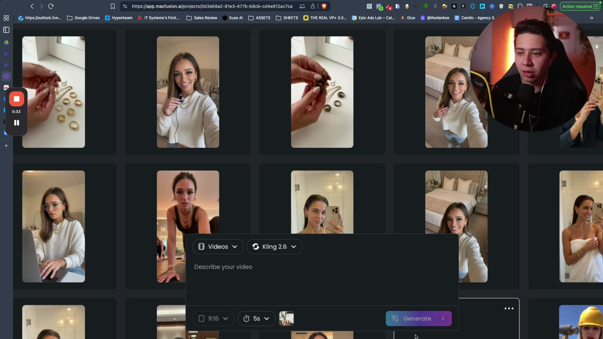
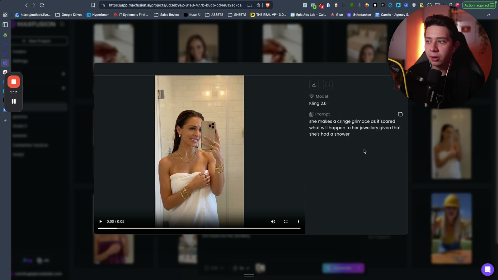
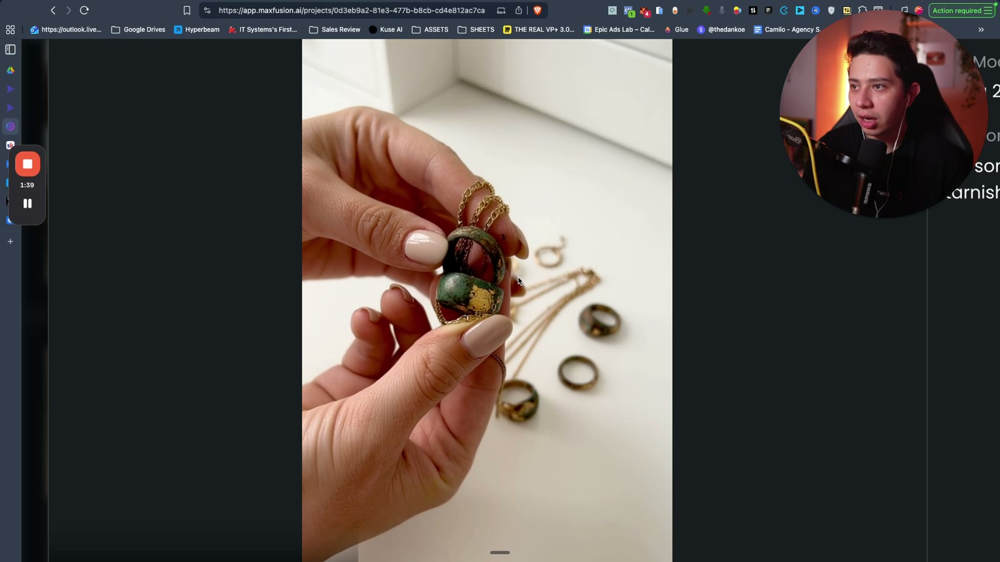

# 30. Generate Realistic AI Broll
> Make B-roll by animating the scene stills you already generated with Kling 2.6 in Max Fusion at 5 seconds, using one simple action per prompt, because Kling costs fewer credits than Veo 3.1.

## 🤖 Agent use
- **Use when:** you need 3 to 10 story cutaways (shower, beach, yoga, product close-ups) matching the creator's look.
- **Inputs → outputs:** scene stills generated from the script (the same creator) → one 5 s Kling 2.6 clip per still, 9:16.
- **Rules:**
  - **DO** generate many scene stills first, one per script beat [00:00].
  - **DO** animate with Kling: "Kling uses less credits as opposed to Veo 3.1 and Kling 2.6 is actually really cool" [00:00] (instructor claim).
  - **DO** use 5 s: "10 seconds just kind of uses too many credits… look at the difference of three versus ten" [00:00]; the Generate button reads 3 at 5 s [frame 00:34].
  - **DO** write very simple prompts: "girl observes her jewelry"; "going hot yoga placing a phone down"; "in the shower just getting ready" [00:40].
  - **DO** experiment with facial emotion in the prompt to match the story [00:40].
  - **DON'T** use Kling's generated voice unless it matches the creator's tone [00:40].
  - **DON'T** use Veo 3 for volume: "a lot more credits to use at scale and a lot more complicated" [01:37] (instructor claim).
- **See also:** Rizz-model chain: [24 the video](024-realistic-ai-ugc-rizz-model-the-video-we-are-making.md) → [25 hook](025-realistic-ai-ugc-rizz-model-generating-realistic-hook.md) → [26 character consistency](026-character-consistency.md) → [27 voice method 1](027-consistent-voices-method-1.md) → [28 voice method 2](028-consistent-voices-method-2.md) → [29 make creators talk](029-make-ai-creators-talk.md) → [30 B-roll](030-generate-realistic-ai-broll.md) → [31 editing](031-realistic-ai-ugc-rizz-model-editing-breakdown.md) · [AI UGC tools](../../../../tools/ai-ugc-tools.md) · [Clone B-roll UGC ads](016-clone-broll-ugc-ads.md)

## Key ideas
### Image to video [00:00–00:40]
- In the library click the still → Generate video → Kling 2.6 [00:00].

### Prompts that worked [00:40–01:37]
- "girl observes her jewelry": she "checks out her rings" [00:40].
- Hot yoga: placing a phone down; shower: getting ready [00:40].
- Emotion: "she makes a cringe grimace as if she's scared what will happen to her jewellery given that she's had a shower" [00:40]; this matches the story that she is scared to test the jewelry.
- Product state: tarnished jewelry with visible patina [01:00–01:37]; screen prompt: "person holding these rings showing how tarnished they are".

### Why Kling [01:37]
- "I would use Kling. I wouldn't use Veo 3… if you just want to get your AI ads done as quickly as possible" [01:37].

## Steps / framework
1. Max Fusion → Images: open the still of the beat.
2. Generate video → Kling 2.6 → 9:16 → 5 s (reference image attached).
3. One action sentence (+ emotion) → Generate (3 credits at recording).
4. Keep the best take; discard added audio unless it matches.
5. Repeat for each beat of the script ([24](024-realistic-ai-ugc-rizz-model-the-video-we-are-making.md) days 1, 3, 5, 7 and the product shots).

## Examples
| Still | Prompt | Result | Source |
|---|---|---|---|
| Creator with jewelry on a bed | "girl observes her jewelry" | Inspects rings | [00:40] |
| Mirror selfie in towel | "she makes a cringe grimace as if she's scared what will happen to her jewellery given that she's had a shower" | Fearful look matching the script | frame [01:14] |
| Hands with rings | "person holding these rings showing how tarnished they are" | Patina on rings | frame [01:37] |

## Structured units
### Rules
- **DO** pick the model by credits first; Kling 2.6 for volume B-roll [00:00].
- **IF** a prop or hand looks wrong **THEN** change the shot or re-roll; do not rescue it in the prompt (derived from [00:40]).

## Prompts / templates (verbatim)
```text
girl observes her jewelry
```
```text
she makes a cringe grimace as if scared what will happen to her jewellery given that she's had a shower
```
```text
person holding these rings showing how tarnished they are
```
*(Prompts as spoken or read from the screen; the second is shown on screen as "she makes a cringe grimace as if scared what will happen to her jewellery given that she's had a shower".)*

## Screenshots

*Videos → Kling 2.6 with an image attached, 9:16 and 5 s; the Generate button shows 3 credits. [00:34]*


*Result of the emotion prompt with model and prompt shown. [01:14]*


*Close-up B-roll of tarnished rings used for the "boutique jewelry fails" beat. [01:36]*

## How to apply
- [ ] List the B-roll beats from the script and generate one still per beat.
- [ ] Animate each at 5 s with a one-line prompt; add emotion where the story needs it.
- [ ] Mute the model audio; keep your ElevenLabs voice.

## Related
- Previous: [29. Make AI creators talk](029-make-ai-creators-talk.md) · Next: [31. Editing breakdown](031-realistic-ai-ugc-rizz-model-editing-breakdown.md)
- Rizz-model chain: [24 the video](024-realistic-ai-ugc-rizz-model-the-video-we-are-making.md) → [25 hook](025-realistic-ai-ugc-rizz-model-generating-realistic-hook.md) → [26 character consistency](026-character-consistency.md) → [27 voice method 1](027-consistent-voices-method-1.md) → [28 voice method 2](028-consistent-voices-method-2.md) → [29 make creators talk](029-make-ai-creators-talk.md) → [30 B-roll](030-generate-realistic-ai-broll.md) → [31 editing](031-realistic-ai-ugc-rizz-model-editing-breakdown.md)

## Sources and limitations
- [Transcript](<../../../../../raw/ad-creators-lab/ai-ads-ugc-animations/_transcripts/Ad Creators Lab - Create Viral AI Ads, UGC & Animations That Convert Into Sales(September 2026)/3. AI UGC/4. Realistic AI UGC (rizz model)/7. Generate Realistic AI Broll - AI UGC Ad Creators Lab.txt>) (machine-transcribed; complete) · [Lesson page](<../../../../../raw/ad-creators-lab/ai-ads-ugc-animations/_extracted/Ad Creators Lab - Create Viral AI Ads, UGC & Animations That Convert Into Sales(September 2026)/3. AI UGC/4. Realistic AI UGC (rizz model)/7. Generate Realistic AI Broll.htm.md>) (affiliate banner only). Whisper wrote "cling" for Kling and "vo 3.1" for Veo 3.1.
- Credit numbers (3 for 5 s) are as at recording (Aug–Sep 2026). The "tarnished" visuals depict a competitor-style jewelry failing; presenting AI-made tarnish as real test proof is a deceptive-claim risk. Mark such footage as dramatization or avoid it for performance claims (derived).
