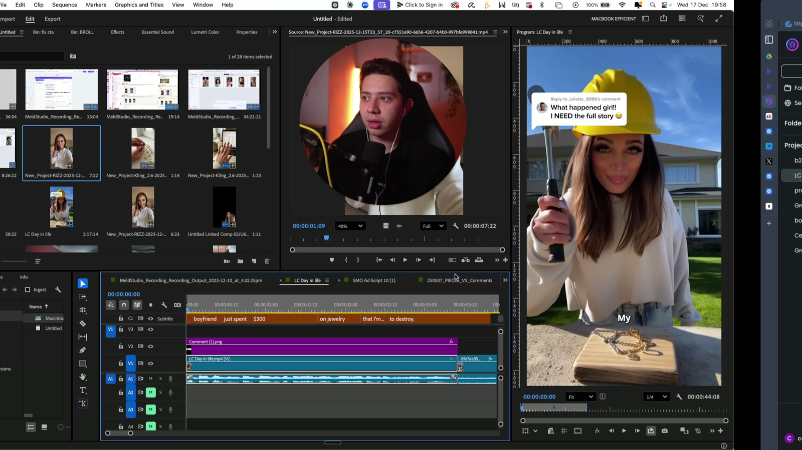
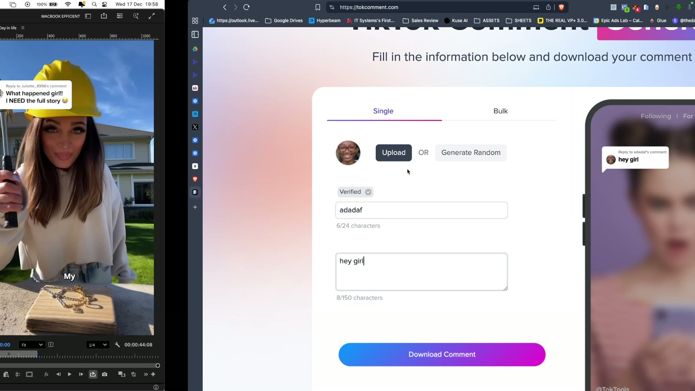
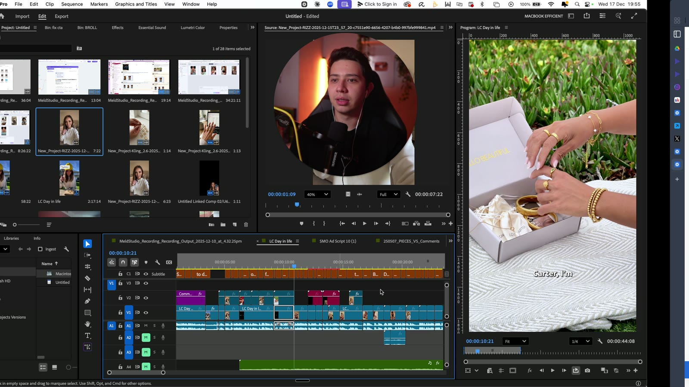

# 31. Editing Breakdown
> A walk through the Premiere Pro timeline of the finished jewelry ad: audio first, comment-overlay hook, repeated faces so viewers know it is her, green-screened talking head, real iPhone B-roll with matched skin tone, a "wiggle" shake on static clips, and no transitions or VFX.

## 🤖 Agent use
- **Use when:** briefing or doing the edit of an AI UGC ad, or checking an editor's cut for "AI tells".
- **Inputs → outputs:** ElevenLabs full-script audio + Sora hook + Rizz talking clips + Kling B-roll + Nano Banana product stills → a 9:16 ad with minimal creator-style editing.
- **Rules:**
  - **DO** build the audio timeline first and trim it so it sounds good; then fill pictures to the audio [00:00–01:47].
  - **DO** put everything on the timeline to see pacing and decide each clip's length [00:58].
  - **DO** open with a long hook then cut fast to different vlog-style shots of her [02:44].
  - **DO** show her face many times: "Don't just cut to other B-roll" [02:44].
  - **DO** use real iPhone footage as extra B-roll only with a similar skin tone to your AI creator [02:44–03:48].
  - **DON'T** dwell on the AI creator talking if it is not perfect: "you don't want too much focus" [03:48].
  - **DO** use green screen: talking clip small at the bottom-left or bottom-right, moving around [03:48].
  - **DO** use jump cuts for pace [04:39].
  - **DO** keep subtitles small and simple (Open Sans) [05:35].
  - **DO** add a handheld wiggle to static clips; static "doesn't really look too good" [06:41–07:38].
  - **DON'T** add transitions, VFX or risers: "I wanted it to look like a video that a creator actually made" [08:47].
- **See also:** Rizz-model chain: [24 the video](024-realistic-ai-ugc-rizz-model-the-video-we-are-making.md) → [25 hook](025-realistic-ai-ugc-rizz-model-generating-realistic-hook.md) → [26 character consistency](026-character-consistency.md) → [27 voice method 1](027-consistent-voices-method-1.md) → [28 voice method 2](028-consistent-voices-method-2.md) → [29 make creators talk](029-make-ai-creators-talk.md) → [30 B-roll](030-generate-realistic-ai-broll.md) → [31 editing](031-realistic-ai-ugc-rizz-model-editing-breakdown.md) · [Video editors (Hiring Talent)](103-video-editors.md) · [Train your video editor](108-train-your-video-editor.md) · [AI UGC tools](../../../../tools/ai-ugc-tools.md)

## Key ideas
### Order of work [00:00–01:47]
- He lists three topics: how elements were generated, the decision logic, and issues/tips [00:00].
- Audio first: all ElevenLabs lines on one timeline, cut so it sounds good; one line was removed ("the boutique $180") after seeing pacing [00:58].
- One clip ("I'm going to wear them both for one week straight") was generated again in Max Fusion with the same voice from a cut audio section, so the viewer sees her again after the hook [01:47].

### Hook construction [01:47–03:48]
- Hook = Sora clip plus a TikTok-comment PNG overlay from a TikTok comment generator (random female avatar, any name, text such as "hey girl, oh my god…"), downloaded and placed on the hook [02:44].
- The overlay frame reads as a reply comment asking for the full story; the comment's handle is not transcribed here (privacy).
- Hook is a long take then fast cuts of her doing vlog things [02:44].

### Body [03:48–05:35]
- Talking sections: keep short; green-screen her into corners with extra still images of her behind, so viewers can recognize that it is her [03:48–04:39].
- Story beats: day 1 shower (two angles), beach day, jump cuts for speed; "recall back" to the hook when the boutique one tarnishes [04:39].
- Product clips: rings must be the brand's real pieces; consistency came from Nano Banana prompts [04:39–05:35].
- Subtitles: just exist, not take space; Open Sans (he first guessed Proxima Nova) [05:35].

### CTA problem and fixes [05:35–07:38]
- Goal: only "Go to this page, pick out seven pieces of waterproof jewelry" with a small microphone. Generations "came out really bad" and once showed a hovering mic [06:41].
- Fix: green screen; choose a different shot saying "Yes, seven" (generated in Max Fusion), then cut back to her for "of waterproof jewelry" so no second has bad audio [06:41].
- Add a "wiggle" shake to the static "yes seven" shot so it feels like she is holding a phone; Premiere Pro's wiggle effect ("comes with Premiere Pro") [06:41–07:38].
- Music: Christmas pop from Premiere's Essential Sound [08:47].
- Result: no transitions, no VFX, no risers [08:47].

## Steps / framework
| # | Step | Tool | Check |
|---|---|---|---|
| 1 | Cut full-script audio | Premiere Pro | Sounds natural, no AI artifacts |
| 2 | Place audio, mark clip lengths | Timeline | Each visual has a duration |
| 3 | Hook | Sora clip + comment PNG | Reads like organic TikTok |
| 4 | Fast vlog cuts of her | Max Fusion stills/Rizz/Kling | Her face appears repeatedly |
| 5 | Talking head | Rizz clip, green screen to corners | Not full-screen if imperfect |
| 6 | Story B-roll | Kling clips + real iPhone footage (matched skin tone) | No visible mismatch |
| 7 | Product beats | Nano Banana stills / Kling | Same ring in every shot |
| 8 | CTA | Green-screened talking + alternative shot | No hovering-mic artifacts |
| 9 | Finish | Open Sans subtitles, wiggle on static clips, pop music | No transitions/VFX |

## Examples
- Timeline names visible: tracks for subtitle, a comment PNG over the video, a video track "LC Day in life", audio from the ElevenLabs export; project length about 44 s [frame 02:32].
- Before/after: static "yes seven" clip → same clip with wiggle shake [07:38].

## Structured units
### Rewrites (before → after)
| Before | After | What changed | Source |
|---|---|---|---|
| Full-frame AI creator talking the whole CTA | Creator green-screened to a corner over B-roll | Reduced exposure of AI imperfections | [03:48] |
| Static CTA clip | Same clip with wiggle shake | Added handheld motion | [07:38] |
| Cut to unrelated B-roll | Cut back to her face repeatedly | Identity recognition | [02:44] |

### Rules
- **DO** keep edits creator-simple; **DON'T** add effects a UGC creator would not (no transitions, VFX, risers) [08:47].
- **IF** a generated line has a bad second **THEN** replace only that shot and keep the voice continuous [06:41].

## Prompts / templates (verbatim)
Subtitle font: Open Sans [05:35]. Audio source: [27](027-consistent-voices-method-1.md) script. Comment overlay text example on screen: "What happened girl!! I NEED the full story" (comment-generator style; author handle omitted).

## Screenshots

*Timeline detail: subtitle track, a comment overlay PNG over the hook, the main clip and audio. [02:32]*

*TikTok Comment Generator: upload an avatar or generate a random one, name, comment text, Download Comment. [02:58]*

*Project bin with the Rizz and Kling clips beside the sequence. [00:45]*

## How to apply
- [ ] Edit audio first, then pictures.
- [ ] Show the creator's face at least every few cuts; avoid full-frame talking where lip-sync is weak.
- [ ] Add handheld wiggle to locked-off shots; keep subtitles small.
- [ ] Do not add transitions or VFX.

## Related
- Previous: [30. Generate realistic AI B-roll](030-generate-realistic-ai-broll.md) · Next: [32. The Arcads workflow](032-the-arcads-workflow.md)
- Rizz-model chain: [24 the video](024-realistic-ai-ugc-rizz-model-the-video-we-are-making.md) → [25 hook](025-realistic-ai-ugc-rizz-model-generating-realistic-hook.md) → [26 character consistency](026-character-consistency.md) → [27 voice method 1](027-consistent-voices-method-1.md) → [28 voice method 2](028-consistent-voices-method-2.md) → [29 make creators talk](029-make-ai-creators-talk.md) → [30 B-roll](030-generate-realistic-ai-broll.md) → [31 editing](031-realistic-ai-ugc-rizz-model-editing-breakdown.md)

## Sources and limitations
- [Transcript](<../../../../../raw/ad-creators-lab/ai-ads-ugc-animations/_transcripts/Ad Creators Lab - Create Viral AI Ads, UGC & Animations That Convert Into Sales(September 2026)/3. AI UGC/4. Realistic AI UGC (rizz model)/8. Editing Breakdown - AI UGC Ad Creators Lab.txt>) (machine-transcribed; ends 9:20.62 of 9:21.26) · [Lesson page](<../../../../../raw/ad-creators-lab/ai-ads-ugc-animations/_extracted/Ad Creators Lab - Create Viral AI Ads, UGC & Animations That Convert Into Sales(September 2026)/3. AI UGC/4. Realistic AI UGC (rizz model)/8. Editing Breakdown.htm.md>) (affiliate banner only). Whisper wrote "Riz" for Rizz.
- Compliance: a fabricated TikTok comment generated with a tool is fake social proof; do not use it as a claim of real engagement. Real third-party iPhone footage requires a licence. Mixing AI and real footage to avoid "subtle thoughts that this is an AI video" [03:48] conflicts with platforms' AI-content disclosure rules; check the ad platform's labeling requirements (derived).
