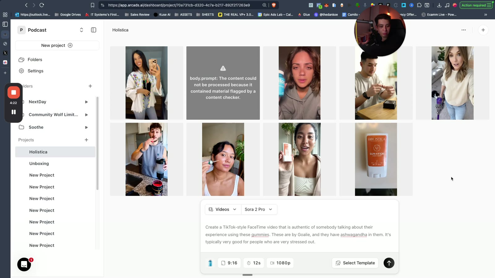
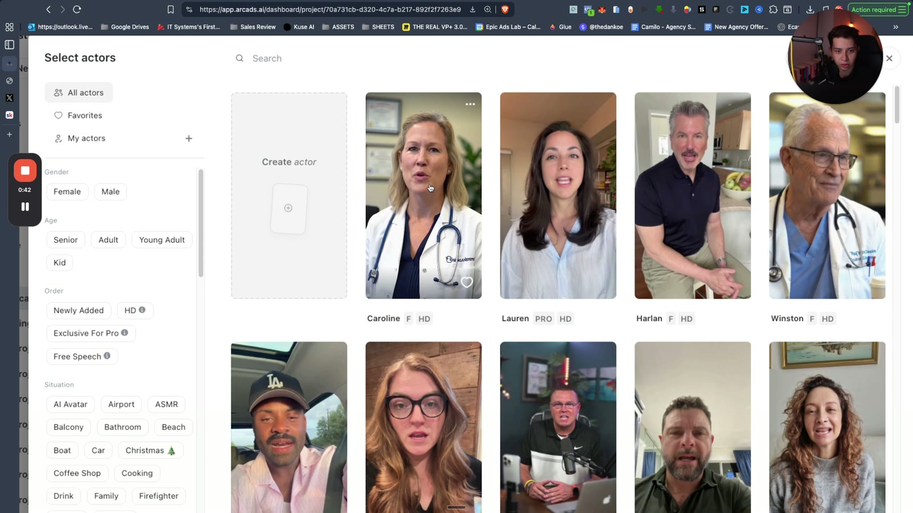
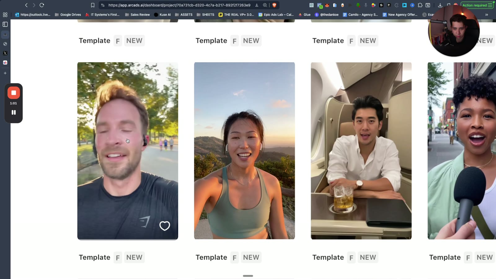
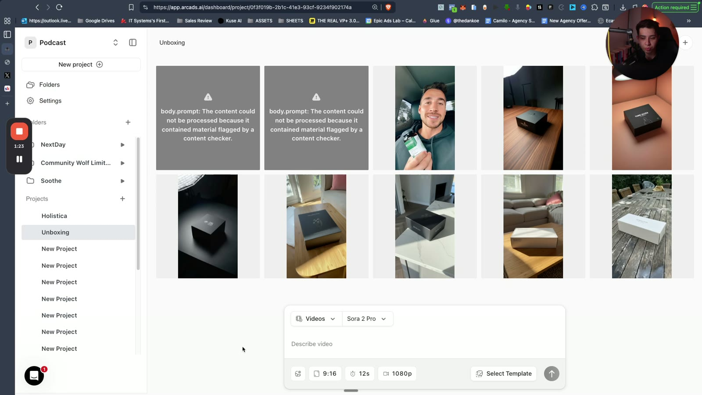

# 33. SORA 2 Pro Hooks
> In Arcads use the Video section (Sora 2 Pro), not Talking Actors, to get organic-looking UGC hooks: pick the concept first (GRWM, unboxing, "TikTok made me buy it"), attach a face-free product image, and describe the scene by vibe rather than JSON.

## 🤖 Agent use
- **Use when:** you need quick realistic UGC-style hook clips for a product and have no creator footage.
- **Inputs → outputs:** concept from research + product facts + scene (place, time of day, lighting) + product image (no faces) → 9:16, 12 s, 1080p Sora 2 Pro clips (several) to edit as hooks.
- **Rules:**
  - **DO** use Arcads' Video section → Sora 2 Pro, not the Talking Actors section: those "typically you get those actors that look like AI" [00:00].
  - **DO** use a template for a ready look and make the person say your text; but a template cannot hold your product [00:51–01:22].
  - **DO** skip the template and add a product reference image when the product must be in hand [01:22].
  - **DO** create the scene "very specific, but also not too specific… not full JSON prompt… the overall vibe" [01:22].
  - **DO** name the concept: get ready with me, unboxing, day in the life, "TikTok made me buy it" [02:18].
  - **DO** pick the concept "from the research and the stuff that you see inside the course" [03:14].
  - **DO** give product context, setting and time-of-day/lighting ("morning energy", "soft lighting as if it's 11 in the morning") [03:46–04:36].
  - **DO** say when the product should appear (for example only near the end) [04:36].
  - **DON'T** upload any image with a human face; the render fails and may flag the account (lesson page; frame [01:23] shows "The content could not be processed because it contained material flagged by a content checker").
  - **IF** you want a higher-production look **THEN** state "as if he had other people helping him" [04:36].
- **See also:** [25. Generating realistic hook](025-realistic-ai-ugc-rizz-model-generating-realistic-hook.md) (same Sora 2 Pro approach in Max Fusion) · [34. Fashion clothing ads](034-fashion-clothing-ads.md) · [AI UGC tools](../../../../tools/ai-ugc-tools.md) · [write-ugc-script skill](../../../../../../.claude/skills/write-ugc-script/SKILL.md) · [LLM output claim audit](../../../stefan-georgi/rmbc-ii/rubrics/llm-output-claim-audit.md)

## Key ideas
### Video section, not Talking Actors [00:00–00:51]
- Finished examples: try-on of an embroidered jacket ("I'm obsessed. The colors…") and a vacuum ("TikTok made me buy this thing… it just eats the pet hair") [00:00].
- "It's not that difficult at all. You just have to be a bit careful with the prompting" [00:00].

### Templates vs reference images [00:51–01:22]
- Select templates shows a grid of creators in ready scenes; "some of these templates are low-key fire". With a template he only supplied what the person says [00:51].
- Limit: "I couldn't make it hold the product", so for product-in-hand add a product image and no template [01:22].

### Sora 2 learns from viral content [01:22–02:18]
- "Sora 2 is fed on the kind of content that people are actually watching right now… TikTok videos… viral content" (instructor claim) [01:22]. Therefore give the type of video ("a get ready with me type of video") [02:18].

### Build the prompt in layers [03:14–04:36]
1. Concept line: "create a TikTok style FaceTime video that is authentic of somebody talking about their experience using these gummies" [03:14].
2. Product context: brand and key ingredient/benefit ("ashwagandha… very good for people who are very stressed out") [03:46].
3. Scene: place and person ("young fitness creator… in his kitchen… before and after… squats and bench") [03:46].
4. Mood and light: "morning energy and soft lighting as if it's 11 in the morning" [03:46].
5. Product timing: show the product toward the end [04:36].
- Settings on screen: 9:16, 12 s, 1080p, Select Template button [frame 04:22].

## Steps / framework
| # | Tool | Setting | Check |
|---|---|---|---|
| 1 | Arcads → project → Video | Sora 2 Pro | Not "Talking Actors" |
| 2 | Concept | Pick from research | One concept per clip |
| 3 | Template or product image | Template for creator look; product image for product in hand | No faces in uploads |
| 4 | Prompt | Concept + product + scene + light + product timing | Not JSON, not vague |
| 5 | Generate | 9:16, 12 s, 1080p | Review each clip; discard flagged or odd ones |

## Examples
| Brand/product (as named in video or page) | Concept | Prompt idea | What to note | Source |
|---|---|---|---|---|
| Embroidered jacket | Quick try-on | Template, he types what she says | Looks real | [00:00] |
| Cordless vacuum | "TikTok made me buy it" | Page prompt 1 | Pet hair "gone" in the clip | [00:00] |
| Aura smart ring (earlier run) | Product in hand | Reference image, no template | Product held correctly | [01:22] |
| Goli gummies (named in the prompt) | FaceTime-style testimonial | Layered prompt below | Product shown late | [03:14–04:36] |
| Fitness creator, kitchen and gym | Before/after | "planned as if he had other people helping" | Higher production feel | [04:36] |

## Structured units
### Rules
- **DO** pick the format before the scene; **DON'T** write "full JSON" [01:22].
- **DON'T** state supplement benefits as facts in a script: "very good for people who are very stressed out" is an unverified claim in the demo.

## Prompts / templates (verbatim)
### Demo prompt (on screen [04:22] and spoken [03:14–04:36])
```text
Create a TikTok-style FaceTime video that is authentic of somebody talking about their experience using these gummies. These are by Goalie, and they have ashwagandha in them. It's typically very good for people who are very stressed out.
```
Spoken additions: young fitness creator in his kitchen, before and after, upbeat, morning energy, soft light, show the product toward the end [03:46–04:36].

### Lesson page rule
```text
Do Not Upload Faces as Reference Images
When using Sora 2 or Arcads, never upload screenshots or images containing human faces. These platforms do not allow facial data for generation — doing so will cause the render to fail and get flagged by the system.
Only upload product images, packaging, or background references (like a desk, gym, or kitchen).
Any image containing a person's face will not process and may trigger a compliance flag.
```

### Ten prompt examples from the lesson page ("PROMPTS")
### 1. "TikTok Made Me Buy It" Review
Product: Cordless handheld vacuum
```text
Create a TikTok-style "TikTok made me buy it" video. A young woman in her apartment is testing a mini vacuum on a messy desk. She's impressed and laughing at how well it works. Show close-ups of dust being cleaned, fast cuts, natural daylight, upbeat tone.
```

### 2. "Get Ready With Me" (GRWM) Routine
Product: Mineral-based lip balm
```text
Make a soft-lighting "Get Ready With Me" TikTok video. A Gen Z creator applies Holistica Sweet Mints while doing her morning skincare. Include product close-up and voiceover mentioning zinc oxide and grass-fed tallow. Calm, morning aesthetic.
```

### 3. "Unboxing First Impression"
Product: Supplement gummies (e.g., Goli Ashwagandha)
```text
Generate a cozy unboxing video. A young fitness creator opens a small box of Goli gummies in his kitchen, talks about stress relief and taste. Show natural hand movements, kitchen background, camera panning slightly, casual vlog tone.
```

### 4. "Before & After Energy Boost"
Product: Pre-workout drink
```text
Create a TikTok ad showing a fitness influencer in gym clothes at home and at the gym. Show him yawning, then taking the pre-workout, then doing squats and bench press with energy. Include text overlay "Before vs After my pre-workout".
```

### 5. "Mini Try-On Haul"
Product: Embroidered jacket or statement clothing item
```text
Make a quick try-on haul video. A girl stands in her bedroom, trying on an embroidered jacket. She comments on details ("the stitching, the colors"). Natural hand-held camera feel, mirror shots, upbeat music, 10-second edit.
```

### 6. "POV: My Morning Routine Changed Everything"
Product: Sleep or wellness supplement
```text
Create a vlog-style "POV" video. A creator films morning light through a window, stretches, takes the wellness supplement, and says "my morning routine actually feels calm now." Gentle tone, ambient music, cozy apartment.
```

### 7. "Product in Hand Testimonial"
Product: Smart ring (e.g., Oura Ring)
```text
Generate a video of a tech-savvy creator holding up a sleek smart ring, showing it on his finger, and explaining how it tracks sleep. Filmed in minimal studio lighting with reflections. Confident tone, futuristic vibe.
```

### 8. "FaceTime-Style Story"
Product: Skincare serum
```text
Make a FaceTime-style vertical video where a creator speaks directly to camera as if chatting with a friend. She talks about trying a new serum and shows results up close. Include slight movement, off-center framing, real-life energy.
```

### 9. "The Aesthetic Product Shot"
Product: Candle or diffuser
```text
Create a moody aesthetic ad. Slow-motion clips of lighting a candle, soft smoke, cozy background music. Include close-up of label, desk setup, and someone reading a book. Minimal dialogue, highly visual.
```

### 10. "Planned High-Production Feel"
Product: Fitness apparel or lifestyle brand
```text
Generate a high-production ad as if shot with a team. Multiple camera angles, outdoor walking scenes, someone filming the creator working out, laughing, putting on headphones. Tone: cinematic, energetic, lifestyle-focused.
```

## Screenshots

*Arcads Videos → Sora 2 Pro with the gummies prompt, product thumbnail attached, 9:16, 12 s, 1080p and Select Template; one tile in the grid shows the content-flag error. [04:22]*


*The Talking Actors picker he steers away from because the actors "look like AI". [00:43]*


*Select templates: ready creator scenes where you only supply the speech. [01:01]*


*"The content could not be processed because it contained material flagged by a content checker": the failure a face upload or flagged content causes. [01:23]*

## How to apply
- [ ] Choose the hook concept from competitor research; write the layered prompt.
- [ ] Attach only a plain product image; never a face.
- [ ] Generate several 12 s clips; keep the one where product, hands and label look right.
- [ ] Replace supplement or health claims with approved copy before voicing; run [LLM output claim audit](../../../stefan-georgi/rmbc-ii/rubrics/llm-output-claim-audit.md).

## Related
- Previous: [32. The Arcads workflow](032-the-arcads-workflow.md) · Next: [34. Fashion clothing ads](034-fashion-clothing-ads.md)

## Sources and limitations
- [Transcript](<../../../../../raw/ad-creators-lab/ai-ads-ugc-animations/_transcripts/Ad Creators Lab - Create Viral AI Ads, UGC & Animations That Convert Into Sales(September 2026)/3. AI UGC/5. Arcads/2.SORA 2 Pro Hooks.txt>) (machine-transcribed; ends 5:23.95 of 5:26.12, last seconds untranscribed) · [Lesson page](<../../../../../raw/ad-creators-lab/ai-ads-ugc-animations/_extracted/Ad Creators Lab - Create Viral AI Ads, UGC & Animations That Convert Into Sales(September 2026)/3. AI UGC/5. Arcads/2.SORA 2 Pro Hooks.htm.md>) (Arcads affiliate link `?via=camilo`, the face-upload warning and ten prompts). Whisper wrote "Arkads" for Arcads and "Goalie" for Goli. The brand names in prompts (Goli, Oura/Aura, Holistica) are examples from the course, not endorsements.
- Compliance: generated creators are not real customers; do not present them as such. Prompts that mention "zinc oxide", "grass-fed tallow", "stress relief" or "tracks sleep" make product claims you must verify. Arcads' Talking Actors are licensed likenesses of real people; use per platform terms.
- Tool facts (Arcads video section, Sora 2 Pro, 12 s, 1080p) as at recording (Aug–Sep 2026).
