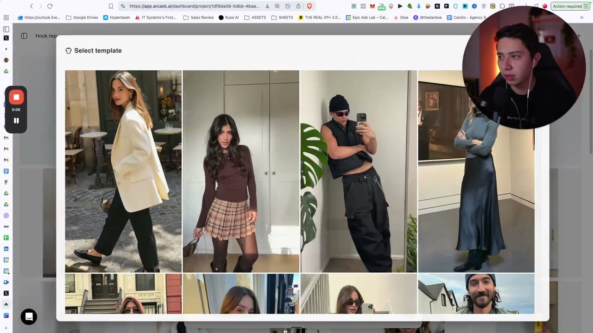
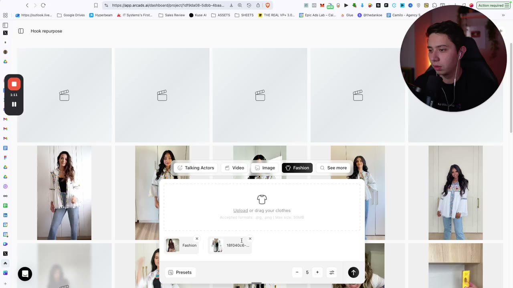
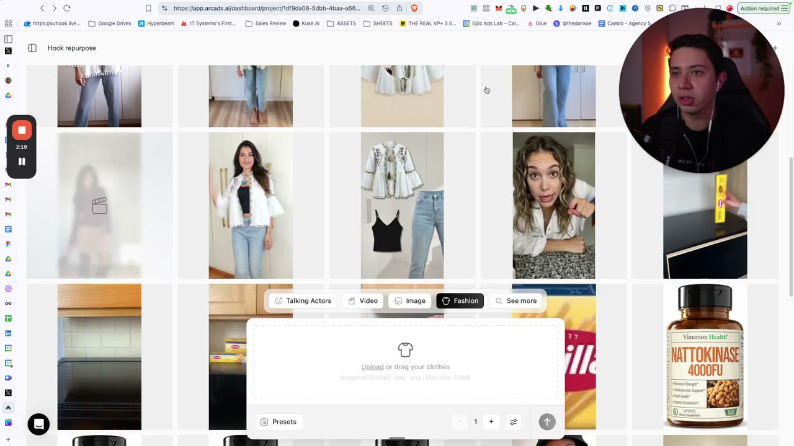

# 34. FASHION CLOTHING ADS
> Arcads' Fashion mode: choose a creator as the base model, upload a clothing image, raise the variation count and cut only the good bits to get many creators wearing your garment.

## 🤖 Agent use
- **Use when:** you sell apparel and want many creator-style try-on variations from a product photo.
- **Inputs → outputs:** garment photo (jpg or png) + base creator template → multiple short clips of the creator wearing it; you edit down.
- **Rules:**
  - **DO** go Arcads → See more → Fashion (new version) → choose a creator → Remix → upload the clothing [00:00].
  - **DO** increase the variation count to get many outputs [00:00].
  - **DO** edit: "you are always going to want to edit this… cut only the good bits because not everything will be perfect" [00:00].
  - **DON'T** keep clips that look "a bit too AI" or "too sped up" [01:02].
  - **DON'T** use someone else's clothing without permission: in the demo he uses a community member's clothing (see limitations); use your own product photos.
  - **IF** you want a different creator look **THEN** pick another base creator and remix [00:00].
- **See also:** [33. Sora 2 Pro hooks](033-sora-2-pro-hooks.md) · [AI UGC tools](../../../../tools/ai-ugc-tools.md) · [15. Change creators with AI](015-change-creators-with-ai.md)

## Key ideas
### Fashion flow [00:00–01:02]
- In Arcads open "see more" and choose the new Fashion version; select a creator as "the base model", click Remix, upload clothing by drag-and-drop, increase variations [00:00].
- First result is shown "without really giving any instructions. It's just that creator" [00:00].

### Quality control [01:02]
- One variation is "too AI", another "too sped up, not so good", another "interesting"; use as "a good way… to have a lot of different creator mashups" for different clothing [01:02].

## Steps / framework
1. Arcads → See more → Fashion.
2. Select creator template → Remix.
3. Upload clothing image (drag and drop; on-screen hint shows image formats and a size cap).
4. Set variations to the highest you need → generate.
5. Review all outputs; cut and keep the good ones in your edit.

## Examples
- Earlier "Hook repurpose" project results visible behind the upload box include an embroidered white jacket with jeans and top, and a supplement bottle (frame [01:27]).
- Result: several creators in the garment; some clips rejected for looking too sped up [01:02].

## Structured units
### Rules
- **DO** run Fashion for variation, then pick winners by eye (derived from [00:00]).
- **IF** hands or garment details warp **THEN** reject the clip; do not try to fix it with the same seed (derived).

## Prompts / templates (verbatim)
No text prompt is used in this lesson ("without really giving it any instructions" [00:00]). The project is named "Hook repurpose" and a "Hook Repurposer" tab is visible [00:17], but it is not explained.

## Screenshots

*Select template: base creators for the Fashion remix. [00:06]*

*Fashion tab with a clothing item uploaded and the variation counter. [00:30]*

*The Fashion drop zone ("Upload or drag your clothes", Presets, variation counter) above earlier Hook-repurpose results. [01:27]*

## How to apply
- [ ] Use your own garment photos on a plain background.
- [ ] Request maximum variations, then cull aggressively.
- [ ] Check logos, stitching and fit against the real garment before using a clip (garment claims must match the product).

## Related
- Previous: [33. Sora 2 Pro hooks](033-sora-2-pro-hooks.md) · Next: [35. Generate human-sounding AI voice overs](035-generate-human-sounding-ai-voice-overs.md)

## Sources and limitations
- [Transcript](<../../../../../raw/ad-creators-lab/ai-ads-ugc-animations/_transcripts/Ad Creators Lab - Create Viral AI Ads, UGC & Animations That Convert Into Sales(September 2026)/3. AI UGC/5. Arcads/3. FASHION CLOTHING ADS.txt>) (machine-transcribed; ends 1:42.03, complete) · [Lesson page](<../../../../../raw/ad-creators-lab/ai-ads-ugc-animations/_extracted/Ad Creators Lab - Create Viral AI Ads, UGC & Animations That Convert Into Sales(September 2026)/3. AI UGC/5. Arcads/3. FASHION CLOTHING ADS.htm.md>) (no lesson text on page).
- "Archives" and "arcades" in the transcript = Arcads. The clothing in the demo is "someone in this community that has some really cool clothing"; obtaining and using a third party's designs for your own ad needs their consent.
- Compliance: virtual try-on on AI or licensed creators must not misrepresent fit, fabric or quality; do not present AI try-ons as customer photos.
