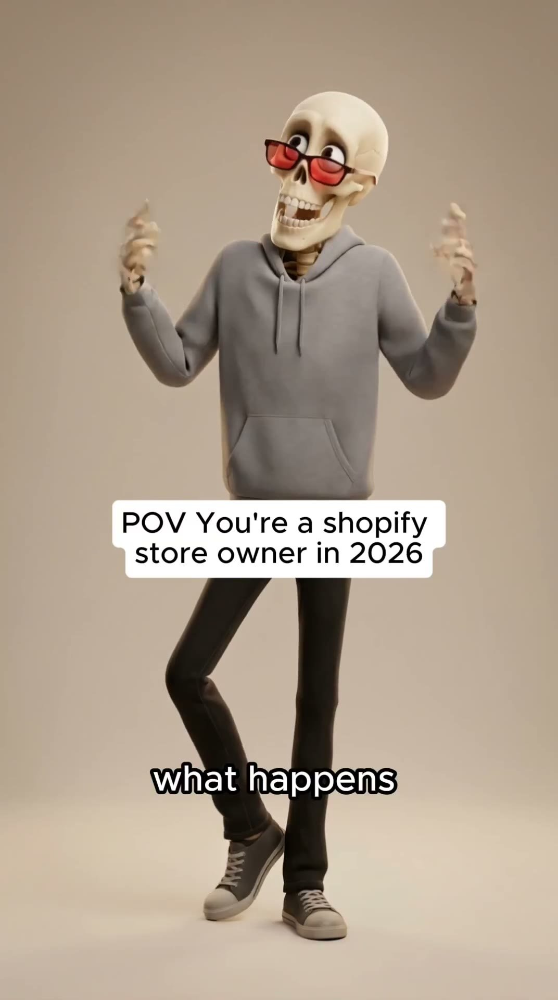
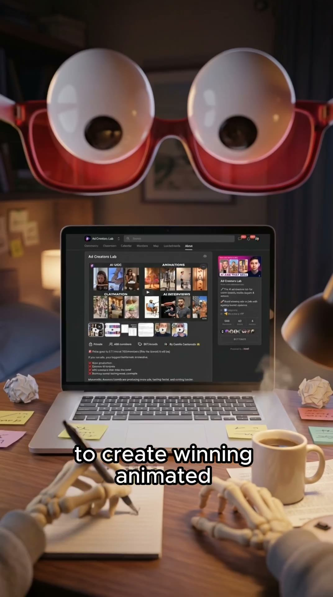
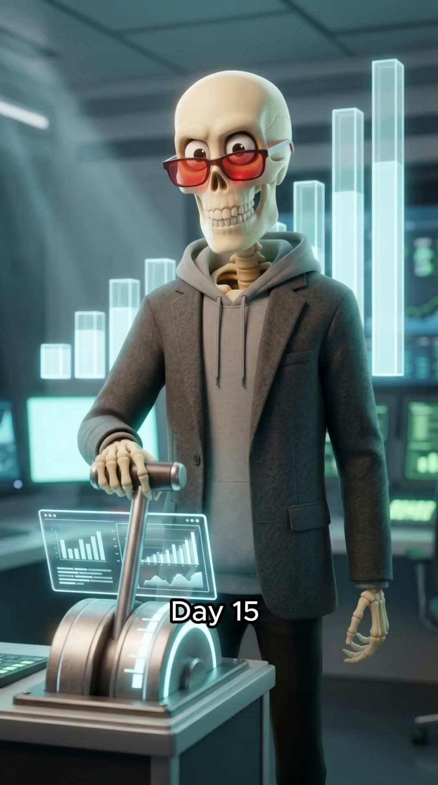
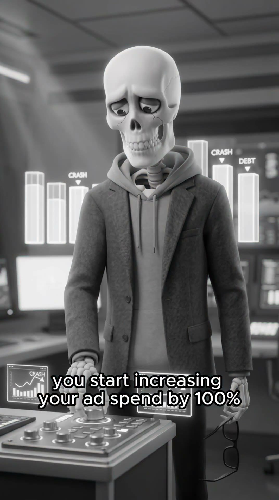

# 36. The Ads We're Making (Skeleton ads)
> The 50-second finished example of the skeleton format that modules 37–42 rebuild step by step: a literal cartoon skeleton lives a "Day 1 → Day 30" progression to a narrated voiceover, selling the Ad Creators Lab community itself.

## 🤖 Agent use
- **Use when:** you need the quality bar and the structure of a skeleton ad before writing or producing one; planning a "What happens if you ___?" progression ad.
- **Inputs → outputs:** nothing to input; output is a reference script and shot list to imitate in structure (not in claims).
- **Rules:**
  - **DO** open with a curiosity-gap question in the first second: "What happens if you join Ad Creators Lab for the next 30 days?" [00:00].
  - **DO** escalate on a fixed spine ("Day 1, Day 5, Day 10 ... Day 30") with one concrete image per line [00:00–00:49].
  - **DO** keep the same character in every shot (red-lensed glasses, grey hoodie, ivory skeleton) while setting and props change [frames 00:00–00:43].
  - **DON'T** copy the outcome claims. "Scale it to $1,000 per day", "increasing your ad spend by 100%" and "double your creative output" are the community's own promises with no proof in this lesson (instructor claim). Replace with your own verified results or soften to what you can substantiate.
  - **IF** you make this for a DTC product **THEN** swap the Day ladder for product-visible changes, and read [037](037-install-skill-generate-script.md) for the skill that writes it.
- **See also:** [037. Install skill and generate script](037-install-skill-generate-script.md) · [042. Editing the video](042-skeleton-editing-the-video.md) · [043. Hall of fame](043-hall-of-fame-skeleton-ads.md) · [LLM output claim audit](../../../stefan-georgi/rmbc-ii/rubrics/llm-output-claim-audit.md)

## Key ideas
### The 30-day promise as the script spine [00:00–00:49]
- The whole voiceover is a timeline of the member's first 30 days: Day 1 learn frameworks, Day 5 AI UGC "look like real ads", Day 10 "double your creative output" (5 to 10 ads per week), Day 15 "increasing your ad spend by 100% instead of incrementally by 10 to 20%", Day 20 "find a winning ad and scale it to $1,000 per day", Day 25 "share your wins with the community" and "a brand twice your size shows you what they're doing", Day 30 "hired a video editor from the community" [00:00].
- Closing line: "You've now built your own small e-commerce empire because you decided to take ad creation seriously." [00:00] (instructor claim).
- It is an ad for the community, so it is a worked example of format, not of a DTC product ad.

### What is on screen [frames]
- Hook shot: skeleton in grey hoodie and red-lensed glasses, full-body, caption "POV You're a shopify store owner in 2026" over "what happens" [00:00].
- Cut to a phone held in skeleton hands showing the community page as "Ad Creators Lab" is spoken [00:01].
- Day 1: skeleton at a desk with notepad and laptop [00:03]. Day 5: skeleton clapping at a monitor with a UGC creator holding a product [00:08].
- Day 15: skeleton at a big lever with glowing bar chart, Day 15 (increase) then a black-and-white "contrast" shot with a small dial and "CRASH/DEBT" bars for "instead of incrementally" [00:19–00:23].
- Day 20: skeleton holds up a vertical image above its head, dashboards behind [00:26]. Day 25: neon "Lock-in" sign, two screens [00:31]. "Brand twice your size": a second skeleton in a suit points at a laptop [00:33].
- Day 30 and finish: skeleton in a skyline office, then a zoom-out through a penthouse full of boxes, desks and trophy [00:37–00:43] (built in [040](040-advanced-video-prompts.md)).

## Examples
| Brand / product (niche) | Format | Hook / opening | What works | What fails | Fix suggested | Principle | Source |
|---|---|---|---|---|---|---|---|
| Ad Creators Lab community (ad education) | Skeleton progression, narrated, 9:16 | "What happens if you join Ad Creators Lab for the next 30 days?" | Open loop + Day ladder; one image per line; identity caption "POV You're a shopify store owner in 2026" (derived: names the viewer) | Outcome claims have no evidence in the lesson | Use only claims you can substantiate; show the product earlier | Curiosity gap, escalation (derived) | [00:00] |

## Structured units
### Hooks
| Hook (verbatim or near) | Heuristic(s) | Emotion / zone | Self targeted | Why it works | Source |
|---|---|---|---|---|---|
| "What happens if you join Ad Creators Lab for the next 30 days?" | curiosity gap, timeline (derived) | curiosity (derived) | Shopify store owner (on-screen caption) | Question plus visible "30 days" promises a payoff arc | [00:00] |

- **DO** pair a hook question with an identity caption so the right viewer self-selects (derived).
- **DON'T** treat the promise ladder as evidence: compliance flag, unsupported results claims (see Sources and limitations).

## Screenshots

*Hook shot: the recurring skeleton, "POV You're a shopify store owner in 2026". [00:00]*

*"to create winning animated" over the Day 1 desk shot with the community page on the laptop. [00:05]*

*Day 15: a lever and rising bars visualise "increasing your ad spend". [00:19]*

*The contrast shot (small dial, black and white) for "instead of incrementally by 10 to 20%". [00:23]*

*Payoff: office full of boxes and screens for "you've now built your own small e-commerce empire". [00:42]*

## How to apply
- [ ] Write your hook as a "What happens if you ___?" question with a time or quantity spine.
- [ ] Plan one concrete image per voiceover line, same character throughout.
- [ ] Remove every outcome number you cannot back up before production.

## Related
- Previous: [035. Generate human-sounding AI voice overs](035-generate-human-sounding-ai-voice-overs.md) · Next: [037. Install skill and generate script](037-install-skill-generate-script.md)

## Sources and limitations
- [Transcript](<../../../../../raw/ad-creators-lab/ai-ads-ugc-animations/_transcripts/Ad Creators Lab - Create Viral AI Ads, UGC & Animations That Convert Into Sales(September 2026)/4. AI Animated Ads/1. 🔥NEW🔥 Skeleton Ads/1. The Ads We're Making.txt>) (Whisper large-v3-turbo; ends 0:49 of 0:50). Lesson page text is empty.
- Frames viewed from the video; no spend, ROAS or performance data is shown.
- Compliance: the on-screen "Day 15/20" results and "$1,000 per day" claims are unsupported marketing claims; the presenter's later lessons build this exact ad as a demo.
