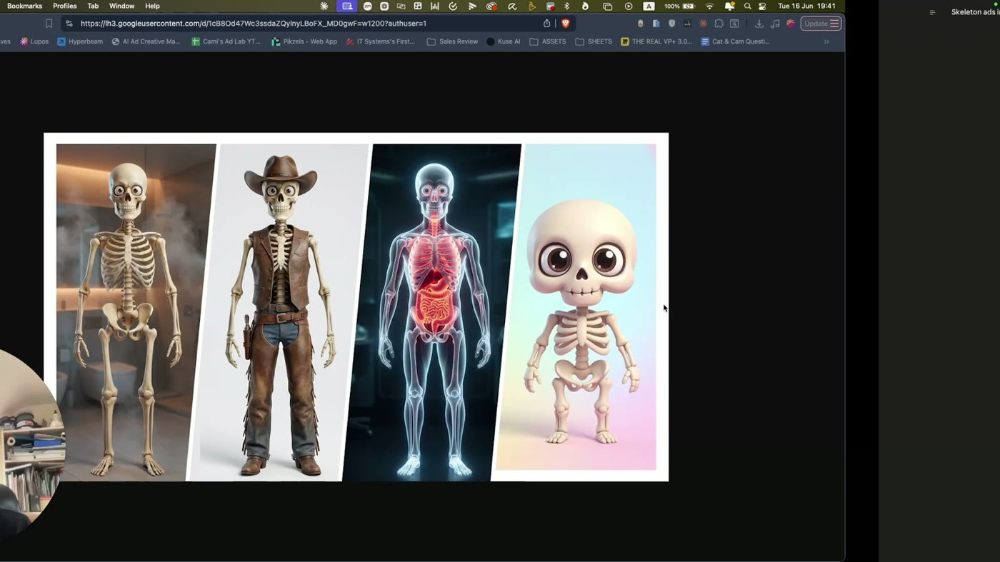
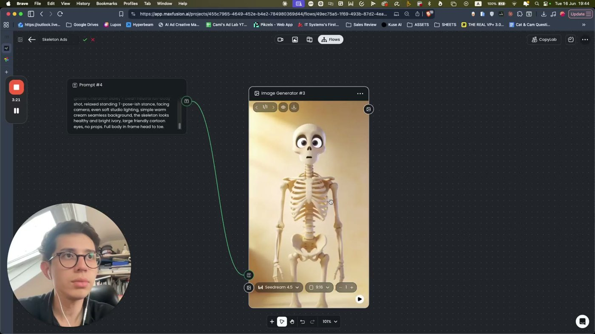
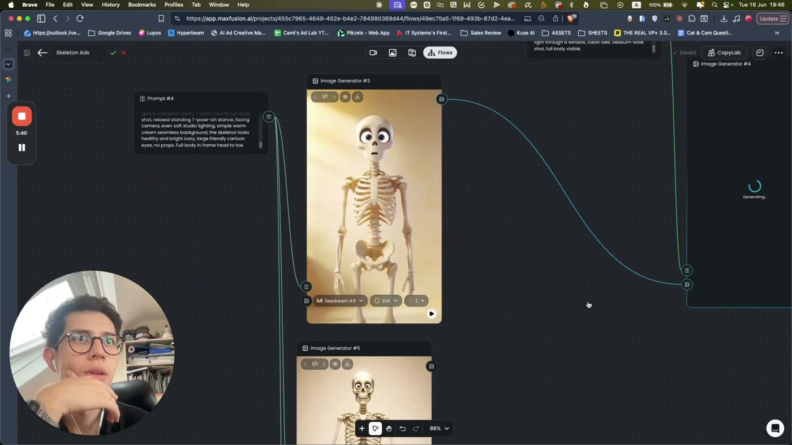
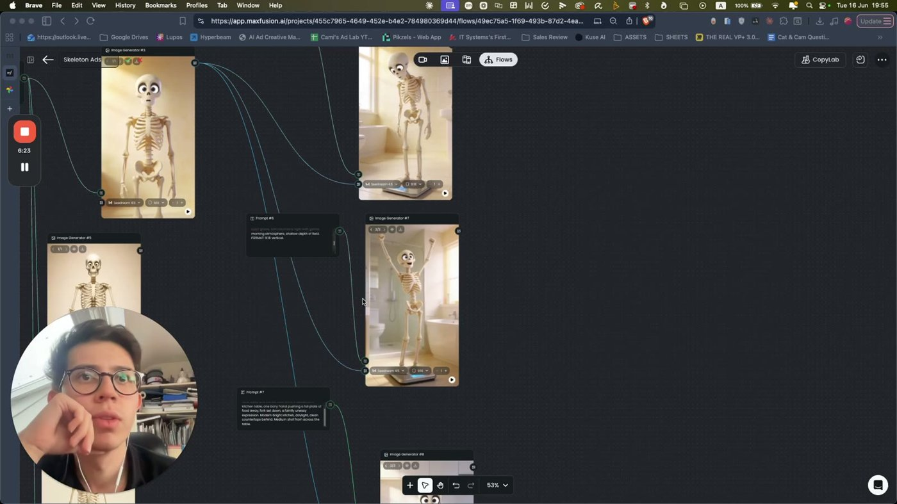

# 38. Generating Images (Skeleton ads)
> Turn the approved script into one locked skeleton "hero" image first, then generate every shot with the character bible plus the hero as a reference so the skeleton stays identical across the ad.

## 🤖 Agent use
- **Use when:** running Stage 3 of the skeleton skill ([037](037-install-skill-generate-script.md)); generating consistent character stills for any animated format.
- **Inputs → outputs:** approved script + chosen style/theme → character bible + hero prompt + one prompt per shot → a set of 9:16 stills, one per voiceover line.
- **Rules:**
  - **DO** pick the style from the skill's style image (four options; he likes "the cute one") and let the skill give a line-by-line breakdown of situation, emotion, setting, props, product [00:00].
  - **DO** prompt "generate images for one two three" to get exact prompts [00:55].
  - **DO** generate the hero image first and wait for it before the rest: "we want the skeleton to look the same" [01:52].
  - **DO** feed every later shot the character bible, the scene section and the hero image as a reference; "even if we prompt it exactly the same ... there will be some differences" without the reference [02:11–02:50].
  - **DO** test with a cheap image model first (he uses Seedream 4.5; screen shows 9:16, 1 image) [01:52].
  - **DO** add missing shots yourself, e.g. a "POV shot of the guy's screen" for a community shot [03:20].
  - **DON'T** assume one model's look: the same prompt looks different in Seedream, GPT Image 2 and Nano Banana 2; "it's your taste" [02:50].
  - **DON'T** ship health-implication shots from the demo (weight-loss script) without substantiation; see [037](037-install-skill-generate-script.md).
- **See also:** [037. Install skill](037-install-skill-generate-script.md) · [039. Generating videos](039-skeleton-generating-videos.md) · [AI UGC tools](../../../../tools/ai-ugc-tools.md) · [Crochet script visualisation (same consistency mechanic)](046-script-visualisation-image-creation.md)

## Key ideas
### Style choice and breakdown [00:00–00:55]
- After you insert a script, the skill recommends a style; click the style image to open the four-up (Bare-Bones Cinematic, Dressed, X-Ray with Organs, Cute Mascot) and choose another [00:00]. The recommended style on screen is Bare-Bones Cinematic ("this one kind of guy"); the see-through X-Ray is the alternative [00:55].
- Quality of the breakdown improves with more context and a research doc; "talk to it back and forth" [00:00].

### Hero image first, everything else references it [00:55–03:20]
- Select all of Claude's output (character bible plus hero prompt) and paste into the image generator. He uses Max Fusion with Seedream 4.5 "just a cheap model to use" [01:52]. The hero prompt on screen ends: "...clean neutral full-body shot, relaxed standing T-pose-ish stance, facing camera, even soft studio lighting, simple warm cream seamless background, the skeleton looks healthy and bright ivory, large friendly cartoon eyes, no props. Full body in frame head to toe." [01:52]
- Shot 1: copy the character bible, the shot section, and connect the hero as a reference node [02:11–02:50]. Result: "the character looking consistent ... exactly what we wanted" [03:20].
- Chained flows: each later image node is wired to the hero node, not the previous output (frames at 02:58–03:33; the skill's rule is "reference image 1, not the previous image").

### Complete the board [03:20–04:46]
- He builds a real ad for the community with the same process and notes a missing shot: a community scene, solved with a "POV shot of the guy's screen" [03:20].
- With a Higgsfield or Max Fusion MCP or API, Claude or Claude Code can send the prompts straight to the generator; otherwise paste prompts into nodes [04:27].

## Steps / framework
| Step | Tool | Setting | Check |
|---|---|---|---|
| 1 | Claude skill | choose style from four | style matches product (health/body → X-Ray; wearable → Dressed; playful → Mascot; default Bare-Bones) |
| 2 | Claude | "generate images for 1, 2, 3" | prompts + character bible returned |
| 3 | Max Fusion → Images | Seedream 4.5, 9:16, 1 image | hero looks right; edit if not |
| 4 | Max Fusion | bible + shot text + hero as reference | skeleton identical to hero |
| 5 | Optional compare | Seedream vs GPT Image 2 vs Nano Banana 2 | pick the look you like |
| 6 | Add missing shots | extra prompts | every VO line has a still |

## Examples
- Demo script on screen: weight-loss theme with Day 1 / Day 14 / Day 30 beats and a protein-shake product; the skill picks Bare-Bones Cinematic with a bright wellness-home theme, alternative X-Ray style (frame [00:00], [00:55]).
- Final deliverable: the stills for the community ad shown in [036](036-skeleton-the-ads-we-re-making.md).

## Structured units
- **DO** keep character-defining wording identical between shots; only change action, setting, framing, lighting (skill, Three-Layer Consistency System, see [037](037-install-skill-generate-script.md)).
- **IF** a shot includes the product **THEN** attach the product photo as a second reference (skill).
- **DON'T** burn text into the image: end each prompt with "no text, no captions, no words, no letters, no watermark, no UI" (skill).

## Prompts / templates (verbatim)
Only the hero prompt tail is legible on screen (above). The full per-style Character Bible blocks and the Stage 3 output format are in the skill file in [037](037-install-skill-generate-script.md) (section "Stage 3 — Image Prompts" and "Style Library").

## Screenshots

*The four selectable styles: Bare-Bones Cinematic, Dressed, X-Ray with Organs, Cute Mascot. [00:15]*

*Max Fusion flow: the hero prompt node feeding an Image Generator set to Seedream 4.5, 9:16. [02:11]*

*Later shots wired to the hero image so the skeleton stays the same. [02:58]*

*The growing board of shot nodes, one per script line. [03:33]*

## How to apply
- [ ] Pick the style that fits the product, not the cute default.
- [ ] Generate and approve the hero before any other image.
- [ ] Attach the hero (and product photo) to every shot.
- [ ] Add shots for every VO line that has no visual.

## Related
- Previous: [037. Install skill](037-install-skill-generate-script.md) · Next: [039. Generating videos](039-skeleton-generating-videos.md)

## Sources and limitations
- [Transcript](<../../../../../raw/ad-creators-lab/ai-ads-ugc-animations/_transcripts/Ad Creators Lab - Create Viral AI Ads, UGC & Animations That Convert Into Sales(September 2026)/4. AI Animated Ads/1. 🔥NEW🔥 Skeleton Ads/3. Generating Images.txt>) (ends 4:52 of 4:53) · [Lesson page](<../../../../../raw/ad-creators-lab/ai-ads-ugc-animations/_extracted/Ad Creators Lab - Create Viral AI Ads, UGC & Animations That Convert Into Sales(September 2026)/4. AI Animated Ads/1. 🔥NEW🔥 Skeleton Ads/3. Generating Images.htm.md>). Whisper wrote "cDream"/"Sea Dream" (Seedream), "Max Fusion" is correct, "Higgs field" = Higgsfield.
- Page-embedded images are not reliable in the raw folder (filename collisions), so screenshots are video frames. Tool lists and model names date quickly (at recording, Aug–Sep 2026). Max Fusion links on the course pages are affiliate links.
