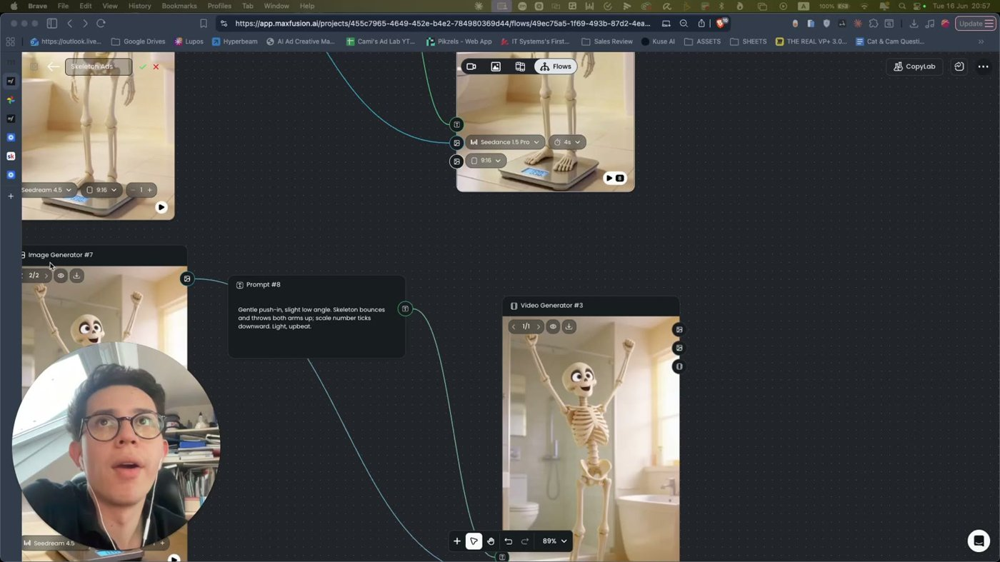
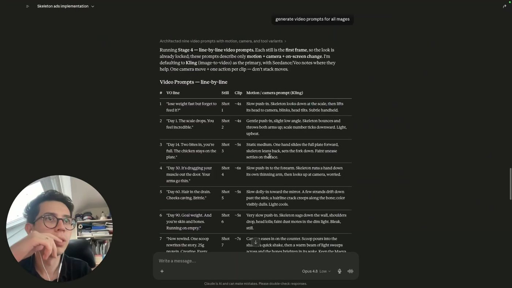
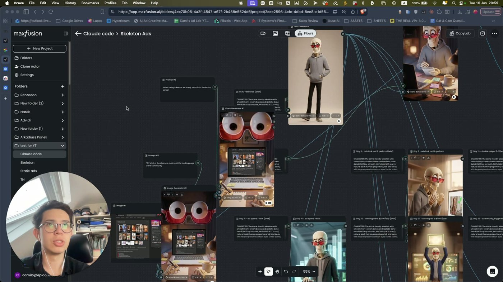

# 39. Generating Videos (Skeleton ads)
> Each approved still becomes a first frame; the skill writes one short motion-plus-camera prompt per voiceover line, and you run it in the cheapest video model first. Skeleton clips need only a push-in or a small character move.

## 🤖 Agent use
- **Use when:** Stage 4 of the skeleton skill; converting stills into 3–7 s clips; choosing a video model on a budget.
- **Inputs → outputs:** the still per line + "generate video prompts for all images" → a table of one motion prompt per line with clip length → one clip per line.
- **Rules:**
  - **DO** ask Claude "generate video prompts for all images"; each image gets a motion description [00:00].
  - **DO** keep motion simple: push-in or slight camera movement around the character; "the animations are not crazy" [02:39].
  - **DO** paste the prompt, drag in the still, pick the model, and set the length from the prompt (4 s in the example) [00:58–01:28].
  - **DO** start with the cheapest model: Seedance 1.5 Pro, then move up; he calls Kling 3.0 Pro "the best one for these" and Kling 2.6 the credit saver [00:58]. Seedance 1.5 Pro cost "like 8" credits per 4 s clip [01:28].
  - **DO** expect Seedance 1.5 to add music; prompt for none or use Kling (no music in his test) [01:28–02:03].
  - **DON'T** stack camera moves or put dialogue in video prompts; the voiceover is recorded separately (skill, Stage 4).
  - **IF** you have a Higgsfield or Max Fusion MCP or API **THEN** let Claude or Claude Code generate in order; it is "complicated if you haven't used Claude Code" [02:39].
- **See also:** [038. Generating images](038-skeleton-generating-images.md) · [040. Advanced video prompts](040-advanced-video-prompts.md) · [042. Editing the video](042-skeleton-editing-the-video.md) · [AI UGC tools](../../../../tools/ai-ugc-tools.md)

## Key ideas
### One motion prompt per line [00:00–00:58]
- Output on screen: "Running Stage 4 — line-by-line video prompts. Each still is the first frame, so the look is already locked; these prompts describe only motion + camera + on-screen change. I'm defaulting to Kling (image-to-video) as the primary, with Seedance/Veo notes where they help. One camera move + one action per clip — don't stack moves." Nine prompts for nine images (frame [02:36]).

### Model and timing [00:58–02:03]
- Seedance 1.5 Pro at 4 s: "Lose weight fast, but forget to feed it. Four seconds. So slow push..." [00:58]. Seedance "does love adding music" [01:28].
- Same 4 s in Kling: skeleton "jumping, very excited", no music [02:03].
- He also ran clips for the community ad and a "school" ad [02:03].

### Advanced: Claude Code plus Max Fusion API [02:39–03:37]
- Claude Code connected to Max Fusion's API generated images in order; the node board shows generator nodes wired to prompts (frames [03:11]). A frame at [02:57] shows Claude explaining how to put the skill in `~/.claude/skills/skeleton-ads/SKILL.md` for Claude Code.

## Steps / framework
1. Claude: "generate video prompts for all images".
2. Video generator: paste motion prompt, attach still as first frame.
3. Model order: Seedance 1.5 Pro → Kling 2.6 (cheap) → Kling 3.0 Pro (best).
4. Duration = the clip length in the table; resolution per tool.
5. Review; regenerate or switch model if there is unwanted music or drift.

## Examples
Video prompt table on screen (rows 1–6 legible; row 7 cut off), Kling variant, product shown is a protein/meal shake:

| # | VO line | Still | Clip | Motion / camera prompt (Kling) |
|---|---|---|---|---|
| 1 | "lose weight fast but forget to feed it?" | Shot 1 | ~4s | Slow push-in. Skeleton looks down at the scale, then lifts its head to camera, blinks, head tilts. Subtle handheld. |
| 2 | "Day 1. The scale drops. You feel incredible." | Shot 2 | ~4s | Gentle push-in, slight low angle. Skeleton bounces and throws both arms up; scale number ticks downward. Light, upbeat. |
| 3 | "Day 14. Two bites in, you're full. The chicken stays on the plate." | Shot 3 | ~5s | Static medium. One hand slides the full plate forward, skeleton leans back, sets the fork down. Faint unease settles on the face. |
| 4 | "Day 30. It's dragging your muscle out the door. Your arms go thin." | Shot 4 | ~6s | Slow push-in to the forearm. Skeleton runs a hand down its own thinning arm, then looks up at camera, worried. |
| 5 | "Day 60. Hair in the drain. Cheeks caving. Brittle." | Shot 5 | ~5s | Slow dolly-in toward the mirror. A few strands drift down past the sink; a hairline crack creeps along the bone; color visibly dulls. Light cools. |
| 6 | "Day 90. Goal weight. And you're skin and bones. Running on empty." | Shot 6 | ~5s | Very slow push-in. Skeleton sags down the wall, shoulders drop, head lolls; faint dust motes in the dim light. Bleak, still. |
| 7 | "Now rewind. One scoop rewrites the story. 25g protein. Creatine. Every..." | Shot 7 | ~7s | Camera eases in on the counter. Scoop pours into the sha[ker], a quick shake, then a warm beam of light sweeps across and the bones brighten in its wake. (truncated on screen) |

Compliance flag: this demo script implies unsubstantiated health outcomes (muscle loss, hair loss, "skin and bones" after a weight-loss drug, product that "rewrites the story"). Do not publish similar claims without evidence and platform-policy review.

## Structured units
- **DO** write motion only; the still locks the look.
- **DON'T** exceed one camera move + one subject action per clip (skill).
- Clip-length rule: about the spoken length of the line, usually 2–5 s (skill, Stage 4), the demo used 4–7 s.

## Prompts / templates (verbatim)
The Stage 4 output format and per-tool notes (Kling 5 s or 10 s clips; Seedance up to about 15 s with native audio; Veo about 8 s) are in the skill file in [037](037-install-skill-generate-script.md), "Stage 4 — Video Prompts".

## Screenshots

*Still image nodes wired to a video generator node. [01:37]*

*Claude's Stage 4 output: one motion prompt per line with clip length, Kling variant. [02:36]*

*Automated board built through Claude Code and the Max Fusion API. [03:11]*

## How to apply
- [ ] Generate all video prompts in one go, then batch the cheap model.
- [ ] Set each clip length from the table; mute or reject unwanted music.
- [ ] Re-run only the failed clips on Kling.
- [ ] Hand the clips to editing ([042](042-skeleton-editing-the-video.md)).

## Related
- Previous: [038. Generating images](038-skeleton-generating-images.md) · Next: [040. Advanced video prompts](040-advanced-video-prompts.md)

## Sources and limitations
- [Transcript](<../../../../../raw/ad-creators-lab/ai-ads-ugc-animations/_transcripts/Ad Creators Lab - Create Viral AI Ads, UGC & Animations That Convert Into Sales(September 2026)/4. AI Animated Ads/1. 🔥NEW🔥 Skeleton Ads/4. Generating Videos.txt>) (ends 3:37 of 3:37) · [Lesson page](<../../../../../raw/ad-creators-lab/ai-ads-ugc-animations/_extracted/Ad Creators Lab - Create Viral AI Ads, UGC & Animations That Convert Into Sales(September 2026)/4. AI Animated Ads/1. 🔥NEW🔥 Skeleton Ads/4. Generating Videos.htm.md>). Whisper wrote "Seed Dance", "cling", "Cloud Code" for Seedance, Kling, Claude Code. "8 creditor" read as 8 credits.
- Model names and credit costs at recording (Aug–Sep 2026); the screen shows the Claude model "Opus 4.8". Video quality claims (Kling 3.0 Pro best) are the instructor's (instructor claim).
