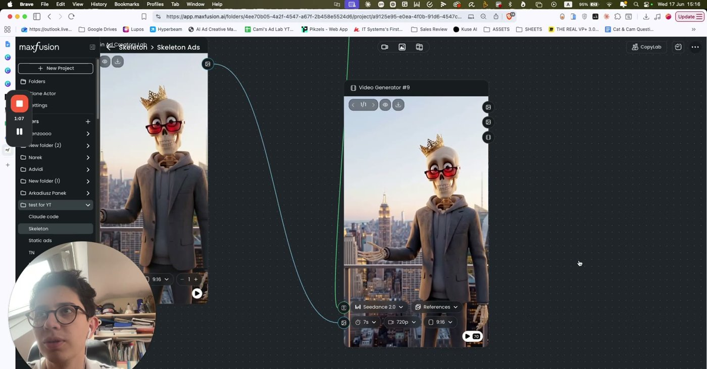
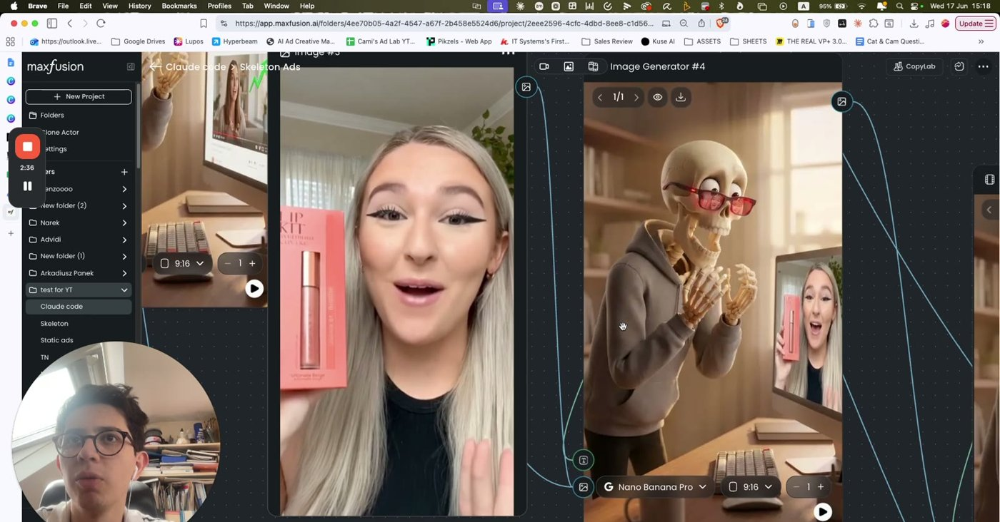
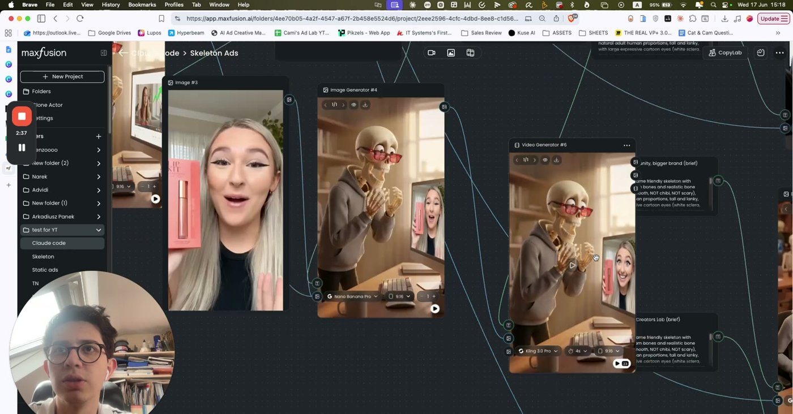

# 40. Advanced Video Prompts (Skeleton ads)
> When the skill's plain push-in is not enough, write a short concept prompt for Seedance 2.0 (zoom-through shots) or add a real reference image so the skeleton holds or reacts to the thing you need on screen.

## 🤖 Agent use
- **Use when:** a shot needs a camera move through a space, a specific product, a specific garment, or a real ad/UGC clip on screen that the skill did not supply.
- **Inputs → outputs:** the skill's still + a one-sentence concept (or a screenshot of the item) → a new still or a Seedance 2.0 clip that includes it.
- **Rules:**
  - **DO** use Seedance 2.0 for ideas and camera concepts: "very good at taking ideas and concepts and direction and making it into a really cool video" (instructor claim) [00:00].
  - **DO** describe the start environment and end on an existing still: "Camera zooms through the room and ends up with image one." [00:00]
  - **DO** settings from the screen: Seedance 2.0, References mode, 7 s, 720p, 9:16 [00:57; frame 01:07]. The generate button showed 70 credits at that setting (at recording).
  - **DO** add a reference image when the skill cannot know the visual: the skill "is not going to know what a good ad looks like" [00:57].
  - **DO** make the character hold/watch the reference in an image step first, then animate it [00:57].
  - **DON'T** rely on the skill to place a specific drink, garment or on-screen ad; supply a screenshot reference.
  - **IF** the reference is a real person's UGC video frame **THEN** treat it as a stranger's likeness: use licensed or generated footage instead (compliance flag).
- **See also:** [039. Generating videos](039-skeleton-generating-videos.md) · [020. Claude skill + Seedance 2.0 AI UGC](020-claude-skill-seedance-2-0-ai-ugc.md) · [038. Generating images](038-skeleton-generating-images.md)

## Key ideas
### Zoom-through ending [00:00–00:57]
- Problem: the final CTA shot "join the community" was a static still. Idea: zoom out through an apartment/office to the end image.
- Instead of generating "loads of images" he wrote one prompt: "video starts inside a penthouse apartment full of boxes of products to sell with multiple Shopify awards and multiple desks with computers showing ads managers and Shopify making money. Camera zooms through the room and ends up with image one." [00:00]. The end image is the first still. Result is the office reveal that closes the ad in [036](036-skeleton-the-ads-we-re-making.md).

### Reference images to fix what the skill cannot know [00:57–02:06]
- The skill's still for "POV you feel like you find a 1000 a day ad" showed a generic prop. Fix: find a screenshot of an ad, then prompt the image step "make the skeleton character hold up this vertical image" (Nano Banana Pro, 9:16 on screen), then in video "skeleton holds up this plain video of a ... woman" [00:57]. Transcript wording is garbled ("pixel woman").
- Same trick for a skeleton reacting to a "realistic UGC video": he found one, replaced it in the still, turned it into video [00:57].
- Takeaway: "use your imagination a little bit and it can take things really far" [02:06].

## Steps / framework
| Need | Tool | Prompt pattern | Check |
|---|---|---|---|
| camera move through a space | Seedance 2.0 (References), 7 s, 720p, 9:16 | "Video starts inside [space with props]. Camera zooms through the room and ends up with image one." | end frame matches still |
| character holds a thing | Nano Banana Pro image step | "Make the skeleton character hold up this vertical image" + screenshot | same skeleton, item readable |
| animate it | Seedance/Kling | "Skeleton holds up this [video]" | motion natural |

## Examples
- Zoom-through: 7 s, 720p; "pretty cool ... super awesome" [00:57].
- Hold-up shot: still from Nano Banana Pro first, then video; the on-screen item was a vertical UGC clip of a woman holding a lip product (frame [02:03]).

## Structured units
- **DO** start a concept prompt with the world and end with a pointer to a reference image (derived).
- **DON'T** expect scene-level accuracy for named products from text alone [00:57].

## Prompts / templates (verbatim)
```text
video starts inside a penthouse apartment full of boxes of products to sell with multiple Shopify awards and multiple desks with computers showing ads managers and Shopify making money. Camera zooms through the room and ends up with image one.
```
```text
make the skeleton character hold up this vertical image
```
*(Spoken, near-verbatim; the second is read from the transcript at [00:57].)*

## Screenshots

*Video Generator node: Seedance 2.0, References, 7 s, 720p, 9:16, 70 credits. [01:07]*


*UGC screenshot (left) and the Nano Banana Pro image of the skeleton watching it (right). [02:03]*


*Video generation node built on the two images. [02:04]*

## How to apply
- [ ] Identify shots where the skill's still is generic; write a one-line concept.
- [ ] Supply a screenshot reference for any exact product/garment/ad.
- [ ] Use a licensed or self-shot clip, not a stranger's UGC, as the on-screen reference.

## Related
- Previous: [039. Generating videos](039-skeleton-generating-videos.md) · Next: [041. Generating voices](041-skeleton-generating-voices.md)

## Sources and limitations
- [Transcript](<../../../../../raw/ad-creators-lab/ai-ads-ugc-animations/_transcripts/Ad Creators Lab - Create Viral AI Ads, UGC & Animations That Convert Into Sales(September 2026)/4. AI Animated Ads/1. 🔥NEW🔥 Skeleton Ads/5. Advanced Video Prompts.txt>) (ends 2:14 of 2:15) · [Lesson page](<../../../../../raw/ad-creators-lab/ai-ads-ugc-animations/_extracted/Ad Creators Lab - Create Viral AI Ads, UGC & Animations That Convert Into Sales(September 2026)/4. AI Animated Ads/1. 🔥NEW🔥 Skeleton Ads/5. Advanced Video Prompts.htm.md>) (empty). Whisper: "Seed Dance" = Seedance.
- Credit cost and settings at recording (Aug–Sep 2026). Frame bottom edge cropped to remove an on-screen account email.
- Compliance: the reference woman is a real person in a UGC clip; consent and licensing are not addressed in the lesson.
