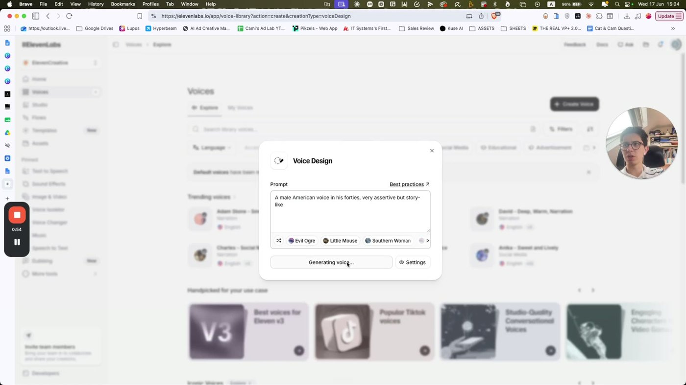
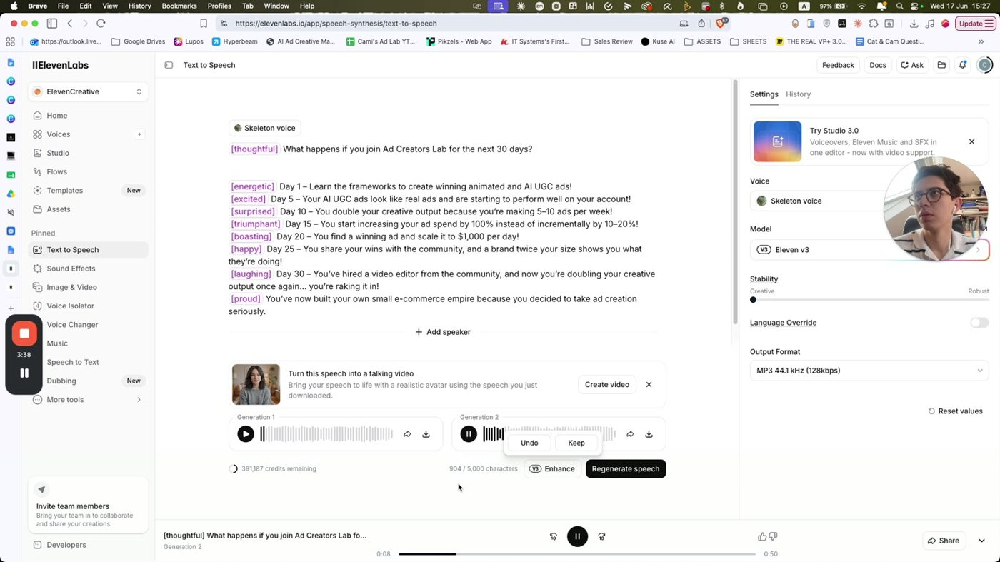

# 41. Generating Voices (Skeleton ads)
> Design a casual, story-style narrator in ElevenLabs, add emotion tags to the script, enhance, download, and check brand-name pronunciation.

## 🤖 Agent use
- **Use when:** producing the voiceover for a skeleton or other narrated animated ad.
- **Inputs → outputs:** the final script/VO line list → an MP3 voiceover (MP3 44.1 kHz 128 kbps on screen).
- **Rules:**
  - **DO** match the voice to your demographic and the format; for a story ad he designs one: "a male American voice in his forties, very assertive but story-like" [00:00].
  - **DO** push away from "too professional and too AI-like" toward "casual conversation tone. He speaks like he just discovered something cool, but not over the top. Very realistic." [00:57]
  - **DO** use Eleven v3 (model on screen) and per-line emotion tags, then click Enhance [00:57].
  - **DO** expect hit-and-miss: "sometimes you have to do a few changes" [00:00].
  - **DO** audit before download: correct brand pronunciation, pacing, clarity (page step 7).
  - **DON'T** pick a polished announcer voice when the ad should feel authentic (page, Cautionary Notes).
  - **DON'T** clone or imitate a real person's voice without consent (derived compliance rule; this lesson designs a new voice).
- **See also:** [ElevenLabs tool page](../../../../tools/elevenlabs.md) · [035. Generate human-sounding AI voice overs](035-generate-human-sounding-ai-voice-overs.md) · [042. Editing the video](042-skeleton-editing-the-video.md)

## Key ideas
### Voice design [00:00–00:57]
- Copy the script, open ElevenLabs, optionally browse existing voices; he prefers to design new ones for freshness [00:00]. The Voice Design box on screen holds the prompt "A male American voice in his forties, very assertive but story-like" [00:30 frame].
- First try sounded too professional; second prompt changed the delivery to casual and discovered-something-cool [00:57].

### Speech generation with tags and Enhance [00:57–01:55]
- Paste the script into Text to Speech, model Eleven v3, Enhance on ("thought for what would happen day one. Excited, surprised, triumphant, happy, proud") [00:57]. Download, then listen for brand pronunciation [01:30].
- Audio tag used per line (on screen): [thoughtful] hook, then [energetic], [excited], [surprised], [triumphant], [boasting], [happy], [laughing], [proud] for the Day lines.

## Steps / framework
1. Copy the final VO script.
2. ElevenLabs → Voices → Voice Design; write demographic + delivery prompt.
3. Listen; adjust style (casual, not over the top).
4. Text to Speech → Eleven v3 → paste script with tags → Enhance → Generate.
5. Download MP3; check names and pacing.

## Examples
Script as pasted on screen (verbatim; its claims are the community's own, see flag):
```text
[thoughtful] What happens if you join Ad Creators Lab for the next 30 days?

[energetic] Day 1 – Learn the frameworks to create winning animated and AI UGC ads!
[excited] Day 5 – Your AI UGC ads look like real ads and are starting to perform well on your account!
[surprised] Day 10 – You double your creative output because you're making 5–10 ads per week!
[triumphant] Day 15 – You start increasing your ad spend by 100% instead of incrementally by 10–20%!
[boasting] Day 20 – You find a winning ad and scale it to $1,000 per day!
[happy] Day 25 – You share your wins with the community, and a brand twice your size shows you what they're doing!
[laughing] Day 30 – You've hired a video editor from the community, and now you're doubling your creative output once again... you're raking it in!
[proud] You've now built your own small e-commerce empire because you decided to take ad creation seriously.
```
The lesson shows 904 of 5,000 characters used and the voice named "Skeleton voice" (frame [01:30]). Note the on-screen text differs slightly from the final video ("you're raking it in!" is added).

## Structured units
- **IF** the first take sounds like an announcer **THEN** re-prompt the voice with "casual conversation tone" and regenerate [00:57].
- **DO** pronounce-check brand names after download [01:30].
- Compliance flag: `[boasting] ... scale it to $1,000 per day` voices an unsupported results claim.

## Prompts / templates (verbatim)
```text
A male American voice in his forties, very assertive but story-like
```
```text
casual conversation tone. He speaks like he just discovered something cool, but not over the top. Very realistic.
```
*(Second prompt is spoken at [00:57]; machine-transcribed.)*

## Screenshots

*Voice Design dialog with the narrator prompt. [00:30]*


*Text to Speech: voice "Skeleton voice", model Eleven v3, tagged script, Enhance button, MP3 output. [01:30]*

## How to apply
- [ ] Design one voice per brand persona; save it.
- [ ] Add emotion tags per line; run Enhance; keep the best take.
- [ ] Verify brand name pronunciation before editing.

## Related
- Previous: [040. Advanced video prompts](040-advanced-video-prompts.md) · Next: [042. Editing the video](042-skeleton-editing-the-video.md)

## Sources and limitations
- [Transcript](<../../../../../raw/ad-creators-lab/ai-ads-ugc-animations/_transcripts/Ad Creators Lab - Create Viral AI Ads, UGC & Animations That Convert Into Sales(September 2026)/4. AI Animated Ads/1. 🔥NEW🔥 Skeleton Ads/6. Generating Voices.txt>) (ends 1:54 of 1:55) · [Lesson page](<../../../../../raw/ad-creators-lab/ai-ads-ugc-animations/_extracted/Ad Creators Lab - Create Viral AI Ads, UGC & Animations That Convert Into Sales(September 2026)/4. AI Animated Ads/1. 🔥NEW🔥 Skeleton Ads/6. Generating Voices.htm.md>) (7-step SOP, page timestamps 0:10–1:48).
- ElevenLabs credits and model availability at recording (Aug–Sep 2026). Account credit balance visible on screen is not recorded here.
