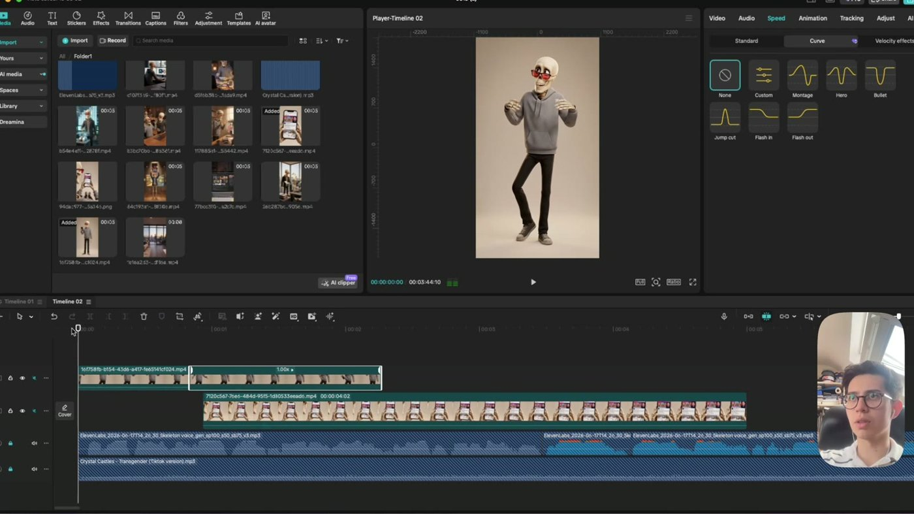
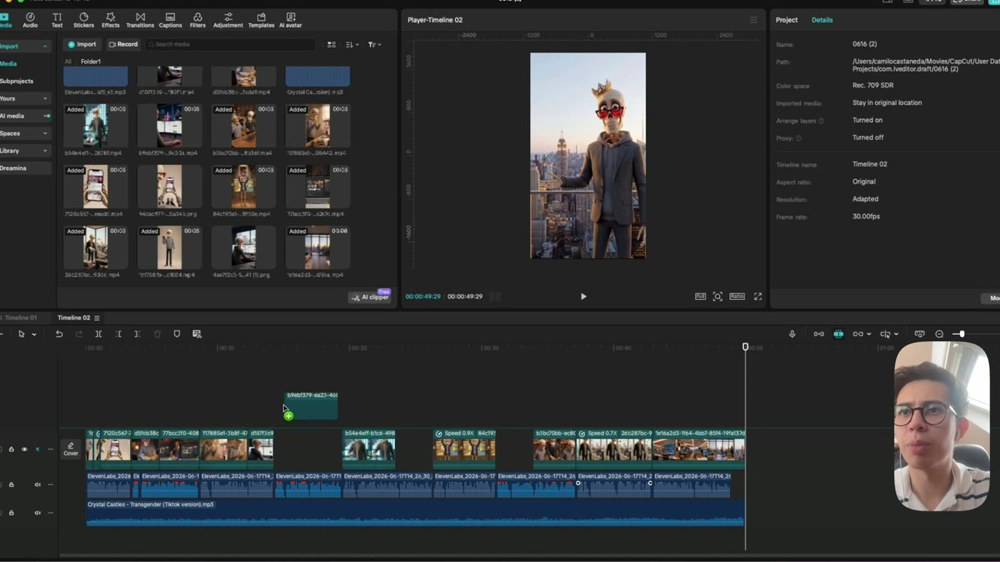
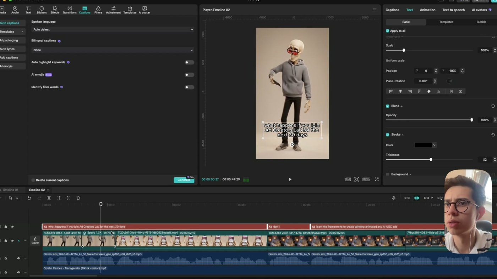
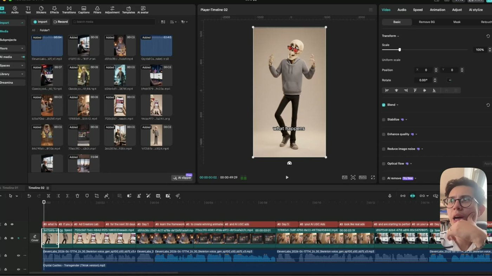

# 42. Editing The Video (Skeleton ads)
> Assemble the skeleton ad in about ten minutes: cut the voiceover tight, lay the clips to the words, match zoom directions, fill missing shots, then add minimal one-line captions and an identity caption.

## 🤖 Agent use
- **Use when:** briefing an editor (or editing yourself) a skeleton/progression ad from a voiceover plus one clip per line.
- **Inputs → outputs:** voiceover MP3 ([041](041-skeleton-generating-voices.md)) + music + one clip per line ([039](039-skeleton-generating-videos.md)) → a 9:16 ad with captions, ready to export and split into hook variants.
- **Rules:**
  - **DO** cut the voiceover first: remove gaps so pacing tightens, then drop in the music and lower it: "you never want the music to be too loud" [00:00].
  - **DO** show the named thing when it is spoken: the community page appears exactly when "Ad Creators Lab" is said [01:57].
  - **DO** make three things happen in the first few seconds (skeleton shrug → phone → community shot) [01:57].
  - **DO** cut to the pace of the audio; speed clips up or slow them to fit ("pacing 101") [01:57, 06:54].
  - **DO** match motion direction between neighbours: a slow zoom-in followed by a static shot then another zoom is "a jarring cut"; if one shot zooms in the next should too [03:03].
  - **DO** generate missing shots while you edit; the Day 10 shot was wrong so he regenerated it [04:58]; for "instead of incrementally" he created contrast with a lever versus a small dial and made the old way black and white [05:54–06:54].
  - **DO** captions: one line, minimal words, thick stroke, no template, broken into 2–3 words matched to speech [07:56–08:52].
  - **DO** add an identity caption such as "POV or Shopify store owner in 2026" to signal who the ad is for [10:49].
  - **DON'T** put captions inside generated footage; add them in the editor (skill, [037](037-install-skill-generate-script.md)).
  - **DON'T** overcomplicate: "this concept is pretty straightforward" [11:53]. Export, then test "a few hooks" [11:53].
- **See also:** [039. Generating videos](039-skeleton-generating-videos.md) · [041. Generating voices](041-skeleton-generating-voices.md) · [047. Crochet editing](047-crochet-editing-final-video.md) · [103. Video editors](103-video-editors.md)

## Key ideas
### Voiceover and music first [00:00–00:58]
- Drag the downloaded voiceover in, split at gaps (key S) and close them; repeat for every Day line [00:00].
- Add the song ("our song") on a second audio track, lower its volume [00:00]. The song's source is not stated in this lesson (song ads are covered in the singing sub-module).

### Lay clips to the words [00:58–03:03]
- Start with the first clip: he wants the skeleton to shrug, take out its phone, cut to the phone shot. The clip "what happens if you join ad" is too long, so he starts it at the movement, locks the timeline so the audio does not get cut, makes it a jump cut, and speeds the "join Ad Creators Lab" clip [00:58].
- Make "Ad Creators Lab" appear on the word; "what happens" and "if" get their own beats and the phone reach is replaced by a straight cut to the phone ("rather than him reaching out") [01:57].

### Trim, match zoom, close dead space [03:03–04:58]
- Use W to delete everything to the right of the playhead and Q for everything to the left instead of slicing [03:03, 03:59].
- Fix jarring zooms: cut dead space where there is no zoom-in so zoom shots join each other [03:03–03:59].
- Day 1, Day 5: the happy skeleton, then the ads-manager shot [03:59]. Day 10 shot replaced (generated "now") [04:58].

### Contrast shots, keyframes [04:58–07:56]
- Day 15 "increasing your ad spend by 100%": "instead of incrementally" needs its own shot. Generate a big lever (new) and a small dial (old): "locked in with his glasses and here he's sad" [05:54]. Make the old one black and white "to look like what it was before" and cut to it exactly on the word "instead" [06:54].
- Add a slow zoom-in to a slow shot with keyframes on scale and position [05:54].
- Day 25: same set-up plus a neon "lock-in" sign for the community scene [06:54–07:56].
- Day 30 and payoff: clips land with the final lines; "this didn't take long at all, probably like 10 minutes plus another few minutes generating some additional shots" [07:56].

### Captions [07:56–11:53]
- Editor is CapCut-style ("Capco" in transcript; the UI matches CapCut). Auto-captions then re-break: no template, "very basic pretty thick stroke", one line [08:52].
- "My whole rule with captions is one line, minimal words" [07:56]. Two lines allowed if inside the safety zones [10:49].
- Split phrases to match speaking: "what happens if you join | ad creators lab for the next 30 days" [08:52].
- Add the identity text: "very native Shopify owner maybe ... POV Shopify store owner in 2026" [10:49].

## Steps / framework
| # | Step | Detail | Time |
|---|---|---|---|
| 1 | Import VO, tighten gaps | S to split, close gaps | [00:00] |
| 2 | Add music, set low | under VO | [00:00] |
| 3 | Place clips line by line | trim to the movement, speed to fit | [00:58] |
| 4 | Sync reveals to words | show named thing on the word | [01:57] |
| 5 | Fix zoom continuity | Q/W trims, cut dead space | [03:03–03:59] |
| 6 | Generate missing shots | contrast pair for "instead" | [04:58–06:54] |
| 7 | Keyframe slow zooms | scale + position | [05:54] |
| 8 | Captions | one line, thick stroke, 2–3 words | [07:56–10:49] |
| 9 | Identity caption | "POV Shopify store owner in 2026" | [10:49] |
| 10 | Export, make hook variants | test | [11:53] |

## Examples
- Ad built: the 30-day community ad ([036](036-skeleton-the-ads-we-re-making.md)): ~10 minutes editing plus generation time [07:56] (instructor claim).
- Before/after of the zoom rule: slow zoom → static → zoom (jarring) became zoom → zoom, dead frames removed [03:03].

## Structured units
### Rewrites
| Before | After | What changed | Source |
|---|---|---|---|
| Hook clip started with the skeleton reaching out, then the phone | Start at the shrug, jump-cut to the phone shot, show "Ad Creators Lab" on the word | visual (cut to word), intensity (speed up) | [00:58–01:57] |
| Day 10 shot using an incorrect clip | Regenerated shot | visual | [04:58] |
| "Instead of incrementally" with a generic shot | Lever (new) vs dial (old, black and white) | visual contrast | [05:54–06:54] |
| Template captions | One-line thick-stroke captions broken to 2–3 words | verb/visual simplification | [08:52] |

- **IF** a clip is too long for its line **THEN** start it at the movement, not at frame 0 [00:58].
- **IF** two neighbouring shots have different motion **THEN** trim or regenerate so zoom direction matches [03:03].

## Screenshots

*Timeline with voiceover and music tracks and first clip placed. [01:30]*

*Most of the clips on the timeline, one inserted shot highlighted. [06:00]*

*Caption styling: basic template-free, thick stroke, one line. [09:00]*

*"POV You're a Shopify store owner in 2026" over the hook shot. [11:00]*

## How to apply
- [ ] Give the editor the VO line list, the clip per line and the style notes above.
- [ ] Require shots on the spoken noun, matched zoom direction, one-line captions in the safe zone.
- [ ] Budget extra generations for 2–3 contrast or missing shots.
- [ ] Export and produce 2–3 hook variants for testing ([Evolve copywriting hub](../../../evolve/copywriting/README.md)).

## Related
- Previous: [041. Generating voices](041-skeleton-generating-voices.md) · Next: [043. Hall of fame, skeleton ads](043-hall-of-fame-skeleton-ads.md)

## Sources and limitations
- [Transcript](<../../../../../raw/ad-creators-lab/ai-ads-ugc-animations/_transcripts/Ad Creators Lab - Create Viral AI Ads, UGC & Animations That Convert Into Sales(September 2026)/4. AI Animated Ads/1. 🔥NEW🔥 Skeleton Ads/7. Editing The Video.txt>) (ends 12:06 = full length) · [Lesson page](<../../../../../raw/ad-creators-lab/ai-ads-ugc-animations/_extracted/Ad Creators Lab - Create Viral AI Ads, UGC & Animations That Convert Into Sales(September 2026)/4. AI Animated Ads/1. 🔥NEW🔥 Skeleton Ads/7. Editing The Video.htm.md>) (empty). Whisper noise: "Capco" (CapCut), a few garbled caption-reading passages.
- The tool is not named reliably; "CapCut" is inferred from the transcript and UI. Time claims are the presenter's (instructor claim).
- Day-line outcome claims in the example ad are unsupported (see [036](036-skeleton-the-ads-we-re-making.md)).
